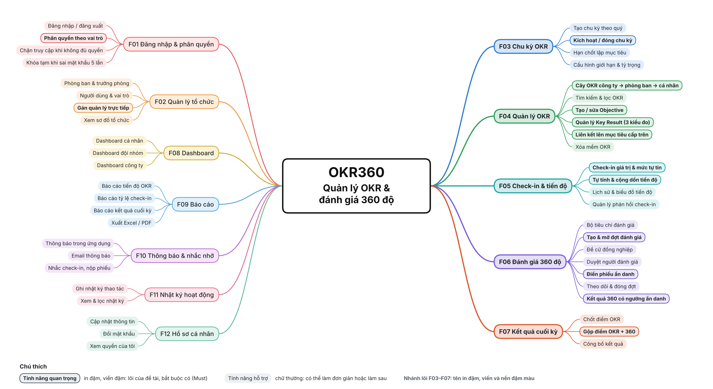
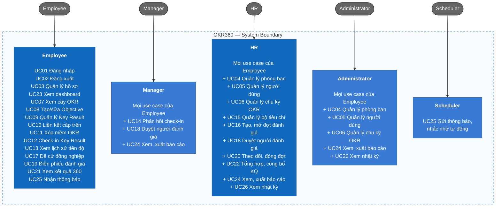

# OKR360

OKR360 giúp công ty đặt mục tiêu theo phương pháp OKR, liên kết mục tiêu từ công ty xuống phòng ban và từng cá nhân, theo dõi tiến độ qua check-in hằng tuần, đánh giá nhân viên 360 độ ẩn danh, rồi tổng hợp hai nguồn dữ liệu thành kết quả cuối kỳ. Hệ thống phân quyền theo vai trò và theo quan hệ báo cáo trong công ty.

## 1. Requirements — INVEST, Use Cases, and Acceptance Criteria

Phần yêu cầu xác định OKR360 phải làm gì, ai dùng, mang lại giá trị gì và thế nào thì được xem là làm đúng. Mỗi user story được kiểm tra theo INVEST và gắn với một use case cùng bộ tiêu chí chấp nhận.

### 1.1 Product mind map



Phạm vi và danh mục tính năng chi tiết nằm ở [Scope](docs/01-scope.md) và [Feature catalog](docs/02-features.md).

### 1.2 INVEST requirements

Backlog V1 gồm 26 user story, bao phủ đăng nhập, tổ chức, chu kỳ OKR, quản lý OKR, check-in và tiến độ, đánh giá 360 độ, kết quả cuối kỳ, dashboard, báo cáo, thông báo và nhật ký hoạt động.
Trước khi đưa vào phát triển, mỗi user story được kiểm tra theo tiêu chí INVEST.

| Tiêu chí        | Ý nghĩa trong OKR360                                                                                        |
| --------------- | ----------------------------------------------------------------------------------------------------------- |
| **Independent** | Mỗi story tạo ra một kết quả demo được, chỉ phụ thuộc story khác khi bắt buộc.                              |
| **Negotiable**  | Giao diện và cách cài đặt có thể thay đổi, miễn giữ nguyên mục tiêu của story và quy tắc phân quyền.        |
| **Valuable**    | Mỗi story nêu rõ giá trị cho người dùng hoặc cho công ty.                                                   |
| **Estimable**   | Vai trò, đầu vào, đầu ra, phụ thuộc và các trường hợp lỗi quan trọng đều được ghi rõ.                       |
| **Small**       | Mỗi story nhắm một năng lực chính, chia được thành việc API, nghiệp vụ, lưu trữ, giao diện và test.         |
| **Testable**    | Mỗi story gắn với tiêu chí chấp nhận quan sát được, gồm cả hành vi phân quyền, kiểm tra dữ liệu và báo lỗi. |

```text
US01–US03   Truy cập và hồ sơ
US04–US06   Tổ chức và chu kỳ OKR
US07–US11   Quản lý OKR
US12–US14   Check-in và tiến độ
US15–US21   Đánh giá 360 độ
US22        Kết quả cuối kỳ
US23–US26   Dashboard, báo cáo, thông báo, nhật ký
```

24 story đạt đủ 6 tiêu chí. Hai story US22 (kết quả cuối kỳ) và US23 (dashboard) đạt mọi tiêu chí trừ **Small**, nên sẽ được tách nhỏ khi lập kế hoạch sprint. Chi tiết từng story nằm ở [INVEST Requirements](docs/08-invest-requirements.md); tiêu chí chấp nhận của từng use case nằm ở [Acceptance Criteria](docs/06-acceptance-criteria.md).

### 1.3 Use cases

Manager, HR và Administrator đều là nhân viên, nên có mọi use case của Employee cộng thêm các use case riêng của vai trò mình. Scheduler là chương trình chạy nền, không phải người.



Sơ đồ use case chi tiết, phạm vi dữ liệu của từng vai trò, quy tắc dùng chung và đặc tả từng use case nằm ở [Actors, roles, and use cases](docs/03-use-cases.md).

### 1.4 Roles and permissions

| Năng lực                                  | Admin                | HR                                           | Manager                                        | Employee         |
| ----------------------------------------- | -------------------- | -------------------------------------------- | ---------------------------------------------- | ---------------- |
| Xem cây OKR, dashboard cá nhân            | Có                   | Có                                           | Có                                             | Có               |
| OKR cá nhân và check-in                   | Chỉ của bản thân     | Chỉ của bản thân                             | Của bản thân và nhân viên dưới quyền trực tiếp | Chỉ của bản thân |
| OKR phòng ban                             | Có                   | Không                                        | Chỉ phòng ban mình phụ trách                   | Không            |
| OKR công ty                               | Có                   | Không                                        | Không                                          | Không            |
| Đề cử đồng nghiệp, điền phiếu 360         | Có                   | Có                                           | Có                                             | Có               |
| Duyệt người đánh giá                      | Không                | Chỉ cho nhân viên không có quản lý trực tiếp | Chỉ cho nhân viên dưới quyền trực tiếp         | Không            |
| Xem kết quả 360                           | Chỉ của bản thân     | Của mọi người                                | Của bản thân và nhân viên dưới quyền trực tiếp | Chỉ của bản thân |
| Vận hành đợt 360, công bố kết quả cuối kỳ | Không                | Có                                           | Không                                          | Không            |
| Quản lý phòng ban, người dùng, chu kỳ     | Có                   | Có (không gán vai trò Admin)                 | Không                                          | Không            |
| Báo cáo                                   | Có (trừ kết quả 360) | Có                                           | Chỉ phòng ban mình phụ trách                   | Không            |
| Nhật ký hoạt động                         | Có                   | Có                                           | Không                                          | Không            |

Backend bắt buộc kiểm tra quyền theo vai trò, theo quan hệ báo cáo và theo quyền sở hữu dữ liệu; việc ẩn nút trên giao diện chỉ phục vụ trải nghiệm người dùng. Admin không xem được kết quả 360 của người khác theo nguyên tắc quyền tối thiểu.
