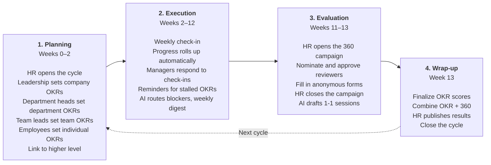

# V1 Scope — OKR360

**Project title:** AI application for automating OKR goal management and 360-degree evaluation

> Design status: TARGET V1 — Analysis of the topic and definition of the project scope.

## 1. Problem

A mid-sized software company (about 50–300 employees, split into multiple departments/teams) manages goals and evaluates employees with Excel and email:

| #   | Current problem                                                 | Consequence                                                            |
| --- | --------------------------------------------------------------- | ---------------------------------------------------------------------- |
| P1  | Company, department and individual goals are scattered across many files | Employees do not know which company-wide goal their work serves |
| P2  | Progress is compiled manually at the end of the month/quarter   | Leadership discovers delayed goals too late                            |
| P3  | There is no history of progress updates                         | No one knows since when, or why, a goal stalled                        |
| P4  | End-of-period evaluation is done only by the direct manager     | Evaluation lacks objectivity and misses the views of peers and subordinates |
| P5  | Feedback via forms/email is not truly anonymous                 | Employees hesitate to give frank feedback, especially to superiors     |
| P6  | Goal results and evaluation results are separate                | HR spends many days merging data to decide on raises and promotions    |
| P7  | Check-in notes and 360 comments are free text, so voluminous that no one reads them all | Blockers that need another department's attention are missed; managers spend hours re-reading to prepare for weekly meetings and 1-1 sessions |

## 2. System goals (Goals)

OKR360 is a web system that helps a company **set goals using the OKR method**, **track progress weekly**, and **run anonymous 360-degree employee evaluations**, then **combine the two data sources into end-of-period results**.

| ID  | Goal                                                             | Solves problem | Success measure                                                     |
| --- | ---------------------------------------------------------------- | -------------- | ------------------------------------------------------------------- |
| G1  | Link goals in a company → department → team → individual tree    | P1             | 100% of department OKRs, team OKRs and ≥ 80% of individual OKRs are linked to a higher level |
| G2  | Automatically calculate and roll up progress in real time        | P2             | Higher-level progress updates immediately after each check-in       |
| G3  | Record periodic check-ins with confidence level and blockers     | P3             | Share of KRs checked in weekly ≥ 80%                                |
| G4  | 360-degree evaluation from manager, peers, subordinates and self-assessment | P4  | Each employee receives the minimum number of forms required         |
| G5  | Guarantee anonymity for peers and subordinates, even from Admin/HR | P5           | No screen, report, API or log reveals who evaluated whom            |
| G6  | Combine OKR + 360 into end-of-period results                     | P6             | HR can export a company-wide results table in 1 action              |
| G7  | Use AI to read the free-text portions, route blockers to the right person and prepare summaries; humans always make the decisions | P7 | Cross-department blockers are routed to the relevant department head within 15 minutes; managers get a 1-1 draft within 1 hour after the 360 campaign closes; AI never changes any score |

## 3. Overall business process (one quarterly cycle)

The whole system revolves around the **OKR cycle** (default: 1 quarter). Each cycle goes through 4 phases:



**Example goal chain used throughout the documentation:**

```text
[Company]    O: Improve product quality
               KR1: Reduce customer-reported bugs from 50 to 20 bugs/month
               KR2: Increase customer satisfaction score from 7.0 to 8.5
                 │
[Dev Dept]     O: Improve the testing process            (linked to Company O)
                 KR1: Increase test coverage from 40% to 70%
                 KR2: 100% of pull requests reviewed before merge
                   │
[Payments Team]    O: Stabilize the payments module      (linked to Dev Dept O)
                     KR1: Reduce production bugs from 12 to 3 bugs/month
                       │
[Individual]           O: Write tests for the payments module   (linked to Payments Team O)
                         KR1: Write 50 test cases for the payments module
```

## 4. V1 scope (In scope)

- Login with email/password, JWT, role-based authorization on the backend.
- Organization management: departments, teams within departments, users, direct manager (reporting relationship).
- OKR cycle management: create, activate, close.
- 4-level OKR management (company, department, team, individual), at most 5 Key Results per Objective. If a department is not split into teams, individual OKRs link directly to the department OKR.
- 3 Key Result types: **numeric** (start value → target value, also supports decreasing goals), **percentage**, **done/not done**.
- Link OKRs to higher-level goals; display as a tree.
- Check-in: update value, confidence level, notes; keep history; managers comment.
- Progress is calculated automatically and rolled up through the levels.
- 360-degree evaluation: criteria template, evaluation campaign, nominating and approving reviewers, filling in forms, anonymity, minimum threshold.
- End-of-period results: OKR score + 360 score by weight; HR publishes.
- Role-based dashboards; reports and XLSX/PDF export.
- In-app notifications and reminder emails.
- Activity log (without exposing anonymous information).
- Personal profile, change password.
- AI automation (read-only: classify, summarize, alert, create drafts):
  - classify blockers in check-ins and route them to the relevant department head;
  - weekly digest for managers;
  - 1-1 draft after the 360 campaign closes;
  - detect check-ins whose confidence level contradicts the notes;
  - review newly created OKRs (is the KR measurable, is there duplication);
  - warn the writer when a 360 comment may reveal identity;
  - Admin turns each flow on/off, sets run schedules, AI call quota, and views run history.

## 5. Out of V1 scope (Non-goals)

V1 does **not** include:

- Integration with Jira, GitLab, Slack, Microsoft Teams (planned for V2 — see section 7).
- Other goal-management methods such as KPI, BSC, MBO.
- Payroll, bonuses, HR policies; the system only **provides data** for those decisions.
- Single sign-on (SSO), two-factor authentication, refresh tokens.
- Native mobile app (a responsive web interface is sufficient).
- Multiple companies in one system (multi-tenant).
- AI that scores, ranks, predicts attrition or makes any HR decision.
- Chatbot-style AI that writes OKRs or 360 comments on someone's behalf.
- Drag-and-drop builder for arbitrary automation flows (n8n/Zapier style); V1 has only prebuilt flows.
- Continuous feedback outside the evaluation campaign (continuous feedback, recognition).

## 6. Target architecture (direction; details in later steps)

```text
React frontend (SPA)
    → REST / HTTPS / JSON
Three-tier backend API (API → Application → Infrastructure)
    → PostgreSQL (OKR tree uses recursive CTE)
    → Background job queue (reminders, progress recalculation, email sending, AI flows)
    → SMTP (notification email)
AI worker (runs in background, reads events from the queue)
    → Anonymize data → external LLM API → validate returned JSON
    → Write results: notifications, labels, drafts awaiting human approval
```

User actions (check-in, submitting a form, closing a campaign) write an event to the database in the same transaction. The AI worker processes the event afterwards, so a slow or failing AI does not slow down or break the user's action.

The backend uses NestJS. Detailed technology choices are in [C4 Architecture](architecture/c4/README.md) and [Architecture Decisions](architecture/arc42/09-architecture-decisions.md).

## 7. Post-V1 extensions

| Version | Feature                                                    | Value                                    |
| ------- | ---------------------------------------------------------- | ---------------------------------------- |
| V2      | Auto-update KRs from Jira/GitLab (closed issues, merged PRs) | Reduces manual data entry for software teams |
| V2      | Check-in reminders via Slack/Teams                         | Increases check-in rate                  |
| V3      | Continuous feedback, peer recognition                      | No need to wait until period end to give feedback |
| V2      | AI drafts next quarter's OKRs from unfinished KRs and the quarter's blockers | Faster planning of the new quarter |
| V2      | AI summarizes company-wide development trends from 360 comments | HR plans training based on data      |
| V3      | Admin builds own automation flows (When → If → Then)       | Company adds processes itself without code changes |

**Related:** [Feature breakdown and mind map](02-features.md)
