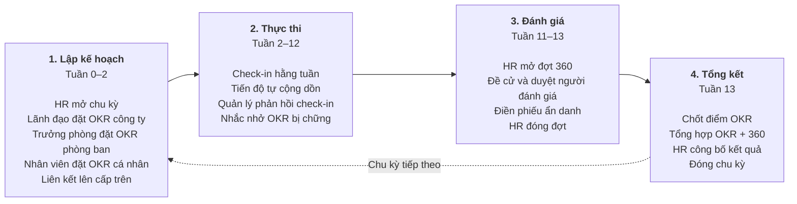

# Phạm vi V1 — OKR360

> Trạng thái thiết kế: TARGET V1 — Bước 1 (Phân tích đề tài tìm hiểu, xác định phạm vi đề tài )

## 1. Vấn đề

Một công ty phần mềm quy mô vừa (khoảng 50–300 nhân viên, chia thành nhiều phòng ban/team) đang quản lý mục tiêu và đánh giá nhân viên bằng Excel và email:

| #   | Vấn đề hiện tại                                                 | Hậu quả                                                                |
| --- | --------------------------------------------------------------- | ---------------------------------------------------------------------- |
| P1  | Mục tiêu công ty, phòng ban và cá nhân nằm ở nhiều file rời rạc | Nhân viên không biết việc mình làm phục vụ mục tiêu chung nào          |
| P2  | Tiến độ được tổng hợp thủ công vào cuối tháng/quý               | Ban lãnh đạo phát hiện mục tiêu chậm tiến độ quá muộn                  |
| P3  | Không có lịch sử cập nhật tiến độ                               | Không biết mục tiêu bị chững lại từ khi nào, vì sao                    |
| P4  | Đánh giá cuối kỳ chỉ do quản lý trực tiếp thực hiện             | Đánh giá thiếu khách quan, bỏ sót góc nhìn của đồng nghiệp và cấp dưới |
| P5  | Góp ý qua form/email không ẩn danh thực sự                      | Nhân viên ngại góp ý thẳng thắn, nhất là với cấp trên                  |
| P6  | Kết quả mục tiêu và kết quả đánh giá tách rời nhau              | HR mất nhiều ngày ghép dữ liệu để xét tăng lương, thăng chức           |

## 2. Mục tiêu hệ thống (Goals)

OKR360 là hệ thống web giúp công ty **đặt mục tiêu theo phương pháp OKR**, **theo dõi tiến độ hằng tuần**, và **đánh giá nhân viên 360 độ ẩn danh**, sau đó **ghép hai nguồn dữ liệu thành kết quả cuối kỳ**.

| ID  | Mục tiêu                                                         | Giải quyết vấn đề | Đo lường thành công                                                 |
| --- | ---------------------------------------------------------------- | ----------------- | ------------------------------------------------------------------- |
| G1  | Liên kết mục tiêu theo cây công ty → phòng ban → cá nhân         | P1                | 100% OKR phòng ban và ≥ 80% OKR cá nhân được liên kết lên cấp trên  |
| G2  | Tự động tính và cộng dồn tiến độ theo thời gian thực             | P2                | Tiến độ cấp trên cập nhật ngay sau mỗi lần check-in                 |
| G3  | Ghi nhận check-in định kỳ kèm mức độ tự tin và vướng mắc         | P3                | Tỷ lệ KR được check-in hằng tuần ≥ 80%                              |
| G4  | Đánh giá 360 độ từ quản lý, đồng nghiệp, cấp dưới và tự đánh giá | P4                | Mỗi nhân viên nhận đủ số phiếu tối thiểu theo quy định              |
| G5  | Đảm bảo ẩn danh cho đồng nghiệp và cấp dưới, kể cả với Admin/HR  | P5                | Không màn hình, báo cáo, API hay nhật ký nào tiết lộ ai đánh giá ai |
| G6  | Tổng hợp OKR + 360 thành kết quả cuối kỳ                         | P6                | HR xuất được bảng kết quả toàn công ty trong 1 thao tác             |

## 3. Quy trình nghiệp vụ tổng thể (một chu kỳ quý)

Toàn bộ hệ thống xoay quanh **chu kỳ OKR** (mặc định 1 quý). Mỗi chu kỳ đi qua 4 giai đoạn:



**Ví dụ chuỗi mục tiêu xuyên suốt tài liệu:**

```text
[Công ty]    O: Nâng cao chất lượng sản phẩm
               KR1: Giảm lỗi khách hàng báo từ 50 xuống 20 lỗi/tháng
               KR2: Tăng điểm hài lòng khách hàng từ 7.0 lên 8.5
                 │
[Phòng Dev]    O: Cải thiện quy trình kiểm thử            (liên kết lên O Công ty)
                 KR1: Tăng độ phủ test từ 40% lên 70%
                 KR2: 100% pull request được review trước khi merge
                   │
[Cá nhân]        O: Viết test cho module thanh toán         (liên kết lên O Phòng Dev)
                   KR1: Viết 50 test case cho module thanh toán
```

## 4. Phạm vi V1 (In scope)

- Đăng nhập bằng email/mật khẩu, JWT, phân quyền theo vai trò ở backend.
- Quản lý tổ chức: phòng ban, người dùng, quản lý trực tiếp (quan hệ báo cáo).
- Quản lý chu kỳ OKR: tạo, kích hoạt, đóng.
- Quản lý OKR 3 cấp (công ty, phòng ban, cá nhân), tối đa 5 Key Result mỗi Objective.
- 3 kiểu Key Result: **số** (giá trị đầu → giá trị đích, hỗ trợ cả mục tiêu giảm), **phần trăm**, **hoàn thành/chưa hoàn thành**.
- Liên kết OKR với mục tiêu cấp trên; hiển thị dạng cây.
- Check-in: cập nhật giá trị, mức tự tin, ghi chú; lưu lịch sử; quản lý bình luận.
- Tiến độ tự tính và cộng dồn lên các cấp.
- Đánh giá 360 độ: bộ tiêu chí, đợt đánh giá, đề cử và duyệt người đánh giá, điền phiếu, ẩn danh, ngưỡng tối thiểu.
- Kết quả cuối kỳ: điểm OKR + điểm 360 theo trọng số; HR công bố.
- Dashboard theo vai trò; báo cáo và xuất file XLSX/PDF.
- Thông báo trong ứng dụng và email nhắc việc.
- Nhật ký hoạt động (không làm lộ thông tin ẩn danh).
- Hồ sơ cá nhân, đổi mật khẩu.

## 5. Ngoài phạm vi V1 (Non-goals)

V1 **không** bao gồm:

- Tích hợp Jira, GitLab, Slack, Microsoft Teams (dự kiến V2 — xem mục 7).
- Các phương pháp quản trị mục tiêu khác như KPI, BSC, MBO.
- Tính lương, thưởng, chế độ nhân sự; hệ thống chỉ **cung cấp dữ liệu** cho các quyết định đó.
- Đăng nhập một lần (SSO), xác thực hai lớp, refresh token.
- Ứng dụng di động native (giao diện web responsive là đủ).
- Nhiều công ty trên một hệ thống (multi-tenant).
- Tính năng AI gợi ý hoặc chấm điểm OKR.
- Phản hồi liên tục ngoài đợt đánh giá (continuous feedback, khen thưởng).

## 6. Kiến trúc mục tiêu (định hướng, chi tiết ở các bước sau)

```text
React frontend (SPA)
    → REST / HTTPS / JSON
Backend API ba tầng (API → Application → Infrastructure)
    → PostgreSQL (cây OKR dùng recursive CTE)
    → Hàng đợi job nền (nhắc nhở, tính lại tiến độ, gửi email)
    → SMTP (email thông báo)
```

Lựa chọn công nghệ cụ thể (ASP.NET Core hoặc NestJS/Spring Boot theo stack công ty) được chốt ở bước thiết kế kiến trúc.

## 7. Hướng mở rộng sau V1

| Phiên bản | Tính năng                                                  | Giá trị                                  |
| --------- | ---------------------------------------------------------- | ---------------------------------------- |
| V2        | Tự cập nhật KR từ Jira/GitLab (số issue đóng, số PR merge) | Giảm nhập liệu thủ công cho đội phần mềm |
| V2        | Nhắc check-in qua Slack/Teams                              | Tăng tỷ lệ check-in                      |
| V3        | Phản hồi liên tục, ghi nhận đồng nghiệp                    | Không phải chờ đến cuối kỳ mới góp ý     |
| V3        | Gợi ý viết OKR tốt hơn bằng AI                             | Nâng chất lượng OKR                      |

**Liên quan:** [Phân rã chức năng và sơ đồ tư duy](02-features.md)
