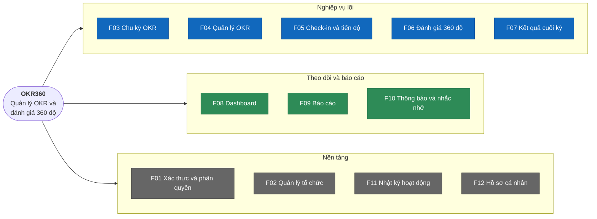

# Phân rã chức năng 

> Trạng thái thiết kế: TARGET V1 — Phân rã chức năng hệ thống

## Các cấp phân rã

Hệ thống được phân rã theo 4 cấp, mỗi cấp chi tiết hơn cấp trên:

```text
Cấp 0  Mục tiêu hệ thống         OKR360 — Quản lý OKR và đánh giá 360 độ
Cấp 1  Phân hệ (module)          F01 … F12
Cấp 2  Chức năng                 F01.1, F01.2 …
Cấp 3  User story / Use case     US01 … US26  ↔  UC01 … UC26
```

Nguyên tắc phân rã: mỗi phân hệ cấp 1 phục vụ ít nhất một mục tiêu G1–G6 trong [01-scope.md](01-scope.md); mỗi chức năng cấp 2 phải truy được về đúng một phân hệ. Cột User story / Use case là mã dự kiến, sẽ được đặc tả ở bước tiếp theo.

## 1. Cấp 0 → Cấp 1: Phân hệ



### Truy vết mục tiêu → phân hệ

| Mục tiêu                       | F01 | F02 | F03 | F04 | F05 | F06 | F07 | F08 | F09 | F10 | F11 | F12 |
| ------------------------------ | --- | --- | --- | --- | --- | --- | --- | --- | --- | --- | --- | --- |
| G1 Liên kết mục tiêu theo cây  |     | ✓   | ✓   | ✓   |     |     |     | ✓   |     |     |     |     |
| G2 Tự tính và cộng dồn tiến độ |     |     |     | ✓   | ✓   |     |     | ✓   | ✓   |     |     |     |
| G3 Check-in định kỳ            |     |     | ✓   |     | ✓   |     |     | ✓   |     | ✓   |     |     |
| G4 Đánh giá 360 nhiều chiều    |     | ✓   |     |     |     | ✓   |     |     |     | ✓   |     |     |
| G5 Ẩn danh thực sự             | ✓   |     |     |     |     | ✓   |     |     | ✓   |     | ✓   |     |
| G6 Tổng hợp kết quả cuối kỳ    |     |     | ✓   |     |     | ✓   | ✓   |     | ✓   |     |     |     |
| Nền tảng bảo mật, quản trị     | ✓   | ✓   |     |     |     |     |     |     |     |     | ✓   | ✓   |

## 2. Danh mục phân hệ

| ID  | Phân hệ                | V1  | Use case  | Vai trò chính          |
| --- | ---------------------- | --- | --------- | ---------------------- |
| F01 | Xác thực và phân quyền | Có  | UC01–UC02 | Tất cả                 |
| F02 | Quản lý tổ chức        | Có  | UC04–UC05 | Admin, HR              |
| F03 | Chu kỳ OKR             | Có  | UC06      | Admin, HR              |
| F04 | Quản lý OKR            | Có  | UC07–UC11 | Tất cả                 |
| F05 | Check-in và tiến độ    | Có  | UC12–UC14 | Tất cả                 |
| F06 | Đánh giá 360 độ        | Có  | UC15–UC21 | Tất cả                 |
| F07 | Kết quả cuối kỳ        | Có  | UC22      | HR, Manager, nhân viên |
| F08 | Dashboard              | Có  | UC23      | Tất cả                 |
| F09 | Báo cáo                | Có  | UC24      | Admin, HR, Manager     |
| F10 | Thông báo và nhắc nhở  | Có  | UC25      | Tất cả                 |
| F11 | Nhật ký hoạt động      | Có  | UC26      | Admin, HR              |
| F12 | Hồ sơ cá nhân          | Có  | UC03      | Tất cả                 |

## 3. Cấp 1 → Cấp 2 → Cấp 3: Chi tiết từng phân hệ

### F01 Xác thực và phân quyền

| ID    | Chức năng                            | Mô tả                                                                                       | User story / Use case (bước sau) |
| ----- | ------------------------------------ | ------------------------------------------------------------------------------------------- | -------------------------------- |
| F01.1 | Đăng nhập                            | Email + mật khẩu, trả về JWT hết hạn sau 30 phút                                            | US01/UC01                        |
| F01.2 | Đăng xuất                            | Xóa token và trạng thái phiên phía client                                                   | US02/UC02                        |
| F01.3 | **Bảo vệ route và API theo vai trò** | Backend kiểm tra quyền; frontend ẩn menu/nút không có quyền, URL không có quyền → trang 403 | US01                             |
| F01.4 | Giới hạn đăng nhập sai               | Tối đa 5 lần sai/15 phút/tài khoản                                                          | US01                             |

### F02 Quản lý tổ chức

| ID    | Chức năng                 | Mô tả                                                                                     | User story / Use case (bước sau) |
| ----- | ------------------------- | ----------------------------------------------------------------------------------------- | -------------------------------- |
| F02.1 | Quản lý phòng ban         | Thêm, sửa, ngưng hoạt động phòng ban; gán trưởng phòng; phòng ban có thể có phòng ban cha | US04/UC04                        |
| F02.2 | Quản lý người dùng        | Thêm, sửa, bật/tắt tài khoản; gán vai trò và phòng ban                                    | US05/UC05                        |
| F02.3 | **Gán quản lý trực tiếp** | Mỗi nhân viên có tối đa một quản lý trực tiếp; không tạo vòng lặp báo cáo                 | US05/UC05                        |
| F02.4 | Xem sơ đồ tổ chức         | Hiển thị cây phòng ban và quan hệ báo cáo                                                 | US04/UC04                        |

### F03 Chu kỳ OKR

| ID    | Chức năng            | Mô tả                                                                 | User story / Use case (bước sau) |
| ----- | -------------------- | --------------------------------------------------------------------- | -------------------------------- |
| F03.1 | Tạo chu kỳ           | Tên (VD: Q1/2027), ngày bắt đầu, ngày kết thúc, hạn chốt lập kế hoạch | US06/UC06                        |
| F03.2 | **Kích hoạt chu kỳ** | Chuyển DRAFT → ACTIVE, mở check-in                                    | US06/UC06                        |
| F03.3 | **Đóng chu kỳ**      | Chuyển ACTIVE → CLOSED, chốt tiến độ, OKR chỉ còn đọc                 | US06/UC06                        |
| F03.4 | Cấu hình chu kỳ      | Số Objective tối đa mỗi người, tần suất check-in, trọng số OKR/360    | US06/UC06                        |

### F04 Quản lý OKR

| ID    | Chức năng                          | Mô tả                                                                                   | User story / Use case (bước sau) |
| ----- | ---------------------------------- | --------------------------------------------------------------------------------------- | -------------------------------- |
| F04.1 | **Xem cây OKR**                    | Cây công ty → phòng ban → cá nhân, mở rộng/thu gọn, màu theo tiến độ và mức tự tin      | US07/UC07                        |
| F04.2 | Tìm kiếm và lọc OKR                | Lọc theo chu kỳ, cấp, phòng ban, người sở hữu, trạng thái tự tin                        | US07/UC07                        |
| F04.3 | **Tạo/sửa Objective**              | Tiêu đề, mô tả, cấp, người sở hữu, chu kỳ                                               | US08/UC08                        |
| F04.4 | **Quản lý Key Result**             | 1–5 KR mỗi Objective; kiểu số/phần trăm/hoàn thành; giá trị đầu, đích, đơn vị; trọng số | US09/UC09                        |
| F04.5 | **Liên kết lên mục tiêu cấp trên** | Chọn Objective cha cùng chu kỳ; kiểm tra cấp và chống vòng lặp                          | US10/UC10                        |
| F04.6 | Xóa mềm OKR                        | Ẩn khỏi cây và báo cáo, vẫn giữ lịch sử                                                 | US11/UC11                        |

### F05 Check-in và tiến độ

| ID    | Chức năng                    | Mô tả                                                                                        | User story / Use case (bước sau) |
| ----- | ---------------------------- | -------------------------------------------------------------------------------------------- | -------------------------------- |
| F05.1 | **Check-in Key Result**      | Nhập giá trị hiện tại, mức tự tin (Đúng hướng / Có rủi ro / Chệch hướng), ghi chú, vướng mắc | US12/UC12                        |
| F05.2 | **Tính và cộng dồn tiến độ** | Tính % KR → % Objective → % Objective cấp trên ngay sau check-in                             | US12/UC12                        |
| F05.3 | Lịch sử và biểu đồ tiến độ   | Danh sách check-in theo thời gian, biểu đồ tiến độ thực tế so với đường kỳ vọng              | US13/UC13                        |
| F05.4 | Phản hồi check-in            | Quản lý trực tiếp bình luận trên một lần check-in                                            | US14/UC14                        |

### F06 Đánh giá 360 độ

| ID    | Chức năng                  | Mô tả                                                                                                 | User story / Use case (bước sau) |
| ----- | -------------------------- | ----------------------------------------------------------------------------------------------------- | -------------------------------- |
| F06.1 | Quản lý bộ tiêu chí        | Mẫu phiếu gồm các tiêu chí (tên, mô tả, thang 1–5) và câu hỏi mở                                      | US15/UC15                        |
| F06.2 | **Tạo và mở đợt đánh giá** | Gắn chu kỳ, chọn mẫu phiếu, chọn người được đánh giá, đặt hạn đề cử và hạn nộp                        | US16/UC16                        |
| F06.3 | Đề cử đồng nghiệp          | Nhân viên đề cử 3–5 đồng nghiệp đánh giá mình                                                         | US17/UC17                        |
| F06.4 | Duyệt người đánh giá       | Quản lý trực tiếp duyệt, thêm hoặc bớt đồng nghiệp được đề cử                                         | US18/UC18                        |
| F06.5 | **Điền phiếu đánh giá**    | Xem danh sách phiếu cần điền, chấm điểm, nhận xét, lưu nháp, nộp                                      | US19/UC19                        |
| F06.6 | Theo dõi và đóng đợt       | Tỷ lệ nộp phiếu theo phòng ban, nhắc người chưa nộp, đóng đợt                                         | US20/UC20                        |
| F06.7 | **Kết quả 360 cá nhân**    | Điểm theo tiêu chí và nhóm người đánh giá, chênh lệch tự đánh giá so với người khác, nhận xét ẩn danh | US21/UC21                        |

### F07 Kết quả cuối kỳ

| ID    | Chức năng         | Mô tả                                                                 | User story / Use case (bước sau) |
| ----- | ----------------- | --------------------------------------------------------------------- | -------------------------------- |
| F07.1 | Chốt điểm OKR     | Lấy tiến độ cuối kỳ của các Objective cá nhân, quy đổi sang thang 1–5 | US22/UC22                        |
| F07.2 | **Tổng hợp điểm** | Điểm cuối kỳ = trọng số OKR × điểm OKR + trọng số 360 × điểm 360      | US22/UC22                        |
| F07.3 | Công bố kết quả   | HR công bố; nhân viên chỉ thấy kết quả của mình sau khi công bố       | US22/UC22                        |

### F08 Dashboard

| ID    | Chức năng          | Mô tả                                                                 | User story / Use case (bước sau) |
| ----- | ------------------ | --------------------------------------------------------------------- | -------------------------------- |
| F08.1 | Dashboard cá nhân  | Tiến độ OKR của tôi, KR cần check-in, phiếu đánh giá cần điền         | US23/UC23                        |
| F08.2 | Dashboard đội nhóm | Tiến độ OKR phòng ban, thành viên chưa check-in, OKR có rủi ro        | US23/UC23                        |
| F08.3 | Dashboard công ty  | Tiến độ theo phòng ban, tỷ lệ check-in, tỷ lệ hoàn thành đánh giá 360 | US23/UC23                        |

### F09 Báo cáo

| ID    | Chức năng               | Mô tả                                                     | User story / Use case (bước sau) |
| ----- | ----------------------- | --------------------------------------------------------- | -------------------------------- |
| F09.1 | Báo cáo tiến độ OKR     | Theo chu kỳ, phòng ban, cấp OKR                           | US24/UC24                        |
| F09.2 | Báo cáo tỷ lệ check-in  | Theo tuần, phòng ban, người                               | US24/UC24                        |
| F09.3 | Báo cáo kết quả cuối kỳ | Điểm OKR, điểm 360, điểm tổng hợp theo người và phòng ban | US24/UC24                        |
| F09.4 | Xuất báo cáo            | Xuất XLSX/PDF theo đúng bộ lọc đang chọn                  | US24/UC24                        |

### F10 Thông báo và nhắc nhở

| ID    | Chức năng                | Mô tả                                               | User story / Use case (bước sau) |
| ----- | ------------------------ | --------------------------------------------------- | -------------------------------- |
| F10.1 | Thông báo trong ứng dụng | Biểu tượng chuông, danh sách, đánh dấu đã đọc       | US25/UC25                        |
| F10.2 | Email thông báo          | Gửi kèm các sự kiện quan trọng                      | US25/UC25                        |
| F10.3 | Nhắc nhở tự động         | Nhắc check-in, nhắc đề cử, nhắc nộp phiếu trước hạn | US25/UC25                        |

### F11 Nhật ký hoạt động

| ID    | Chức năng          | Mô tả                                                                                | User story / Use case (bước sau) |
| ----- | ------------------ | ------------------------------------------------------------------------------------ | -------------------------------- |
| F11.1 | Ghi nhật ký        | Đăng nhập, thay đổi OKR, check-in, chuyển trạng thái chu kỳ/đợt, thay đổi người dùng | US26/UC26                        |
| F11.2 | Xem và lọc nhật ký | Lọc theo người, phân hệ, hành động, thời gian                                        | US26/UC26                        |

### F12 Hồ sơ cá nhân

| ID    | Chức năng          | Mô tả                                                                  | User story / Use case (bước sau) |
| ----- | ------------------ | ---------------------------------------------------------------------- | -------------------------------- |
| F12.1 | Cập nhật thông tin | Họ tên, số điện thoại, ảnh đại diện; email, vai trò, phòng ban chỉ đọc | US03/UC03                        |
| F12.2 | Đổi mật khẩu       | Nhập mật khẩu cũ, mật khẩu mới tối thiểu 8 ký tự                       | US03/UC03                        |
| F12.3 | Xem quyền của tôi  | Ma trận quyền theo vai trò hiện tại                                    | US03/UC03                        |

## 4. Thứ tự ưu tiên triển khai (MoSCoW)

| Mức        | Phân hệ / chức năng                               | Lý do                                                            |
| ---------- | ------------------------------------------------- | ---------------------------------------------------------------- |
| Must       | F01, F02, F03, F04, F05.1–F05.3, F06.1–F06.7, F07 | Lõi của đề tài: không có thì không chạy được một chu kỳ trọn vẹn |
| Should     | F08, F09.1, F09.3, F10.1, F11                     | Cần để demo giá trị và quản trị, nhưng có thể làm đơn giản trước |
| Could      | F05.4, F09.2, F09.4, F10.2–F10.3, F12.3           | Tăng trải nghiệm, làm khi còn thời gian                          |
| Won't (V1) | Tích hợp Jira/Slack, KPI/BSC, AI                  | Đã ghi ở Non-goals                                               |

**Liên quan:** [Phạm vi](01-scope.md)
