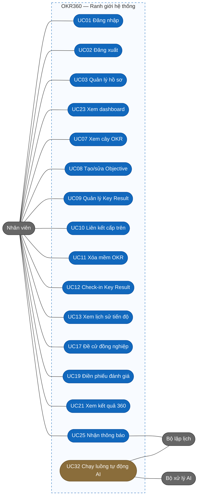
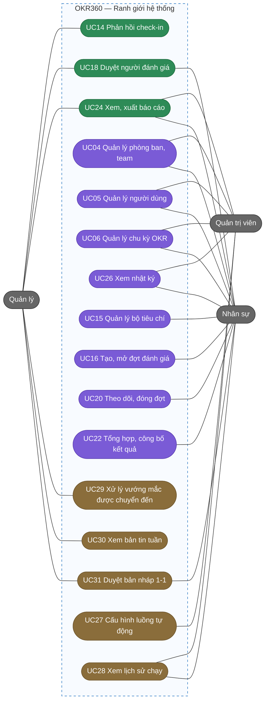
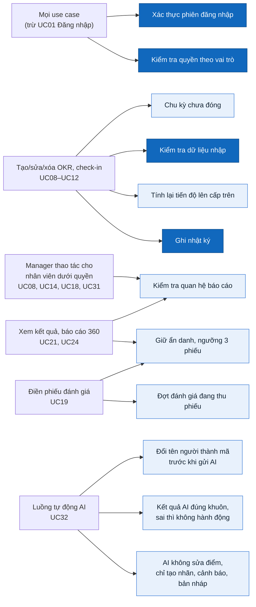

# Tác nhân, vai trò và use case

> Trạng thái thiết kế: TARGET V1
>
> Trạng thái triển khai: CHƯA BẮT ĐẦU

Tên sản phẩm: **OKR360**.

## Tác nhân / vai trò

| Vai trò    | Tên hiển thị  | Trong thực tế                                         | Mối quan tâm chính                                                   |
| ---------- | ------------- | ----------------------------------------------------- | -------------------------------------------------------------------- |
| `ADMIN`    | Quản trị viên | Quản trị hệ thống, nhập OKR công ty thay ban lãnh đạo | Tổ chức, OKR công ty, an toàn hệ thống                               |
| `HR`       | Nhân sự       | Phòng nhân sự                                         | Chu kỳ OKR, đợt đánh giá 360, kết quả cuối kỳ                        |
| `MANAGER`  | Quản lý       | Trưởng phòng, team lead                               | OKR phòng ban hoặc OKR team, theo sát cấp dưới, duyệt người đánh giá |
| `EMPLOYEE` | Nhân viên     | Mọi nhân viên                                         | OKR cá nhân, check-in, điền phiếu đánh giá                           |
| —          | Bộ lập lịch   | Chương trình chạy nền                                 | Gửi nhắc nhở đúng giờ, kích hoạt luồng AI theo lịch                  |
| —          | Bộ xử lý AI   | Chương trình chạy nền gọi dịch vụ AI                  | Đọc văn bản, phân loại, tóm tắt, tạo cảnh báo và bản nháp            |

**Phòng ban và team:** công ty chia thành phòng ban; phòng ban lớn chia tiếp thành team (ví dụ Phòng Dev có Team Thanh toán và Team Nền tảng). Mỗi phòng ban có một trưởng phòng, mỗi team có một team lead; cả hai thường mang vai trò `MANAGER`. Thành viên team báo cáo cho team lead, team lead báo cáo cho trưởng phòng.

**Quy tắc kế thừa:** mỗi người dùng có đúng một vai trò. `ADMIN`, `HR`, `MANAGER` đều là nhân viên nên có **toàn bộ quyền của `EMPLOYEE`** (có OKR cá nhân, được đánh giá 360, điền phiếu). Vai trò chỉ cộng thêm quyền.

## Phạm vi dữ liệu

Có những việc một vai trò được làm, nhưng **chỉ với một phần dữ liệu**. Ma trận bên dưới dùng 3 cách gọi phạm vi sau:

| Tên                                    | Mô tả                                                                                               | Ví dụ                                                                                                                                                                  |
| -------------------------------------- | --------------------------------------------------------------------------------------------------- | ---------------------------------------------------------------------------------------------------------------------------------------------------------------------- |
| **Chỉ của bản thân**                   | Dữ liệu do chính người dùng sở hữu: OKR cá nhân của họ, Key Result họ phụ trách, kết quả 360 của họ | Lan chỉ check-in được Key Result Lan phụ trách                                                                                                                         |
| **Chỉ đơn vị mình phụ trách**          | Với trưởng phòng: phòng ban của mình và mọi team trong phòng. Với team lead: chỉ team của mình      | Anh Sơn là trưởng phòng Dev nên sửa được OKR Phòng Dev và OKR của Team Thanh toán, Team Nền tảng; anh Nam là team lead Thanh toán nên chỉ sửa được OKR Team Thanh toán |
| **Chỉ nhân viên dưới quyền trực tiếp** | Những người có "quản lý trực tiếp" là người dùng này                                                | Lan báo cáo cho anh Nam (team lead), nên anh Nam xem được kết quả 360 của Lan; anh Sơn (trưởng phòng) thì không, vì Lan không báo cáo trực tiếp cho anh                |

## Ma trận vai trò × chức năng

| Chức năng                                            | Admin                         | HR                                           | Manager                                            | Employee                      |
| ---------------------------------------------------- | ----------------------------- | -------------------------------------------- | -------------------------------------------------- | ----------------------------- |
| Đăng nhập, đăng xuất, hồ sơ cá nhân                  | Có                            | Có                                           | Có                                                 | Có                            |
| Quản lý phòng ban và team                            | Có                            | Có                                           | Không                                              | Không                         |
| Quản lý người dùng                                   | Có                            | Có, nhưng không được gán vai trò Admin       | Không                                              | Không                         |
| Quản lý chu kỳ OKR                                   | Có                            | Có                                           | Không                                              | Không                         |
| Xem cây OKR toàn công ty                             | Có                            | Có                                           | Có                                                 | Có                            |
| Tạo/sửa OKR công ty                                  | Có                            | Không                                        | Không                                              | Không                         |
| Tạo/sửa OKR phòng ban                                | Có                            | Không                                        | Chỉ trưởng phòng, với phòng ban của mình           | Không                         |
| Tạo/sửa OKR team                                     | Có                            | Không                                        | Chỉ đơn vị mình phụ trách                          | Không                         |
| Tạo/sửa OKR cá nhân                                  | Có, của mọi người             | Chỉ của bản thân                             | Của bản thân và của nhân viên dưới quyền trực tiếp | Chỉ của bản thân              |
| Xóa mềm OKR                                          | Có, của mọi người             | Chỉ của bản thân                             | Của bản thân và OKR thuộc đơn vị mình phụ trách    | Chỉ của bản thân              |
| Check-in Key Result                                  | Chỉ Key Result mình phụ trách | Chỉ Key Result mình phụ trách                | Chỉ Key Result mình phụ trách                      | Chỉ Key Result mình phụ trách |
| Bình luận vào check-in                               | Không                         | Không                                        | Chỉ check-in của nhân viên dưới quyền trực tiếp    | Không                         |
| Quản lý bộ tiêu chí 360                              | Không                         | Có                                           | Không                                              | Không                         |
| Tạo, mở, đóng đợt đánh giá 360                       | Không                         | Có                                           | Không                                              | Không                         |
| Đề cử đồng nghiệp đánh giá mình                      | Có                            | Có                                           | Có                                                 | Có                            |
| Duyệt người đánh giá                                 | Không                         | Chỉ cho nhân viên không có quản lý trực tiếp | Chỉ cho nhân viên dưới quyền trực tiếp             | Không                         |
| Điền phiếu được phân công                            | Có                            | Có                                           | Có                                                 | Có                            |
| Xem kết quả 360                                      | Chỉ của bản thân              | Của mọi người                                | Của bản thân và của nhân viên dưới quyền trực tiếp | Chỉ của bản thân              |
| Tổng hợp và công bố kết quả cuối kỳ                  | Không                         | Có                                           | Không                                              | Không                         |
| Dashboard cá nhân                                    | Có                            | Có                                           | Có                                                 | Có                            |
| Dashboard đội nhóm                                   | Không                         | Không                                        | Có                                                 | Không                         |
| Dashboard công ty                                    | Có                            | Có                                           | Không                                              | Không                         |
| Báo cáo                                              | Có, trừ báo cáo kết quả 360   | Có, toàn công ty                             | Chỉ đơn vị mình phụ trách                          | Không                         |
| Nhật ký hoạt động                                    | Có                            | Có                                           | Không                                              | Không                         |
| Cấu hình luồng tự động AI                            | Có                            | Không                                        | Không                                              | Không                         |
| Xem lịch sử chạy tự động                             | Có                            | Có                                           | Không                                              | Không                         |
| Xử lý vướng mắc được AI chuyển đến                   | Chỉ đơn vị mình phụ trách     | Chỉ đơn vị mình phụ trách                    | Chỉ đơn vị mình phụ trách                          | Không                         |
| Xem bản tin tuần do AI tạo                           | Không                         | Không                                        | Chỉ nhân viên dưới quyền trực tiếp                 | Không                         |
| Duyệt bản nháp 1-1 do AI tạo                         | Không                         | Chỉ cho nhân viên không có quản lý trực tiếp | Chỉ cho nhân viên dưới quyền trực tiếp             | Không                         |
| Nhận cảnh báo AI về OKR, check-in, nhận xét của mình | Có                            | Có                                           | Có                                                 | Có                            |

Admin **không** xem được kết quả 360 của người khác. Lý do là nguyên tắc quyền tối thiểu: người quản trị kỹ thuật không cần biết đồng nghiệp chấm nhau thế nào. Vì vậy Admin bật/tắt được các luồng AI nhưng không đọc được bản nháp 1-1, và lịch sử chạy không lưu nội dung gửi cho AI.

## Sơ đồ use case

Sơ đồ được chia làm 3 phần. Các vai trò không nối bằng mũi tên, vì trong sơ đồ use case, đường nối giữa tác nhân và use case chỉ có nghĩa "tác nhân này dùng use case đó".

### 1. Quan hệ kế thừa giữa các vai trò

Quản lý, Nhân sự và Quản trị viên đều là nhân viên, nên kế thừa toàn bộ use case của Nhân viên ở sơ đồ 2.

### 2. Sơ đồ use case tổng quan của nhân viên

UC32 là use case của hệ thống: Bộ lập lịch kích hoạt các luồng chạy theo lịch, AI thực hiện năm luồng chạy nền. Kết quả đến người dùng qua UC25 (thông báo) và các màn hình của UC08, UC12. Luồng thứ sáu, cảnh báo nhận xét 360, không chạy nền mà chạy ngay trong UC19. Từng bước do người, hệ thống hay AI thực hiện được ghi ở [Phân định Người, Tự động và AI](#phân-định-người-tự-động-và-ai).

### 3. Use case của Quản lý, Nhân sự và Quản trị viên

Màu xanh lá là use case Quản lý dùng; màu tím là use case chỉ Nhân sự hoặc Quản trị viên dùng; màu nâu là use case của phần tự động hóa bằng AI. UC18, UC24, UC29 và UC31 được nhiều vai trò dùng chung, nhưng phạm vi dữ liệu khác nhau (xem ma trận ở trên). UC29 dành cho người phụ trách đơn vị (trưởng phòng hoặc team lead), thường là Quản lý.

## Quy tắc và ràng buộc dùng chung

Nhiều use case dùng chung các bước kiểm tra. Sơ đồ dưới cho biết nhóm use case nào phải đi qua bước nào: màu xanh đậm là bước kiểm tra chung của mọi hệ thống, màu xanh nhạt là quy tắc riêng của nghiệp vụ OKR360.

- Mọi use case trừ đăng nhập đều phải xác thực phiên và kiểm tra quyền **ở backend**; giao diện ẩn nút đi chỉ để gọn mắt, không phải để bảo mật.
- OKR có 4 cấp: công ty, phòng ban, team, cá nhân. Được nối vượt cấp: phòng ban chưa chia team thì OKR cá nhân nối thẳng lên OKR phòng ban.
- Tạo/sửa OKR được phép khi chu kỳ ở `DRAFT` hoặc `ACTIVE`; check-in chỉ được phép khi chu kỳ `ACTIVE`. Chu kỳ `CLOSED` thì chỉ xem.
- Mỗi lần OKR thay đổi hoặc có check-in, tiến độ được tính lại dọc theo chuỗi mục tiêu cấp trên **trong cùng một lần lưu**.
- Manager chỉ thao tác được trên đơn vị mình phụ trách (trưởng phòng: phòng ban và các team bên trong; team lead: team của mình) và nhân viên dưới quyền trực tiếp.
- Kết quả 360 của nhóm Đồng nghiệp và Cấp dưới chỉ hiển thị khi có **từ 3 phiếu trở lên**; không màn hình, báo cáo hay nhật ký nào cho biết ai đánh giá ai.
- Employee chỉ check-in được Key Result mình phụ trách và chỉ sửa được OKR cá nhân của bản thân.

Quy tắc riêng cho tự động hóa bằng AI:

- AI **không chấm điểm, không xếp loại, không sửa** số liệu OKR hay 360. Kết quả của AI chỉ là nhãn, cảnh báo, thông báo hoặc bản nháp; mọi nội dung do AI tạo đều có nhãn "Do AI tạo".
- Nội dung gửi tới ai khác ngoài chính người viết (bản tóm tắt 1-1) luôn là **bản nháp**, có người duyệt rồi mới gửi.
- Trước khi gửi cho dịch vụ AI, tên người được đổi thành mã (ví dụ `NV-01`); phòng ban và team được gửi dạng mã kèm danh bạ tên (ví dụ `DV-01` = Phòng QA) để AI trả về mã. Hệ thống đổi mã về tên khi nhận kết quả. Email và số điện thoại không bao giờ được gửi; tên đơn vị không phải dữ liệu cá nhân nên được gửi.
- Nhận xét 360 chỉ được gửi cho AI trong hai trường hợp. Luồng "Bản nháp 1-1": khi đợt đã `CLOSED`, chỉ của nhóm đủ ngưỡng ẩn danh (sau khi gộp), không kèm điểm từng phiếu hay bất kỳ thông tin nào nối được tới người viết. Luồng "Cảnh báo nhận xét 360" (UC19): khi đợt đang `COLLECTING`, chỉ phần nhận xét của chính phiếu đang nộp, đã đổi tên thành mã.
- Văn bản người dùng gõ chỉ là **dữ liệu**, không phải lệnh cho AI. Kết quả AI phải đúng khuôn JSON đã định; sai khuôn thì không hành động và ghi lỗi.
- Luồng AI chạy nền sau khi thao tác gốc đã lưu xong; AI chậm hoặc lỗi không làm hỏng check-in hay nộp phiếu. Lỗi thì thử lại tối đa 3 lần, sau đó đánh dấu Lỗi.
- Mỗi sự kiện chỉ được một luồng xử lý một lần, kể cả khi job chạy lại.
- Ngoại lệ: cảnh báo nhận xét 360 (UC19) chạy ngay khi bấm nộp, chờ tối đa 5 giây; AI lỗi hoặc quá giờ thì cho nộp bình thường, không cảnh báo. Luồng này không qua hộp thư sự kiện, không có dòng trong lịch sử chạy và không lưu cảnh báo; hệ thống chỉ cộng số lần gọi AI để áp hạn mức, vì một dòng lịch sử cho mỗi lần nộp có thể giúp đoán ai đã chấm.
- Mỗi luồng có hạn mức số lần gọi AI mỗi ngày; vượt hạn mức thì luồng tạm dừng tới hôm sau và Admin nhận cảnh báo.

Cả bốn vai trò đều dùng: đăng nhập, đăng xuất, hồ sơ, dashboard cá nhân, cây OKR, OKR cá nhân, check-in, đề cử, điền phiếu, xem kết quả 360 của bản thân, thông báo.

## Phân định Người, Tự động và AI

"Tự động" và "AI" là hai việc khác nhau. Mọi luồng AI đều chạy tự động, nhưng phần lớn việc tự động không dùng AI. Các use case bên dưới gắn nhãn cho từng bước theo quy ước sau:

| Nhãn          | Ai thực hiện                                    | Đặc điểm                                                                 | Ví dụ                                                         |
| ------------- | ----------------------------------------------- | ------------------------------------------------------------------------ | ------------------------------------------------------------- |
| **[Người]**   | Người dùng                                      | Thao tác và quyết định; chịu trách nhiệm về kết quả                      | Duyệt bản nháp 1-1, công bố kết quả, chọn "Vẫn nộp"           |
| **[Tự động]** | Hệ thống hoặc Bộ lập lịch, không cần ai bấm nút | Chạy theo luật cố định, cùng đầu vào luôn cho cùng kết quả; không gọi AI | Cộng dồn tiến độ, tính điểm cuối kỳ, nhắc check-in sau 7 ngày |
| **[AI]**      | Dịch vụ AI bên ngoài (mô hình ngôn ngữ)         | Đọc văn bản tự do, trả JSON; kết quả có thể sai nên luôn được kiểm tra   | Phân loại vướng mắc, tóm tắt nhận xét 360                     |

Một vài điểm cần lưu ý khi đọc:

- Việc xử lý thông thường của một yêu cầu (kiểm tra quyền, kiểm tra dữ liệu nhập, lưu dữ liệu) không gắn nhãn. Bước không có nhãn là người dùng thao tác hoặc hệ thống xử lý trực tiếp thao tác đó.
- **[Người]** chỉ được ghi ở những chỗ cần làm rõ người quyết định sau một bước Tự động hoặc AI.
- Bộ xử lý AI là chương trình của hệ thống, không phải AI. Trong một lần chạy, chỉ bước gọi dịch vụ AI mang nhãn **[AI]**; các bước đổi tên thành mã, kiểm tra khuôn, gắn nhãn, gửi thông báo và ghi lịch sử đều là **[Tự động]**.

### Tổng hợp theo use case

Bảng này chỉ liệt kê use case có bước Tự động hoặc AI. Các use case còn lại không có bước nào như vậy; UC27 và UC28 là việc của người cấu hình và theo dõi tự động hóa.

| Use case                  | Tự động                                                                                                                  | AI                                                                 | Người quyết định                                                     |
| ------------------------- | ------------------------------------------------------------------------------------------------------------------------ | ------------------------------------------------------------------ | -------------------------------------------------------------------- |
| UC06 Quản lý chu kỳ       | Chốt tiến độ khi đóng chu kỳ                                                                                             | Không                                                              | Admin, HR kích hoạt và đóng chu kỳ                                   |
| UC08 Tạo/sửa Objective    | Ghi nhật ký; ghi sự kiện `OBJECTIVE_CREATED`; gắn ghi chú rà soát                                                        | Rà soát KR mới                                                     | Người tạo tự quyết định sửa hay không                                |
| UC09, UC10, UC11          | Tính lại tiến độ                                                                                                         | Không                                                              | Người sở hữu OKR                                                     |
| UC12 Check-in             | Cộng dồn tiến độ; ghi sự kiện `CHECKIN_CREATED`; báo quản lý khi "Chệch hướng"; gắn nhãn, chuyển vướng mắc, nhắc xem lại | Phân loại vướng mắc; so mức tự tin với ghi chú                     | Người check-in tự quyết định mức tự tin và nội dung                  |
| UC14 Phản hồi check-in    | Thông báo cho người check-in                                                                                             | Không                                                              | Manager viết bình luận                                               |
| UC16 Mở đợt 360           | Chụp quan hệ báo cáo; sinh phiếu                                                                                         | Không                                                              | HR mở từng giai đoạn                                                 |
| UC17 Đề cử                | Thông báo cho quản lý trực tiếp                                                                                          | Không                                                              | Nhân viên chọn người                                                 |
| UC19 Điền phiếu           | Hiện cảnh báo chỉ cho người viết                                                                                         | Phát hiện câu dễ lộ người viết hoặc xúc phạm                       | Người viết sửa hoặc chọn "Vẫn nộp"                                   |
| UC20 Đóng đợt             | Gửi nhắc; hủy phiếu chưa nộp; tách câu trả lời khỏi người chấm; ghi sự kiện `CAMPAIGN_CLOSED`                            | Không có bước trong UC này; việc đóng đợt kích hoạt "Bản nháp 1-1" | HR gửi nhắc và đóng đợt                                              |
| UC21 Kết quả 360          | Gộp hoặc ẩn nhóm dưới ngưỡng ẩn danh                                                                                     | Không                                                              | Không có quyết định                                                  |
| UC22 Kết quả cuối kỳ      | Tính điểm, xếp loại; gửi thông báo                                                                                       | Không; AI không tham gia chấm điểm                                 | HR xem trước và công bố                                              |
| UC25 Thông báo, nhắc nhở  | Bộ lập lịch kiểm tra sự kiện đến hạn; tạo thông báo; gửi email                                                           | Không                                                              | Không có quyết định                                                  |
| UC29 Vướng mắc chuyển đến | Thông báo; chuyển về quản lý trực tiếp khi bị từ chối; ghi lại lượt phân loại sai                                        | Có từ trước, ở luồng "Chuyển vướng mắc"                            | Người phụ trách đơn vị nhận xử lý hoặc từ chối                       |
| UC30 Bản tin tuần         | Bộ lập lịch kích hoạt; đếm số liệu từ database; tạo bản tin; gửi thông báo, email                                        | Gom vướng mắc giống nhau, chọn tối đa 3 việc cần chú ý             | Manager đọc và tự quyết định xử lý                                   |
| UC31 Bản nháp 1-1         | Lọc nhóm đủ ngưỡng; lưu bản nháp; thông báo khi gửi                                                                      | Tóm tắt điểm mạnh, điểm cần cải thiện                              | Manager hoặc HR sửa, gửi hoặc bỏ                                     |
| UC32 Luồng AI             | Mọi bước trừ bước gọi dịch vụ AI                                                                                         | Xem bảng từng luồng ở UC32                                         | Không có quyết định trong UC32; người quyết định ở các use case trên |

## Đặc tả use case

### UC01 Đăng nhập

<table border="1" cellpadding="6" style="border-collapse: collapse; width: 100%">
  <tr><td width="16%"><b>Mã use case</b></td><td colspan="2" width="20%">UC01</td><td width="16%"><b>Tên use case</b></td><td width="48%">Đăng nhập</td></tr>
  <tr><td valign="top"><b>Tác nhân</b></td><td colspan="4">Mọi vai trò</td></tr>
  <tr><td valign="top"><b>Mô tả</b></td><td colspan="4">Người dùng đăng nhập bằng email và mật khẩu để vào phần việc mình được phép.</td></tr>
  <tr><td valign="top"><b>Tiền điều kiện</b></td><td colspan="4">Tài khoản tồn tại và đang hoạt động</td></tr>
  <tr><td rowspan="4" valign="top"><b>Luồng sự kiện chính (Thành công)</b></td><td><b>STT</b></td><td><b>Thực hiện bởi</b></td><td colspan="2"><b>Hành động</b></td></tr>
  <tr><td>1.</td><td>Người dùng</td><td colspan="2">mở trang đăng nhập, nhập email và mật khẩu, bấm "Đăng nhập"</td></tr>
  <tr><td>2.</td><td>Hệ thống</td><td colspan="2">kiểm tra thông tin và trạng thái tài khoản</td></tr>
  <tr><td>3.</td><td>Hệ thống</td><td colspan="2">trả về token và hồ sơ an toàn, chuyển tới Dashboard</td></tr>
  <tr><td rowspan="3" valign="top"><b>Luồng sự kiện thay thế</b></td><td><b>STT</b></td><td><b>Thực hiện bởi</b></td><td colspan="2"><b>Hành động</b></td></tr>
  <tr><td>2a.</td><td>Hệ thống</td><td colspan="2">sai thông tin hoặc tài khoản bị khóa → báo lỗi chung, không cho biết tài khoản có tồn tại hay không; người dùng ở lại trang đăng nhập</td></tr>
  <tr><td>2b.</td><td>Hệ thống</td><td colspan="2">sai quá 5 lần trong 15 phút → tạm khóa đăng nhập</td></tr>
  <tr><td valign="top"><b>Quyền</b></td><td colspan="4">Công khai</td></tr>
  <tr><td valign="top"><b>Hậu điều kiện</b></td><td colspan="4">Phiên làm việc có token hết hạn sau 30 phút</td></tr>
</table>

### UC02 Đăng xuất

<table border="1" cellpadding="6" style="border-collapse: collapse; width: 100%">
  <tr><td width="16%"><b>Mã use case</b></td><td colspan="2" width="20%">UC02</td><td width="16%"><b>Tên use case</b></td><td width="48%">Đăng xuất</td></tr>
  <tr><td valign="top"><b>Tác nhân</b></td><td colspan="4">Mọi vai trò</td></tr>
  <tr><td valign="top"><b>Mô tả</b></td><td colspan="4">Người dùng kết thúc phiên làm việc trên thiết bị đang dùng.</td></tr>
  <tr><td valign="top"><b>Tiền điều kiện</b></td><td colspan="4">Đã đăng nhập</td></tr>
  <tr><td rowspan="4" valign="top"><b>Luồng sự kiện chính (Thành công)</b></td><td><b>STT</b></td><td><b>Thực hiện bởi</b></td><td colspan="2"><b>Hành động</b></td></tr>
  <tr><td>1.</td><td>Người dùng</td><td colspan="2">bấm "Đăng xuất"</td></tr>
  <tr><td>2.</td><td>Hệ thống</td><td colspan="2">xóa token và dữ liệu phiên phía client</td></tr>
  <tr><td>3.</td><td>Hệ thống</td><td colspan="2">chuyển về trang đăng nhập</td></tr>
  <tr><td valign="top"><b>Luồng sự kiện thay thế</b></td><td colspan="4">Không có</td></tr>
  <tr><td valign="top"><b>Quyền</b></td><td colspan="4">Đã xác thực</td></tr>
  <tr><td valign="top"><b>Hậu điều kiện</b></td><td colspan="4">Không truy cập được trang nội bộ từ thiết bị đã đăng xuất</td></tr>
</table>

### UC03 Quản lý hồ sơ cá nhân

<table border="1" cellpadding="6" style="border-collapse: collapse; width: 100%">
  <tr><td width="16%"><b>Mã use case</b></td><td colspan="2" width="20%">UC03</td><td width="16%"><b>Tên use case</b></td><td width="48%">Quản lý hồ sơ cá nhân</td></tr>
  <tr><td valign="top"><b>Tác nhân</b></td><td colspan="4">Mọi vai trò</td></tr>
  <tr><td valign="top"><b>Mô tả</b></td><td colspan="4">Người dùng cập nhật thông tin cá nhân, đổi mật khẩu và xem quyền của mình.</td></tr>
  <tr><td valign="top"><b>Tiền điều kiện</b></td><td colspan="4">Đã đăng nhập</td></tr>
  <tr><td rowspan="6" valign="top"><b>Luồng sự kiện chính (Thành công)</b></td><td><b>STT</b></td><td><b>Thực hiện bởi</b></td><td colspan="2"><b>Hành động</b></td></tr>
  <tr><td>1.</td><td>Người dùng</td><td colspan="2">mở "Hồ sơ", tab Tài khoản: sửa họ tên, số điện thoại, ảnh đại diện (V1 lưu đường dẫn ảnh, chưa có tải file lên), bấm lưu</td></tr>
  <tr><td>2.</td><td>Hệ thống</td><td colspan="2">lưu thông tin</td></tr>
  <tr><td>3.</td><td>Người dùng</td><td colspan="2">tab Bảo mật: nhập mật khẩu cũ và mật khẩu mới (tối thiểu 8 ký tự)</td></tr>
  <tr><td>4.</td><td>Hệ thống</td><td colspan="2">kiểm tra mật khẩu cũ, lưu mật khẩu mới</td></tr>
  <tr><td>5.</td><td>Người dùng</td><td colspan="2">tab Quyền: xem ma trận quyền của mình</td></tr>
  <tr><td rowspan="2" valign="top"><b>Luồng sự kiện thay thế</b></td><td><b>STT</b></td><td><b>Thực hiện bởi</b></td><td colspan="2"><b>Hành động</b></td></tr>
  <tr><td>4a.</td><td>Hệ thống</td><td colspan="2">mật khẩu cũ sai hoặc mật khẩu mới ngắn hơn 8 ký tự → báo lỗi, không đổi mật khẩu</td></tr>
  <tr><td valign="top"><b>Quyền</b></td><td colspan="4">Đã xác thực</td></tr>
  <tr><td valign="top"><b>Hậu điều kiện</b></td><td colspan="4">Email, vai trò, phòng ban, quản lý trực tiếp chỉ được xem, không tự sửa được</td></tr>
</table>

### UC04 Quản lý phòng ban và team

<table border="1" cellpadding="6" style="border-collapse: collapse; width: 100%">
  <tr><td width="16%"><b>Mã use case</b></td><td colspan="2" width="20%">UC04</td><td width="16%"><b>Tên use case</b></td><td width="48%">Quản lý phòng ban và team</td></tr>
  <tr><td valign="top"><b>Tác nhân</b></td><td colspan="4">Admin, HR</td></tr>
  <tr><td valign="top"><b>Mô tả</b></td><td colspan="4">Admin hoặc HR dựng sơ đồ tổ chức gồm phòng ban và team, làm nền cho cây OKR.</td></tr>
  <tr><td valign="top"><b>Tiền điều kiện</b></td><td colspan="4">Đã đăng nhập với vai trò Admin hoặc HR</td></tr>
  <tr><td rowspan="6" valign="top"><b>Luồng sự kiện chính (Thành công)</b></td><td><b>STT</b></td><td><b>Thực hiện bởi</b></td><td colspan="2"><b>Hành động</b></td></tr>
  <tr><td>1.</td><td>Admin, HR</td><td colspan="2">xem cây tổ chức</td></tr>
  <tr><td>2.</td><td>Admin, HR</td><td colspan="2">thêm hoặc sửa phòng ban: tên, phòng ban cha, trưởng phòng</td></tr>
  <tr><td>3.</td><td>Admin, HR</td><td colspan="2">thêm hoặc sửa team trong một phòng ban: tên, team lead</td></tr>
  <tr><td>4.</td><td>Hệ thống</td><td colspan="2">kiểm tra cấu trúc cây, lưu</td></tr>
  <tr><td>5.</td><td>Admin, HR</td><td colspan="2">ngưng hoạt động phòng ban hoặc team khi cần</td></tr>
  <tr><td rowspan="4" valign="top"><b>Luồng sự kiện thay thế</b></td><td><b>STT</b></td><td><b>Thực hiện bởi</b></td><td colspan="2"><b>Hành động</b></td></tr>
  <tr><td>4a.</td><td>Hệ thống</td><td colspan="2">đơn vị cha tạo vòng lặp → từ chối</td></tr>
  <tr><td>4b.</td><td>Hệ thống</td><td colspan="2">tạo team dưới một team khác hoặc team không thuộc phòng ban nào → từ chối</td></tr>
  <tr><td>5a.</td><td>Hệ thống</td><td colspan="2">ngưng đơn vị còn nhân viên đang hoạt động → từ chối</td></tr>
  <tr><td valign="top"><b>Quyền</b></td><td colspan="4"><code>orgManage</code></td></tr>
  <tr><td valign="top"><b>Hậu điều kiện</b></td><td colspan="4">Sơ đồ tổ chức được cập nhật, là nền cho cây OKR</td></tr>
</table>

### UC05 Quản lý người dùng

<table border="1" cellpadding="6" style="border-collapse: collapse; width: 100%">
  <tr><td width="16%"><b>Mã use case</b></td><td colspan="2" width="20%">UC05</td><td width="16%"><b>Tên use case</b></td><td width="48%">Quản lý người dùng</td></tr>
  <tr><td valign="top"><b>Tác nhân</b></td><td colspan="4">Admin, HR</td></tr>
  <tr><td valign="top"><b>Mô tả</b></td><td colspan="4">Admin hoặc HR quản lý tài khoản, vai trò, phòng ban và quản lý trực tiếp, để hệ thống biết ai báo cáo cho ai.</td></tr>
  <tr><td valign="top"><b>Tiền điều kiện</b></td><td colspan="4">Đã đăng nhập với vai trò Admin hoặc HR</td></tr>
  <tr><td rowspan="5" valign="top"><b>Luồng sự kiện chính (Thành công)</b></td><td><b>STT</b></td><td><b>Thực hiện bởi</b></td><td colspan="2"><b>Hành động</b></td></tr>
  <tr><td>1.</td><td>Admin, HR</td><td colspan="2">xem danh sách người dùng</td></tr>
  <tr><td>2.</td><td>Admin, HR</td><td colspan="2">thêm hoặc sửa: họ tên, email, mật khẩu ban đầu, vai trò, phòng ban, quản lý trực tiếp</td></tr>
  <tr><td>3.</td><td>Hệ thống</td><td colspan="2">kiểm tra, lưu</td></tr>
  <tr><td>4.</td><td>Admin, HR</td><td colspan="2">bật hoặc tắt tài khoản</td></tr>
  <tr><td rowspan="4" valign="top"><b>Luồng sự kiện thay thế</b></td><td><b>STT</b></td><td><b>Thực hiện bởi</b></td><td colspan="2"><b>Hành động</b></td></tr>
  <tr><td>3a.</td><td>Hệ thống</td><td colspan="2">email trùng → từ chối</td></tr>
  <tr><td>3b.</td><td>Hệ thống</td><td colspan="2">gán quản lý tạo vòng lặp hoặc tự quản lý chính mình → từ chối</td></tr>
  <tr><td>3c.</td><td>Hệ thống</td><td colspan="2">HR gán vai trò Admin → <code>403</code></td></tr>
  <tr><td valign="top"><b>Quyền</b></td><td colspan="4"><code>userManage</code></td></tr>
  <tr><td valign="top"><b>Hậu điều kiện</b></td><td colspan="4">Người dùng bị tắt không đăng nhập được và không được phân công làm người đánh giá mới</td></tr>
</table>

### UC06 Quản lý chu kỳ OKR

<table border="1" cellpadding="6" style="border-collapse: collapse; width: 100%">
  <tr><td width="16%"><b>Mã use case</b></td><td colspan="2" width="20%">UC06</td><td width="16%"><b>Tên use case</b></td><td width="48%">Quản lý chu kỳ OKR</td></tr>
  <tr><td valign="top"><b>Tác nhân</b></td><td colspan="4">Admin, HR</td></tr>
  <tr><td valign="top"><b>Mô tả</b></td><td colspan="4">Admin hoặc HR mở và đóng một kỳ làm việc chung cho cả công ty, thường là một quý.</td></tr>
  <tr><td valign="top"><b>Tiền điều kiện</b></td><td colspan="4">Đã đăng nhập với vai trò Admin hoặc HR</td></tr>
  <tr><td rowspan="7" valign="top"><b>Luồng sự kiện chính (Thành công)</b></td><td><b>STT</b></td><td><b>Thực hiện bởi</b></td><td colspan="2"><b>Hành động</b></td></tr>
  <tr><td>1.</td><td>Admin, HR</td><td colspan="2">tạo chu kỳ: tên, ngày bắt đầu, ngày kết thúc, hạn chốt lập mục tiêu, số Objective tối đa, tỷ trọng OKR/360</td></tr>
  <tr><td>2.</td><td>Hệ thống</td><td colspan="2">lưu chu kỳ ở trạng thái <code>DRAFT</code></td></tr>
  <tr><td>3.</td><td>Admin, HR</td><td colspan="2">kích hoạt chu kỳ</td></tr>
  <tr><td>4.</td><td>Hệ thống</td><td colspan="2">chuyển sang <code>ACTIVE</code></td></tr>
  <tr><td>5.</td><td>Admin, HR</td><td colspan="2">hết quý thì đóng chu kỳ</td></tr>
  <tr><td>6.</td><td>Hệ thống</td><td colspan="2">chuyển sang <code>CLOSED</code>, chốt tiến độ cuối kỳ của mọi Objective</td></tr>
  <tr><td rowspan="3" valign="top"><b>Luồng sự kiện thay thế</b></td><td><b>STT</b></td><td><b>Thực hiện bởi</b></td><td colspan="2"><b>Hành động</b></td></tr>
  <tr><td>2a.</td><td>Hệ thống</td><td colspan="2">ngày kết thúc trước ngày bắt đầu → báo lỗi</td></tr>
  <tr><td>4a.</td><td>Hệ thống</td><td colspan="2">đã có chu kỳ <code>ACTIVE</code> khác → từ chối</td></tr>
  <tr><td valign="top"><b>Quyền</b></td><td colspan="4"><code>cycleManage</code></td></tr>
  <tr><td valign="top"><b>Hậu điều kiện</b></td><td colspan="4">Khi đóng, tiến độ được chốt và mọi OKR của chu kỳ chỉ còn xem được</td></tr>
</table>

### UC07 Xem cây OKR

<table border="1" cellpadding="6" style="border-collapse: collapse; width: 100%">
  <tr><td width="16%"><b>Mã use case</b></td><td colspan="2" width="20%">UC07</td><td width="16%"><b>Tên use case</b></td><td width="48%">Xem cây OKR</td></tr>
  <tr><td valign="top"><b>Tác nhân</b></td><td colspan="4">Mọi vai trò</td></tr>
  <tr><td valign="top"><b>Mô tả</b></td><td colspan="4">Người dùng xem mục tiêu toàn công ty để biết mục tiêu của mình đóng góp vào đâu.</td></tr>
  <tr><td valign="top"><b>Tiền điều kiện</b></td><td colspan="4">Đã đăng nhập; có ít nhất một chu kỳ</td></tr>
  <tr><td rowspan="5" valign="top"><b>Luồng sự kiện chính (Thành công)</b></td><td><b>STT</b></td><td><b>Thực hiện bởi</b></td><td colspan="2"><b>Hành động</b></td></tr>
  <tr><td>1.</td><td>Người dùng</td><td colspan="2">chọn chu kỳ</td></tr>
  <tr><td>2.</td><td>Hệ thống</td><td colspan="2">hiển thị cây công ty → phòng ban → team → cá nhân</td></tr>
  <tr><td>3.</td><td>Người dùng</td><td colspan="2">mở rộng, thu gọn, lọc theo phòng ban hoặc team, người, cấp, mức tự tin</td></tr>
  <tr><td>4.</td><td>Người dùng</td><td colspan="2">mở chi tiết một Objective</td></tr>
  <tr><td valign="top"><b>Luồng sự kiện thay thế</b></td><td colspan="4">Không có</td></tr>
  <tr><td valign="top"><b>Quyền</b></td><td colspan="4"><code>okrRead</code></td></tr>
  <tr><td valign="top"><b>Hậu điều kiện</b></td><td colspan="4">Mỗi nút hiện tiêu đề, người sở hữu, % tiến độ, màu mức tự tin; OKR đã xóa mềm không hiện</td></tr>
</table>

### UC08 Tạo/sửa Objective

<table border="1" cellpadding="6" style="border-collapse: collapse; width: 100%">
  <tr><td width="16%"><b>Mã use case</b></td><td colspan="2" width="20%">UC08</td><td width="16%"><b>Tên use case</b></td><td width="48%">Tạo/sửa Objective</td></tr>
  <tr><td valign="top"><b>Tác nhân</b></td><td colspan="4">Nhân viên (OKR cá nhân của bản thân); Manager (trưởng phòng: OKR phòng ban và OKR các team trong phòng; team lead: OKR team mình; cả hai: OKR cá nhân của nhân viên dưới quyền trực tiếp); Admin (mọi cấp)</td></tr>
  <tr><td valign="top"><b>Mô tả</b></td><td colspan="4">Người dùng tạo hoặc sửa Objective ở cấp mình được phép trong chu kỳ.</td></tr>
  <tr><td valign="top"><b>Tiền điều kiện</b></td><td colspan="4">Có chu kỳ <code>DRAFT</code> hoặc <code>ACTIVE</code></td></tr>
  <tr><td rowspan="5" valign="top"><b>Luồng sự kiện chính (Thành công)</b></td><td><b>STT</b></td><td><b>Thực hiện bởi</b></td><td colspan="2"><b>Hành động</b></td></tr>
  <tr><td>1.</td><td>Người dùng</td><td colspan="2">chọn chu kỳ, bấm "Thêm Objective"</td></tr>
  <tr><td>2.</td><td>Hệ thống</td><td colspan="2">chỉ hiện các cấp người dùng được phép tạo</td></tr>
  <tr><td>3.</td><td>Người dùng</td><td colspan="2">chọn cấp, nhập tiêu đề, mô tả, người sở hữu; thêm Key Result (UC09); tùy chọn liên kết cấp trên (UC10); bấm lưu</td></tr>
  <tr><td>4.</td><td>Hệ thống</td><td colspan="2">kiểm tra, lưu, ghi nhật ký; với Objective mới, ghi sự kiện <code>OBJECTIVE_CREATED</code> trong cùng lần lưu</td></tr>
  <tr><td rowspan="3" valign="top"><b>Luồng sự kiện thay thế</b></td><td><b>STT</b></td><td><b>Thực hiện bởi</b></td><td colspan="2"><b>Hành động</b></td></tr>
  <tr><td>4a.</td><td>Hệ thống</td><td colspan="2">vượt số Objective tối đa → báo lỗi</td></tr>
  <tr><td>4b.</td><td>Hệ thống</td><td colspan="2">chu kỳ đã <code>CLOSED</code> → từ chối</td></tr>
  <tr><td rowspan="4" valign="top"><b>Luồng AI</b></td><td><b>STT</b></td><td><b>Thực hiện bởi</b></td><td colspan="2"><b>Hành động</b></td></tr>
  <tr><td>A1.</td><td>AI</td><td colspan="2">chạy nền sau khi Objective mới đã lưu, luồng "Rà soát OKR mới tạo" (UC32): kiểm tra KR có đo được không, có trùng KR của người cùng phòng không, có khớp Objective cấp trên không</td></tr>
  <tr><td>A2.</td><td>Hệ thống</td><td colspan="2">gắn ghi chú rà soát vào Objective, ví dụ "KR2 chưa có con số đo được"</td></tr>
  <tr><td>A3.</td><td>Người tạo</td><td colspan="2">tự quyết định sửa hay bỏ qua ghi chú</td></tr>
  <tr><td valign="top"><b>Quyền</b></td><td colspan="4"><code>okrWrite</code> + kiểm tra cấp OKR và quan hệ báo cáo</td></tr>
  <tr><td valign="top"><b>Hậu điều kiện</b></td><td colspan="4">Objective xuất hiện trong cây</td></tr>
</table>

### UC09 Quản lý Key Result

<table border="1" cellpadding="6" style="border-collapse: collapse; width: 100%">
  <tr><td width="16%"><b>Mã use case</b></td><td colspan="2" width="20%">UC09</td><td width="16%"><b>Tên use case</b></td><td width="48%">Quản lý Key Result</td></tr>
  <tr><td valign="top"><b>Tác nhân</b></td><td colspan="4">Người sở hữu Objective</td></tr>
  <tr><td valign="top"><b>Mô tả</b></td><td colspan="4">Người sở hữu định nghĩa cách đo mục tiêu bằng 1 đến 5 Key Result.</td></tr>
  <tr><td valign="top"><b>Tiền điều kiện</b></td><td colspan="4">Objective tồn tại; chu kỳ chưa <code>CLOSED</code></td></tr>
  <tr><td rowspan="3" valign="top"><b>Luồng sự kiện chính (Thành công)</b></td><td><b>STT</b></td><td><b>Thực hiện bởi</b></td><td colspan="2"><b>Hành động</b></td></tr>
  <tr><td>1.</td><td>Người sở hữu</td><td colspan="2">thêm hoặc sửa Key Result: tiêu đề, kiểu đo (Số / Phần trăm / Hoàn thành), giá trị ban đầu, giá trị đích, đơn vị, người phụ trách check-in</td></tr>
  <tr><td>2.</td><td>Hệ thống</td><td colspan="2">kiểm tra, lưu; nếu sửa giá trị đầu hoặc đích của KR đã có check-in thì tính lại tiến độ, giữ nguyên lịch sử check-in</td></tr>
  <tr><td rowspan="3" valign="top"><b>Luồng sự kiện thay thế</b></td><td><b>STT</b></td><td><b>Thực hiện bởi</b></td><td colspan="2"><b>Hành động</b></td></tr>
  <tr><td>2a.</td><td>Hệ thống</td><td colspan="2">thêm KR thứ 6 → từ chối</td></tr>
  <tr><td>2b.</td><td>Hệ thống</td><td colspan="2">giá trị ban đầu bằng giá trị đích → báo lỗi</td></tr>
  <tr><td valign="top"><b>Quyền</b></td><td colspan="4"><code>okrWrite</code></td></tr>
  <tr><td valign="top"><b>Hậu điều kiện</b></td><td colspan="4">Objective có 1–5 Key Result đo được</td></tr>
</table>

### UC10 Liên kết lên mục tiêu cấp trên

<table border="1" cellpadding="6" style="border-collapse: collapse; width: 100%">
  <tr><td width="16%"><b>Mã use case</b></td><td colspan="2" width="20%">UC10</td><td width="16%"><b>Tên use case</b></td><td width="48%">Liên kết lên mục tiêu cấp trên</td></tr>
  <tr><td valign="top"><b>Tác nhân</b></td><td colspan="4">Người sở hữu Objective</td></tr>
  <tr><td valign="top"><b>Mô tả</b></td><td colspan="4">Người sở hữu nối Objective vào mục tiêu cấp trên, để tiến độ của mình đóng góp vào mục tiêu chung.</td></tr>
  <tr><td valign="top"><b>Tiền điều kiện</b></td><td colspan="4">Objective tồn tại; chu kỳ chưa <code>CLOSED</code></td></tr>
  <tr><td rowspan="4" valign="top"><b>Luồng sự kiện chính (Thành công)</b></td><td><b>STT</b></td><td><b>Thực hiện bởi</b></td><td colspan="2"><b>Hành động</b></td></tr>
  <tr><td>1.</td><td>Người sở hữu</td><td colspan="2">mở Objective, bấm "Liên kết", chọn Objective cha cùng chu kỳ</td></tr>
  <tr><td>2.</td><td>Hệ thống</td><td colspan="2">kiểm tra cấp và vòng lặp, lưu</td></tr>
  <tr><td>3.</td><td>Hệ thống</td><td colspan="2">tính lại tiến độ Objective cha</td></tr>
  <tr><td rowspan="3" valign="top"><b>Luồng sự kiện thay thế</b></td><td><b>STT</b></td><td><b>Thực hiện bởi</b></td><td colspan="2"><b>Hành động</b></td></tr>
  <tr><td>2a.</td><td>Hệ thống</td><td colspan="2">sai cấp → báo lỗi. Cấp hợp lệ: OKR phòng ban nối lên OKR công ty; OKR team nối lên OKR phòng ban hoặc công ty; OKR cá nhân nối lên OKR team, phòng ban hoặc công ty</td></tr>
  <tr><td>2b.</td><td>Hệ thống</td><td colspan="2">liên kết tạo vòng lặp → từ chối</td></tr>
  <tr><td valign="top"><b>Quyền</b></td><td colspan="4"><code>okrWrite</code></td></tr>
  <tr><td valign="top"><b>Hậu điều kiện</b></td><td colspan="4">Objective nằm đúng nhánh trong cây; OKR chưa liên kết được đánh dấu "Chưa liên kết"</td></tr>
</table>

### UC11 Xóa mềm OKR

<table border="1" cellpadding="6" style="border-collapse: collapse; width: 100%">
  <tr><td width="16%"><b>Mã use case</b></td><td colspan="2" width="20%">UC11</td><td width="16%"><b>Tên use case</b></td><td width="48%">Xóa mềm OKR</td></tr>
  <tr><td valign="top"><b>Tác nhân</b></td><td colspan="4">Người sở hữu OKR; Manager với OKR thuộc đơn vị mình phụ trách; Admin</td></tr>
  <tr><td valign="top"><b>Mô tả</b></td><td colspan="4">Người dùng gỡ OKR đặt sai khỏi cây và báo cáo nhưng vẫn truy vết được.</td></tr>
  <tr><td valign="top"><b>Tiền điều kiện</b></td><td colspan="4">OKR tồn tại; chu kỳ chưa <code>CLOSED</code></td></tr>
  <tr><td rowspan="4" valign="top"><b>Luồng sự kiện chính (Thành công)</b></td><td><b>STT</b></td><td><b>Thực hiện bởi</b></td><td colspan="2"><b>Hành động</b></td></tr>
  <tr><td>1.</td><td>Người dùng</td><td colspan="2">bấm xóa, xác nhận</td></tr>
  <tr><td>2.</td><td>Hệ thống</td><td colspan="2">đặt <code>deletedAt</code>, <code>deletedBy</code>, không xóa vật lý</td></tr>
  <tr><td>3.</td><td>Hệ thống</td><td colspan="2">tính lại tiến độ Objective cha</td></tr>
  <tr><td rowspan="2" valign="top"><b>Luồng sự kiện thay thế</b></td><td><b>STT</b></td><td><b>Thực hiện bởi</b></td><td colspan="2"><b>Hành động</b></td></tr>
  <tr><td>2a.</td><td>Hệ thống</td><td colspan="2">Objective còn Objective con đang liên kết → từ chối, yêu cầu gỡ liên kết trước</td></tr>
  <tr><td valign="top"><b>Quyền</b></td><td colspan="4"><code>okrDelete</code></td></tr>
  <tr><td valign="top"><b>Hậu điều kiện</b></td><td colspan="4">OKR biến mất khỏi cây, dashboard, báo cáo; lịch sử vẫn còn</td></tr>
</table>

### UC12 Check-in Key Result

<table border="1" cellpadding="6" style="border-collapse: collapse; width: 100%">
  <tr><td width="16%"><b>Mã use case</b></td><td colspan="2" width="20%">UC12</td><td width="16%"><b>Tên use case</b></td><td width="48%">Check-in Key Result</td></tr>
  <tr><td valign="top"><b>Tác nhân</b></td><td colspan="4">Người phụ trách Key Result</td></tr>
  <tr><td valign="top"><b>Mô tả</b></td><td colspan="4">Người phụ trách cập nhật giá trị hiện tại và mức tự tin, để mọi người thấy tiến độ thật ngay lập tức.</td></tr>
  <tr><td valign="top"><b>Tiền điều kiện</b></td><td colspan="4">Chu kỳ <code>ACTIVE</code>; KR chưa bị xóa</td></tr>
  <tr><td rowspan="5" valign="top"><b>Luồng sự kiện chính (Thành công)</b></td><td><b>STT</b></td><td><b>Thực hiện bởi</b></td><td colspan="2"><b>Hành động</b></td></tr>
  <tr><td>1.</td><td>Người phụ trách</td><td colspan="2">mở KR từ dashboard hoặc cây OKR, bấm "Check-in"</td></tr>
  <tr><td>2.</td><td>Người phụ trách</td><td colspan="2">nhập giá trị hiện tại (hoặc đánh dấu hoàn thành), chọn mức tự tin (Đúng hướng / Có rủi ro / Chệch hướng), ghi chú, vướng mắc; bấm lưu</td></tr>
  <tr><td>3.</td><td>Hệ thống</td><td colspan="2">lưu bản ghi check-in mới</td></tr>
  <tr><td>4.</td><td>Hệ thống</td><td colspan="2">tính lại tiến độ KR → Objective → các Objective cấp trên và ghi sự kiện <code>CHECKIN_CREATED</code> trong cùng lần lưu</td></tr>
  <tr><td rowspan="3" valign="top"><b>Luồng sự kiện thay thế</b></td><td><b>STT</b></td><td><b>Thực hiện bởi</b></td><td colspan="2"><b>Hành động</b></td></tr>
  <tr><td>3a.</td><td>Hệ thống</td><td colspan="2">giá trị sai kiểu → báo lỗi tại ô nhập</td></tr>
  <tr><td>4a.</td><td>Hệ thống</td><td colspan="2">chọn "Chệch hướng" → báo quản lý trực tiếp, theo luật, không dùng AI</td></tr>
  <tr><td rowspan="6" valign="top"><b>Luồng AI</b></td><td><b>STT</b></td><td><b>Thực hiện bởi</b></td><td colspan="2"><b>Hành động</b></td></tr>
  <tr><td>A1.</td><td>AI</td><td colspan="2">chạy nền khi check-in có vướng mắc, luồng "Chuyển vướng mắc" (UC32): phân loại vướng mắc, chỉ ra đơn vị liên quan và mức nghiêm trọng</td></tr>
  <tr><td>A2.</td><td>Hệ thống</td><td colspan="2">gắn nhãn vào check-in; nếu là phụ thuộc đơn vị khác thì báo người phụ trách đơn vị đó (UC29)</td></tr>
  <tr><td>A3.</td><td>AI</td><td colspan="2">chạy nền khi check-in có ghi chú, luồng "Phát hiện check-in không khớp" (UC32): so mức tự tin với ghi chú</td></tr>
  <tr><td>A4.</td><td>Hệ thống</td><td colspan="2">nếu mâu thuẫn thì nhắc người check-in xem lại; 3 lần mâu thuẫn liên tiếp trên cùng KR thì báo quản lý trực tiếp</td></tr>
  <tr><td>A5.</td><td>Người phụ trách</td><td colspan="2">tự quyết định có check-in lại hay không</td></tr>
  <tr><td valign="top"><b>Quyền</b></td><td colspan="4"><code>checkinWrite</code> (chỉ người phụ trách KR)</td></tr>
  <tr><td valign="top"><b>Hậu điều kiện</b></td><td colspan="4">Tiến độ các cấp phản ánh ngay; bản check-in cũ không bị sửa hay xóa</td></tr>
</table>

### UC13 Xem lịch sử check-in và biểu đồ tiến độ

<table border="1" cellpadding="6" style="border-collapse: collapse; width: 100%">
  <tr><td width="16%"><b>Mã use case</b></td><td colspan="2" width="20%">UC13</td><td width="16%"><b>Tên use case</b></td><td width="48%">Xem lịch sử check-in và biểu đồ tiến độ</td></tr>
  <tr><td valign="top"><b>Tác nhân</b></td><td colspan="4">Mọi vai trò</td></tr>
  <tr><td valign="top"><b>Mô tả</b></td><td colspan="4">Người dùng xem lịch sử của một KR để biết nó bị chững lại từ khi nào.</td></tr>
  <tr><td valign="top"><b>Tiền điều kiện</b></td><td colspan="4">KR tồn tại</td></tr>
  <tr><td rowspan="4" valign="top"><b>Luồng sự kiện chính (Thành công)</b></td><td><b>STT</b></td><td><b>Thực hiện bởi</b></td><td colspan="2"><b>Hành động</b></td></tr>
  <tr><td>1.</td><td>Người dùng</td><td colspan="2">mở một KR</td></tr>
  <tr><td>2.</td><td>Hệ thống</td><td colspan="2">hiển thị danh sách check-in, mới nhất trước, kèm bình luận và nhãn AI</td></tr>
  <tr><td>3.</td><td>Hệ thống</td><td colspan="2">hiển thị biểu đồ tiến độ thực tế so với đường kỳ vọng</td></tr>
  <tr><td valign="top"><b>Luồng sự kiện thay thế</b></td><td colspan="4">Không có</td></tr>
  <tr><td valign="top"><b>Quyền</b></td><td colspan="4"><code>okrRead</code></td></tr>
  <tr><td valign="top"><b>Hậu điều kiện</b></td><td colspan="4">Thấy được KR bị chững lại từ khi nào</td></tr>
</table>

### UC14 Phản hồi check-in

<table border="1" cellpadding="6" style="border-collapse: collapse; width: 100%">
  <tr><td width="16%"><b>Mã use case</b></td><td colspan="2" width="20%">UC14</td><td width="16%"><b>Tên use case</b></td><td width="48%">Phản hồi check-in</td></tr>
  <tr><td valign="top"><b>Tác nhân</b></td><td colspan="4">Manager</td></tr>
  <tr><td valign="top"><b>Mô tả</b></td><td colspan="4">Quản lý trực tiếp góp ý vào check-in của cấp dưới để hỗ trợ kịp thời.</td></tr>
  <tr><td valign="top"><b>Tiền điều kiện</b></td><td colspan="4">Check-in thuộc nhân viên dưới quyền trực tiếp</td></tr>
  <tr><td rowspan="4" valign="top"><b>Luồng sự kiện chính (Thành công)</b></td><td><b>STT</b></td><td><b>Thực hiện bởi</b></td><td colspan="2"><b>Hành động</b></td></tr>
  <tr><td>1.</td><td>Manager</td><td colspan="2">mở check-in của một nhân viên dưới quyền trực tiếp</td></tr>
  <tr><td>2.</td><td>Manager</td><td colspan="2">viết bình luận, bấm gửi</td></tr>
  <tr><td>3.</td><td>Hệ thống</td><td colspan="2">lưu bình luận, thông báo cho người check-in</td></tr>
  <tr><td rowspan="2" valign="top"><b>Luồng sự kiện thay thế</b></td><td><b>STT</b></td><td><b>Thực hiện bởi</b></td><td colspan="2"><b>Hành động</b></td></tr>
  <tr><td>3a.</td><td>Hệ thống</td><td colspan="2">người gửi không phải quản lý trực tiếp → <code>403</code></td></tr>
  <tr><td valign="top"><b>Quyền</b></td><td colspan="4"><code>checkinComment</code> (chỉ quản lý trực tiếp)</td></tr>
  <tr><td valign="top"><b>Hậu điều kiện</b></td><td colspan="4">Chỉ có bình luận, check-in không bị sửa</td></tr>
</table>

### UC15 Quản lý bộ tiêu chí đánh giá

<table border="1" cellpadding="6" style="border-collapse: collapse; width: 100%">
  <tr><td width="16%"><b>Mã use case</b></td><td colspan="2" width="20%">UC15</td><td width="16%"><b>Tên use case</b></td><td width="48%">Quản lý bộ tiêu chí đánh giá</td></tr>
  <tr><td valign="top"><b>Tác nhân</b></td><td colspan="4">HR</td></tr>
  <tr><td valign="top"><b>Mô tả</b></td><td colspan="4">HR tạo mẫu phiếu để các đợt 360 dùng chung một chuẩn.</td></tr>
  <tr><td valign="top"><b>Tiền điều kiện</b></td><td colspan="4">Đã đăng nhập với vai trò HR</td></tr>
  <tr><td rowspan="5" valign="top"><b>Luồng sự kiện chính (Thành công)</b></td><td><b>STT</b></td><td><b>Thực hiện bởi</b></td><td colspan="2"><b>Hành động</b></td></tr>
  <tr><td>1.</td><td>HR</td><td colspan="2">tạo mẫu phiếu</td></tr>
  <tr><td>2.</td><td>HR</td><td colspan="2">thêm tiêu chí: tên, mô tả, bắt buộc hay không, thang 1–5</td></tr>
  <tr><td>3.</td><td>HR</td><td colspan="2">thêm câu hỏi mở</td></tr>
  <tr><td>4.</td><td>Hệ thống</td><td colspan="2">lưu mẫu phiếu</td></tr>
  <tr><td rowspan="3" valign="top"><b>Luồng sự kiện thay thế</b></td><td><b>STT</b></td><td><b>Thực hiện bởi</b></td><td colspan="2"><b>Hành động</b></td></tr>
  <tr><td>4a.</td><td>Hệ thống</td><td colspan="2">mẫu không có tiêu chí chấm điểm nào → báo lỗi</td></tr>
  <tr><td>4b.</td><td>Hệ thống</td><td colspan="2">sửa mẫu đang được đợt đánh giá dùng → từ chối, chỉ được nhân bản thành mẫu mới</td></tr>
  <tr><td valign="top"><b>Quyền</b></td><td colspan="4"><code>reviewTemplateManage</code></td></tr>
  <tr><td valign="top"><b>Hậu điều kiện</b></td><td colspan="4">Mẫu phiếu dùng chung cho các đợt đánh giá</td></tr>
</table>

### UC16 Tạo và mở đợt đánh giá 360

<table border="1" cellpadding="6" style="border-collapse: collapse; width: 100%">
  <tr><td width="16%"><b>Mã use case</b></td><td colspan="2" width="20%">UC16</td><td width="16%"><b>Tên use case</b></td><td width="48%">Tạo và mở đợt đánh giá 360</td></tr>
  <tr><td valign="top"><b>Tác nhân</b></td><td colspan="4">HR</td></tr>
  <tr><td valign="top"><b>Mô tả</b></td><td colspan="4">HR tổ chức một đợt đánh giá 360 gắn với chu kỳ, đúng thời điểm.</td></tr>
  <tr><td valign="top"><b>Tiền điều kiện</b></td><td colspan="4">Có chu kỳ và mẫu phiếu</td></tr>
  <tr><td rowspan="7" valign="top"><b>Luồng sự kiện chính (Thành công)</b></td><td><b>STT</b></td><td><b>Thực hiện bởi</b></td><td colspan="2"><b>Hành động</b></td></tr>
  <tr><td>1.</td><td>HR</td><td colspan="2">tạo đợt gắn với chu kỳ: chọn mẫu phiếu, người được đánh giá, hạn đề cử, hạn nộp phiếu</td></tr>
  <tr><td>2.</td><td>Hệ thống</td><td colspan="2">kiểm tra, lưu đợt ở <code>DRAFT</code></td></tr>
  <tr><td>3.</td><td>HR</td><td colspan="2">mở giai đoạn đề cử</td></tr>
  <tr><td>4.</td><td>Hệ thống</td><td colspan="2">chuyển sang <code>NOMINATION</code></td></tr>
  <tr><td>5.</td><td>HR</td><td colspan="2">khi đủ người đánh giá, mở giai đoạn thu phiếu</td></tr>
  <tr><td>6.</td><td>Hệ thống</td><td colspan="2">chuyển sang <code>COLLECTING</code>; chụp lại quan hệ báo cáo; sinh phiếu tự đánh giá, quản lý trực tiếp, đồng nghiệp đã duyệt, mọi cấp dưới trực tiếp; khóa tỷ trọng OKR/360 của chu kỳ</td></tr>
  <tr><td rowspan="3" valign="top"><b>Luồng sự kiện thay thế</b></td><td><b>STT</b></td><td><b>Thực hiện bởi</b></td><td colspan="2"><b>Hành động</b></td></tr>
  <tr><td>2a.</td><td>Hệ thống</td><td colspan="2">hạn đề cử sau hạn nộp → báo lỗi</td></tr>
  <tr><td>2b.</td><td>Hệ thống</td><td colspan="2">chu kỳ đã có đợt 360 → từ chối</td></tr>
  <tr><td valign="top"><b>Quyền</b></td><td colspan="4"><code>reviewCampaignManage</code></td></tr>
  <tr><td valign="top"><b>Hậu điều kiện</b></td><td colspan="4">Mọi người được đánh giá có đủ phiếu theo bản chụp quan hệ báo cáo</td></tr>
</table>

### UC17 Đề cử đồng nghiệp

<table border="1" cellpadding="6" style="border-collapse: collapse; width: 100%">
  <tr><td width="16%"><b>Mã use case</b></td><td colspan="2" width="20%">UC17</td><td width="16%"><b>Tên use case</b></td><td width="48%">Đề cử đồng nghiệp</td></tr>
  <tr><td valign="top"><b>Tác nhân</b></td><td colspan="4">Người được đánh giá (mọi vai trò)</td></tr>
  <tr><td valign="top"><b>Mô tả</b></td><td colspan="4">Người được đánh giá chọn 3–5 đồng nghiệp hiểu công việc của mình để nhận góp ý sát thực tế.</td></tr>
  <tr><td valign="top"><b>Tiền điều kiện</b></td><td colspan="4">Đợt ở <code>NOMINATION</code></td></tr>
  <tr><td rowspan="4" valign="top"><b>Luồng sự kiện chính (Thành công)</b></td><td><b>STT</b></td><td><b>Thực hiện bởi</b></td><td colspan="2"><b>Hành động</b></td></tr>
  <tr><td>1.</td><td>Người được đánh giá</td><td colspan="2">mở "Đề cử", chọn 3–5 đồng nghiệp, bấm gửi</td></tr>
  <tr><td>2.</td><td>Hệ thống</td><td colspan="2">kiểm tra, lưu danh sách chờ duyệt</td></tr>
  <tr><td>3.</td><td>Hệ thống</td><td colspan="2">thông báo cho quản lý trực tiếp để duyệt</td></tr>
  <tr><td rowspan="3" valign="top"><b>Luồng sự kiện thay thế</b></td><td><b>STT</b></td><td><b>Thực hiện bởi</b></td><td colspan="2"><b>Hành động</b></td></tr>
  <tr><td>2a.</td><td>Hệ thống</td><td colspan="2">chọn chính mình, quản lý trực tiếp, cấp dưới trực tiếp hoặc người bị khóa → báo lỗi</td></tr>
  <tr><td>2b.</td><td>Hệ thống</td><td colspan="2">số người ngoài khoảng 3–5 → báo lỗi</td></tr>
  <tr><td valign="top"><b>Quyền</b></td><td colspan="4"><code>nominate</code></td></tr>
  <tr><td valign="top"><b>Hậu điều kiện</b></td><td colspan="4">Danh sách chờ quản lý duyệt</td></tr>
</table>

### UC18 Duyệt người đánh giá

<table border="1" cellpadding="6" style="border-collapse: collapse; width: 100%">
  <tr><td width="16%"><b>Mã use case</b></td><td colspan="2" width="20%">UC18</td><td width="16%"><b>Tên use case</b></td><td width="48%">Duyệt người đánh giá</td></tr>
  <tr><td valign="top"><b>Tác nhân</b></td><td colspan="4">Manager (cho nhân viên dưới quyền trực tiếp); HR (cho nhân viên không có quản lý trực tiếp)</td></tr>
  <tr><td valign="top"><b>Mô tả</b></td><td colspan="4">Người duyệt chốt danh sách đồng nghiệp đánh giá cho từng người, tránh chọn toàn người thân quen.</td></tr>
  <tr><td valign="top"><b>Tiền điều kiện</b></td><td colspan="4">Đợt ở <code>NOMINATION</code></td></tr>
  <tr><td rowspan="4" valign="top"><b>Luồng sự kiện chính (Thành công)</b></td><td><b>STT</b></td><td><b>Thực hiện bởi</b></td><td colspan="2"><b>Hành động</b></td></tr>
  <tr><td>1.</td><td>Manager, HR</td><td colspan="2">xem danh sách đề cử của từng nhân viên</td></tr>
  <tr><td>2.</td><td>Manager, HR</td><td colspan="2">giữ, thêm hoặc bớt người, bấm duyệt</td></tr>
  <tr><td>3.</td><td>Hệ thống</td><td colspan="2">kiểm tra danh sách có 3–5 đồng nghiệp, lưu</td></tr>
  <tr><td rowspan="3" valign="top"><b>Luồng sự kiện thay thế</b></td><td><b>STT</b></td><td><b>Thực hiện bởi</b></td><td colspan="2"><b>Hành động</b></td></tr>
  <tr><td>1a.</td><td>Manager, HR</td><td colspan="2">nhân viên đến hạn chưa đề cử → người duyệt tự chọn đủ số người</td></tr>
  <tr><td>3a.</td><td>Hệ thống</td><td colspan="2">số người ngoài khoảng 3–5 → báo lỗi</td></tr>
  <tr><td valign="top"><b>Quyền</b></td><td colspan="4"><code>reviewerApprove</code> + kiểm tra quan hệ báo cáo</td></tr>
  <tr><td valign="top"><b>Hậu điều kiện</b></td><td colspan="4">Danh sách sau duyệt có 3–5 đồng nghiệp</td></tr>
</table>

### UC19 Điền phiếu đánh giá

<table border="1" cellpadding="6" style="border-collapse: collapse; width: 100%">
  <tr><td width="16%"><b>Mã use case</b></td><td colspan="2" width="20%">UC19</td><td width="16%"><b>Tên use case</b></td><td width="48%">Điền phiếu đánh giá</td></tr>
  <tr><td valign="top"><b>Tác nhân</b></td><td colspan="4">Người đánh giá được phân công (mọi vai trò)</td></tr>
  <tr><td valign="top"><b>Mô tả</b></td><td colspan="4">Người đánh giá chấm điểm và nhận xét, lưu nháp và nộp mà không bị lộ danh tính.</td></tr>
  <tr><td valign="top"><b>Tiền điều kiện</b></td><td colspan="4">Đợt ở <code>COLLECTING</code></td></tr>
  <tr><td rowspan="5" valign="top"><b>Luồng sự kiện chính (Thành công)</b></td><td><b>STT</b></td><td><b>Thực hiện bởi</b></td><td colspan="2"><b>Hành động</b></td></tr>
  <tr><td>1.</td><td>Người đánh giá</td><td colspan="2">mở "Phiếu cần điền", chọn một phiếu; thấy tên người được đánh giá và vai trò của mình trong phiếu</td></tr>
  <tr><td>2.</td><td>Người đánh giá</td><td colspan="2">chấm 1–5 hoặc "Không đủ thông tin" cho từng tiêu chí, trả lời câu hỏi mở</td></tr>
  <tr><td>3.</td><td>Người đánh giá</td><td colspan="2">bấm lưu nháp hoặc nộp</td></tr>
  <tr><td>4.</td><td>Hệ thống</td><td colspan="2">kiểm tra đủ tiêu chí bắt buộc khi nộp, lưu phiếu</td></tr>
  <tr><td rowspan="4" valign="top"><b>Luồng sự kiện thay thế</b></td><td><b>STT</b></td><td><b>Thực hiện bởi</b></td><td colspan="2"><b>Hành động</b></td></tr>
  <tr><td>1a.</td><td>Hệ thống</td><td colspan="2">đợt đã <code>CLOSED</code> → người chấm chỉ thấy phiếu đã nộp hay chưa, không xem lại được nội dung vì câu trả lời đã tách khỏi người chấm</td></tr>
  <tr><td>3a.</td><td>Người đánh giá</td><td colspan="2">đã nộp mà muốn sửa khi đợt còn <code>COLLECTING</code> → mở lại phiếu, sửa và nộp lại</td></tr>
  <tr><td>4a.</td><td>Hệ thống</td><td colspan="2">còn tiêu chí bắt buộc chưa chấm → không cho nộp</td></tr>
  <tr><td rowspan="5" valign="top"><b>Luồng AI</b></td><td><b>STT</b></td><td><b>Thực hiện bởi</b></td><td colspan="2"><b>Hành động</b></td></tr>
  <tr><td>A1.</td><td>AI</td><td colspan="2">khi bấm nộp, trước bước 4, chạy ngay chứ không qua UC32, chờ tối đa 5 giây: kiểm tra nhận xét mở</td></tr>
  <tr><td>A2.</td><td>Hệ thống</td><td colspan="2">có câu dễ làm lộ người viết hoặc lời lẽ xúc phạm → hiện cảnh báo chỉ cho người viết, kèm câu bị đánh dấu</td></tr>
  <tr><td>A3.</td><td>Người đánh giá</td><td colspan="2">sửa nhận xét hoặc chọn "Vẫn nộp"</td></tr>
  <tr><td>A4.</td><td>Hệ thống</td><td colspan="2">không có gì cần cảnh báo, AI lỗi hoặc quá giờ → nộp bình thường</td></tr>
  <tr><td valign="top"><b>Quyền</b></td><td colspan="4"><code>reviewSubmit</code> (chỉ phiếu được giao cho mình)</td></tr>
  <tr><td valign="top"><b>Hậu điều kiện</b></td><td colspan="4">Phiếu của nhóm Đồng nghiệp và Cấp dưới được giữ ẩn danh</td></tr>
</table>

### UC20 Theo dõi tiến độ nộp phiếu và đóng đợt

<table border="1" cellpadding="6" style="border-collapse: collapse; width: 100%">
  <tr><td width="16%"><b>Mã use case</b></td><td colspan="2" width="20%">UC20</td><td width="16%"><b>Tên use case</b></td><td width="48%">Theo dõi tiến độ nộp phiếu và đóng đợt</td></tr>
  <tr><td valign="top"><b>Tác nhân</b></td><td colspan="4">HR</td></tr>
  <tr><td valign="top"><b>Mô tả</b></td><td colspan="4">HR theo dõi tỷ lệ nộp phiếu, nhắc người chưa nộp và đóng đợt đúng hạn.</td></tr>
  <tr><td valign="top"><b>Tiền điều kiện</b></td><td colspan="4">Đợt ở <code>COLLECTING</code></td></tr>
  <tr><td rowspan="6" valign="top"><b>Luồng sự kiện chính (Thành công)</b></td><td><b>STT</b></td><td><b>Thực hiện bởi</b></td><td colspan="2"><b>Hành động</b></td></tr>
  <tr><td>1.</td><td>HR</td><td colspan="2">xem tỷ lệ nộp theo phòng ban và số phiếu còn thiếu của từng người chấm</td></tr>
  <tr><td>2.</td><td>HR</td><td colspan="2">bấm gửi nhắc người chưa nộp</td></tr>
  <tr><td>3.</td><td>Hệ thống</td><td colspan="2">gửi nhắc</td></tr>
  <tr><td>4.</td><td>HR</td><td colspan="2">đến hạn thì đóng đợt</td></tr>
  <tr><td>5.</td><td>Hệ thống</td><td colspan="2">chuyển sang <code>CLOSED</code>; hủy phiếu chưa nộp; tách câu trả lời khỏi người chấm; ghi sự kiện <code>CAMPAIGN_CLOSED</code>, kích hoạt luồng "Bản nháp 1-1" (UC32)</td></tr>
  <tr><td valign="top"><b>Luồng sự kiện thay thế</b></td><td colspan="4">Không có</td></tr>
  <tr><td valign="top"><b>Quyền</b></td><td colspan="4"><code>reviewCampaignManage</code></td></tr>
  <tr><td valign="top"><b>Hậu điều kiện</b></td><td colspan="4">HR chỉ thấy mỗi người còn thiếu bao nhiêu phiếu, không thấy họ còn thiếu phiếu cho ai; sau khi đóng, không ai nối được điểm với người chấm</td></tr>
</table>

### UC21 Xem kết quả 360

<table border="1" cellpadding="6" style="border-collapse: collapse; width: 100%">
  <tr><td width="16%"><b>Mã use case</b></td><td colspan="2" width="20%">UC21</td><td width="16%"><b>Tên use case</b></td><td width="48%">Xem kết quả 360</td></tr>
  <tr><td valign="top"><b>Tác nhân</b></td><td colspan="4">Nhân viên (kết quả của bản thân, sau khi công bố); Manager (kết quả của nhân viên dưới quyền trực tiếp, từ khi đóng đợt); HR (kết quả của mọi người)</td></tr>
  <tr><td valign="top"><b>Mô tả</b></td><td colspan="4">Người dùng xem kết quả 360 theo tiêu chí, theo nhóm người đánh giá và chênh lệch với tự đánh giá, để biết điểm cần cải thiện.</td></tr>
  <tr><td valign="top"><b>Tiền điều kiện</b></td><td colspan="4">Đợt đã <code>CLOSED</code> (Manager, HR) hoặc <code>PUBLISHED</code> (nhân viên)</td></tr>
  <tr><td rowspan="4" valign="top"><b>Luồng sự kiện chính (Thành công)</b></td><td><b>STT</b></td><td><b>Thực hiện bởi</b></td><td colspan="2"><b>Hành động</b></td></tr>
  <tr><td>1.</td><td>Người dùng</td><td colspan="2">mở kết quả 360 của mình, hoặc chọn một nhân viên mình được xem</td></tr>
  <tr><td>2.</td><td>Hệ thống</td><td colspan="2">kiểm tra quyền và trạng thái đợt</td></tr>
  <tr><td>3.</td><td>Hệ thống</td><td colspan="2">hiển thị điểm theo tiêu chí, theo nhóm người đánh giá, chênh lệch tự đánh giá so với người khác, nhận xét không kèm tên; nếu quản lý đã gửi bản tóm tắt 1-1 (UC31) thì thêm khối "Tóm tắt từ quản lý"</td></tr>
  <tr><td rowspan="3" valign="top"><b>Luồng sự kiện thay thế</b></td><td><b>STT</b></td><td><b>Thực hiện bởi</b></td><td colspan="2"><b>Hành động</b></td></tr>
  <tr><td>2a.</td><td>Hệ thống</td><td colspan="2">nhân viên xem khi đợt chưa công bố → <code>403</code></td></tr>
  <tr><td>3a.</td><td>Hệ thống</td><td colspan="2">nhóm Đồng nghiệp hoặc Cấp dưới dưới 3 phiếu → gộp hai nhóm; gộp rồi vẫn dưới 3 → ẩn và không tính vào điểm</td></tr>
  <tr><td valign="top"><b>Quyền</b></td><td colspan="4"><code>reviewResultRead</code> + kiểm tra quan hệ báo cáo</td></tr>
  <tr><td valign="top"><b>Hậu điều kiện</b></td><td colspan="4">Không ai suy ra được ai đã chấm điểm nào</td></tr>
</table>

### UC22 Tổng hợp và công bố kết quả cuối kỳ

<table border="1" cellpadding="6" style="border-collapse: collapse; width: 100%">
  <tr><td width="16%"><b>Mã use case</b></td><td colspan="2" width="20%">UC22</td><td width="16%"><b>Tên use case</b></td><td width="48%">Tổng hợp và công bố kết quả cuối kỳ</td></tr>
  <tr><td valign="top"><b>Tác nhân</b></td><td colspan="4">HR</td></tr>
  <tr><td valign="top"><b>Mô tả</b></td><td colspan="4">HR tổng hợp điểm OKR và 360 theo tỷ trọng rồi công bố, để có dữ liệu cuối kỳ cho quyết định nhân sự.</td></tr>
  <tr><td valign="top"><b>Tiền điều kiện</b></td><td colspan="4">Chu kỳ và đợt đánh giá đều đã <code>CLOSED</code></td></tr>
  <tr><td rowspan="6" valign="top"><b>Luồng sự kiện chính (Thành công)</b></td><td><b>STT</b></td><td><b>Thực hiện bởi</b></td><td colspan="2"><b>Hành động</b></td></tr>
  <tr><td>1.</td><td>HR</td><td colspan="2">mở màn hình kết quả cuối kỳ, bấm tổng hợp</td></tr>
  <tr><td>2.</td><td>Hệ thống</td><td colspan="2">tính điểm OKR, điểm 360, điểm cuối kỳ theo tỷ trọng và xếp loại, không dùng AI</td></tr>
  <tr><td>3.</td><td>HR</td><td colspan="2">xem trước, xuất file nếu cần</td></tr>
  <tr><td>4.</td><td>HR</td><td colspan="2">bấm "Công bố"</td></tr>
  <tr><td>5.</td><td>Hệ thống</td><td colspan="2">chuyển đợt sang <code>PUBLISHED</code>, gửi thông báo cho từng người</td></tr>
  <tr><td rowspan="4" valign="top"><b>Luồng sự kiện thay thế</b></td><td><b>STT</b></td><td><b>Thực hiện bởi</b></td><td colspan="2"><b>Hành động</b></td></tr>
  <tr><td>1a.</td><td>Hệ thống</td><td colspan="2">chu kỳ hoặc đợt chưa <code>CLOSED</code> → từ chối</td></tr>
  <tr><td>2a.</td><td>Hệ thống</td><td colspan="2">người thiếu điểm OKR hoặc điểm 360 → ghi "Thiếu dữ liệu", không cho 0 điểm</td></tr>
  <tr><td>3a.</td><td>HR</td><td colspan="2">dữ liệu thay đổi trước khi công bố → tổng hợp lại; hệ thống ghi đè kết quả cũ</td></tr>
  <tr><td valign="top"><b>Quyền</b></td><td colspan="4"><code>finalResultManage</code></td></tr>
  <tr><td valign="top"><b>Hậu điều kiện</b></td><td colspan="4">Mỗi nhân viên chỉ thấy kết quả của chính mình; sau khi công bố, kết quả không đổi</td></tr>
</table>

### UC23 Xem dashboard

<table border="1" cellpadding="6" style="border-collapse: collapse; width: 100%">
  <tr><td width="16%"><b>Mã use case</b></td><td colspan="2" width="20%">UC23</td><td width="16%"><b>Tên use case</b></td><td width="48%">Xem dashboard</td></tr>
  <tr><td valign="top"><b>Tác nhân</b></td><td colspan="4">Mọi vai trò</td></tr>
  <tr><td valign="top"><b>Mô tả</b></td><td colspan="4">Người dùng thấy ngay việc cần làm và tình hình mục tiêu theo vai trò của mình.</td></tr>
  <tr><td valign="top"><b>Tiền điều kiện</b></td><td colspan="4">Đã đăng nhập</td></tr>
  <tr><td rowspan="3" valign="top"><b>Luồng sự kiện chính (Thành công)</b></td><td><b>STT</b></td><td><b>Thực hiện bởi</b></td><td colspan="2"><b>Hành động</b></td></tr>
  <tr><td>1.</td><td>Người dùng</td><td colspan="2">mở trang chủ, chọn chu kỳ</td></tr>
  <tr><td>2.</td><td>Hệ thống</td><td colspan="2">hiển thị dashboard theo vai trò: cá nhân (mọi người), đội nhóm (Manager), công ty (Admin, HR)</td></tr>
  <tr><td valign="top"><b>Luồng sự kiện thay thế</b></td><td colspan="4">Không có</td></tr>
  <tr><td valign="top"><b>Quyền</b></td><td colspan="4"><code>dashboard</code></td></tr>
  <tr><td valign="top"><b>Hậu điều kiện</b></td><td colspan="4">Số liệu khớp với báo cáo cùng bộ lọc</td></tr>
</table>

### UC24 Xem và xuất báo cáo

<table border="1" cellpadding="6" style="border-collapse: collapse; width: 100%">
  <tr><td width="16%"><b>Mã use case</b></td><td colspan="2" width="20%">UC24</td><td width="16%"><b>Tên use case</b></td><td width="48%">Xem và xuất báo cáo</td></tr>
  <tr><td valign="top"><b>Tác nhân</b></td><td colspan="4">Admin, HR, Manager</td></tr>
  <tr><td valign="top"><b>Mô tả</b></td><td colspan="4">Người dùng xem và xuất báo cáo theo bộ lọc để phân tích và chia sẻ.</td></tr>
  <tr><td valign="top"><b>Tiền điều kiện</b></td><td colspan="4">Đã đăng nhập với vai trò Admin, HR hoặc Manager</td></tr>
  <tr><td rowspan="6" valign="top"><b>Luồng sự kiện chính (Thành công)</b></td><td><b>STT</b></td><td><b>Thực hiện bởi</b></td><td colspan="2"><b>Hành động</b></td></tr>
  <tr><td>1.</td><td>Người dùng</td><td colspan="2">chọn loại báo cáo: tiến độ OKR, tỷ lệ check-in, kết quả cuối kỳ</td></tr>
  <tr><td>2.</td><td>Người dùng</td><td colspan="2">chọn chu kỳ, phòng ban</td></tr>
  <tr><td>3.</td><td>Hệ thống</td><td colspan="2">hiển thị báo cáo trong phạm vi quyền của người xem</td></tr>
  <tr><td>4.</td><td>Người dùng</td><td colspan="2">bấm xuất Excel hoặc PDF</td></tr>
  <tr><td>5.</td><td>Hệ thống</td><td colspan="2">tạo file đúng với bộ lọc đang chọn</td></tr>
  <tr><td rowspan="3" valign="top"><b>Luồng sự kiện thay thế</b></td><td><b>STT</b></td><td><b>Thực hiện bởi</b></td><td colspan="2"><b>Hành động</b></td></tr>
  <tr><td>3a.</td><td>Hệ thống</td><td colspan="2">Admin chọn báo cáo kết quả cuối kỳ → từ chối, vì có điểm 360</td></tr>
  <tr><td>3b.</td><td>Hệ thống</td><td colspan="2">Manager: chỉ thấy đơn vị mình phụ trách; riêng báo cáo kết quả cuối kỳ chỉ gồm nhân viên dưới quyền trực tiếp</td></tr>
  <tr><td valign="top"><b>Quyền</b></td><td colspan="4"><code>reportRead</code></td></tr>
  <tr><td valign="top"><b>Hậu điều kiện</b></td><td colspan="4">Báo cáo 360 tổng hợp áp ngưỡng ẩn danh; file xuất khớp số liệu đang hiển thị</td></tr>
</table>

### UC25 Nhận thông báo và nhắc nhở

<table border="1" cellpadding="6" style="border-collapse: collapse; width: 100%">
  <tr><td width="16%"><b>Mã use case</b></td><td colspan="2" width="20%">UC25</td><td width="16%"><b>Tên use case</b></td><td width="48%">Nhận thông báo và nhắc nhở</td></tr>
  <tr><td valign="top"><b>Tác nhân</b></td><td colspan="4">Mọi vai trò; Bộ lập lịch</td></tr>
  <tr><td valign="top"><b>Mô tả</b></td><td colspan="4">Người dùng nhận thông báo và nhắc nhở đúng lúc để không quên check-in hay nộp phiếu.</td></tr>
  <tr><td valign="top"><b>Tiền điều kiện</b></td><td colspan="4">Đã đăng nhập</td></tr>
  <tr><td rowspan="4" valign="top"><b>Luồng sự kiện chính (Thành công)</b></td><td><b>STT</b></td><td><b>Thực hiện bởi</b></td><td colspan="2"><b>Hành động</b></td></tr>
  <tr><td>1.</td><td>Bộ lập lịch</td><td colspan="2">kiểm tra các việc đến hạn: KR chưa check-in 7 ngày, chưa đề cử, còn phiếu chưa nộp</td></tr>
  <tr><td>2.</td><td>Hệ thống</td><td colspan="2">tạo thông báo trong ứng dụng và gửi email, không dùng AI</td></tr>
  <tr><td>3.</td><td>Người dùng</td><td colspan="2">xem thông báo, đánh dấu đã đọc hoặc đánh dấu tất cả</td></tr>
  <tr><td valign="top"><b>Luồng sự kiện thay thế</b></td><td colspan="4">Không có</td></tr>
  <tr><td valign="top"><b>Quyền</b></td><td colspan="4">Đã xác thực</td></tr>
  <tr><td valign="top"><b>Hậu điều kiện</b></td><td colspan="4">Mỗi người nhận tối đa một lần nhắc cho mỗi sự kiện mỗi ngày</td></tr>
</table>

### UC26 Xem nhật ký hoạt động

<table border="1" cellpadding="6" style="border-collapse: collapse; width: 100%">
  <tr><td width="16%"><b>Mã use case</b></td><td colspan="2" width="20%">UC26</td><td width="16%"><b>Tên use case</b></td><td width="48%">Xem nhật ký hoạt động</td></tr>
  <tr><td valign="top"><b>Tác nhân</b></td><td colspan="4">Admin, HR</td></tr>
  <tr><td valign="top"><b>Mô tả</b></td><td colspan="4">Admin hoặc HR truy vết các thay đổi quan trọng trong hệ thống.</td></tr>
  <tr><td valign="top"><b>Tiền điều kiện</b></td><td colspan="4">Đã đăng nhập với vai trò Admin hoặc HR</td></tr>
  <tr><td rowspan="4" valign="top"><b>Luồng sự kiện chính (Thành công)</b></td><td><b>STT</b></td><td><b>Thực hiện bởi</b></td><td colspan="2"><b>Hành động</b></td></tr>
  <tr><td>1.</td><td>Admin, HR</td><td colspan="2">mở nhật ký</td></tr>
  <tr><td>2.</td><td>Admin, HR</td><td colspan="2">lọc theo người, phân hệ, hành động, thời gian</td></tr>
  <tr><td>3.</td><td>Hệ thống</td><td colspan="2">hiển thị bản ghi: người thực hiện, hành động, phân hệ, đối tượng, thời điểm</td></tr>
  <tr><td valign="top"><b>Luồng sự kiện thay thế</b></td><td colspan="4">Không có</td></tr>
  <tr><td valign="top"><b>Quyền</b></td><td colspan="4"><code>auditRead</code></td></tr>
  <tr><td valign="top"><b>Hậu điều kiện</b></td><td colspan="4">Nhật ký không chứa nội dung phiếu đánh giá và không ghi ai đánh giá ai trong nhóm ẩn danh</td></tr>
</table>

### UC27 Cấu hình luồng tự động

<table border="1" cellpadding="6" style="border-collapse: collapse; width: 100%">
  <tr><td width="16%"><b>Mã use case</b></td><td colspan="2" width="20%">UC27</td><td width="16%"><b>Tên use case</b></td><td width="48%">Cấu hình luồng tự động</td></tr>
  <tr><td valign="top"><b>Tác nhân</b></td><td colspan="4">Admin</td></tr>
  <tr><td valign="top"><b>Mô tả</b></td><td colspan="4">Admin bật/tắt từng luồng, đặt lịch chạy và hạn mức gọi AI để kiểm soát chi phí và tắt ngay luồng chạy sai.</td></tr>
  <tr><td valign="top"><b>Tiền điều kiện</b></td><td colspan="4">Đã đăng nhập với vai trò Admin</td></tr>
  <tr><td rowspan="5" valign="top"><b>Luồng sự kiện chính (Thành công)</b></td><td><b>STT</b></td><td><b>Thực hiện bởi</b></td><td colspan="2"><b>Hành động</b></td></tr>
  <tr><td>1.</td><td>Admin</td><td colspan="2">mở "Tự động hóa"</td></tr>
  <tr><td>2.</td><td>Hệ thống</td><td colspan="2">hiển thị danh sách luồng dựng sẵn: tên, mô tả, khi nào chạy, trạng thái bật/tắt, số lần chạy hôm nay so với hạn mức</td></tr>
  <tr><td>3.</td><td>Admin</td><td colspan="2">bật/tắt một luồng, sửa lịch chạy (luồng theo lịch) và hạn mức gọi AI mỗi ngày, bấm lưu</td></tr>
  <tr><td>4.</td><td>Hệ thống</td><td colspan="2">kiểm tra, lưu, ghi nhật ký</td></tr>
  <tr><td rowspan="3" valign="top"><b>Luồng sự kiện thay thế</b></td><td><b>STT</b></td><td><b>Thực hiện bởi</b></td><td colspan="2"><b>Hành động</b></td></tr>
  <tr><td>4a.</td><td>Hệ thống</td><td colspan="2">hạn mức ≤ 0 hoặc lịch chạy sai định dạng → báo lỗi</td></tr>
  <tr><td>4b.</td><td>Hệ thống</td><td colspan="2">dịch vụ AI chưa cấu hình khóa truy cập → không cho bật luồng, hiện hướng dẫn</td></tr>
  <tr><td valign="top"><b>Quyền</b></td><td colspan="4"><code>automationManage</code></td></tr>
  <tr><td valign="top"><b>Hậu điều kiện</b></td><td colspan="4">Tắt một luồng thì sự kiện mới của luồng đó được đánh dấu "Bỏ qua"; luồng khác và mọi tính năng không dùng AI vẫn chạy bình thường</td></tr>
</table>

### UC28 Xem lịch sử chạy tự động

<table border="1" cellpadding="6" style="border-collapse: collapse; width: 100%">
  <tr><td width="16%"><b>Mã use case</b></td><td colspan="2" width="20%">UC28</td><td width="16%"><b>Tên use case</b></td><td width="48%">Xem lịch sử chạy tự động</td></tr>
  <tr><td valign="top"><b>Tác nhân</b></td><td colspan="4">Admin, HR</td></tr>
  <tr><td valign="top"><b>Mô tả</b></td><td colspan="4">Admin hoặc HR biết luồng nào đang hỏng và chạy lại lần bị lỗi.</td></tr>
  <tr><td valign="top"><b>Tiền điều kiện</b></td><td colspan="4">Đã đăng nhập với vai trò Admin hoặc HR</td></tr>
  <tr><td rowspan="7" valign="top"><b>Luồng sự kiện chính (Thành công)</b></td><td><b>STT</b></td><td><b>Thực hiện bởi</b></td><td colspan="2"><b>Hành động</b></td></tr>
  <tr><td>1.</td><td>Admin, HR</td><td colspan="2">mở tab "Lịch sử chạy", lọc theo luồng, trạng thái (Đang chờ / Thành công / Lỗi / Bỏ qua), thời gian</td></tr>
  <tr><td>2.</td><td>Hệ thống</td><td colspan="2">hiển thị danh sách lần chạy</td></tr>
  <tr><td>3.</td><td>Admin, HR</td><td colspan="2">mở một lần chạy</td></tr>
  <tr><td>4.</td><td>Hệ thống</td><td colspan="2">hiển thị sự kiện kích hoạt, số lần thử, thời gian chạy, số token, lỗi</td></tr>
  <tr><td>5.</td><td>Admin</td><td colspan="2">chạy lại lần chạy bị lỗi</td></tr>
  <tr><td>6.</td><td>Hệ thống</td><td colspan="2">đưa lần chạy vào hàng đợi để chạy lại</td></tr>
  <tr><td rowspan="2" valign="top"><b>Luồng sự kiện thay thế</b></td><td><b>STT</b></td><td><b>Thực hiện bởi</b></td><td colspan="2"><b>Hành động</b></td></tr>
  <tr><td>5a.</td><td>Hệ thống</td><td colspan="2">HR bấm chạy lại → không có quyền; HR chỉ xem</td></tr>
  <tr><td valign="top"><b>Quyền</b></td><td colspan="4"><code>automationRead</code>; chạy lại cần <code>automationManage</code></td></tr>
  <tr><td valign="top"><b>Hậu điều kiện</b></td><td colspan="4">Lịch sử không chứa nội dung gửi cho AI hay nội dung AI trả về, nên không lộ ghi chú check-in hay nhận xét 360</td></tr>
</table>

### UC29 Xử lý vướng mắc được chuyển đến

<table border="1" cellpadding="6" style="border-collapse: collapse; width: 100%">
  <tr><td width="16%"><b>Mã use case</b></td><td colspan="2" width="20%">UC29</td><td width="16%"><b>Tên use case</b></td><td width="48%">Xử lý vướng mắc được chuyển đến</td></tr>
  <tr><td valign="top"><b>Tác nhân</b></td><td colspan="4">Người phụ trách đơn vị được chuyển đến: trưởng phòng hoặc team lead (thường là Manager)</td></tr>
  <tr><td valign="top"><b>Mô tả</b></td><td colspan="4">Người phụ trách nhận ngay các vướng mắc mà đơn vị khác đang chờ đơn vị mình, để gỡ việc trước khi KR của họ bị trễ.</td></tr>
  <tr><td valign="top"><b>Tiền điều kiện</b></td><td colspan="4">AI đã phân loại một vướng mắc là "phụ thuộc phòng khác" và chỉ ra đơn vị (phòng ban hoặc team) mình phụ trách; hệ thống đã kiểm tra đơn vị đó và chuyển vướng mắc đến người phụ trách (UC12, UC32)</td></tr>
  <tr><td rowspan="5" valign="top"><b>Luồng sự kiện chính (Thành công)</b></td><td><b>STT</b></td><td><b>Thực hiện bởi</b></td><td colspan="2"><b>Hành động</b></td></tr>
  <tr><td>1.</td><td>Hệ thống</td><td colspan="2">gửi thông báo cho người phụ trách</td></tr>
  <tr><td>2.</td><td>Người phụ trách</td><td colspan="2">mở "Vướng mắc chuyển đến", xem KR, người check-in, nội dung vướng mắc, nhãn AI, mức nghiêm trọng</td></tr>
  <tr><td>3.</td><td>Người phụ trách</td><td colspan="2">chọn "Đã nhận xử lý" kèm ghi chú</td></tr>
  <tr><td>4.</td><td>Hệ thống</td><td colspan="2">lưu, báo cho người check-in</td></tr>
  <tr><td rowspan="3" valign="top"><b>Luồng sự kiện thay thế</b></td><td><b>STT</b></td><td><b>Thực hiện bởi</b></td><td colspan="2"><b>Hành động</b></td></tr>
  <tr><td>3a.</td><td>Người phụ trách</td><td colspan="2">AI chỉ nhầm đơn vị → chọn "Không liên quan phòng tôi"</td></tr>
  <tr><td>3a.1.</td><td>Hệ thống</td><td colspan="2">chuyển vướng mắc về quản lý trực tiếp của người check-in, ghi lại lượt phản hồi để đo độ chính xác của luồng</td></tr>
  <tr><td valign="top"><b>Quyền</b></td><td colspan="4"><code>blockerHandle</code> + chỉ vướng mắc chuyển tới đơn vị mình phụ trách</td></tr>
  <tr><td valign="top"><b>Hậu điều kiện</b></td><td colspan="4">Người check-in biết vướng mắc đã có người nhận; người phụ trách không sửa được check-in</td></tr>
</table>

### UC30 Xem bản tin tuần

<table border="1" cellpadding="6" style="border-collapse: collapse; width: 100%">
  <tr><td width="16%"><b>Mã use case</b></td><td colspan="2" width="20%">UC30</td><td width="16%"><b>Tên use case</b></td><td width="48%">Xem bản tin tuần</td></tr>
  <tr><td valign="top"><b>Tác nhân</b></td><td colspan="4">Manager; Bộ lập lịch</td></tr>
  <tr><td valign="top"><b>Mô tả</b></td><td colspan="4">Manager nhận bản tin tóm tắt check-in và vướng mắc của đội vào sáng thứ Hai, để không phải đọc từng check-in trước buổi họp.</td></tr>
  <tr><td valign="top"><b>Tiền điều kiện</b></td><td colspan="4">Manager có nhân viên dưới quyền trực tiếp</td></tr>
  <tr><td rowspan="7" valign="top"><b>Luồng sự kiện chính (Thành công)</b></td><td><b>STT</b></td><td><b>Thực hiện bởi</b></td><td colspan="2"><b>Hành động</b></td></tr>
  <tr><td>1.</td><td>Bộ lập lịch</td><td colspan="2">8h sáng thứ Hai, kích hoạt luồng bản tin tuần cho từng Manager</td></tr>
  <tr><td>2.</td><td>Hệ thống</td><td colspan="2">đếm số liệu từ database: đã check-in, chưa check-in, KR Có rủi ro, KR Chệch hướng</td></tr>
  <tr><td>3.</td><td>AI</td><td colspan="2">gom vướng mắc giống nhau, chọn tối đa 3 việc cần chú ý</td></tr>
  <tr><td>4.</td><td>Hệ thống</td><td colspan="2">tạo bản tin, gửi thông báo và email</td></tr>
  <tr><td>5.</td><td>Manager</td><td colspan="2">mở bản tin, xem số liệu và các việc cần chú ý</td></tr>
  <tr><td>6.</td><td>Manager</td><td colspan="2">bấm vào từng mục để mở KR</td></tr>
  <tr><td rowspan="2" valign="top"><b>Luồng sự kiện thay thế</b></td><td><b>STT</b></td><td><b>Thực hiện bởi</b></td><td colspan="2"><b>Hành động</b></td></tr>
  <tr><td>3a.</td><td>Hệ thống</td><td colspan="2">tuần không có ghi chú hay vướng mắc nào → không gọi AI, bản tin chỉ có số liệu</td></tr>
  <tr><td valign="top"><b>Quyền</b></td><td colspan="4"><code>digestRead</code> + chỉ nhân viên dưới quyền trực tiếp</td></tr>
  <tr><td valign="top"><b>Hậu điều kiện</b></td><td colspan="4">Các con số trong bản tin lấy từ database, AI chỉ viết phần tóm tắt vướng mắc</td></tr>
</table>

### UC31 Duyệt bản nháp 1-1

<table border="1" cellpadding="6" style="border-collapse: collapse; width: 100%">
  <tr><td width="16%"><b>Mã use case</b></td><td colspan="2" width="20%">UC31</td><td width="16%"><b>Tên use case</b></td><td width="48%">Duyệt bản nháp 1-1</td></tr>
  <tr><td valign="top"><b>Tác nhân</b></td><td colspan="4">Manager (cho nhân viên dưới quyền trực tiếp); HR (cho nhân viên không có quản lý trực tiếp)</td></tr>
  <tr><td valign="top"><b>Mô tả</b></td><td colspan="4">Người duyệt có sẵn bản nháp tóm tắt nhận xét 360 của từng nhân viên để sửa rồi gửi, chuẩn bị buổi 1-1 nhanh hơn.</td></tr>
  <tr><td valign="top"><b>Tiền điều kiện</b></td><td colspan="4">Đợt 360 đã <code>CLOSED</code></td></tr>
  <tr><td rowspan="8" valign="top"><b>Luồng sự kiện chính (Thành công)</b></td><td><b>STT</b></td><td><b>Thực hiện bởi</b></td><td colspan="2"><b>Hành động</b></td></tr>
  <tr><td>1.</td><td>Hệ thống</td><td colspan="2">sau khi đóng đợt, lọc nhận xét của các nhóm đủ ngưỡng ẩn danh</td></tr>
  <tr><td>2.</td><td>AI</td><td colspan="2">tóm tắt thành điểm mạnh và điểm cần cải thiện</td></tr>
  <tr><td>3.</td><td>Hệ thống</td><td colspan="2">kiểm tra không có câu trích nguyên văn, lưu bản nháp "Chờ duyệt", thông báo cho người duyệt</td></tr>
  <tr><td>4.</td><td>Manager, HR</td><td colspan="2">mở "Bản nháp AI", chọn một nhân viên, xem đề xuất của AI cạnh kết quả 360</td></tr>
  <tr><td>5.</td><td>Manager, HR</td><td colspan="2">sửa nội dung</td></tr>
  <tr><td>6.</td><td>Manager, HR</td><td colspan="2">bấm "Gửi cho nhân viên" hoặc "Bỏ bản nháp"</td></tr>
  <tr><td>7.</td><td>Hệ thống</td><td colspan="2">gửi bản đã sửa; nhân viên thấy khối "Tóm tắt từ quản lý" trong kết quả 360 (UC21)</td></tr>
  <tr><td rowspan="3" valign="top"><b>Luồng sự kiện thay thế</b></td><td><b>STT</b></td><td><b>Thực hiện bởi</b></td><td colspan="2"><b>Hành động</b></td></tr>
  <tr><td>1a.</td><td>Hệ thống</td><td colspan="2">nhân viên không có nhóm nào đủ ngưỡng ẩn danh, hoặc các nhóm đủ ngưỡng không có nhận xét mở → không gọi AI, không có bản nháp, hiện lý do</td></tr>
  <tr><td>6a.</td><td>Hệ thống</td><td colspan="2">đợt chưa công bố → chỉ lưu bản sửa, chưa gửi được</td></tr>
  <tr><td valign="top"><b>Quyền</b></td><td colspan="4"><code>aiDraftReview</code> + kiểm tra quan hệ báo cáo (theo bản chụp lúc mở thu phiếu)</td></tr>
  <tr><td valign="top"><b>Hậu điều kiện</b></td><td colspan="4">Nhân viên chỉ thấy nội dung đã được duyệt; bản nháp AI gốc không bao giờ được gửi thẳng</td></tr>
</table>

### UC32 Chạy luồng tự động AI

<table border="1" cellpadding="6" style="border-collapse: collapse; width: 100%">
  <tr><td width="16%"><b>Mã use case</b></td><td colspan="2" width="20%">UC32</td><td width="16%"><b>Tên use case</b></td><td width="48%">Chạy luồng tự động AI</td></tr>
  <tr><td valign="top"><b>Tác nhân</b></td><td colspan="4">Bộ xử lý AI; Bộ lập lịch (với luồng chạy theo lịch)</td></tr>
  <tr><td valign="top"><b>Mô tả</b></td><td colspan="4">Hệ thống chạy nền năm luồng AI, đổi tên người thành mã, kiểm tra kết quả và không bao giờ sửa điểm.</td></tr>
  <tr><td valign="top"><b>Tiền điều kiện</b></td><td colspan="4">Luồng đang bật, chưa vượt hạn mức trong ngày</td></tr>
  <tr><td rowspan="11" valign="top"><b>Luồng sự kiện chính (Thành công)</b></td><td><b>STT</b></td><td><b>Thực hiện bởi</b></td><td colspan="2"><b>Hành động</b></td></tr>
  <tr><td>1.</td><td>Hệ thống, Bộ lập lịch</td><td colspan="2">nhận sự kiện (check-in mới, Objective mới, đợt 360 đóng) hoặc tới lịch (bản tin tuần)</td></tr>
  <tr><td>2.</td><td>Hệ thống</td><td colspan="2">kiểm tra sự kiện chưa được xử lý</td></tr>
  <tr><td>3.</td><td>Hệ thống</td><td colspan="2">lấy dữ liệu cần thiết</td></tr>
  <tr><td>4.</td><td>Hệ thống</td><td colspan="2">đổi tên người thành mã, đơn vị thành mã kèm danh bạ</td></tr>
  <tr><td>5.</td><td>Hệ thống</td><td colspan="2">gửi cho dịch vụ AI</td></tr>
  <tr><td>6.</td><td>AI</td><td colspan="2">đọc văn bản, trả về JSON</td></tr>
  <tr><td>7.</td><td>Hệ thống</td><td colspan="2">kiểm tra kết quả đúng khuôn</td></tr>
  <tr><td>8.</td><td>Hệ thống</td><td colspan="2">đổi mã về tên</td></tr>
  <tr><td>9.</td><td>Hệ thống</td><td colspan="2">thực hiện hành động: gắn nhãn, tạo thông báo, tạo ghi chú rà soát, tạo bản tin, tạo bản nháp</td></tr>
  <tr><td>10.</td><td>Hệ thống</td><td colspan="2">ghi lịch sử chạy</td></tr>
  <tr><td rowspan="4" valign="top"><b>Luồng sự kiện thay thế</b></td><td><b>STT</b></td><td><b>Thực hiện bởi</b></td><td colspan="2"><b>Hành động</b></td></tr>
  <tr><td>1a.</td><td>Hệ thống</td><td colspan="2">luồng bị tắt hoặc vượt hạn mức → đánh dấu Bỏ qua, không gọi AI</td></tr>
  <tr><td>6a.</td><td>Hệ thống</td><td colspan="2">dịch vụ AI lỗi hoặc quá giờ → thử lại sau 1, 5, 15 phút; vẫn lỗi → đánh dấu Lỗi, không hành động</td></tr>
  <tr><td>7a.</td><td>Hệ thống</td><td colspan="2">kết quả sai khuôn → đánh dấu Lỗi, không hành động</td></tr>
  <tr><td valign="top"><b>Quyền</b></td><td colspan="4">Tài khoản hệ thống, chỉ ghi được nhãn, thông báo, ghi chú rà soát, bản tin, bản nháp và lịch sử chạy</td></tr>
  <tr><td valign="top"><b>Hậu điều kiện</b></td><td colspan="4">Không luồng nào thay đổi điểm, tiến độ, check-in hay phiếu đánh giá</td></tr>
</table>

Phần riêng của từng luồng:

| Luồng                                                | Kích hoạt [Tự động]                                             | Tự động trước khi gọi AI                                  | AI                                                                   | Tự động sau khi có kết quả                                                                                                   | Người                                          |
| ---------------------------------------------------- | --------------------------------------------------------------- | --------------------------------------------------------- | -------------------------------------------------------------------- | ---------------------------------------------------------------------------------------------------------------------------- | ---------------------------------------------- |
| Chuyển vướng mắc (`BLOCKER_ROUTING`)                 | Sự kiện `CHECKIN_CREATED`, có ghi vướng mắc                     | Đổi tên thành mã; lấy danh bạ đơn vị đã đổi mã            | Phân loại vướng mắc, chỉ ra đơn vị liên quan, mức nghiêm trọng       | Gắn nhãn; kiểm tra đơn vị không phải đơn vị của người báo hay phòng ban chứa team của họ; tìm người phụ trách; gửi thông báo | Người phụ trách nhận xử lý hoặc từ chối (UC29) |
| Phát hiện check-in không khớp (`CHECKIN_MISMATCH`)   | Sự kiện `CHECKIN_CREATED`, có ghi chú                           | Đổi tên thành mã                                          | So mức tự tin với ghi chú                                            | Gắn nhãn và nhắc người check-in; đếm 3 lần mâu thuẫn liên tiếp thì báo quản lý trực tiếp                                     | Người check-in tự quyết định (UC12)            |
| Rà soát OKR mới tạo (`OKR_REVIEW`)                   | Sự kiện `OBJECTIVE_CREATED`                                     | Đổi tên thành mã; lấy KR cùng phòng và Objective cấp trên | Đánh giá KR có đo được không, có trùng không, có khớp cấp trên không | Gắn ghi chú rà soát vào Objective                                                                                            | Người tạo sửa hoặc bỏ qua (UC08)               |
| Bản tin tuần (`WEEKLY_DIGEST`)                       | Bộ lập lịch, 8h sáng thứ Hai                                    | Đếm số liệu từ database; đổi tên thành mã                 | Gom vướng mắc giống nhau, chọn tối đa 3 việc cần chú ý               | Ghép số liệu và phần AI viết thành bản tin; gửi thông báo và email                                                           | Manager đọc và tự quyết định xử lý (UC30)      |
| Bản nháp 1-1 (`ONE_ON_ONE_DRAFT`)                    | Sự kiện `CAMPAIGN_CLOSED`, mỗi người được đánh giá một lần chạy | Lọc nhóm đủ ngưỡng ẩn danh; đổi tên thành mã              | Tóm tắt nhận xét mở thành điểm mạnh và điểm cần cải thiện            | Lưu bản nháp "Chờ duyệt" cho người duyệt                                                                                     | Manager hoặc HR sửa, gửi hoặc bỏ (UC31)        |
| Cảnh báo nhận xét 360 (`REVIEW_COMMENT_GUARD`), UC19 | Người viết bấm nộp, không qua hộp thư sự kiện                   | Đổi tên thành mã                                          | Phát hiện câu dễ lộ người viết hoặc xúc phạm                         | Hiện cảnh báo chỉ cho người viết; cộng số lần gọi AI; không lưu cảnh báo, không ghi lịch sử chạy                             | Người viết sửa hoặc chọn "Vẫn nộp" (UC19)      |
