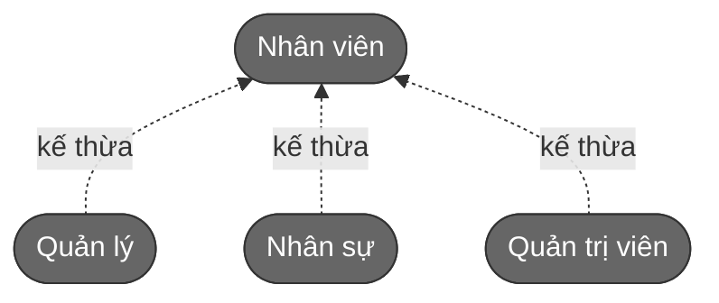
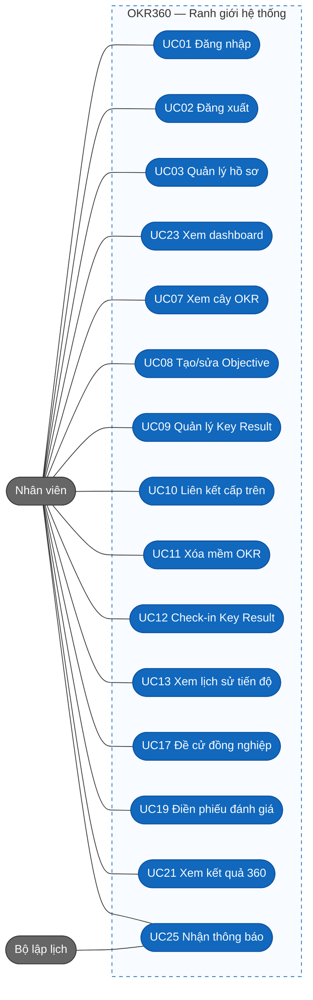
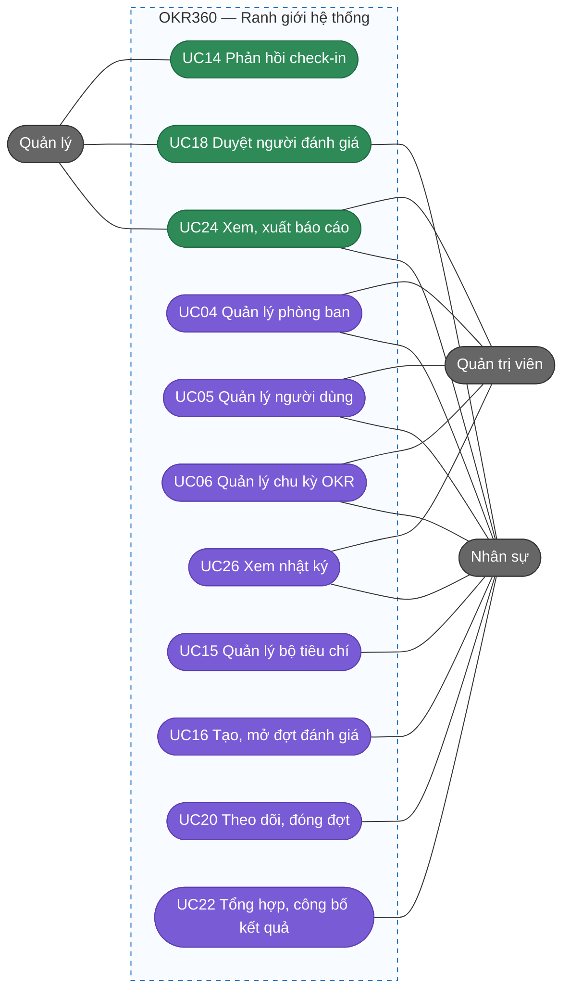
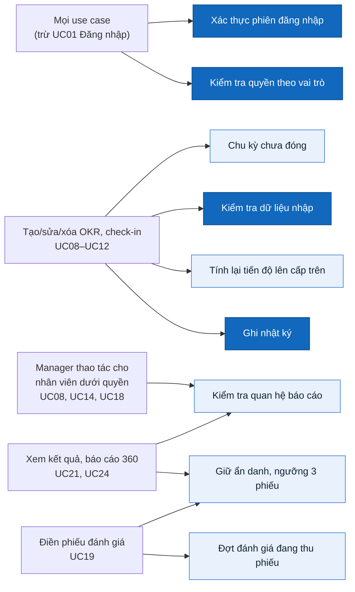

# Tác nhân, vai trò và use case

> Trạng thái thiết kế: TARGET V1
>
> Trạng thái triển khai: CHƯA BẮT ĐẦU

Tên sản phẩm: **OKR360**.

## Tác nhân / vai trò

| Vai trò    | Tên hiển thị  | Trong thực tế                                         | Mối quan tâm chính                                     |
| ---------- | ------------- | ----------------------------------------------------- | ------------------------------------------------------ |
| `ADMIN`    | Quản trị viên | Quản trị hệ thống, nhập OKR công ty thay ban lãnh đạo | Tổ chức, OKR công ty, an toàn hệ thống                 |
| `HR`       | Nhân sự       | Phòng nhân sự                                         | Chu kỳ OKR, đợt đánh giá 360, kết quả cuối kỳ          |
| `MANAGER`  | Quản lý       | Trưởng phòng, team lead                               | OKR phòng ban, theo sát cấp dưới, duyệt người đánh giá |
| `EMPLOYEE` | Nhân viên     | Mọi nhân viên                                         | OKR cá nhân, check-in, điền phiếu đánh giá             |
| —          | Bộ lập lịch   | Chương trình chạy nền (không phải người)              | Gửi nhắc nhở đúng giờ                                  |

**Quy tắc kế thừa:** mỗi người dùng có đúng một vai trò. `ADMIN`, `HR`, `MANAGER` đều là nhân viên nên có **toàn bộ quyền của `EMPLOYEE`** (có OKR cá nhân, được đánh giá 360, điền phiếu). Vai trò chỉ cộng thêm quyền.

## Phạm vi dữ liệu

Có những việc một vai trò được làm, nhưng **chỉ với một phần dữ liệu**. Ma trận bên dưới dùng 3 cách gọi phạm vi sau:

| Cách gọi                               | Nghĩa là                                                                                            | Ví dụ                                                                                                          |
| -------------------------------------- | --------------------------------------------------------------------------------------------------- | -------------------------------------------------------------------------------------------------------------- |
| **Chỉ của bản thân**                   | Dữ liệu do chính người dùng sở hữu: OKR cá nhân của họ, Key Result họ phụ trách, kết quả 360 của họ | Lan chỉ check-in được Key Result Lan phụ trách                                                                 |
| **Chỉ phòng ban mình phụ trách**       | Phòng ban mà người dùng được gán làm trưởng phòng                                                   | Anh Nam là trưởng phòng Dev nên chỉ sửa được OKR của phòng Dev, không sửa được OKR phòng Kinh doanh            |
| **Chỉ nhân viên dưới quyền trực tiếp** | Những người có "quản lý trực tiếp" là người dùng này                                                | Lan báo cáo cho anh Nam, nên anh Nam xem được kết quả 360 của Lan; anh không xem được của nhân viên phòng khác |

## Ma trận vai trò × chức năng

| Chức năng                           | Admin                         | HR                                           | Manager                                            | Employee                      |
| ----------------------------------- | ----------------------------- | -------------------------------------------- | -------------------------------------------------- | ----------------------------- |
| Đăng nhập, đăng xuất, hồ sơ cá nhân | Có                            | Có                                           | Có                                                 | Có                            |
| Quản lý phòng ban                   | Có                            | Có                                           | Không                                              | Không                         |
| Quản lý người dùng                  | Có                            | Có, nhưng không được gán vai trò Admin       | Không                                              | Không                         |
| Quản lý chu kỳ OKR                  | Có                            | Có                                           | Không                                              | Không                         |
| Xem cây OKR toàn công ty            | Có                            | Có                                           | Có                                                 | Có                            |
| Tạo/sửa OKR công ty                 | Có                            | Không                                        | Không                                              | Không                         |
| Tạo/sửa OKR phòng ban               | Có                            | Không                                        | Chỉ phòng ban mình phụ trách                       | Không                         |
| Tạo/sửa OKR cá nhân                 | Có, của mọi người             | Chỉ của bản thân                             | Của bản thân và của nhân viên dưới quyền trực tiếp | Chỉ của bản thân              |
| Xóa mềm OKR                         | Có, của mọi người             | Chỉ của bản thân                             | Của bản thân và OKR thuộc phòng ban mình phụ trách | Chỉ của bản thân              |
| Check-in Key Result                 | Chỉ Key Result mình phụ trách | Chỉ Key Result mình phụ trách                | Chỉ Key Result mình phụ trách                      | Chỉ Key Result mình phụ trách |
| Bình luận vào check-in              | Không                         | Không                                        | Chỉ check-in của nhân viên dưới quyền trực tiếp    | Không                         |
| Quản lý bộ tiêu chí 360             | Không                         | Có                                           | Không                                              | Không                         |
| Tạo, mở, đóng đợt đánh giá 360      | Không                         | Có                                           | Không                                              | Không                         |
| Đề cử đồng nghiệp đánh giá mình     | Có                            | Có                                           | Có                                                 | Có                            |
| Duyệt người đánh giá                | Không                         | Chỉ cho nhân viên không có quản lý trực tiếp | Chỉ cho nhân viên dưới quyền trực tiếp             | Không                         |
| Điền phiếu được phân công           | Có                            | Có                                           | Có                                                 | Có                            |
| Xem kết quả 360                     | Chỉ của bản thân              | Của mọi người                                | Của bản thân và của nhân viên dưới quyền trực tiếp | Chỉ của bản thân              |
| Tổng hợp và công bố kết quả cuối kỳ | Không                         | Có                                           | Không                                              | Không                         |
| Dashboard cá nhân                   | Có                            | Có                                           | Có                                                 | Có                            |
| Dashboard đội nhóm                  | Không                         | Không                                        | Có                                                 | Không                         |
| Dashboard công ty                   | Có                            | Có                                           | Không                                              | Không                         |
| Báo cáo                             | Có, trừ báo cáo kết quả 360   | Có, toàn công ty                             | Chỉ phòng ban mình phụ trách                       | Không                         |
| Nhật ký hoạt động                   | Có                            | Có                                           | Không                                              | Không                         |

Menu và nút không có quyền thì **không hiển thị**. Truy cập URL không có quyền → `#/403`. Backend luôn là nơi kiểm tra quyền cuối cùng.

Admin **không** xem được kết quả 360 của người khác. Lý do là nguyên tắc quyền tối thiểu: người quản trị kỹ thuật không cần biết đồng nghiệp chấm nhau thế nào.

## Sơ đồ use case

Sơ đồ được chia làm 3 phần cho dễ đọc. Các vai trò không nối bằng mũi tên, vì trong sơ đồ use case, đường nối giữa tác nhân và use case chỉ có nghĩa "tác nhân này dùng use case đó".

### 1. Quan hệ kế thừa giữa các vai trò

Quản lý, Nhân sự và Quản trị viên đều là nhân viên, nên kế thừa toàn bộ use case của Nhân viên ở sơ đồ 2.

### 2. Use case mọi vai trò đều dùng

### 3. Use case của Quản lý, Nhân sự và Quản trị viên

Màu xanh lá là use case Quản lý dùng; màu tím là use case chỉ Nhân sự hoặc Quản trị viên dùng. UC18 và UC24 được nhiều vai trò dùng chung, nhưng phạm vi dữ liệu khác nhau (xem ma trận ở trên).

## Quy tắc và ràng buộc dùng chung

Nhiều use case dùng chung các bước kiểm tra. Sơ đồ dưới cho biết nhóm use case nào phải đi qua bước nào: màu xanh đậm là bước kiểm tra chung của mọi hệ thống, màu xanh nhạt là quy tắc riêng của nghiệp vụ OKR360.

- Mọi use case trừ đăng nhập đều phải xác thực phiên và kiểm tra quyền **ở backend**; giao diện ẩn nút đi chỉ để gọn mắt, không phải để bảo mật.
- Tạo/sửa OKR được phép khi chu kỳ ở `DRAFT` hoặc `ACTIVE`; check-in chỉ được phép khi chu kỳ `ACTIVE`. Chu kỳ `CLOSED` thì chỉ xem.
- Mỗi lần OKR thay đổi hoặc có check-in, tiến độ được tính lại dọc theo chuỗi mục tiêu cấp trên **trong cùng một lần lưu**.
- Manager chỉ thao tác được trên phòng ban mình phụ trách và nhân viên dưới quyền trực tiếp.
- Kết quả 360 của nhóm Đồng nghiệp và Cấp dưới chỉ hiển thị khi có **từ 3 phiếu trở lên**; không màn hình, báo cáo hay nhật ký nào cho biết ai đánh giá ai.
- Employee chỉ check-in được Key Result mình phụ trách và chỉ sửa được OKR cá nhân của bản thân.

Cả bốn vai trò đều dùng: đăng nhập, đăng xuất, hồ sơ, dashboard cá nhân, cây OKR, OKR cá nhân, check-in, đề cử, điền phiếu, xem kết quả 360 của bản thân, thông báo.

## Use case

### UC01 Đăng nhập

- **Tác nhân:** mọi vai trò
- **Tiền điều kiện:** tài khoản tồn tại và đang hoạt động
- **Luồng chính:** nhập email, mật khẩu → gửi `login` → backend kiểm tra thông tin và trạng thái tài khoản → trả về Bearer token và hồ sơ an toàn → chuyển tới Dashboard
- **Luồng thay thế:** sai thông tin hoặc tài khoản bị khóa → báo lỗi chung, ở lại trang đăng nhập; sai quá 5 lần trong 15 phút → tạm khóa đăng nhập
- **Quyền:** công khai
- **Kết quả:** phiên làm việc có token hết hạn sau 30 phút

### UC02 Đăng xuất

- **Tác nhân:** mọi vai trò
- **Tiền điều kiện:** đã đăng nhập
- **Luồng chính:** bấm đăng xuất → xóa token và dữ liệu phiên phía client → về trang đăng nhập
- **Quyền:** đã xác thực
- **Kết quả:** không truy cập được trang nội bộ từ thiết bị đã đăng xuất

### UC03 Quản lý hồ sơ cá nhân

- **Tác nhân:** mọi vai trò
- **Luồng chính:** tab Tài khoản sửa họ tên, số điện thoại, ảnh đại diện; tab Bảo mật nhập mật khẩu cũ rồi đặt mật khẩu mới (tối thiểu 8 ký tự); tab Quyền xem ma trận quyền của mình
- **Quyền:** đã xác thực
- **Kết quả:** email, vai trò, phòng ban, quản lý trực tiếp chỉ được xem, không tự sửa được

### UC04 Quản lý phòng ban

- **Tác nhân:** Admin, HR
- **Luồng chính:** xem cây phòng ban → thêm/sửa phòng ban (tên, phòng ban cha, trưởng phòng) → ngưng hoạt động phòng ban
- **Luồng thay thế:** chọn phòng ban cha tạo vòng lặp → từ chối; ngưng phòng ban còn nhân viên đang hoạt động → từ chối
- **Quyền:** `orgManage`
- **Kết quả:** sơ đồ tổ chức được cập nhật, là nền cho cây OKR

### UC05 Quản lý người dùng

- **Tác nhân:** Admin, HR
- **Luồng chính:** danh sách người dùng → thêm/sửa (họ tên, email, mật khẩu ban đầu, vai trò, phòng ban, quản lý trực tiếp) → bật/tắt tài khoản
- **Luồng thay thế:** email trùng → từ chối; gán quản lý tạo vòng lặp hoặc tự quản lý chính mình → từ chối; HR gán vai trò Admin → `403`
- **Quyền:** `userManage`
- **Kết quả:** người dùng bị tắt không đăng nhập được và không được phân công làm người đánh giá mới

### UC06 Quản lý chu kỳ OKR

- **Tác nhân:** Admin, HR
- **Luồng chính:** tạo chu kỳ (tên, ngày bắt đầu, ngày kết thúc, hạn chốt lập mục tiêu, số Objective tối đa, tỷ trọng OKR/360) ở trạng thái `DRAFT` → kích hoạt sang `ACTIVE` → hết quý thì đóng sang `CLOSED`
- **Luồng thay thế:** kích hoạt khi đã có chu kỳ `ACTIVE` khác → từ chối; ngày kết thúc trước ngày bắt đầu → báo lỗi
- **Quyền:** `cycleManage`
- **Kết quả:** khi đóng, tiến độ được chốt và mọi OKR của chu kỳ chỉ còn xem được

### UC07 Xem cây OKR

- **Tác nhân:** mọi vai trò
- **Luồng chính:** chọn chu kỳ → xem cây công ty → phòng ban → cá nhân → mở rộng/thu gọn → lọc theo phòng ban, người, cấp, mức tự tin → mở chi tiết một Objective
- **Quyền:** `okrRead`
- **Kết quả:** mỗi nút hiện tiêu đề, người sở hữu, % tiến độ, màu mức tự tin; OKR đã xóa mềm không hiện

### UC08 Tạo/sửa Objective

- **Tác nhân:** Nhân viên (OKR cá nhân của bản thân), Manager (OKR phòng ban mình phụ trách và OKR cá nhân của nhân viên dưới quyền trực tiếp), Admin (mọi cấp)
- **Tiền điều kiện:** có chu kỳ `DRAFT` hoặc `ACTIVE`
- **Luồng chính:** chọn chu kỳ → "Thêm Objective" → chọn cấp (chỉ hiện các cấp được phép) → nhập tiêu đề, mô tả, người sở hữu → thêm Key Result (UC09) → tùy chọn liên kết cấp trên (UC10) → lưu → ghi nhật ký
- **Luồng thay thế:** vượt số Objective tối đa → báo lỗi; chu kỳ đã `CLOSED` → từ chối
- **Quyền:** `okrWrite` + kiểm tra cấp OKR và quan hệ báo cáo
- **Kết quả:** Objective xuất hiện trong cây

### UC09 Quản lý Key Result

- **Tác nhân:** người sở hữu Objective
- **Luồng chính:** thêm/sửa Key Result: tiêu đề, kiểu đo (Số / Phần trăm / Hoàn thành), giá trị ban đầu, giá trị đích, đơn vị, người phụ trách check-in, trọng số
- **Luồng thay thế:** thêm KR thứ 6 → từ chối; giá trị ban đầu bằng giá trị đích → báo lỗi
- **Quyền:** `okrWrite`
- **Kết quả:** sửa giá trị đầu/đích của KR đã có check-in thì tiến độ được tính lại, lịch sử check-in giữ nguyên

### UC10 Liên kết lên mục tiêu cấp trên

- **Tác nhân:** người sở hữu Objective
- **Luồng chính:** mở Objective → "Liên kết" → chọn Objective cha cùng chu kỳ → lưu → tiến độ Objective cha được tính lại
- **Luồng thay thế:** sai cấp (OKR phòng ban chỉ nối lên OKR công ty; OKR cá nhân nối lên OKR phòng ban hoặc công ty) → báo lỗi; tạo vòng lặp → từ chối
- **Quyền:** `okrWrite`
- **Kết quả:** Objective nằm đúng nhánh trong cây; OKR chưa liên kết được đánh dấu "Chưa liên kết"

### UC11 Xóa mềm OKR

- **Tác nhân:** người sở hữu OKR; Manager với OKR thuộc phòng ban mình phụ trách; Admin
- **Luồng chính:** xác nhận → đặt `deletedAt`, `deletedBy`, không xóa vật lý → tính lại tiến độ Objective cha
- **Luồng thay thế:** Objective còn Objective con đang liên kết → từ chối, yêu cầu gỡ liên kết trước
- **Quyền:** `okrDelete`
- **Kết quả:** OKR biến mất khỏi cây, dashboard, báo cáo; lịch sử vẫn còn

### UC12 Check-in Key Result

- **Tác nhân:** người phụ trách Key Result
- **Tiền điều kiện:** chu kỳ `ACTIVE`; KR chưa bị xóa
- **Luồng chính:** mở KR từ dashboard hoặc cây OKR → "Check-in" → nhập giá trị hiện tại (hoặc đánh dấu hoàn thành) → chọn mức tự tin (Đúng hướng / Có rủi ro / Chệch hướng) → ghi chú, vướng mắc → lưu bản ghi check-in mới → tính lại tiến độ KR → Objective → các Objective cấp trên
- **Luồng thay thế:** giá trị sai kiểu → báo lỗi tại ô nhập; chọn "Chệch hướng" → quản lý trực tiếp nhận thông báo
- **Quyền:** `checkinWrite` (chỉ người phụ trách KR)
- **Kết quả:** tiến độ các cấp phản ánh ngay; bản check-in cũ không bị sửa hay xóa

### UC13 Xem lịch sử check-in và biểu đồ tiến độ

- **Tác nhân:** mọi vai trò
- **Luồng chính:** mở một KR → xem danh sách check-in (mới nhất trước) kèm bình luận → xem biểu đồ tiến độ thực tế so với đường kỳ vọng
- **Quyền:** `okrRead`
- **Kết quả:** thấy được KR bị chững lại từ khi nào

### UC14 Phản hồi check-in

- **Tác nhân:** Manager
- **Luồng chính:** mở check-in của một nhân viên dưới quyền trực tiếp → viết bình luận → người check-in nhận thông báo
- **Quyền:** `checkinComment` (chỉ quản lý trực tiếp)
- **Kết quả:** chỉ bình luận, không sửa được check-in

### UC15 Quản lý bộ tiêu chí đánh giá

- **Tác nhân:** HR
- **Luồng chính:** tạo mẫu phiếu → thêm tiêu chí (tên, mô tả, bắt buộc hay không, thang 1–5) → thêm câu hỏi mở
- **Luồng thay thế:** sửa mẫu đang được đợt đánh giá dùng → từ chối, chỉ được nhân bản thành mẫu mới
- **Quyền:** `reviewTemplateManage`
- **Kết quả:** mẫu phiếu dùng chung cho các đợt đánh giá

### UC16 Tạo và mở đợt đánh giá 360

- **Tác nhân:** HR
- **Luồng chính:** tạo đợt gắn với chu kỳ → chọn mẫu phiếu và người được đánh giá → đặt hạn đề cử, hạn nộp phiếu → mở giai đoạn đề cử (`NOMINATION`) → khi đủ người đánh giá, mở giai đoạn thu phiếu (`COLLECTING`)
- **Luồng thay thế:** hạn đề cử sau hạn nộp → báo lỗi
- **Quyền:** `reviewCampaignManage`
- **Kết quả:** khi mở thu phiếu, hệ thống chụp lại quan hệ báo cáo và sinh phiếu: tự đánh giá, quản lý trực tiếp, đồng nghiệp đã duyệt, mọi cấp dưới trực tiếp

### UC17 Đề cử đồng nghiệp

- **Tác nhân:** người được đánh giá (mọi vai trò)
- **Tiền điều kiện:** đợt ở `NOMINATION`
- **Luồng chính:** mở "Đề cử" → chọn 3–5 đồng nghiệp → gửi → quản lý trực tiếp nhận thông báo duyệt
- **Luồng thay thế:** chọn chính mình, quản lý trực tiếp, cấp dưới trực tiếp hoặc người bị khóa → báo lỗi; số người ngoài khoảng 3–5 → báo lỗi
- **Quyền:** `nominate`
- **Kết quả:** danh sách chờ quản lý duyệt

### UC18 Duyệt người đánh giá

- **Tác nhân:** Manager (cho nhân viên dưới quyền trực tiếp); HR (cho nhân viên không có quản lý trực tiếp)
- **Luồng chính:** xem danh sách đề cử → giữ, thêm hoặc bớt người → duyệt
- **Luồng thay thế:** nhân viên đến hạn chưa đề cử → quản lý tự chọn đủ số người
- **Quyền:** `reviewerApprove` + kiểm tra quan hệ báo cáo
- **Kết quả:** danh sách sau duyệt vẫn phải có 3–5 đồng nghiệp

### UC19 Điền phiếu đánh giá

- **Tác nhân:** người đánh giá được phân công (mọi vai trò)
- **Tiền điều kiện:** đợt ở `COLLECTING`
- **Luồng chính:** mở "Phiếu cần điền" → chọn một phiếu (thấy tên người được đánh giá và vai trò của mình trong phiếu) → chấm 1–5 hoặc "Không đủ thông tin" cho từng tiêu chí → trả lời câu hỏi mở → lưu nháp hoặc nộp
- **Luồng thay thế:** còn tiêu chí bắt buộc chưa chấm → không cho nộp; đợt đã `CLOSED` → phiếu chỉ xem
- **Quyền:** `reviewSubmit` (chỉ phiếu được giao cho mình)
- **Kết quả:** phiếu của nhóm Đồng nghiệp và Cấp dưới được giữ ẩn danh

### UC20 Theo dõi tiến độ nộp phiếu và đóng đợt

- **Tác nhân:** HR
- **Luồng chính:** xem tỷ lệ nộp theo phòng ban → gửi nhắc người chưa nộp → đến hạn thì đóng đợt (`CLOSED`)
- **Quyền:** `reviewCampaignManage`
- **Kết quả:** HR chỉ thấy mỗi người còn thiếu bao nhiêu phiếu, không thấy họ còn thiếu phiếu cho ai; phiếu chưa nộp khi đóng đợt bị hủy

### UC21 Xem kết quả 360

- **Tác nhân:** Nhân viên (kết quả của bản thân, sau khi công bố); Manager (kết quả của nhân viên dưới quyền trực tiếp, từ khi đóng đợt); HR (kết quả của mọi người)
- **Luồng chính:** mở kết quả → xem điểm theo tiêu chí, theo nhóm người đánh giá, chênh lệch tự đánh giá so với người khác, nhận xét không kèm tên
- **Luồng thay thế:** nhóm Đồng nghiệp hoặc Cấp dưới dưới 3 phiếu → gộp hai nhóm; gộp rồi vẫn dưới 3 → ẩn và không tính vào điểm
- **Quyền:** `reviewResultRead` + kiểm tra quan hệ báo cáo
- **Kết quả:** không ai suy ra được ai đã chấm điểm nào

### UC22 Tổng hợp và công bố kết quả cuối kỳ

- **Tác nhân:** HR
- **Tiền điều kiện:** chu kỳ và đợt đánh giá đều đã `CLOSED`
- **Luồng chính:** mở màn hình kết quả → hệ thống tính điểm OKR, điểm 360, điểm cuối kỳ theo tỷ trọng → HR xem trước, xuất file nếu cần → "Công bố" → đợt chuyển `PUBLISHED`, gửi thông báo từng người
- **Luồng thay thế:** người thiếu điểm OKR hoặc điểm 360 → ghi "Thiếu dữ liệu", không cho 0 điểm
- **Quyền:** `finalResultManage`
- **Kết quả:** mỗi nhân viên chỉ thấy kết quả của chính mình

### UC23 Xem dashboard

- **Tác nhân:** mọi vai trò
- **Luồng chính:** mở trang chủ → hệ thống hiện dashboard theo vai trò: cá nhân (mọi người), đội nhóm (Manager), công ty (Admin, HR)
- **Quyền:** `dashboard`
- **Kết quả:** số liệu khớp với báo cáo cùng bộ lọc

### UC24 Xem và xuất báo cáo

- **Tác nhân:** Admin, HR, Manager
- **Luồng chính:** chọn loại báo cáo (tiến độ OKR, tỷ lệ check-in, kết quả cuối kỳ) → chọn chu kỳ, phòng ban → xem → xuất Excel hoặc PDF theo đúng bộ lọc
- **Quyền:** `reportRead` (Manager chỉ xem báo cáo của phòng ban mình phụ trách; Admin không xem báo cáo kết quả 360)
- **Kết quả:** báo cáo 360 tổng hợp cũng áp ngưỡng ẩn danh

### UC25 Nhận thông báo và nhắc nhở

- **Tác nhân:** mọi vai trò; Bộ lập lịch
- **Luồng chính:** Bộ lập lịch kiểm tra các sự kiện đến hạn (KR chưa check-in 7 ngày, chưa đề cử, còn phiếu chưa nộp) → tạo thông báo trong ứng dụng và gửi email → người dùng xem, đánh dấu đã đọc
- **Quyền:** đã xác thực
- **Kết quả:** mỗi người nhận tối đa một lần nhắc cho mỗi sự kiện mỗi ngày

### UC26 Xem nhật ký hoạt động

- **Tác nhân:** Admin, HR
- **Luồng chính:** mở nhật ký → lọc theo người, phân hệ, hành động, thời gian
- **Quyền:** `auditRead`
- **Kết quả:** nhật ký không chứa nội dung phiếu đánh giá và không ghi ai đánh giá ai trong nhóm ẩn danh
