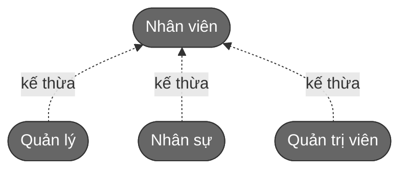
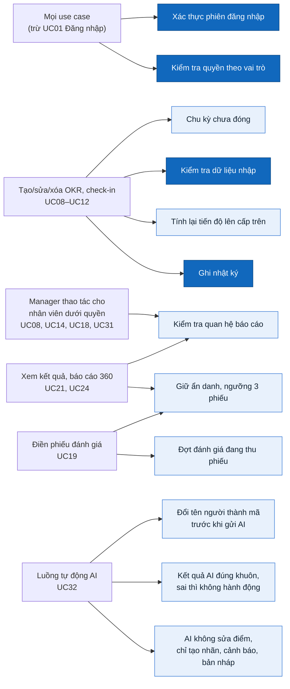

# Tác nhân, vai trò và use case

> Trạng thái thiết kế: TARGET V1
>
> Trạng thái triển khai: CHƯA BẮT ĐẦU

Tên sản phẩm: **OKR360**.

## Tác nhân / vai trò

| Vai trò    | Tên hiển thị  | Trong thực tế                                         | Mối quan tâm chính                                     |
| ---------- | ------------- | ----------------------------------------------------- | ------------------------------------------------------ |
| `ADMIN`    | Quản trị viên | Quản trị hệ thống, nhập OKR công ty thay ban lãnh đạo | Tổ chức, OKR công ty, an toàn hệ thống                 |
| `HR`       | Nhân sự       | Phòng nhân sự                                         | Chu kỳ OKR, đợt đánh giá 360, kết quả cuối kỳ          |
| `MANAGER`  | Quản lý       | Trưởng phòng, team lead                               | OKR phòng ban hoặc OKR team, theo sát cấp dưới, duyệt người đánh giá |
| `EMPLOYEE` | Nhân viên     | Mọi nhân viên                                         | OKR cá nhân, check-in, điền phiếu đánh giá             |
| —          | Bộ lập lịch   | Chương trình chạy nền (không phải người)              | Gửi nhắc nhở đúng giờ, kích hoạt luồng AI theo lịch    |
| —          | Bộ xử lý AI   | Chương trình chạy nền gọi dịch vụ AI (không phải người) | Đọc văn bản, phân loại, tóm tắt, tạo cảnh báo và bản nháp |

**Phòng ban và team:** công ty chia thành phòng ban; phòng ban lớn chia tiếp thành team (ví dụ Phòng Dev có Team Thanh toán và Team Nền tảng). Mỗi phòng ban có một trưởng phòng, mỗi team có một team lead; cả hai thường mang vai trò `MANAGER`. Thành viên team báo cáo cho team lead, team lead báo cáo cho trưởng phòng.

**Quy tắc kế thừa:** mỗi người dùng có đúng một vai trò. `ADMIN`, `HR`, `MANAGER` đều là nhân viên nên có **toàn bộ quyền của `EMPLOYEE`** (có OKR cá nhân, được đánh giá 360, điền phiếu). Vai trò chỉ cộng thêm quyền.

## Phạm vi dữ liệu

Có những việc một vai trò được làm, nhưng **chỉ với một phần dữ liệu**. Ma trận bên dưới dùng 3 cách gọi phạm vi sau:

| Cách gọi                               | Nghĩa là                                                                                            | Ví dụ                                                                                                          |
| -------------------------------------- | --------------------------------------------------------------------------------------------------- | -------------------------------------------------------------------------------------------------------------- |
| **Chỉ của bản thân**                   | Dữ liệu do chính người dùng sở hữu: OKR cá nhân của họ, Key Result họ phụ trách, kết quả 360 của họ | Lan chỉ check-in được Key Result Lan phụ trách                                                                 |
| **Chỉ đơn vị mình phụ trách**          | Với trưởng phòng: phòng ban của mình và mọi team trong phòng. Với team lead: chỉ team của mình       | Anh Sơn là trưởng phòng Dev nên sửa được OKR Phòng Dev và OKR của Team Thanh toán, Team Nền tảng; anh Nam là team lead Thanh toán nên chỉ sửa được OKR Team Thanh toán |
| **Chỉ nhân viên dưới quyền trực tiếp** | Những người có "quản lý trực tiếp" là người dùng này                                                | Lan báo cáo cho anh Nam (team lead), nên anh Nam xem được kết quả 360 của Lan; anh Sơn (trưởng phòng) thì không, vì Lan không báo cáo trực tiếp cho anh |

## Ma trận vai trò × chức năng

| Chức năng                           | Admin                         | HR                                           | Manager                                            | Employee                      |
| ----------------------------------- | ----------------------------- | -------------------------------------------- | -------------------------------------------------- | ----------------------------- |
| Đăng nhập, đăng xuất, hồ sơ cá nhân | Có                            | Có                                           | Có                                                 | Có                            |
| Quản lý phòng ban và team           | Có                            | Có                                           | Không                                              | Không                         |
| Quản lý người dùng                  | Có                            | Có, nhưng không được gán vai trò Admin       | Không                                              | Không                         |
| Quản lý chu kỳ OKR                  | Có                            | Có                                           | Không                                              | Không                         |
| Xem cây OKR toàn công ty            | Có                            | Có                                           | Có                                                 | Có                            |
| Tạo/sửa OKR công ty                 | Có                            | Không                                        | Không                                              | Không                         |
| Tạo/sửa OKR phòng ban               | Có                            | Không                                        | Chỉ trưởng phòng, với phòng ban của mình           | Không                         |
| Tạo/sửa OKR team                    | Có                            | Không                                        | Chỉ đơn vị mình phụ trách                          | Không                         |
| Tạo/sửa OKR cá nhân                 | Có, của mọi người             | Chỉ của bản thân                             | Của bản thân và của nhân viên dưới quyền trực tiếp | Chỉ của bản thân              |
| Xóa mềm OKR                         | Có, của mọi người             | Chỉ của bản thân                             | Của bản thân và OKR thuộc đơn vị mình phụ trách    | Chỉ của bản thân              |
| Check-in Key Result                 | Chỉ Key Result mình phụ trách | Chỉ Key Result mình phụ trách                | Chỉ Key Result mình phụ trách                      | Chỉ Key Result mình phụ trách |
| Bình luận vào check-in              | Không                         | Không                                        | Chỉ check-in của nhân viên dưới quyền trực tiếp    | Không                         |
| Quản lý bộ tiêu chí 360             | Không                         | Có                                           | Không                                              | Không                         |
| Tạo, mở, đóng đợt đánh giá 360      | Không                         | Có                                           | Không                                              | Không                         |
| Đề cử đồng nghiệp đánh giá mình     | Có                            | Có                                           | Có                                                 | Có                            |
| Duyệt người đánh giá                | Không                         | Chỉ cho nhân viên không có quản lý trực tiếp | Chỉ cho nhân viên dưới quyền trực tiếp             | Không                         |
| Điền phiếu được phân công           | Có                            | Có                                           | Có                                                 | Có                            |
| Xem kết quả 360                     | Chỉ của bản thân              | Của mọi người                                | Của bản thân và của nhân viên dưới quyền trực tiếp | Chỉ của bản thân              |
| Tổng hợp và công bố kết quả cuối kỳ | Không                         | Có                                           | Không                                              | Không                         |
| Dashboard cá nhân                   | Có                            | Có                                           | Có                                                 | Có                            |
| Dashboard đội nhóm                  | Không                         | Không                                        | Có                                                 | Không                         |
| Dashboard công ty                   | Có                            | Có                                           | Không                                              | Không                         |
| Báo cáo                             | Có, trừ báo cáo kết quả 360   | Có, toàn công ty                             | Chỉ đơn vị mình phụ trách                          | Không                         |
| Nhật ký hoạt động                   | Có                            | Có                                           | Không                                              | Không                         |
| Cấu hình luồng tự động AI           | Có                            | Không                                        | Không                                              | Không                         |
| Xem lịch sử chạy tự động            | Có                            | Có                                           | Không                                              | Không                         |
| Xử lý vướng mắc được AI chuyển đến  | Chỉ đơn vị mình phụ trách     | Chỉ đơn vị mình phụ trách                    | Chỉ đơn vị mình phụ trách                          | Không                         |
| Xem bản tin tuần do AI tạo          | Không                         | Không                                        | Chỉ nhân viên dưới quyền trực tiếp                 | Không                         |
| Duyệt bản nháp 1-1 do AI tạo        | Không                         | Chỉ cho nhân viên không có quản lý trực tiếp | Chỉ cho nhân viên dưới quyền trực tiếp             | Không                         |
| Nhận cảnh báo AI về OKR, check-in, nhận xét của mình | Có           | Có                                           | Có                                                 | Có                            |

Menu và nút không có quyền thì **không hiển thị**. Truy cập URL không có quyền → `#/403`. Backend luôn là nơi kiểm tra quyền cuối cùng.

Admin **không** xem được kết quả 360 của người khác. Lý do là nguyên tắc quyền tối thiểu: người quản trị kỹ thuật không cần biết đồng nghiệp chấm nhau thế nào. Vì vậy Admin bật/tắt được các luồng AI nhưng không đọc được bản nháp 1-1, và lịch sử chạy không lưu nội dung gửi cho AI.

## Sơ đồ use case

Sơ đồ được chia làm 3 phần cho dễ đọc. Các vai trò không nối bằng mũi tên, vì trong sơ đồ use case, đường nối giữa tác nhân và use case chỉ có nghĩa "tác nhân này dùng use case đó".

### 1. Quan hệ kế thừa giữa các vai trò

Quản lý, Nhân sự và Quản trị viên đều là nhân viên, nên kế thừa toàn bộ use case của Nhân viên ở sơ đồ 2.

### 2. Use case mọi vai trò đều dùng

UC32 là use case của hệ thống: Bộ lập lịch kích hoạt các luồng chạy theo lịch, Bộ xử lý AI thực hiện năm luồng chạy nền. Kết quả đến người dùng qua UC25 (thông báo) và các màn hình của UC08, UC12. Luồng thứ sáu, cảnh báo nhận xét 360, không chạy nền mà chạy ngay trong UC19. Từng bước do người, hệ thống hay AI thực hiện được ghi ở [Phân định Người, Tự động và AI](#phân-định-người-tự-động-và-ai).

### 3. Use case của Quản lý, Nhân sự và Quản trị viên

Màu xanh lá là use case Quản lý dùng; màu tím là use case chỉ Nhân sự hoặc Quản trị viên dùng; màu nâu là use case của phần tự động hóa bằng AI. UC18, UC24, UC29 và UC31 được nhiều vai trò dùng chung, nhưng phạm vi dữ liệu khác nhau (xem ma trận ở trên). UC29 dành cho người phụ trách đơn vị (trưởng phòng hoặc team lead), thường là Quản lý.

## Quy tắc và ràng buộc dùng chung

Nhiều use case dùng chung các bước kiểm tra. Sơ đồ dưới cho biết nhóm use case nào phải đi qua bước nào: màu xanh đậm là bước kiểm tra chung của mọi hệ thống, màu xanh nhạt là quy tắc riêng của nghiệp vụ OKR360.

- Mọi use case trừ đăng nhập đều phải xác thực phiên và kiểm tra quyền **ở backend**; giao diện ẩn nút đi chỉ để gọn mắt, không phải để bảo mật.
- OKR có 4 cấp: công ty, phòng ban, team, cá nhân. Được nối vượt cấp: phòng ban chưa chia team thì OKR cá nhân nối thẳng lên OKR phòng ban.
- Tạo/sửa OKR được phép khi chu kỳ ở `DRAFT` hoặc `ACTIVE`; check-in chỉ được phép khi chu kỳ `ACTIVE`. Chu kỳ `CLOSED` thì chỉ xem.
- Mỗi lần OKR thay đổi hoặc có check-in, tiến độ được tính lại dọc theo chuỗi mục tiêu cấp trên **trong cùng một lần lưu**.
- Manager chỉ thao tác được trên đơn vị mình phụ trách (trưởng phòng: phòng ban và các team bên trong; team lead: team của mình) và nhân viên dưới quyền trực tiếp.
- Kết quả 360 của nhóm Đồng nghiệp và Cấp dưới chỉ hiển thị khi có **từ 3 phiếu trở lên**; không màn hình, báo cáo hay nhật ký nào cho biết ai đánh giá ai.
- Employee chỉ check-in được Key Result mình phụ trách và chỉ sửa được OKR cá nhân của bản thân.

Quy tắc riêng cho tự động hóa bằng AI:

- AI **không chấm điểm, không xếp loại, không sửa** số liệu OKR hay 360. Kết quả của AI chỉ là nhãn, cảnh báo, thông báo hoặc bản nháp; mọi nội dung do AI tạo đều có nhãn "Do AI tạo".
- Nội dung gửi tới ai khác ngoài chính người viết (bản tóm tắt 1-1) luôn là **bản nháp**, có người duyệt rồi mới gửi.
- Trước khi gửi cho dịch vụ AI, tên người và tên phòng ban được đổi thành mã (ví dụ `NV-01`, `PB-QA`), rồi đổi lại khi nhận kết quả.
- Nhận xét 360 chỉ được gửi cho AI trong hai trường hợp. Luồng "Bản nháp 1-1": khi đợt đã `CLOSED`, chỉ của nhóm đủ ngưỡng ẩn danh (sau khi gộp), không kèm điểm từng phiếu hay bất kỳ thông tin nào nối được tới người viết. Luồng "Cảnh báo nhận xét 360" (UC19): khi đợt đang `COLLECTING`, chỉ phần nhận xét của chính phiếu đang nộp, đã đổi tên thành mã.
- Văn bản người dùng gõ chỉ là **dữ liệu**, không phải lệnh cho AI. Kết quả AI phải đúng khuôn JSON đã định; sai khuôn thì không hành động và ghi lỗi.
- Luồng AI chạy nền sau khi thao tác gốc đã lưu xong; AI chậm hoặc lỗi không làm hỏng check-in hay nộp phiếu. Lỗi thì thử lại tối đa 3 lần, sau đó đánh dấu Lỗi.
- Mỗi sự kiện chỉ được một luồng xử lý một lần, kể cả khi job chạy lại.
- Ngoại lệ: cảnh báo nhận xét 360 (UC19) chạy ngay khi bấm nộp, chờ tối đa 5 giây; AI lỗi hoặc quá giờ thì cho nộp bình thường, không cảnh báo. Luồng này không qua hộp thư sự kiện, không có dòng trong lịch sử chạy và không lưu cảnh báo; hệ thống chỉ cộng số lần gọi AI để áp hạn mức, vì một dòng lịch sử cho mỗi lần nộp có thể giúp đoán ai đã chấm.
- Mỗi luồng có hạn mức số lần gọi AI mỗi ngày; vượt hạn mức thì luồng tạm dừng tới hôm sau và Admin nhận cảnh báo.

Cả bốn vai trò đều dùng: đăng nhập, đăng xuất, hồ sơ, dashboard cá nhân, cây OKR, OKR cá nhân, check-in, đề cử, điền phiếu, xem kết quả 360 của bản thân, thông báo.

## Phân định Người, Tự động và AI

"Tự động" và "AI" là hai việc khác nhau. Mọi luồng AI đều chạy tự động, nhưng phần lớn việc tự động không dùng AI. Các use case bên dưới gắn nhãn cho từng bước theo quy ước sau:

| Nhãn         | Ai thực hiện                                    | Đặc điểm                                                                 | Ví dụ                                                     |
| ------------ | ----------------------------------------------- | ------------------------------------------------------------------------ | --------------------------------------------------------- |
| **[Người]**  | Người dùng                                      | Thao tác và quyết định; chịu trách nhiệm về kết quả                      | Duyệt bản nháp 1-1, công bố kết quả, chọn "Vẫn nộp"       |
| **[Tự động]** | Hệ thống hoặc Bộ lập lịch, không cần ai bấm nút | Chạy theo luật cố định, cùng đầu vào luôn cho cùng kết quả; không gọi AI | Cộng dồn tiến độ, tính điểm cuối kỳ, nhắc check-in sau 7 ngày |
| **[AI]**     | Dịch vụ AI bên ngoài (mô hình ngôn ngữ)         | Đọc văn bản tự do, trả JSON; kết quả có thể sai nên luôn được kiểm tra   | Phân loại vướng mắc, tóm tắt nhận xét 360                 |

Một vài điểm cần lưu ý khi đọc:

- Việc xử lý thông thường của một yêu cầu (kiểm tra quyền, kiểm tra dữ liệu nhập, lưu dữ liệu) không gắn nhãn. Bước không có nhãn là người dùng thao tác hoặc hệ thống xử lý trực tiếp thao tác đó.
- **[Người]** chỉ được ghi ở những chỗ cần làm rõ người quyết định sau một bước Tự động hoặc AI.
- Bộ xử lý AI là chương trình của hệ thống, không phải AI. Trong một lần chạy, chỉ bước gọi dịch vụ AI mang nhãn **[AI]**; các bước đổi tên thành mã, kiểm tra khuôn, gắn nhãn, gửi thông báo và ghi lịch sử đều là **[Tự động]**.

### Tổng hợp theo use case

Bảng này chỉ liệt kê use case có bước Tự động hoặc AI. Các use case còn lại không có bước nào như vậy; UC27 và UC28 là việc của người cấu hình và theo dõi tự động hóa.

| Use case                  | Tự động                                                                                                     | AI                                                                  | Người quyết định                                                       |
| ------------------------- | ----------------------------------------------------------------------------------------------------------- | ------------------------------------------------------------------- | ---------------------------------------------------------------------- |
| UC06 Quản lý chu kỳ       | Chốt tiến độ khi đóng chu kỳ                                                                                | Không                                                               | Admin, HR kích hoạt và đóng chu kỳ                                     |
| UC08 Tạo/sửa Objective    | Ghi nhật ký; ghi sự kiện `OBJECTIVE_CREATED`; gắn ghi chú rà soát                                           | Rà soát KR mới                                                      | Người tạo tự quyết định sửa hay không                                  |
| UC09, UC10, UC11          | Tính lại tiến độ                                                                                            | Không                                                               | Người sở hữu OKR                                                       |
| UC12 Check-in             | Cộng dồn tiến độ; ghi sự kiện `CHECKIN_CREATED`; báo quản lý khi "Chệch hướng"; gắn nhãn, chuyển vướng mắc, nhắc xem lại | Phân loại vướng mắc; so mức tự tin với ghi chú                      | Người check-in tự quyết định mức tự tin và nội dung                    |
| UC14 Phản hồi check-in    | Thông báo cho người check-in                                                                                | Không                                                               | Manager viết bình luận                                                 |
| UC16 Mở đợt 360           | Chụp quan hệ báo cáo; sinh phiếu                                                                            | Không                                                               | HR mở từng giai đoạn                                                   |
| UC17 Đề cử                | Thông báo cho quản lý trực tiếp                                                                             | Không                                                               | Nhân viên chọn người                                                   |
| UC19 Điền phiếu           | Hiện cảnh báo chỉ cho người viết                                                                            | Phát hiện câu dễ lộ người viết hoặc xúc phạm                        | Người viết sửa hoặc chọn "Vẫn nộp"                                     |
| UC20 Đóng đợt             | Gửi nhắc; hủy phiếu chưa nộp; tách câu trả lời khỏi người chấm; ghi sự kiện `CAMPAIGN_CLOSED`               | Không có bước trong UC này; việc đóng đợt kích hoạt "Bản nháp 1-1" | HR gửi nhắc và đóng đợt                                                |
| UC21 Kết quả 360          | Gộp hoặc ẩn nhóm dưới ngưỡng ẩn danh                                                                        | Không                                                               | Không có quyết định                                                    |
| UC22 Kết quả cuối kỳ      | Tính điểm, xếp loại; gửi thông báo                                                                          | Không; AI không tham gia chấm điểm                                  | HR xem trước và công bố                                                |
| UC25 Thông báo, nhắc nhở  | Bộ lập lịch kiểm tra sự kiện đến hạn; tạo thông báo; gửi email                                              | Không                                                               | Không có quyết định                                                    |
| UC29 Vướng mắc chuyển đến | Thông báo; chuyển về quản lý trực tiếp khi bị từ chối; ghi lại lượt phân loại sai                           | Có từ trước, ở luồng "Chuyển vướng mắc"                             | Người phụ trách đơn vị nhận xử lý hoặc từ chối                         |
| UC30 Bản tin tuần         | Bộ lập lịch kích hoạt; đếm số liệu từ database; tạo bản tin; gửi thông báo, email                           | Gom vướng mắc giống nhau, chọn tối đa 3 việc cần chú ý              | Manager đọc và tự quyết định xử lý                                     |
| UC31 Bản nháp 1-1         | Lọc nhóm đủ ngưỡng; lưu bản nháp; thông báo khi gửi                                                         | Tóm tắt điểm mạnh, điểm cần cải thiện                               | Manager hoặc HR sửa, gửi hoặc bỏ                                       |
| UC32 Luồng AI             | Mọi bước trừ bước gọi dịch vụ AI                                                                            | Xem bảng từng luồng ở UC32                                          | Không có quyết định trong UC32; người quyết định ở các use case trên   |

## Use case

### UC01 Đăng nhập

- **Tác nhân:** mọi vai trò
- **Tiền điều kiện:** tài khoản tồn tại và đang hoạt động
- **Luồng chính:** nhập email, mật khẩu → gửi `login` → backend kiểm tra thông tin và trạng thái tài khoản → trả về Bearer token và hồ sơ an toàn → chuyển tới Dashboard
- **Luồng thay thế:** sai thông tin hoặc tài khoản bị khóa → báo lỗi chung, ở lại trang đăng nhập; sai quá 5 lần trong 15 phút → tạm khóa đăng nhập
- **Quyền:** công khai
- **Kết quả:** phiên làm việc có token hết hạn sau 30 phút

### UC02 Đăng xuất

- **Tác nhân:** mọi vai trò
- **Tiền điều kiện:** đã đăng nhập
- **Luồng chính:** bấm đăng xuất → xóa token và dữ liệu phiên phía client → về trang đăng nhập
- **Quyền:** đã xác thực
- **Kết quả:** không truy cập được trang nội bộ từ thiết bị đã đăng xuất

### UC03 Quản lý hồ sơ cá nhân

- **Tác nhân:** mọi vai trò
- **Luồng chính:** tab Tài khoản sửa họ tên, số điện thoại, ảnh đại diện; tab Bảo mật nhập mật khẩu cũ rồi đặt mật khẩu mới (tối thiểu 8 ký tự); tab Quyền xem ma trận quyền của mình
- **Quyền:** đã xác thực
- **Kết quả:** email, vai trò, phòng ban, quản lý trực tiếp chỉ được xem, không tự sửa được

### UC04 Quản lý phòng ban và team

- **Tác nhân:** Admin, HR
- **Luồng chính:** xem cây tổ chức → thêm/sửa phòng ban (tên, phòng ban cha, trưởng phòng) → thêm/sửa team trong một phòng ban (tên, team lead) → ngưng hoạt động phòng ban hoặc team
- **Luồng thay thế:** chọn đơn vị cha tạo vòng lặp → từ chối; tạo team dưới một team khác hoặc team không thuộc phòng ban nào → từ chối; ngưng đơn vị còn nhân viên đang hoạt động → từ chối
- **Quyền:** `orgManage`
- **Kết quả:** sơ đồ tổ chức được cập nhật, là nền cho cây OKR

### UC05 Quản lý người dùng

- **Tác nhân:** Admin, HR
- **Luồng chính:** danh sách người dùng → thêm/sửa (họ tên, email, mật khẩu ban đầu, vai trò, phòng ban, quản lý trực tiếp) → bật/tắt tài khoản
- **Luồng thay thế:** email trùng → từ chối; gán quản lý tạo vòng lặp hoặc tự quản lý chính mình → từ chối; HR gán vai trò Admin → `403`
- **Quyền:** `userManage`
- **Kết quả:** người dùng bị tắt không đăng nhập được và không được phân công làm người đánh giá mới

### UC06 Quản lý chu kỳ OKR

- **Tác nhân:** Admin, HR
- **Luồng chính:** tạo chu kỳ (tên, ngày bắt đầu, ngày kết thúc, hạn chốt lập mục tiêu, số Objective tối đa, tỷ trọng OKR/360) ở trạng thái `DRAFT` → kích hoạt sang `ACTIVE` → hết quý thì đóng sang `CLOSED`
- **Luồng thay thế:** kích hoạt khi đã có chu kỳ `ACTIVE` khác → từ chối; ngày kết thúc trước ngày bắt đầu → báo lỗi
- **Quyền:** `cycleManage`
- **Kết quả:** khi đóng, **[Tự động]** tiến độ được chốt và mọi OKR của chu kỳ chỉ còn xem được

### UC07 Xem cây OKR

- **Tác nhân:** mọi vai trò
- **Luồng chính:** chọn chu kỳ → xem cây công ty → phòng ban → team → cá nhân → mở rộng/thu gọn → lọc theo phòng ban hoặc team, người, cấp, mức tự tin → mở chi tiết một Objective
- **Quyền:** `okrRead`
- **Kết quả:** mỗi nút hiện tiêu đề, người sở hữu, % tiến độ, màu mức tự tin; OKR đã xóa mềm không hiện

### UC08 Tạo/sửa Objective

- **Tác nhân:** Nhân viên (OKR cá nhân của bản thân), Manager (trưởng phòng: OKR phòng ban và OKR các team trong phòng; team lead: OKR team mình; cả hai: OKR cá nhân của nhân viên dưới quyền trực tiếp), Admin (mọi cấp)
- **Tiền điều kiện:** có chu kỳ `DRAFT` hoặc `ACTIVE`
- **Luồng chính:** chọn chu kỳ → "Thêm Objective" → chọn cấp (chỉ hiện các cấp được phép) → nhập tiêu đề, mô tả, người sở hữu → thêm Key Result (UC09) → tùy chọn liên kết cấp trên (UC10) → lưu → **[Tự động]** ghi nhật ký; với Objective mới, ghi sự kiện `OBJECTIVE_CREATED` trong cùng lần lưu
- **Luồng thay thế:** vượt số Objective tối đa → báo lỗi; chu kỳ đã `CLOSED` → từ chối
- **Luồng phụ (AI), chạy nền sau khi Objective mới đã lưu:** luồng "Rà soát OKR mới tạo" (UC32): **[AI]** kiểm tra KR có đo được không, có trùng KR của người cùng phòng không, có khớp Objective cấp trên không → **[Tự động]** gắn ghi chú rà soát vào Objective, ví dụ "KR2 chưa có con số đo được" → **[Người]** người tạo tự quyết định sửa hay không
- **Quyền:** `okrWrite` + kiểm tra cấp OKR và quan hệ báo cáo
- **Kết quả:** Objective xuất hiện trong cây

### UC09 Quản lý Key Result

- **Tác nhân:** người sở hữu Objective
- **Luồng chính:** thêm/sửa Key Result: tiêu đề, kiểu đo (Số / Phần trăm / Hoàn thành), giá trị ban đầu, giá trị đích, đơn vị, người phụ trách check-in, trọng số
- **Luồng thay thế:** thêm KR thứ 6 → từ chối; giá trị ban đầu bằng giá trị đích → báo lỗi
- **Quyền:** `okrWrite`
- **Kết quả:** sửa giá trị đầu/đích của KR đã có check-in thì **[Tự động]** tiến độ được tính lại, lịch sử check-in giữ nguyên

### UC10 Liên kết lên mục tiêu cấp trên

- **Tác nhân:** người sở hữu Objective
- **Luồng chính:** mở Objective → "Liên kết" → chọn Objective cha cùng chu kỳ → lưu → **[Tự động]** tiến độ Objective cha được tính lại
- **Luồng thay thế:** sai cấp (OKR phòng ban chỉ nối lên OKR công ty; OKR team nối lên OKR phòng ban hoặc công ty; OKR cá nhân nối lên OKR team, phòng ban hoặc công ty) → báo lỗi; tạo vòng lặp → từ chối
- **Quyền:** `okrWrite`
- **Kết quả:** Objective nằm đúng nhánh trong cây; OKR chưa liên kết được đánh dấu "Chưa liên kết"

### UC11 Xóa mềm OKR

- **Tác nhân:** người sở hữu OKR; Manager với OKR thuộc đơn vị mình phụ trách; Admin
- **Luồng chính:** xác nhận → đặt `deletedAt`, `deletedBy`, không xóa vật lý → **[Tự động]** tính lại tiến độ Objective cha
- **Luồng thay thế:** Objective còn Objective con đang liên kết → từ chối, yêu cầu gỡ liên kết trước
- **Quyền:** `okrDelete`
- **Kết quả:** OKR biến mất khỏi cây, dashboard, báo cáo; lịch sử vẫn còn

### UC12 Check-in Key Result

- **Tác nhân:** người phụ trách Key Result
- **Tiền điều kiện:** chu kỳ `ACTIVE`; KR chưa bị xóa
- **Luồng chính:** mở KR từ dashboard hoặc cây OKR → "Check-in" → nhập giá trị hiện tại (hoặc đánh dấu hoàn thành) → chọn mức tự tin (Đúng hướng / Có rủi ro / Chệch hướng) → ghi chú, vướng mắc → lưu bản ghi check-in mới → **[Tự động]** tính lại tiến độ KR → Objective → các Objective cấp trên và ghi sự kiện `CHECKIN_CREATED` trong cùng lần lưu
- **Luồng thay thế:** giá trị sai kiểu → báo lỗi tại ô nhập; chọn "Chệch hướng" → **[Tự động]** quản lý trực tiếp nhận thông báo (theo luật, không dùng AI)
- **Luồng phụ (AI), chạy nền sau khi check-in đã lưu:**
  - Có ghi vướng mắc, luồng "Chuyển vướng mắc" (UC32): **[AI]** phân loại vướng mắc, chỉ ra đơn vị liên quan và mức nghiêm trọng → **[Tự động]** gắn nhãn vào check-in; nếu là phụ thuộc đơn vị khác thì báo người phụ trách đơn vị đó (UC29)
  - Có ghi chú, luồng "Phát hiện check-in không khớp" (UC32): **[AI]** so mức tự tin với ghi chú → **[Tự động]** nếu mâu thuẫn thì nhắc người check-in xem lại; 3 lần mâu thuẫn liên tiếp thì báo quản lý trực tiếp → **[Người]** người check-in tự quyết định có check-in lại hay không
- **Quyền:** `checkinWrite` (chỉ người phụ trách KR)
- **Kết quả:** tiến độ các cấp phản ánh ngay; bản check-in cũ không bị sửa hay xóa

### UC13 Xem lịch sử check-in và biểu đồ tiến độ

- **Tác nhân:** mọi vai trò
- **Luồng chính:** mở một KR → xem danh sách check-in (mới nhất trước) kèm bình luận → xem biểu đồ tiến độ thực tế so với đường kỳ vọng
- **Quyền:** `okrRead`
- **Kết quả:** thấy được KR bị chững lại từ khi nào

### UC14 Phản hồi check-in

- **Tác nhân:** Manager
- **Luồng chính:** mở check-in của một nhân viên dưới quyền trực tiếp → viết bình luận → **[Tự động]** người check-in nhận thông báo
- **Quyền:** `checkinComment` (chỉ quản lý trực tiếp)
- **Kết quả:** chỉ bình luận, không sửa được check-in

### UC15 Quản lý bộ tiêu chí đánh giá

- **Tác nhân:** HR
- **Luồng chính:** tạo mẫu phiếu → thêm tiêu chí (tên, mô tả, bắt buộc hay không, thang 1–5) → thêm câu hỏi mở
- **Luồng thay thế:** sửa mẫu đang được đợt đánh giá dùng → từ chối, chỉ được nhân bản thành mẫu mới
- **Quyền:** `reviewTemplateManage`
- **Kết quả:** mẫu phiếu dùng chung cho các đợt đánh giá

### UC16 Tạo và mở đợt đánh giá 360

- **Tác nhân:** HR
- **Luồng chính:** tạo đợt gắn với chu kỳ → chọn mẫu phiếu và người được đánh giá → đặt hạn đề cử, hạn nộp phiếu → mở giai đoạn đề cử (`NOMINATION`) → khi đủ người đánh giá, mở giai đoạn thu phiếu (`COLLECTING`)
- **Luồng thay thế:** hạn đề cử sau hạn nộp → báo lỗi
- **Quyền:** `reviewCampaignManage`
- **Kết quả:** khi mở thu phiếu, **[Tự động]** hệ thống chụp lại quan hệ báo cáo và sinh phiếu: tự đánh giá, quản lý trực tiếp, đồng nghiệp đã duyệt, mọi cấp dưới trực tiếp

### UC17 Đề cử đồng nghiệp

- **Tác nhân:** người được đánh giá (mọi vai trò)
- **Tiền điều kiện:** đợt ở `NOMINATION`
- **Luồng chính:** mở "Đề cử" → chọn 3–5 đồng nghiệp → gửi → **[Tự động]** quản lý trực tiếp nhận thông báo duyệt
- **Luồng thay thế:** chọn chính mình, quản lý trực tiếp, cấp dưới trực tiếp hoặc người bị khóa → báo lỗi; số người ngoài khoảng 3–5 → báo lỗi
- **Quyền:** `nominate`
- **Kết quả:** danh sách chờ quản lý duyệt

### UC18 Duyệt người đánh giá

- **Tác nhân:** Manager (cho nhân viên dưới quyền trực tiếp); HR (cho nhân viên không có quản lý trực tiếp)
- **Luồng chính:** xem danh sách đề cử → giữ, thêm hoặc bớt người → duyệt
- **Luồng thay thế:** nhân viên đến hạn chưa đề cử → quản lý tự chọn đủ số người
- **Quyền:** `reviewerApprove` + kiểm tra quan hệ báo cáo
- **Kết quả:** danh sách sau duyệt vẫn phải có 3–5 đồng nghiệp

### UC19 Điền phiếu đánh giá

- **Tác nhân:** người đánh giá được phân công (mọi vai trò)
- **Tiền điều kiện:** đợt ở `COLLECTING`
- **Luồng chính:** mở "Phiếu cần điền" → chọn một phiếu (thấy tên người được đánh giá và vai trò của mình trong phiếu) → chấm 1–5 hoặc "Không đủ thông tin" cho từng tiêu chí → trả lời câu hỏi mở → lưu nháp hoặc nộp
- **Luồng thay thế:** còn tiêu chí bắt buộc chưa chấm → không cho nộp; đợt đã `CLOSED` → phiếu chỉ xem
- **Luồng phụ (AI), chạy ngay khi bấm nộp, không qua UC32:** **[AI]** kiểm tra nhận xét mở, chờ tối đa 5 giây; có câu dễ làm lộ người viết hoặc lời lẽ xúc phạm → **[Tự động]** hiện cảnh báo chỉ cho người viết, kèm câu bị đánh dấu → **[Người]** người viết sửa hoặc chọn "Vẫn nộp". Không có gì cần cảnh báo, AI lỗi hoặc quá giờ → **[Tự động]** phiếu được nộp bình thường
- **Quyền:** `reviewSubmit` (chỉ phiếu được giao cho mình)
- **Kết quả:** phiếu của nhóm Đồng nghiệp và Cấp dưới được giữ ẩn danh

### UC20 Theo dõi tiến độ nộp phiếu và đóng đợt

- **Tác nhân:** HR
- **Luồng chính:** xem tỷ lệ nộp theo phòng ban → **[Người]** HR bấm gửi nhắc người chưa nộp → **[Tự động]** hệ thống gửi nhắc → **[Người]** đến hạn thì HR đóng đợt (`CLOSED`) → **[Tự động]** hủy phiếu chưa nộp, tách câu trả lời khỏi người chấm, ghi sự kiện `CAMPAIGN_CLOSED`
- **Quyền:** `reviewCampaignManage`
- **Kết quả:** HR chỉ thấy mỗi người còn thiếu bao nhiêu phiếu, không thấy họ còn thiếu phiếu cho ai; sự kiện đóng đợt kích hoạt luồng "Bản nháp 1-1" (UC32)

### UC21 Xem kết quả 360

- **Tác nhân:** Nhân viên (kết quả của bản thân, sau khi công bố); Manager (kết quả của nhân viên dưới quyền trực tiếp, từ khi đóng đợt); HR (kết quả của mọi người)
- **Luồng chính:** mở kết quả → xem điểm theo tiêu chí, theo nhóm người đánh giá, chênh lệch tự đánh giá so với người khác, nhận xét không kèm tên; nếu quản lý đã gửi bản tóm tắt 1-1 (UC31) thì thấy thêm khối "Tóm tắt từ quản lý"
- **Luồng thay thế:** nhóm Đồng nghiệp hoặc Cấp dưới dưới 3 phiếu → **[Tự động]** gộp hai nhóm; gộp rồi vẫn dưới 3 → **[Tự động]** ẩn và không tính vào điểm
- **Quyền:** `reviewResultRead` + kiểm tra quan hệ báo cáo
- **Kết quả:** không ai suy ra được ai đã chấm điểm nào

### UC22 Tổng hợp và công bố kết quả cuối kỳ

- **Tác nhân:** HR
- **Tiền điều kiện:** chu kỳ và đợt đánh giá đều đã `CLOSED`
- **Luồng chính:** mở màn hình kết quả → **[Tự động]** hệ thống tính điểm OKR, điểm 360, điểm cuối kỳ theo tỷ trọng, không dùng AI → **[Người]** HR xem trước, xuất file nếu cần → **[Người]** HR bấm "Công bố" → **[Tự động]** đợt chuyển `PUBLISHED`, gửi thông báo từng người
- **Luồng thay thế:** người thiếu điểm OKR hoặc điểm 360 → **[Tự động]** ghi "Thiếu dữ liệu", không cho 0 điểm
- **Quyền:** `finalResultManage`
- **Kết quả:** mỗi nhân viên chỉ thấy kết quả của chính mình

### UC23 Xem dashboard

- **Tác nhân:** mọi vai trò
- **Luồng chính:** mở trang chủ → hệ thống hiện dashboard theo vai trò: cá nhân (mọi người), đội nhóm (Manager), công ty (Admin, HR)
- **Quyền:** `dashboard`
- **Kết quả:** số liệu khớp với báo cáo cùng bộ lọc

### UC24 Xem và xuất báo cáo

- **Tác nhân:** Admin, HR, Manager
- **Luồng chính:** chọn loại báo cáo (tiến độ OKR, tỷ lệ check-in, kết quả cuối kỳ) → chọn chu kỳ, phòng ban → xem → xuất Excel hoặc PDF theo đúng bộ lọc
- **Quyền:** `reportRead` (Manager chỉ xem báo cáo của đơn vị mình phụ trách; Admin không xem báo cáo kết quả 360)
- **Kết quả:** báo cáo 360 tổng hợp cũng áp ngưỡng ẩn danh

### UC25 Nhận thông báo và nhắc nhở

- **Tác nhân:** mọi vai trò; Bộ lập lịch
- **Luồng chính:** **[Tự động]** Bộ lập lịch kiểm tra các sự kiện đến hạn (KR chưa check-in 7 ngày, chưa đề cử, còn phiếu chưa nộp) → **[Tự động]** tạo thông báo trong ứng dụng và gửi email, không dùng AI → người dùng xem, đánh dấu đã đọc
- **Quyền:** đã xác thực
- **Kết quả:** mỗi người nhận tối đa một lần nhắc cho mỗi sự kiện mỗi ngày

### UC26 Xem nhật ký hoạt động

- **Tác nhân:** Admin, HR
- **Luồng chính:** mở nhật ký → lọc theo người, phân hệ, hành động, thời gian
- **Quyền:** `auditRead`
- **Kết quả:** nhật ký không chứa nội dung phiếu đánh giá và không ghi ai đánh giá ai trong nhóm ẩn danh

### UC27 Cấu hình luồng tự động

- **Tác nhân:** Admin
- **Luồng chính:** mở "Tự động hóa" → xem danh sách luồng dựng sẵn (tên, mô tả, khi nào chạy, trạng thái bật/tắt, số lần chạy hôm nay so với hạn mức) → bật/tắt một luồng → sửa lịch chạy (luồng theo lịch) và hạn mức gọi AI mỗi ngày → lưu → ghi nhật ký
- **Luồng thay thế:** hạn mức ≤ 0 hoặc lịch chạy sai định dạng → báo lỗi; dịch vụ AI chưa cấu hình khóa truy cập → không cho bật luồng, hiện hướng dẫn
- **Quyền:** `automationManage`
- **Kết quả:** tắt một luồng thì sự kiện mới của luồng đó được đánh dấu "Bỏ qua"; luồng khác và mọi tính năng không dùng AI vẫn chạy bình thường

### UC28 Xem lịch sử chạy tự động

- **Tác nhân:** Admin, HR
- **Luồng chính:** mở tab "Lịch sử chạy" → lọc theo luồng, trạng thái (Đang chờ / Thành công / Lỗi / Bỏ qua), thời gian → mở một lần chạy để xem sự kiện kích hoạt, số lần thử, thời gian chạy, số token, lỗi → chạy lại lần chạy bị lỗi
- **Quyền:** `automationRead`; chạy lại cần `automationManage`
- **Kết quả:** lịch sử không chứa nội dung gửi cho AI hay nội dung AI trả về, nên không lộ ghi chú check-in hay nhận xét 360

### UC29 Xử lý vướng mắc được chuyển đến

- **Tác nhân:** người phụ trách đơn vị được chuyển đến: trưởng phòng hoặc team lead (thường là Manager)
- **Tiền điều kiện:** AI đã phân loại một vướng mắc là "phụ thuộc phòng khác" và chỉ ra đơn vị (phòng ban hoặc team) mình phụ trách; hệ thống đã kiểm tra đơn vị đó và chuyển vướng mắc đến người phụ trách (UC12, UC32)
- **Luồng chính:** **[Tự động]** nhận thông báo → mở "Vướng mắc chuyển đến" → xem KR, người check-in, nội dung vướng mắc, nhãn AI, mức nghiêm trọng → **[Người]** chọn "Đã nhận xử lý" kèm ghi chú → **[Tự động]** người check-in nhận thông báo
- **Luồng thay thế:** AI chỉ nhầm đơn vị → **[Người]** chọn "Không liên quan phòng tôi" → **[Tự động]** vướng mắc chuyển về quản lý trực tiếp của người check-in; lượt phản hồi này được ghi lại để đo độ chính xác của luồng
- **Quyền:** `blockerHandle` + chỉ vướng mắc chuyển tới đơn vị mình phụ trách
- **Kết quả:** người check-in biết vướng mắc đã có người nhận; trưởng phòng không sửa được check-in

### UC30 Xem bản tin tuần

- **Tác nhân:** Manager
- **Luồng chính:** **[Tự động]** 8h sáng thứ Hai Bộ lập lịch kích hoạt luồng, hệ thống đếm số liệu từ database → **[AI]** gom vướng mắc giống nhau, chọn tối đa 3 việc cần chú ý → **[Tự động]** tạo bản tin, gửi thông báo và email → **[Người]** Manager mở bản tin → xem tối đa 3 việc cần chú ý, vướng mắc lặp lại trong đội, nhân viên chưa check-in, KR chuyển sang Có rủi ro hoặc Chệch hướng → bấm vào từng mục để mở KR
- **Luồng thay thế:** tuần không có check-in nào → **[Tự động]** bản tin chỉ có danh sách người chưa check-in, không gọi AI
- **Quyền:** `digestRead` + chỉ nhân viên dưới quyền trực tiếp
- **Kết quả:** các con số trong bản tin lấy từ database, AI chỉ viết phần tóm tắt vướng mắc

### UC31 Duyệt bản nháp 1-1

- **Tác nhân:** Manager (cho nhân viên dưới quyền trực tiếp); HR (cho nhân viên không có quản lý trực tiếp)
- **Tiền điều kiện:** đợt 360 đã `CLOSED`; luồng "Bản nháp 1-1" đã tạo bản nháp
- **Luồng chính:** **[Tự động]** sau khi đóng đợt, hệ thống lọc nhận xét của các nhóm đủ ngưỡng ẩn danh → **[AI]** tóm tắt thành điểm mạnh và điểm cần cải thiện → **[Tự động]** lưu bản nháp "Chờ duyệt" → **[Người]** mở "Bản nháp AI" → chọn một nhân viên → xem đề xuất của AI cạnh kết quả 360 → sửa nội dung → "Gửi cho nhân viên" (chỉ khi đợt đã `PUBLISHED`) hoặc "Bỏ bản nháp"
- **Luồng thay thế:** nhân viên không có nhóm nào đủ ngưỡng ẩn danh → **[Tự động]** không gọi AI, không có bản nháp, hiện lý do; đợt chưa công bố → chỉ lưu bản sửa, chưa gửi được
- **Quyền:** `aiDraftReview` + kiểm tra quan hệ báo cáo (theo bản chụp lúc mở thu phiếu)
- **Kết quả:** nhân viên chỉ thấy nội dung đã được quản lý duyệt; bản nháp AI gốc không bao giờ được gửi thẳng

### UC32 Chạy luồng tự động AI

- **Tác nhân:** Bộ xử lý AI; Bộ lập lịch (với luồng chạy theo lịch)
- **Tiền điều kiện:** luồng đang bật, chưa vượt hạn mức trong ngày
- **Luồng chính (chung cho năm luồng chạy nền):** **[Tự động]** nhận sự kiện (check-in mới, Objective mới, đợt 360 đóng) hoặc tới lịch (bản tin tuần) → **[Tự động]** kiểm tra sự kiện chưa được xử lý → **[Tự động]** lấy dữ liệu cần thiết → **[Tự động]** đổi tên người và tên phòng ban thành mã → **[Tự động]** gửi cho dịch vụ AI → **[AI]** đọc văn bản, trả về JSON → **[Tự động]** kiểm tra kết quả đúng khuôn → **[Tự động]** đổi mã về tên → **[Tự động]** thực hiện hành động (gắn nhãn, tạo thông báo, tạo ghi chú rà soát, tạo bản tin, tạo bản nháp) → **[Tự động]** ghi lịch sử chạy
- **Luồng thay thế (đều là [Tự động]):** dịch vụ AI lỗi hoặc quá giờ → thử lại sau 1, 5, 15 phút; vẫn lỗi → đánh dấu Lỗi, không hành động; kết quả sai khuôn → đánh dấu Lỗi; luồng bị tắt hoặc vượt hạn mức → đánh dấu Bỏ qua
- **Quyền:** tài khoản hệ thống, chỉ ghi được nhãn, thông báo, ghi chú rà soát, bản tin, bản nháp và lịch sử chạy
- **Kết quả:** không luồng nào thay đổi điểm, tiến độ, check-in hay phiếu đánh giá

Phần riêng của từng luồng:

| Luồng                                                  | Kích hoạt [Tự động]                       | Tự động trước khi gọi AI                                | AI                                                                                          | Tự động sau khi có kết quả                                                                                                         | Người                                                                   |
| ------------------------------------------------------ | ----------------------------------------- | ------------------------------------------------------- | ------------------------------------------------------------------------------------------- | ---------------------------------------------------------------------------------------------------------------------------------- | ----------------------------------------------------------------------- |
| Chuyển vướng mắc (`BLOCKER_ROUTING`)                   | Sự kiện `CHECKIN_CREATED`, có ghi vướng mắc | Đổi tên thành mã; lấy danh bạ đơn vị đã đổi mã          | Phân loại vướng mắc, chỉ ra đơn vị liên quan, mức nghiêm trọng                              | Gắn nhãn; kiểm tra đơn vị không phải đơn vị của người báo hay phòng ban chứa team của họ; tìm người phụ trách; gửi thông báo       | Người phụ trách nhận xử lý hoặc từ chối (UC29)                          |
| Phát hiện check-in không khớp (`CHECKIN_MISMATCH`)     | Sự kiện `CHECKIN_CREATED`, có ghi chú     | Đổi tên thành mã                                        | So mức tự tin với ghi chú                                                                   | Gắn nhãn và nhắc người check-in; đếm 3 lần mâu thuẫn liên tiếp thì báo quản lý trực tiếp                                           | Người check-in tự quyết định (UC12)                                     |
| Rà soát OKR mới tạo (`OKR_REVIEW`)                     | Sự kiện `OBJECTIVE_CREATED`               | Đổi tên thành mã; lấy KR cùng phòng và Objective cấp trên | Đánh giá KR có đo được không, có trùng không, có khớp cấp trên không                        | Gắn ghi chú rà soát vào Objective                                                                                                  | Người tạo sửa hoặc bỏ qua (UC08)                                        |
| Bản tin tuần (`WEEKLY_DIGEST`)                         | Bộ lập lịch, 8h sáng thứ Hai              | Đếm số liệu từ database; đổi tên thành mã               | Gom vướng mắc giống nhau, chọn tối đa 3 việc cần chú ý                                      | Ghép số liệu và phần AI viết thành bản tin; gửi thông báo và email                                                                 | Manager đọc và tự quyết định xử lý (UC30)                               |
| Bản nháp 1-1 (`ONE_ON_ONE_DRAFT`)                      | Sự kiện `CAMPAIGN_CLOSED`, mỗi người được đánh giá một lần chạy | Lọc nhóm đủ ngưỡng ẩn danh; đổi tên thành mã            | Tóm tắt nhận xét mở thành điểm mạnh và điểm cần cải thiện                                   | Lưu bản nháp "Chờ duyệt" cho người duyệt                                                                                           | Manager hoặc HR sửa, gửi hoặc bỏ (UC31)                                 |
| Cảnh báo nhận xét 360 (`REVIEW_COMMENT_GUARD`), UC19   | Người viết bấm nộp, không qua hộp thư sự kiện | Đổi tên thành mã                                        | Phát hiện câu dễ lộ người viết hoặc xúc phạm                                                | Hiện cảnh báo chỉ cho người viết; cộng số lần gọi AI; không lưu cảnh báo, không ghi lịch sử chạy                                   | Người viết sửa hoặc chọn "Vẫn nộp" (UC19)                               |

