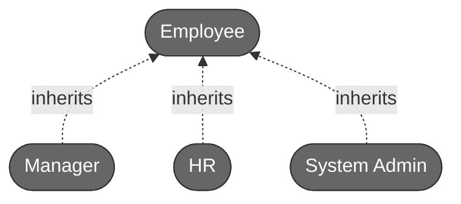
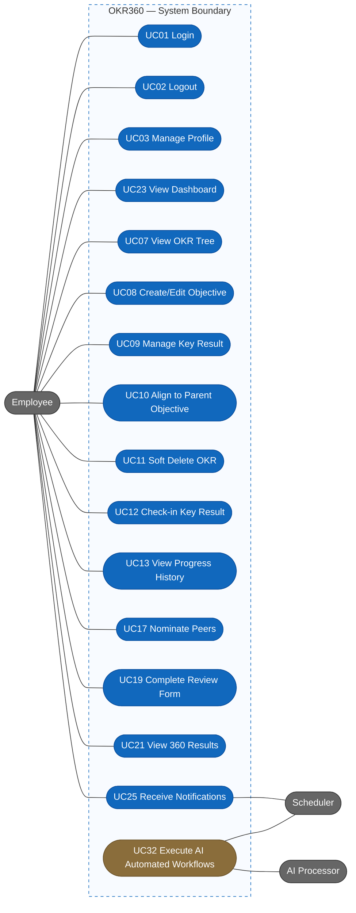
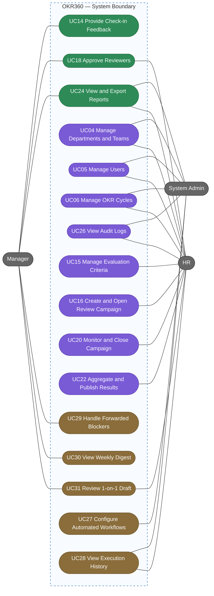
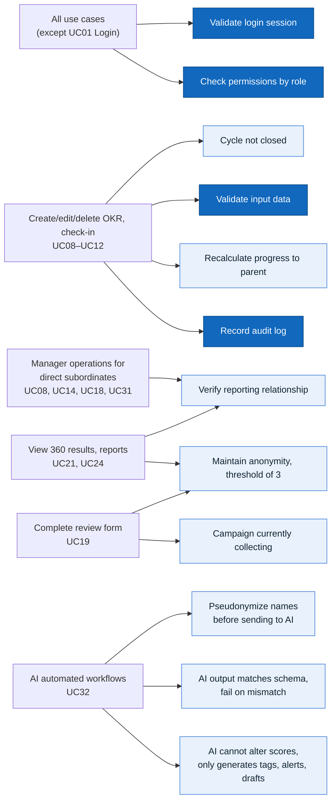

# Actors, Roles, and Use Cases

> Design Status: TARGET V1
>
> Implementation Status: NOT STARTED

Product Name: **OKR360**.

## Actors / Roles

| Role       | Display Name | In Practice                                           | Primary Concern                                                      |
| ---------- | ------------ | ----------------------------------------------------- | -------------------------------------------------------------------- |
| `ADMIN`    | System Admin | System administrator, enters company OKRs on behalf of executive leadership | Organization, company OKRs, system security                          |
| `HR`       | HR           | HR department                                         | OKR cycles, 360 review campaigns, end-of-cycle results               |
| `MANAGER`  | Manager      | Department head, team lead                            | Department or team OKRs, monitoring subordinates, approving reviewers |
| `EMPLOYEE` | Employee     | All employees                                         | Personal OKRs, check-ins, completing review forms                    |
| —          | Scheduler    | Background job runner                                 | Sending timely reminders, triggering scheduled AI workflows          |
| —          | AI Processor | Background worker calling AI services                 | Reading free text, classifying, summarizing, generating alerts and drafts |

**Departments and teams:** The company is divided into departments; large departments are further divided into teams (e.g., Dev Department includes Payments Team and Platform Team). Each department has a department head, and each team has a team lead; both typically hold the `MANAGER` role. Team members report to the team lead, and team leads report to the department head.

**Inheritance rules:** Each user has exactly one role. `ADMIN`, `HR`, and `MANAGER` are all employees and therefore inherit **all permissions of `EMPLOYEE`** (having personal OKRs, participating in 360 reviews, completing review forms). Roles only add permissions.

## Data Scope

Certain actions are permitted for a role, but **only on a subset of data**. The matrix below uses the following 3 scope definitions:

| Name                                   | Description                                                                                         | Example                                                                                                                                                                  |
| -------------------------------------- | --------------------------------------------------------------------------------------------------- | ------------------------------------------------------------------------------------------------------------------------------------------------------------------------ |
| **Self only**                          | Data owned by the user themselves: their personal OKRs, Key Results they are assigned to, their 360 review results | Lan can only check in Key Results she is responsible for                                                                                                                 |
| **Assigned unit only**                 | For department heads: their department and all teams within that department. For team leads: their team only | Son is the Dev department head, so he can edit Dev Department OKRs and OKRs of Payments Team and Platform Team; Nam is Payments team lead, so he can only edit Payments Team OKRs |
| **Direct subordinates only**           | Users whose "direct manager" is this user                                                           | Lan reports to Nam (team lead), so Nam can view Lan's 360 review results; Son (department head) cannot, because Lan does not report directly to him                     |

## Role × Feature Matrix

| Feature                                              | Admin                         | HR                                           | Manager                                            | Employee                      |
| ---------------------------------------------------- | ----------------------------- | -------------------------------------------- | -------------------------------------------------- | ----------------------------- |
| Login, logout, personal profile                      | Yes                           | Yes                                          | Yes                                                | Yes                           |
| Manage departments and teams                         | Yes                           | Yes                                          | No                                                 | No                            |
| Manage users                                         | Yes                           | Yes, but cannot assign Admin role            | No                                                 | No                            |
| Manage OKR cycles                                    | Yes                           | Yes                                          | No                                                 | No                            |
| View company-wide OKR tree                           | Yes                           | Yes                                          | Yes                                                | Yes                           |
| Create/edit company OKRs                             | Yes                           | No                                           | No                                                 | No                            |
| Create/edit department OKRs                          | Yes                           | No                                           | Department head only, for own department           | No                            |
| Create/edit team OKRs                                | Yes                           | No                                           | Assigned unit only                                 | No                            |
| Create/edit personal OKRs                            | Yes, for everyone             | Self only                                    | Self and direct subordinates                       | Self only                     |
| Soft delete OKRs                                     | Yes, for everyone             | Self only                                    | Self and OKRs within assigned unit                 | Self only                     |
| Check-in Key Result                                  | Assigned Key Results only     | Assigned Key Results only                    | Assigned Key Results only                          | Assigned Key Results only     |
| Comment on check-ins                                 | No                            | No                                           | Direct subordinates' check-ins only                | No                            |
| Manage 360 evaluation criteria                       | No                            | Yes                                          | No                                                 | No                            |
| Create, open, close 360 review campaign              | No                            | Yes                                          | No                                                 | No                            |
| Nominate peer reviewers                              | Yes                           | Yes                                          | Yes                                                | Yes                           |
| Approve reviewers                                    | No                            | Only for employees without a direct manager  | Direct subordinates only                           | No                            |
| Complete assigned review forms                       | Yes                           | Yes                                          | Yes                                                | Yes                           |
| View 360 results                                     | Self only                     | Everyone's                                   | Self and direct subordinates                       | Self only                     |
| Aggregate and publish final results                  | No                            | Yes                                          | No                                                 | No                            |
| Personal dashboard                                   | Yes                           | Yes                                          | Yes                                                | Yes                           |
| Team dashboard                                       | No                            | No                                           | Yes                                                | No                            |
| Company dashboard                                    | Yes                           | Yes                                          | No                                                 | No                            |
| Reports                                              | Yes, except 360 result reports| Yes, company-wide                            | Assigned unit only                                 | No                            |
| Audit logs                                           | Yes                           | Yes                                          | No                                                 | No                            |
| Configure AI automated workflows                     | Yes                           | No                                           | No                                                 | No                            |
| View automated execution history                     | Yes                           | Yes                                          | No                                                 | No                            |
| Handle forwarded blockers                            | Assigned unit only            | Assigned unit only                           | Assigned unit only                                 | No                            |
| View AI-generated weekly digest                      | No                            | No                                           | Direct subordinates only                           | No                            |
| Review AI-generated 1-on-1 draft                     | No                            | Only for employees without a direct manager  | Direct subordinates only                           | No                            |
| Receive AI alerts on own OKRs, check-ins, comments   | Yes                           | Yes                                          | Yes                                                | Yes                           |

System Admin **cannot** view 360 review results of other users. This follows the principle of least privilege: technical administrators do not need to know how colleagues evaluate each other. Consequently, Admin can toggle AI workflows but cannot read 1-on-1 drafts, and execution history does not store payload contents sent to AI.

## Use Case Diagrams

The diagram is divided into 3 parts. Roles are not connected by arrows to use cases, because in use case diagrams, a line connecting an actor and a use case simply signifies "this actor uses that use case."

### 1. Role Inheritance Relationship

Managers, HR, and System Admins are all employees, and therefore inherit all Employee use cases shown in Diagram 2.

### 2. Employee Overview Use Case Diagram

UC32 is a system use case: the Scheduler triggers workflows on schedule, and the AI Processor executes the five background workflows. Results reach users via UC25 (notifications) and the screens of UC08 and UC12. The sixth workflow, 360 review comment guard, does not run in the background but executes synchronously within UC19. Individual steps performed by humans, automation, or AI are documented in [Demarcation of Human, Automation, and AI](#demarcation-of-human-automation-and-ai).

### 3. Use Cases for Manager, HR, and System Admin

Green indicates use cases used by Manager; purple indicates use cases used exclusively by HR or System Admin; brown indicates AI automation use cases. UC18, UC24, UC29, and UC31 are shared across multiple roles, but with different data scopes (see matrix above). UC29 is intended for the person in charge of an organizational unit (department head or team lead), typically a Manager.

## Common Rules and Constraints

Many use cases share common verification steps. The diagram below illustrates which group of use cases must pass through which checks: dark blue represents standard verification steps common to any system, light blue represents specific business rules of OKR360.

- All use cases except login must validate session and verify permissions **at the backend**; hiding buttons on the UI is purely for clean visual presentation, not for security.
- OKRs exist across 4 levels: company, department, team, personal. Skipping levels is allowed: if a department has not been divided into teams, personal OKRs link directly to department OKRs.
- Creating/editing OKRs is permitted when the cycle is in `DRAFT` or `ACTIVE`; check-ins are permitted only when the cycle is `ACTIVE`. When a cycle is `CLOSED`, it is read-only.
- Each time an OKR changes or a check-in occurs, progress is recalculated along the parent objective chain **within the same save transaction**.
- Managers can only operate within their assigned unit (department heads: their department and contained teams; team leads: their team) and on their direct subordinates.
- 360 results for Peer and Subordinate groups are only displayed when there are **3 or more submissions**; no screen, report, or log reveals who evaluated whom.
- Employees can only check in Key Results they are responsible for and can only edit their own personal OKRs.

Specific rules for AI automation:

- AI **does not score, grade, or alter** OKR or 360 metrics. AI outputs are strictly limited to tags, alerts, notifications, or drafts; all AI-generated content carries an "AI Generated" badge.
- Content delivered to anyone other than the original author (such as the 1-on-1 summary draft) is always a **draft**, requiring human review and approval before being sent.
- Before sending data to the AI service, human names are pseudonymized into identifiers (e.g., `NV-01`); departments and teams are sent as identifiers accompanied by a name directory (e.g., `DV-01` = QA Department) so that AI returns IDs. The system maps IDs back to names upon receiving results. Email addresses and phone numbers are never transmitted; organizational unit names are not personal data and may be included.
- 360 review comments are only sent to AI in two circumstances: The "1-on-1 Draft" workflow: when the campaign is `CLOSED`, only for groups meeting the anonymity threshold (after aggregation), without individual scores or any information that could trace back to the author. The "360 Review Comment Guard" workflow (UC19): when the campaign is `COLLECTING`, only for the comments section of the form currently being submitted, with names pseudonymized.
- User-typed text is strictly **data**, never instructions for the AI. AI results must conform to the defined JSON schema; if the schema is invalid, no action is taken and an error is logged.
- AI workflows run in the background after the primary transaction has completed; slow or failing AI calls do not fail check-ins or form submissions. On failure, the system retries up to 3 times, then marks the run as Error.
- Each event is processed at most once per workflow, even if the job is rerun.
- Exception: the 360 review comment guard (UC19) runs immediately upon clicking submit, waiting a maximum of 5 seconds; if AI errors or times out, the submission proceeds normally without warning. This workflow does not use the event outbox, does not create a record in execution history, and does not store alerts; the system only increments the AI call count to enforce quotas, because a history log entry for each submission could enable guessing who submitted.
- Each workflow has a daily AI call quota; if the quota is exceeded, the workflow pauses until the next day, and System Admin receives an alert.

All four roles use: login, logout, profile, personal dashboard, OKR tree, personal OKR, check-in, nominate, complete review form, view own 360 results, notifications.

## Demarcation of Human, Automation, and AI

All AI workflows run automatically, but most automated tasks do not use AI. The use cases below label each step according to the following conventions:

| Label          | Performed By                                    | Characteristics                                                          | Example                                                       |
| -------------- | ----------------------------------------------- | ------------------------------------------------------------------------ | ------------------------------------------------------------- |
| **[Human]**    | User                                            | Takes actions and makes decisions; accountable for outcomes              | Approve 1-on-1 draft, publish results, select "Submit Anyway" |
| **[Automated]**| System or Scheduler, without manual triggering  | Runs based on fixed rules; identical input always produces identical output; does not call AI | Roll up progress, calculate end-of-cycle scores, remind check-in after 7 days |
| **[AI]**       | External AI service (language model)            | Reads unstructured text, returns JSON; outputs may be inaccurate and are always validated | Classify blockers, summarize 360 comments                     |

Key points when reading:

- Standard processing of a request (permission check, input validation, data persistence) is not labeled. Unlabeled steps are performed directly by the user or processed directly by the system in response to user actions.
- **[Human]** is only explicitly noted where human decision-making needs clarification following an Automated or AI step.
- The AI Processor is a system background service, not AI itself. Within a run, only the step calling the external AI service carries the **[AI]** label; pseudonymization, schema validation, tagging, notification dispatch, and history logging are all **[Automated]**.

### Summary by Use Case

This table lists only use cases containing Automated or AI steps. Other use cases have no such steps; UC27 and UC28 are human workflows for configuring and monitoring automation.

| Use Case                  | Automated                                                                                                                | AI                                                                 | Decision Maker (Human)                                               |
| ------------------------- | ------------------------------------------------------------------------------------------------------------------------ | ------------------------------------------------------------------ | -------------------------------------------------------------------- |
| UC06 Manage OKR Cycles    | Finalize progress upon cycle closure                                                                                     | None                                                               | Admin, HR activate and close cycles                                  |
| UC08 Create/Edit Objective| Write audit log; record `OBJECTIVE_CREATED` event; attach review notes                                                   | Review newly created KRs                                           | Objective creator decides whether to edit or ignore                  |
| UC09, UC10, UC11          | Recalculate progress                                                                                                     | None                                                               | OKR owner                                                            |
| UC12 Check-in Key Result  | Roll up progress; record `CHECKIN_CREATED` event; notify manager on "Off track"; tag, route blocker, trigger review reminder | Classify blockers; detect confidence vs. notes mismatch           | Check-in submitter decides confidence level and content              |
| UC14 Provide Check-in Feedback | Notify check-in owner                                                                                               | None                                                               | Manager writes comments                                              |
| UC16 Create and Open Review Campaign | Snapshot reporting lines; generate review forms                                                               | None                                                               | HR opens each phase                                                  |
| UC17 Nominate Peers       | Notify direct manager                                                                                                    | None                                                               | Employee selects nominees                                            |
| UC19 Complete Review Form | Display alert only to author                                                                                             | Detect deanonymizing phrases or offensive language                 | Author edits or selects "Submit Anyway"                              |
| UC20 Monitor and Close Campaign | Send reminders; cancel unsubmitted forms; dissociate responses from respondents; record `CAMPAIGN_CLOSED` event  | No step within this UC; campaign closure triggers "1-on-1 Draft"   | HR sends reminders and closes campaign                               |
| UC21 View 360 Results     | Merge or mask groups below anonymity threshold                                                                           | None                                                               | No decision                                                          |
| UC22 Aggregate and Publish Results | Compute scores, grades; dispatch notifications                                                                  | None; AI does not participate in scoring                           | HR previews and publishes                                            |
| UC25 Notifications & Reminders | Scheduler checks due events; creates notifications; sends emails                                                    | None                                                               | No decision                                                          |
| UC29 Handle Forwarded Blockers | Dispatch notification; reroute to direct manager when rejected; log misclassification                                   | Pre-generated in "Blocker Routing" flow                            | Assigned unit head accepts or rejects                                |
| UC30 View Weekly Digest   | Scheduler triggers; counts DB metrics; generates digest; sends notifications and emails                                  | Cluster similar blockers, select top 3 attention items             | Manager reads and decides follow-up actions                          |
| UC31 Review 1-on-1 Draft  | Filter groups meeting threshold; save draft; notify upon delivery                                                        | Summarize strengths and areas for improvement                      | Manager or HR edits, sends, or discards                              |
| UC32 Execute AI Workflows | All steps except the AI API invocation                                                                                   | See per-workflow table in UC32                                     | No decision within UC32; decisions made in use cases above           |

## Use Case Specifications

### UC01 Login

<table border="1" cellpadding="6" style="border-collapse: collapse; width: 100%">
  <tr><td width="16%"><b>Use Case ID</b></td><td colspan="2" width="20%">UC01</td><td width="16%"><b>Use Case Name</b></td><td width="48%">Login</td></tr>
  <tr><td valign="top"><b>Actors</b></td><td colspan="4">All roles</td></tr>
  <tr><td valign="top"><b>Description</b></td><td colspan="4">Users log in using email and password to access authorized features.</td></tr>
  <tr><td valign="top"><b>Preconditions</b></td><td colspan="4">Account exists and is active</td></tr>
  <tr><td rowspan="4" valign="top"><b>Main Flow (Success)</b></td><td><b>Step</b></td><td><b>Performed By</b></td><td colspan="2"><b>Action</b></td></tr>
  <tr><td>1.</td><td>User</td><td colspan="2">opens login page, enters email and password, clicks "Login"</td></tr>
  <tr><td>2.</td><td>System</td><td colspan="2">validates credentials and account status</td></tr>
  <tr><td>3.</td><td>System</td><td colspan="2">returns token and safe profile, redirects to Dashboard</td></tr>
  <tr><td rowspan="3" valign="top"><b>Alternative Flows</b></td><td><b>Step</b></td><td><b>Performed By</b></td><td colspan="2"><b>Action</b></td></tr>
  <tr><td>2a.</td><td>System</td><td colspan="2">invalid credentials or account locked → displays generic error message without revealing whether account exists; user remains on login page</td></tr>
  <tr><td>2b.</td><td>System</td><td colspan="2">more than 5 consecutive failed attempts within 15 minutes → temporarily locks login</td></tr>
  <tr><td valign="top"><b>Permissions</b></td><td colspan="4">Public</td></tr>
  <tr><td valign="top"><b>Postconditions</b></td><td colspan="4">Active session with token expiring after 30 minutes</td></tr>
</table>

### UC02 Logout

<table border="1" cellpadding="6" style="border-collapse: collapse; width: 100%">
  <tr><td width="16%"><b>Use Case ID</b></td><td colspan="2" width="20%">UC02</td><td width="16%"><b>Use Case Name</b></td><td width="48%">Logout</td></tr>
  <tr><td valign="top"><b>Actors</b></td><td colspan="4">All roles</td></tr>
  <tr><td valign="top"><b>Description</b></td><td colspan="4">User terminates current session on current device.</td></tr>
  <tr><td valign="top"><b>Preconditions</b></td><td colspan="4">Logged in</td></tr>
  <tr><td rowspan="4" valign="top"><b>Main Flow (Success)</b></td><td><b>Step</b></td><td><b>Performed By</b></td><td colspan="2"><b>Action</b></td></tr>
  <tr><td>1.</td><td>User</td><td colspan="2">clicks "Logout"</td></tr>
  <tr><td>2.</td><td>System</td><td colspan="2">clears token and session data on client side</td></tr>
  <tr><td>3.</td><td>System</td><td colspan="2">redirects to login page</td></tr>
  <tr><td valign="top"><b>Alternative Flows</b></td><td colspan="4">None</td></tr>
  <tr><td valign="top"><b>Permissions</b></td><td colspan="4">Authenticated</td></tr>
  <tr><td valign="top"><b>Postconditions</b></td><td colspan="4">Cannot access internal pages from the logged-out device</td></tr>
</table>

### UC03 Manage Personal Profile

<table border="1" cellpadding="6" style="border-collapse: collapse; width: 100%">
  <tr><td width="16%"><b>Use Case ID</b></td><td colspan="2" width="20%">UC03</td><td width="16%"><b>Use Case Name</b></td><td width="48%">Manage Personal Profile</td></tr>
  <tr><td valign="top"><b>Actors</b></td><td colspan="4">All roles</td></tr>
  <tr><td valign="top"><b>Description</b></td><td colspan="4">User updates personal profile information, changes password, and views assigned permissions.</td></tr>
  <tr><td valign="top"><b>Preconditions</b></td><td colspan="4">Logged in</td></tr>
  <tr><td rowspan="6" valign="top"><b>Main Flow (Success)</b></td><td><b>Step</b></td><td><b>Performed By</b></td><td colspan="2"><b>Action</b></td></tr>
  <tr><td>1.</td><td>User</td><td colspan="2">opens "Profile", Account tab: edits full name, phone number, avatar URL (V1 stores image URL, file upload not yet supported), clicks save</td></tr>
  <tr><td>2.</td><td>System</td><td colspan="2">saves information</td></tr>
  <tr><td>3.</td><td>User</td><td colspan="2">Security tab: enters current password and new password (minimum 8 characters)</td></tr>
  <tr><td>4.</td><td>System</td><td colspan="2">verifies current password, saves new password</td></tr>
  <tr><td>5.</td><td>User</td><td colspan="2">Permissions tab: views assigned permission matrix</td></tr>
  <tr><td rowspan="2" valign="top"><b>Alternative Flows</b></td><td><b>Step</b></td><td><b>Performed By</b></td><td colspan="2"><b>Action</b></td></tr>
  <tr><td>4a.</td><td>System</td><td colspan="2">incorrect current password or new password shorter than 8 characters → displays error, does not change password</td></tr>
  <tr><td valign="top"><b>Permissions</b></td><td colspan="4">Authenticated</td></tr>
  <tr><td valign="top"><b>Postconditions</b></td><td colspan="4">Email, role, department, and direct manager are read-only and cannot be self-edited</td></tr>
</table>

### UC04 Manage Departments and Teams

<table border="1" cellpadding="6" style="border-collapse: collapse; width: 100%">
  <tr><td width="16%"><b>Use Case ID</b></td><td colspan="2" width="20%">UC04</td><td width="16%"><b>Use Case Name</b></td><td width="48%">Manage Departments and Teams</td></tr>
  <tr><td valign="top"><b>Actors</b></td><td colspan="4">System Admin, HR</td></tr>
  <tr><td valign="top"><b>Description</b></td><td colspan="4">System Admin or HR builds the organizational hierarchy consisting of departments and teams as the foundation for the OKR tree.</td></tr>
  <tr><td valign="top"><b>Preconditions</b></td><td colspan="4">Logged in with System Admin or HR role</td></tr>
  <tr><td rowspan="6" valign="top"><b>Main Flow (Success)</b></td><td><b>Step</b></td><td><b>Performed By</b></td><td colspan="2"><b>Action</b></td></tr>
  <tr><td>1.</td><td>System Admin, HR</td><td colspan="2">views organizational tree</td></tr>
  <tr><td>2.</td><td>System Admin, HR</td><td colspan="2">adds or edits department: name, parent department, department head</td></tr>
  <tr><td>3.</td><td>System Admin, HR</td><td colspan="2">adds or edits team within a department: name, team lead</td></tr>
  <tr><td>4.</td><td>System</td><td colspan="2">validates tree hierarchy, saves</td></tr>
  <tr><td>5.</td><td>System Admin, HR</td><td colspan="2">deactivates department or team when necessary</td></tr>
  <tr><td rowspan="4" valign="top"><b>Alternative Flows</b></td><td><b>Step</b></td><td><b>Performed By</b></td><td colspan="2"><b>Action</b></td></tr>
  <tr><td>4a.</td><td>System</td><td colspan="2">parent unit causes circular dependency → rejects</td></tr>
  <tr><td>4b.</td><td>System</td><td colspan="2">creating team under another team or team without parent department → rejects</td></tr>
  <tr><td>5a.</td><td>System</td><td colspan="2">deactivating unit that still has active employees → rejects</td></tr>
  <tr><td valign="top"><b>Permissions</b></td><td colspan="4"><code>orgManage</code></td></tr>
  <tr><td valign="top"><b>Postconditions</b></td><td colspan="4">Organizational structure updated, serving as baseline for OKR tree</td></tr>
</table>

### UC05 Manage Users

<table border="1" cellpadding="6" style="border-collapse: collapse; width: 100%">
  <tr><td width="16%"><b>Use Case ID</b></td><td colspan="2" width="20%">UC05</td><td width="16%"><b>Use Case Name</b></td><td width="48%">Manage Users</td></tr>
  <tr><td valign="top"><b>Actors</b></td><td colspan="4">System Admin, HR</td></tr>
  <tr><td valign="top"><b>Description</b></td><td colspan="4">System Admin or HR manages user accounts, roles, departments, and direct managers so the system knows reporting lines.</td></tr>
  <tr><td valign="top"><b>Preconditions</b></td><td colspan="4">Logged in with System Admin or HR role</td></tr>
  <tr><td rowspan="5" valign="top"><b>Main Flow (Success)</b></td><td><b>Step</b></td><td><b>Performed By</b></td><td colspan="2"><b>Action</b></td></tr>
  <tr><td>1.</td><td>System Admin, HR</td><td colspan="2">views user list</td></tr>
  <tr><td>2.</td><td>System Admin, HR</td><td colspan="2">adds or edits: full name, email, initial password, role, department, direct manager</td></tr>
  <tr><td>3.</td><td>System</td><td colspan="2">validates, saves</td></tr>
  <tr><td>4.</td><td>System Admin, HR</td><td colspan="2">activates or deactivates user account</td></tr>
  <tr><td rowspan="4" valign="top"><b>Alternative Flows</b></td><td><b>Step</b></td><td><b>Performed By</b></td><td colspan="2"><b>Action</b></td></tr>
  <tr><td>3a.</td><td>System</td><td colspan="2">duplicate email → rejects</td></tr>
  <tr><td>3b.</td><td>System</td><td colspan="2">assigning manager creates circular reporting or self-management → rejects</td></tr>
  <tr><td>3c.</td><td>System</td><td colspan="2">HR attempts to assign Admin role → <code>403</code></td></tr>
  <tr><td valign="top"><b>Permissions</b></td><td colspan="4"><code>userManage</code></td></tr>
  <tr><td valign="top"><b>Postconditions</b></td><td colspan="4">Deactivated user cannot log in and cannot be assigned as a new reviewer</td></tr>
</table>

### UC06 Manage OKR Cycles

<table border="1" cellpadding="6" style="border-collapse: collapse; width: 100%">
  <tr><td width="16%"><b>Use Case ID</b></td><td colspan="2" width="20%">UC06</td><td width="16%"><b>Use Case Name</b></td><td width="48%">Manage OKR Cycles</td></tr>
  <tr><td valign="top"><b>Actors</b></td><td colspan="4">System Admin, HR</td></tr>
  <tr><td valign="top"><b>Description</b></td><td colspan="4">System Admin or HR opens and closes a shared company-wide working period, typically a quarter.</td></tr>
  <tr><td valign="top"><b>Preconditions</b></td><td colspan="4">Logged in with System Admin or HR role</td></tr>
  <tr><td rowspan="7" valign="top"><b>Main Flow (Success)</b></td><td><b>Step</b></td><td><b>Performed By</b></td><td colspan="2"><b>Action</b></td></tr>
  <tr><td>1.</td><td>System Admin, HR</td><td colspan="2">creates cycle: name, start date, end date, goal setting deadline, max objectives per user, OKR/360 weight ratio</td></tr>
  <tr><td>2.</td><td>System</td><td colspan="2">saves cycle in <code>DRAFT</code> status</td></tr>
  <tr><td>3.</td><td>System Admin, HR</td><td colspan="2">activates cycle</td></tr>
  <tr><td>4.</td><td>System</td><td colspan="2">transitions status to <code>ACTIVE</code></td></tr>
  <tr><td>5.</td><td>System Admin, HR</td><td colspan="2">closes cycle at end of quarter</td></tr>
  <tr><td>6.</td><td>System</td><td colspan="2">transitions status to <code>CLOSED</code>, finalizes end-of-cycle progress for all Objectives</td></tr>
  <tr><td rowspan="3" valign="top"><b>Alternative Flows</b></td><td><b>Step</b></td><td><b>Performed By</b></td><td colspan="2"><b>Action</b></td></tr>
  <tr><td>2a.</td><td>System</td><td colspan="2">end date earlier than start date → displays error</td></tr>
  <tr><td>4a.</td><td>System</td><td colspan="2">another cycle is already <code>ACTIVE</code> → rejects</td></tr>
  <tr><td valign="top"><b>Permissions</b></td><td colspan="4"><code>cycleManage</code></td></tr>
  <tr><td valign="top"><b>Postconditions</b></td><td colspan="4">Upon closure, progress is locked and all OKRs in cycle become read-only</td></tr>
</table>

### UC07 View OKR Tree

<table border="1" cellpadding="6" style="border-collapse: collapse; width: 100%">
  <tr><td width="16%"><b>Use Case ID</b></td><td colspan="2" width="20%">UC07</td><td width="16%"><b>Use Case Name</b></td><td width="48%">View OKR Tree</td></tr>
  <tr><td valign="top"><b>Actors</b></td><td colspan="4">All roles</td></tr>
  <tr><td valign="top"><b>Description</b></td><td colspan="4">Users view company-wide objectives to understand how their own goals contribute to the organization.</td></tr>
  <tr><td valign="top"><b>Preconditions</b></td><td colspan="4">Logged in; at least one cycle exists</td></tr>
  <tr><td rowspan="5" valign="top"><b>Main Flow (Success)</b></td><td><b>Step</b></td><td><b>Performed By</b></td><td colspan="2"><b>Action</b></td></tr>
  <tr><td>1.</td><td>User</td><td colspan="2">selects cycle</td></tr>
  <tr><td>2.</td><td>System</td><td colspan="2">displays hierarchy: company → department → team → personal</td></tr>
  <tr><td>3.</td><td>User</td><td colspan="2">expands, collapses, filters by department or team, user, level, confidence level</td></tr>
  <tr><td>4.</td><td>User</td><td colspan="2">opens details of an Objective</td></tr>
  <tr><td valign="top"><b>Alternative Flows</b></td><td colspan="4">None</td></tr>
  <tr><td valign="top"><b>Permissions</b></td><td colspan="4"><code>okrRead</code></td></tr>
  <tr><td valign="top"><b>Postconditions</b></td><td colspan="4">Each node displays title, owner, % progress, confidence color; soft-deleted OKRs are not displayed</td></tr>
</table>

### UC08 Create/Edit Objective

<table border="1" cellpadding="6" style="border-collapse: collapse; width: 100%">
  <tr><td width="16%"><b>Use Case ID</b></td><td colspan="2" width="20%">UC08</td><td width="16%"><b>Use Case Name</b></td><td width="48%">Create/Edit Objective</td></tr>
  <tr><td valign="top"><b>Actors</b></td><td colspan="4">Employee (own personal OKRs); Manager (department heads: department OKRs and team OKRs within the department; team leads: own team OKRs; both: personal OKRs of direct subordinates); System Admin (all levels)</td></tr>
  <tr><td valign="top"><b>Description</b></td><td colspan="4">Users create or edit Objectives at their authorized level within the cycle.</td></tr>
  <tr><td valign="top"><b>Preconditions</b></td><td colspan="4">Cycle in <code>DRAFT</code> or <code>ACTIVE</code> status</td></tr>
  <tr><td rowspan="5" valign="top"><b>Main Flow (Success)</b></td><td><b>Step</b></td><td><b>Performed By</b></td><td colspan="2"><b>Action</b></td></tr>
  <tr><td>1.</td><td>User</td><td colspan="2">selects cycle, clicks "Add Objective"</td></tr>
  <tr><td>2.</td><td>System</td><td colspan="2">displays only levels the user is authorized to create</td></tr>
  <tr><td>3.</td><td>User</td><td colspan="2">selects level, enters title, description, owner; adds Key Results (UC09); optionally aligns to parent objective (UC10); clicks save</td></tr>
  <tr><td>4.</td><td>System</td><td colspan="2">validates, saves, records audit log; for new Objectives, records <code>OBJECTIVE_CREATED</code> event within the same transaction</td></tr>
  <tr><td rowspan="3" valign="top"><b>Alternative Flows</b></td><td><b>Step</b></td><td><b>Performed By</b></td><td colspan="2"><b>Action</b></td></tr>
  <tr><td>4a.</td><td>System</td><td colspan="2">exceeds maximum allowed Objectives → displays error</td></tr>
  <tr><td>4b.</td><td>System</td><td colspan="2">cycle is <code>CLOSED</code> → rejects</td></tr>
  <tr><td rowspan="4" valign="top"><b>AI Flow</b></td><td><b>Step</b></td><td><b>Performed By</b></td><td colspan="2"><b>Action</b></td></tr>
  <tr><td>A1.</td><td>AI</td><td colspan="2">runs in the background after new Objective is saved, "Review Newly Created OKRs" workflow (UC32): checks if KRs are measurable, checks for duplicates among departmental peers, checks alignment with parent Objective</td></tr>
  <tr><td>A2.</td><td>System</td><td colspan="2">attaches review notes to Objective, e.g., "KR2 lacks a measurable metric"</td></tr>
  <tr><td>A3.</td><td>Creator</td><td colspan="2">decides whether to edit or dismiss the note</td></tr>
  <tr><td valign="top"><b>Permissions</b></td><td colspan="4"><code>okrWrite</code> + level check and reporting relationship verification</td></tr>
  <tr><td valign="top"><b>Postconditions</b></td><td colspan="4">Objective appears in the tree</td></tr>
</table>

### UC09 Manage Key Result

<table border="1" cellpadding="6" style="border-collapse: collapse; width: 100%">
  <tr><td width="16%"><b>Use Case ID</b></td><td colspan="2" width="20%">UC09</td><td width="16%"><b>Use Case Name</b></td><td width="48%">Manage Key Result</td></tr>
  <tr><td valign="top"><b>Actors</b></td><td colspan="4">Objective owner</td></tr>
  <tr><td valign="top"><b>Description</b></td><td colspan="4">Owner defines how the objective is measured using 1 to 5 Key Results.</td></tr>
  <tr><td valign="top"><b>Preconditions</b></td><td colspan="4">Objective exists; cycle is not <code>CLOSED</code></td></tr>
  <tr><td rowspan="3" valign="top"><b>Main Flow (Success)</b></td><td><b>Step</b></td><td><b>Performed By</b></td><td colspan="2"><b>Action</b></td></tr>
  <tr><td>1.</td><td>Owner</td><td colspan="2">adds or edits Key Result: title, metric type (Numeric / Percentage / Milestone), starting value, target value, unit, assigned check-in owner</td></tr>
  <tr><td>2.</td><td>System</td><td colspan="2">validates, saves; if modifying start or target value of a KR with existing check-ins, recalculates progress while preserving check-in history</td></tr>
  <tr><td rowspan="3" valign="top"><b>Alternative Flows</b></td><td><b>Step</b></td><td><b>Performed By</b></td><td colspan="2"><b>Action</b></td></tr>
  <tr><td>2a.</td><td>System</td><td colspan="2">adding 6th KR → rejects</td></tr>
  <tr><td>2b.</td><td>System</td><td colspan="2">starting value equals target value → displays error</td></tr>
  <tr><td valign="top"><b>Permissions</b></td><td colspan="4"><code>okrWrite</code></td></tr>
  <tr><td valign="top"><b>Postconditions</b></td><td colspan="4">Objective has 1–5 measurable Key Results</td></tr>
</table>

### UC10 Align to Parent Objective

<table border="1" cellpadding="6" style="border-collapse: collapse; width: 100%">
  <tr><td width="16%"><b>Use Case ID</b></td><td colspan="2" width="20%">UC10</td><td width="16%"><b>Use Case Name</b></td><td width="48%">Align to Parent Objective</td></tr>
  <tr><td valign="top"><b>Actors</b></td><td colspan="4">Objective owner</td></tr>
  <tr><td valign="top"><b>Description</b></td><td colspan="4">Owner connects Objective to a parent objective so that personal/team progress rolls up into broader company goals.</td></tr>
  <tr><td valign="top"><b>Preconditions</b></td><td colspan="4">Objective exists; cycle is not <code>CLOSED</code></td></tr>
  <tr><td rowspan="4" valign="top"><b>Main Flow (Success)</b></td><td><b>Step</b></td><td><b>Performed By</b></td><td colspan="2"><b>Action</b></td></tr>
  <tr><td>1.</td><td>Owner</td><td colspan="2">opens Objective, clicks "Align", selects parent Objective in the same cycle</td></tr>
  <tr><td>2.</td><td>System</td><td colspan="2">checks level hierarchy and circular dependencies, saves</td></tr>
  <tr><td>3.</td><td>System</td><td colspan="2">recalculates progress of parent Objective</td></tr>
  <tr><td rowspan="3" valign="top"><b>Alternative Flows</b></td><td><b>Step</b></td><td><b>Performed By</b></td><td colspan="2"><b>Action</b></td></tr>
  <tr><td>2a.</td><td>System</td><td colspan="2">invalid hierarchy level → displays error. Valid hierarchy: Department OKR aligns to Company OKR; Team OKR aligns to Department or Company OKR; Personal OKR aligns to Team, Department, or Company OKR</td></tr>
  <tr><td>2b.</td><td>System</td><td colspan="2">alignment creates circular loop → rejects</td></tr>
  <tr><td valign="top"><b>Permissions</b></td><td colspan="4"><code>okrWrite</code></td></tr>
  <tr><td valign="top"><b>Postconditions</b></td><td colspan="4">Objective is placed in the correct branch of the tree; unaligned OKRs are marked "Unaligned"</td></tr>
</table>

### UC11 Soft Delete OKR

<table border="1" cellpadding="6" style="border-collapse: collapse; width: 100%">
  <tr><td width="16%"><b>Use Case ID</b></td><td colspan="2" width="20%">UC11</td><td width="16%"><b>Use Case Name</b></td><td width="48%">Soft Delete OKR</td></tr>
  <tr><td valign="top"><b>Actors</b></td><td colspan="4">OKR owner; Manager for OKRs within their assigned unit; System Admin</td></tr>
  <tr><td valign="top"><b>Description</b></td><td colspan="4">User removes an improperly set OKR from tree and reports while preserving traceability.</td></tr>
  <tr><td valign="top"><b>Preconditions</b></td><td colspan="4">OKR exists; cycle is not <code>CLOSED</code></td></tr>
  <tr><td rowspan="4" valign="top"><b>Main Flow (Success)</b></td><td><b>Step</b></td><td><b>Performed By</b></td><td colspan="2"><b>Action</b></td></tr>
  <tr><td>1.</td><td>User</td><td colspan="2">clicks delete, confirms</td></tr>
  <tr><td>2.</td><td>System</td><td colspan="2">sets <code>deletedAt</code>, <code>deletedBy</code>, does not physically delete</td></tr>
  <tr><td>3.</td><td>System</td><td colspan="2">recalculates progress of parent Objective</td></tr>
  <tr><td rowspan="2" valign="top"><b>Alternative Flows</b></td><td><b>Step</b></td><td><b>Performed By</b></td><td colspan="2"><b>Action</b></td></tr>
  <tr><td>2a.</td><td>System</td><td colspan="2">Objective still has active child Objectives aligned to it → rejects, requires unlinking child objectives first</td></tr>
  <tr><td valign="top"><b>Permissions</b></td><td colspan="4"><code>okrDelete</code></td></tr>
  <tr><td valign="top"><b>Postconditions</b></td><td colspan="4">OKR disappears from tree, dashboard, reports; history is preserved</td></tr>
</table>

### UC12 Check-in Key Result

<table border="1" cellpadding="6" style="border-collapse: collapse; width: 100%">
  <tr><td width="16%"><b>Use Case ID</b></td><td colspan="2" width="20%">UC12</td><td width="16%"><b>Use Case Name</b></td><td width="48%">Check-in Key Result</td></tr>
  <tr><td valign="top"><b>Actors</b></td><td colspan="4">Key Result assignee</td></tr>
  <tr><td valign="top"><b>Description</b></td><td colspan="4">Assignee updates current metric value and confidence level, providing immediate visibility into actual progress.</td></tr>
  <tr><td valign="top"><b>Preconditions</b></td><td colspan="4">Cycle is <code>ACTIVE</code>; KR is not deleted</td></tr>
  <tr><td rowspan="5" valign="top"><b>Main Flow (Success)</b></td><td><b>Step</b></td><td><b>Performed By</b></td><td colspan="2"><b>Action</b></td></tr>
  <tr><td>1.</td><td>Assignee</td><td colspan="2">opens KR from dashboard or OKR tree, clicks "Check-in"</td></tr>
  <tr><td>2.</td><td>Assignee</td><td colspan="2">enters current value (or marks complete), selects confidence level (On track / At risk / Off track), notes, blockers; clicks save</td></tr>
  <tr><td>3.</td><td>System</td><td colspan="2">saves new check-in record</td></tr>
  <tr><td>4.</td><td>System</td><td colspan="2">recalculates progress KR → Objective → parent Objectives and records <code>CHECKIN_CREATED</code> event within the same transaction</td></tr>
  <tr><td rowspan="3" valign="top"><b>Alternative Flows</b></td><td><b>Step</b></td><td><b>Performed By</b></td><td colspan="2"><b>Action</b></td></tr>
  <tr><td>3a.</td><td>System</td><td colspan="2">value of invalid type → displays field error</td></tr>
  <tr><td>4a.</td><td>System</td><td colspan="2">selects "Off track" → notifies direct manager based on rule, without calling AI</td></tr>
  <tr><td rowspan="6" valign="top"><b>AI Flow</b></td><td><b>Step</b></td><td><b>Performed By</b></td><td colspan="2"><b>Action</b></td></tr>
  <tr><td>A1.</td><td>AI</td><td colspan="2">runs in the background when check-in includes blockers, "Blocker Routing" workflow (UC32): classifies blocker, identifies related organizational unit and severity</td></tr>
  <tr><td>A2.</td><td>System</td><td colspan="2">tags check-in; if external dependency identified, alerts the head of that unit (UC29)</td></tr>
  <tr><td>A3.</td><td>AI</td><td colspan="2">runs in the background when check-in has notes, "Check-in Mismatch Detection" workflow (UC32): compares confidence level against notes</td></tr>
  <tr><td>A4.</td><td>System</td><td colspan="2">if contradictory, reminds submitter to review; 3 consecutive contradictions on the same KR alerts direct manager</td></tr>
  <tr><td>A5.</td><td>Assignee</td><td colspan="2">decides whether to re-check-in</td></tr>
  <tr><td valign="top"><b>Permissions</b></td><td colspan="4"><code>checkinWrite</code> (KR assignee only)</td></tr>
  <tr><td valign="top"><b>Postconditions</b></td><td colspan="4">Progress at all levels reflects update immediately; previous check-in records are neither edited nor deleted</td></tr>
</table>

### UC13 View Check-in History and Progress Chart

<table border="1" cellpadding="6" style="border-collapse: collapse; width: 100%">
  <tr><td width="16%"><b>Use Case ID</b></td><td colspan="2" width="20%">UC13</td><td width="16%"><b>Use Case Name</b></td><td width="48%">View Check-in History and Progress Chart</td></tr>
  <tr><td valign="top"><b>Actors</b></td><td colspan="4">All roles</td></tr>
  <tr><td valign="top"><b>Description</b></td><td colspan="4">User views historical timeline of a KR to identify when and why progress stalled.</td></tr>
  <tr><td valign="top"><b>Preconditions</b></td><td colspan="4">KR exists</td></tr>
  <tr><td rowspan="4" valign="top"><b>Main Flow (Success)</b></td><td><b>Step</b></td><td><b>Performed By</b></td><td colspan="2"><b>Action</b></td></tr>
  <tr><td>1.</td><td>User</td><td colspan="2">opens a KR</td></tr>
  <tr><td>2.</td><td>System</td><td colspan="2">displays check-in history, newest first, including comments and AI tags</td></tr>
  <tr><td>3.</td><td>System</td><td colspan="2">displays actual progress chart against target trajectory line</td></tr>
  <tr><td valign="top"><b>Alternative Flows</b></td><td colspan="4">None</td></tr>
  <tr><td valign="top"><b>Permissions</b></td><td colspan="4"><code>okrRead</code></td></tr>
  <tr><td valign="top"><b>Postconditions</b></td><td colspan="4">Visibility into when and where KR progress slowed down</td></tr>
</table>

### UC14 Provide Check-in Feedback

<table border="1" cellpadding="6" style="border-collapse: collapse; width: 100%">
  <tr><td width="16%"><b>Use Case ID</b></td><td colspan="2" width="20%">UC14</td><td width="16%"><b>Use Case Name</b></td><td width="48%">Provide Check-in Feedback</td></tr>
  <tr><td valign="top"><b>Actors</b></td><td colspan="4">Manager</td></tr>
  <tr><td valign="top"><b>Description</b></td><td colspan="4">Direct manager provides comments on subordinate's check-in to offer timely support.</td></tr>
  <tr><td valign="top"><b>Preconditions</b></td><td colspan="4">Check-in belongs to direct subordinate</td></tr>
  <tr><td rowspan="4" valign="top"><b>Main Flow (Success)</b></td><td><b>Step</b></td><td><b>Performed By</b></td><td colspan="2"><b>Action</b></td></tr>
  <tr><td>1.</td><td>Manager</td><td colspan="2">opens check-in of a direct subordinate</td></tr>
  <tr><td>2.</td><td>Manager</td><td colspan="2">writes comment, clicks send</td></tr>
  <tr><td>3.</td><td>System</td><td colspan="2">saves comment, notifies check-in owner</td></tr>
  <tr><td rowspan="2" valign="top"><b>Alternative Flows</b></td><td><b>Step</b></td><td><b>Performed By</b></td><td colspan="2"><b>Action</b></td></tr>
  <tr><td>3a.</td><td>System</td><td colspan="2">sender is not direct manager → <code>403</code></td></tr>
  <tr><td valign="top"><b>Permissions</b></td><td colspan="4"><code>checkinComment</code> (direct manager only)</td></tr>
  <tr><td valign="top"><b>Postconditions</b></td><td colspan="4">Comment is appended; original check-in data remains unmodified</td></tr>
</table>

### UC15 Manage Evaluation Criteria

<table border="1" cellpadding="6" style="border-collapse: collapse; width: 100%">
  <tr><td width="16%"><b>Use Case ID</b></td><td colspan="2" width="20%">UC15</td><td width="16%"><b>Use Case Name</b></td><td width="48%">Manage Evaluation Criteria</td></tr>
  <tr><td valign="top"><b>Actors</b></td><td colspan="4">HR</td></tr>
  <tr><td valign="top"><b>Description</b></td><td colspan="4">HR creates review templates to ensure 360 review campaigns follow unified standards.</td></tr>
  <tr><td valign="top"><b>Preconditions</b></td><td colspan="4">Logged in with HR role</td></tr>
  <tr><td rowspan="5" valign="top"><b>Main Flow (Success)</b></td><td><b>Step</b></td><td><b>Performed By</b></td><td colspan="2"><b>Action</b></td></tr>
  <tr><td>1.</td><td>HR</td><td colspan="2">creates review template</td></tr>
  <tr><td>2.</td><td>HR</td><td colspan="2">adds criteria: title, description, required flag, 1–5 scale</td></tr>
  <tr><td>3.</td><td>HR</td><td colspan="2">adds open-ended questions</td></tr>
  <tr><td>4.</td><td>System</td><td colspan="2">saves review template</td></tr>
  <tr><td rowspan="3" valign="top"><b>Alternative Flows</b></td><td><b>Step</b></td><td><b>Performed By</b></td><td colspan="2"><b>Action</b></td></tr>
  <tr><td>4a.</td><td>System</td><td colspan="2">template contains no scored criteria → displays error</td></tr>
  <tr><td>4b.</td><td>System</td><td colspan="2">editing template currently in use by an active campaign → rejects, allows duplicating into new template</td></tr>
  <tr><td valign="top"><b>Permissions</b></td><td colspan="4"><code>reviewTemplateManage</code></td></tr>
  <tr><td valign="top"><b>Postconditions</b></td><td colspan="4">Standard review template available for campaigns</td></tr>
</table>

### UC16 Create and Open 360 Review Campaign

<table border="1" cellpadding="6" style="border-collapse: collapse; width: 100%">
  <tr><td width="16%"><b>Use Case ID</b></td><td colspan="2" width="20%">UC16</td><td width="16%"><b>Use Case Name</b></td><td width="48%">Create and Open 360 Review Campaign</td></tr>
  <tr><td valign="top"><b>Actors</b></td><td colspan="4">HR</td></tr>
  <tr><td valign="top"><b>Description</b></td><td colspan="4">HR organizes a 360 review campaign linked to a cycle at the appropriate time.</td></tr>
  <tr><td valign="top"><b>Preconditions</b></td><td colspan="4">Cycle and review template exist</td></tr>
  <tr><td rowspan="7" valign="top"><b>Main Flow (Success)</b></td><td><b>Step</b></td><td><b>Performed By</b></td><td colspan="2"><b>Action</b></td></tr>
  <tr><td>1.</td><td>HR</td><td colspan="2">creates campaign linked to cycle: selects template, reviewees, nomination deadline, submission deadline</td></tr>
  <tr><td>2.</td><td>System</td><td colspan="2">validates, saves campaign in <code>DRAFT</code> status</td></tr>
  <tr><td>3.</td><td>HR</td><td colspan="2">opens nomination phase</td></tr>
  <tr><td>4.</td><td>System</td><td colspan="2">transitions status to <code>NOMINATION</code></td></tr>
  <tr><td>5.</td><td>HR</td><td colspan="2">upon finalizing reviewers, opens collection phase</td></tr>
  <tr><td>6.</td><td>System</td><td colspan="2">transitions status to <code>COLLECTING</code>; snapshots reporting lines; generates self-review, direct manager review, approved peer reviews, and all direct subordinate reviews; locks OKR/360 weight ratio of cycle</td></tr>
  <tr><td rowspan="3" valign="top"><b>Alternative Flows</b></td><td><b>Step</b></td><td><b>Performed By</b></td><td colspan="2"><b>Action</b></td></tr>
  <tr><td>2a.</td><td>System</td><td colspan="2">nomination deadline after submission deadline → displays error</td></tr>
  <tr><td>2b.</td><td>System</td><td colspan="2">cycle already has an existing 360 campaign → rejects</td></tr>
  <tr><td valign="top"><b>Permissions</b></td><td colspan="4"><code>reviewCampaignManage</code></td></tr>
  <tr><td valign="top"><b>Postconditions</b></td><td colspan="4">All reviewees have complete review forms generated based on snapshotted reporting hierarchy</td></tr>
</table>

### UC17 Nominate Peers

<table border="1" cellpadding="6" style="border-collapse: collapse; width: 100%">
  <tr><td width="16%"><b>Use Case ID</b></td><td colspan="2" width="20%">UC17</td><td width="16%"><b>Use Case Name</b></td><td width="48%">Nominate Peers</td></tr>
  <tr><td valign="top"><b>Actors</b></td><td colspan="4">Reviewee (all roles)</td></tr>
  <tr><td valign="top"><b>Description</b></td><td colspan="4">Reviewee selects 3–5 peers familiar with their work to receive actionable, practical feedback.</td></tr>
  <tr><td valign="top"><b>Preconditions</b></td><td colspan="4">Campaign in <code>NOMINATION</code> status</td></tr>
  <tr><td rowspan="4" valign="top"><b>Main Flow (Success)</b></td><td><b>Step</b></td><td><b>Performed By</b></td><td colspan="2"><b>Action</b></td></tr>
  <tr><td>1.</td><td>Reviewee</td><td colspan="2">opens "Nomination", selects 3–5 peers, clicks submit</td></tr>
  <tr><td>2.</td><td>System</td><td colspan="2">validates, saves pending approval list</td></tr>
  <tr><td>3.</td><td>System</td><td colspan="2">notifies direct manager for approval</td></tr>
  <tr><td rowspan="3" valign="top"><b>Alternative Flows</b></td><td><b>Step</b></td><td><b>Performed By</b></td><td colspan="2"><b>Action</b></td></tr>
  <tr><td>2a.</td><td>System</td><td colspan="2">selects self, direct manager, direct subordinate, or locked user → displays error</td></tr>
  <tr><td>2b.</td><td>System</td><td colspan="2">peer count outside 3–5 range → displays error</td></tr>
  <tr><td valign="top"><b>Permissions</b></td><td colspan="4"><code>nominate</code></td></tr>
  <tr><td valign="top"><b>Postconditions</b></td><td colspan="4">Nominee list awaiting manager approval</td></tr>
</table>

### UC18 Approve Reviewers

<table border="1" cellpadding="6" style="border-collapse: collapse; width: 100%">
  <tr><td width="16%"><b>Use Case ID</b></td><td colspan="2" width="20%">UC18</td><td width="16%"><b>Use Case Name</b></td><td width="48%">Approve Reviewers</td></tr>
  <tr><td valign="top"><b>Actors</b></td><td colspan="4">Manager (for direct subordinates); HR (for employees without direct manager)</td></tr>
  <tr><td valign="top"><b>Description</b></td><td colspan="4">Approver finalizes the peer reviewer list for each employee to prevent biased selections.</td></tr>
  <tr><td valign="top"><b>Preconditions</b></td><td colspan="4">Campaign in <code>NOMINATION</code> status</td></tr>
  <tr><td rowspan="4" valign="top"><b>Main Flow (Success)</b></td><td><b>Step</b></td><td><b>Performed By</b></td><td colspan="2"><b>Action</b></td></tr>
  <tr><td>1.</td><td>Manager, HR</td><td colspan="2">views nomination list of each employee</td></tr>
  <tr><td>2.</td><td>Manager, HR</td><td colspan="2">retains, adds, or removes reviewers, clicks approve</td></tr>
  <tr><td>3.</td><td>System</td><td colspan="2">validates list contains 3–5 peers, saves</td></tr>
  <tr><td rowspan="3" valign="top"><b>Alternative Flows</b></td><td><b>Step</b></td><td><b>Performed By</b></td><td colspan="2"><b>Action</b></td></tr>
  <tr><td>1a.</td><td>Manager, HR</td><td colspan="2">employee missed nomination deadline → approver directly selects required number of peers</td></tr>
  <tr><td>3a.</td><td>System</td><td colspan="2">peer count outside 3–5 range → displays error</td></tr>
  <tr><td valign="top"><b>Permissions</b></td><td colspan="4"><code>reviewerApprove</code> + reporting line check</td></tr>
  <tr><td valign="top"><b>Postconditions</b></td><td colspan="4">Approved reviewer list contains 3–5 peers</td></tr>
</table>

### UC19 Complete Review Form

<table border="1" cellpadding="6" style="border-collapse: collapse; width: 100%">
  <tr><td width="16%"><b>Use Case ID</b></td><td colspan="2" width="20%">UC19</td><td width="16%"><b>Use Case Name</b></td><td width="48%">Complete Review Form</td></tr>
  <tr><td valign="top"><b>Actors</b></td><td colspan="4">Assigned reviewer (all roles)</td></tr>
  <tr><td valign="top"><b>Description</b></td><td colspan="4">Reviewer scores and comments on feedback form, saves drafts, and submits without compromising anonymity.</td></tr>
  <tr><td valign="top"><b>Preconditions</b></td><td colspan="4">Campaign in <code>COLLECTING</code> status</td></tr>
  <tr><td rowspan="5" valign="top"><b>Main Flow (Success)</b></td><td><b>Step</b></td><td><b>Performed By</b></td><td colspan="2"><b>Action</b></td></tr>
  <tr><td>1.</td><td>Reviewer</td><td colspan="2">opens "Assigned Reviews", selects a form; views reviewee name and reviewer relationship role</td></tr>
  <tr><td>2.</td><td>Reviewer</td><td colspan="2">rates 1–5 or "Insufficient information" for each criterion, answers open-ended questions</td></tr>
  <tr><td>3.</td><td>Reviewer</td><td colspan="2">clicks save draft or submit</td></tr>
  <tr><td>4.</td><td>System</td><td colspan="2">validates all mandatory criteria are scored upon submission, saves form</td></tr>
  <tr><td rowspan="4" valign="top"><b>Alternative Flows</b></td><td><b>Step</b></td><td><b>Performed By</b></td><td colspan="2"><b>Action</b></td></tr>
  <tr><td>1a.</td><td>System</td><td colspan="2">campaign is <code>CLOSED</code> → reviewer only sees submission status (submitted or not), cannot view submitted content because responses are detached from respondent</td></tr>
  <tr><td>3a.</td><td>Reviewer</td><td colspan="2">wishes to update submitted review while campaign is still <code>COLLECTING</code> → reopens form, edits, and resubmits</td></tr>
  <tr><td>4a.</td><td>System</td><td colspan="2">mandatory criteria remain unrated → blocks submission</td></tr>
  <tr><td rowspan="5" valign="top"><b>AI Flow</b></td><td><b>Step</b></td><td><b>Performed By</b></td><td colspan="2"><b>Action</b></td></tr>
  <tr><td>A1.</td><td>AI</td><td colspan="2">upon clicking submit, before step 4, executes synchronously without going through UC32, waiting up to 5 seconds: scans open-ended comments</td></tr>
  <tr><td>A2.</td><td>System</td><td colspan="2">identifies phrases likely revealing identity or offensive language → displays warning only to author with flagged sentences highlighted</td></tr>
  <tr><td>A3.</td><td>Reviewer</td><td colspan="2">revises comments or selects "Submit Anyway"</td></tr>
  <tr><td>A4.</td><td>System</td><td colspan="2">no warning triggered, or AI errors / times out → proceeds with submission normally</td></tr>
  <tr><td valign="top"><b>Permissions</b></td><td colspan="4"><code>reviewSubmit</code> (assigned forms only)</td></tr>
  <tr><td valign="top"><b>Postconditions</b></td><td colspan="4">Peer and Subordinate submissions remain strictly anonymous</td></tr>
</table>

### UC20 Monitor Submission Progress and Close Campaign

<table border="1" cellpadding="6" style="border-collapse: collapse; width: 100%">
  <tr><td width="16%"><b>Use Case ID</b></td><td colspan="2" width="20%">UC20</td><td width="16%"><b>Use Case Name</b></td><td width="48%">Monitor Submission Progress and Close Campaign</td></tr>
  <tr><td valign="top"><b>Actors</b></td><td colspan="4">HR</td></tr>
  <tr><td valign="top"><b>Description</b></td><td colspan="4">HR tracks submission rates, reminds delinquent reviewers, and closes campaign on time.</td></tr>
  <tr><td valign="top"><b>Preconditions</b></td><td colspan="4">Campaign in <code>COLLECTING</code> status</td></tr>
  <tr><td rowspan="6" valign="top"><b>Main Flow (Success)</b></td><td><b>Step</b></td><td><b>Performed By</b></td><td colspan="2"><b>Action</b></td></tr>
  <tr><td>1.</td><td>HR</td><td colspan="2">views submission rates by department and count of missing forms per reviewer</td></tr>
  <tr><td>2.</td><td>HR</td><td colspan="2">clicks send reminder to non-respondents</td></tr>
  <tr><td>3.</td><td>System</td><td colspan="2">sends reminders</td></tr>
  <tr><td>4.</td><td>HR</td><td colspan="2">closes campaign upon reaching deadline</td></tr>
  <tr><td>5.</td><td>System</td><td colspan="2">transitions status to <code>CLOSED</code>; cancels unsubmitted forms; dissociates responses from respondents; records <code>CAMPAIGN_CLOSED</code> event, triggering "1-on-1 Draft" workflow (UC32)</td></tr>
  <tr><td valign="top"><b>Alternative Flows</b></td><td colspan="4">None</td></tr>
  <tr><td valign="top"><b>Permissions</b></td><td colspan="4"><code>reviewCampaignManage</code></td></tr>
  <tr><td valign="top"><b>Postconditions</b></td><td colspan="4">HR only sees how many forms each reviewer owes, not whom they owe them for; after closure, no one can associate scores with reviewers</td></tr>
</table>

### UC21 View 360 Results

<table border="1" cellpadding="6" style="border-collapse: collapse; width: 100%">
  <tr><td width="16%"><b>Use Case ID</b></td><td colspan="2" width="20%">UC21</td><td width="16%"><b>Use Case Name</b></td><td width="48%">View 360 Results</td></tr>
  <tr><td valign="top"><b>Actors</b></td><td colspan="4">Employee (own results, after publication); Manager (direct subordinates' results, from campaign closure); HR (everyone's results)</td></tr>
  <tr><td valign="top"><b>Description</b></td><td colspan="4">User views 360 feedback breakdown by criteria, reviewer relationship group, and self-vs-others gaps to identify areas for growth.</td></tr>
  <tr><td valign="top"><b>Preconditions</b></td><td colspan="4">Campaign in <code>CLOSED</code> (Manager, HR) or <code>PUBLISHED</code> (Employee) status</td></tr>
  <tr><td rowspan="4" valign="top"><b>Main Flow (Success)</b></td><td><b>Step</b></td><td><b>Performed By</b></td><td colspan="2"><b>Action</b></td></tr>
  <tr><td>1.</td><td>User</td><td colspan="2">opens own 360 results, or selects an authorized subordinate</td></tr>
  <tr><td>2.</td><td>System</td><td colspan="2">verifies permissions and campaign status</td></tr>
  <tr><td>3.</td><td>System</td><td colspan="2">displays scores by criteria, by reviewer group, gap between self-evaluation and others, comments without author names; if manager has sent a 1-on-1 summary (UC31), appends "Summary from Manager" section</td></tr>
  <tr><td rowspan="3" valign="top"><b>Alternative Flows</b></td><td><b>Step</b></td><td><b>Performed By</b></td><td colspan="2"><b>Action</b></td></tr>
  <tr><td>2a.</td><td>System</td><td colspan="2">employee views unpublished campaign results → <code>403</code></td></tr>
  <tr><td>3a.</td><td>System</td><td colspan="2">Peer or Subordinate group has fewer than 3 submissions → merges the two groups; if combined count is still under 3 → masks comments and excludes from group score calculations</td></tr>
  <tr><td valign="top"><b>Permissions</b></td><td colspan="4"><code>reviewResultRead</code> + reporting relationship check</td></tr>
  <tr><td valign="top"><b>Postconditions</b></td><td colspan="4">No user can deduce who submitted which rating or comment</td></tr>
</table>

### UC22 Aggregate and Publish Final Results

<table border="1" cellpadding="6" style="border-collapse: collapse; width: 100%">
  <tr><td width="16%"><b>Use Case ID</b></td><td colspan="2" width="20%">UC22</td><td width="16%"><b>Use Case Name</b></td><td width="48%">Aggregate and Publish Final Results</td></tr>
  <tr><td valign="top"><b>Actors</b></td><td colspan="4">HR</td></tr>
  <tr><td valign="top"><b>Description</b></td><td colspan="4">HR aggregates OKR and 360 scores according to configured weights and publishes them, providing final period data for HR decisions.</td></tr>
  <tr><td valign="top"><b>Preconditions</b></td><td colspan="4">Both cycle and review campaign are <code>CLOSED</code></td></tr>
  <tr><td rowspan="6" valign="top"><b>Main Flow (Success)</b></td><td><b>Step</b></td><td><b>Performed By</b></td><td colspan="2"><b>Action</b></td></tr>
  <tr><td>1.</td><td>HR</td><td colspan="2">opens final results screen, clicks aggregate</td></tr>
  <tr><td>2.</td><td>System</td><td colspan="2">computes OKR score, 360 score, final weighted score and performance rating, without using AI</td></tr>
  <tr><td>3.</td><td>HR</td><td colspan="2">previews results, exports file if needed</td></tr>
  <tr><td>4.</td><td>HR</td><td colspan="2">clicks "Publish"</td></tr>
  <tr><td>5.</td><td>System</td><td colspan="2">transitions campaign to <code>PUBLISHED</code>, sends notifications to individual employees</td></tr>
  <tr><td rowspan="4" valign="top"><b>Alternative Flows</b></td><td><b>Step</b></td><td><b>Performed By</b></td><td colspan="2"><b>Action</b></td></tr>
  <tr><td>1a.</td><td>System</td><td colspan="2">cycle or campaign not <code>CLOSED</code> → rejects</td></tr>
  <tr><td>2a.</td><td>System</td><td colspan="2">user missing OKR score or 360 score → records "Missing Data", does not assign 0 points</td></tr>
  <tr><td>3a.</td><td>HR</td><td colspan="2">data changes prior to publishing → re-aggregates; system overwrites previous results</td></tr>
  <tr><td valign="top"><b>Permissions</b></td><td colspan="4"><code>finalResultManage</code></td></tr>
  <tr><td valign="top"><b>Postconditions</b></td><td colspan="4">Each employee can only view their own final results; once published, results are locked</td></tr>
</table>

### UC23 View Dashboard

<table border="1" cellpadding="6" style="border-collapse: collapse; width: 100%">
  <tr><td width="16%"><b>Use Case ID</b></td><td colspan="2" width="20%">UC23</td><td width="16%"><b>Use Case Name</b></td><td width="48%">View Dashboard</td></tr>
  <tr><td valign="top"><b>Actors</b></td><td colspan="4">All roles</td></tr>
  <tr><td valign="top"><b>Description</b></td><td colspan="4">User immediately sees action items and objective progress according to their assigned role.</td></tr>
  <tr><td valign="top"><b>Preconditions</b></td><td colspan="4">Logged in</td></tr>
  <tr><td rowspan="3" valign="top"><b>Main Flow (Success)</b></td><td><b>Step</b></td><td><b>Performed By</b></td><td colspan="2"><b>Action</b></td></tr>
  <tr><td>1.</td><td>User</td><td colspan="2">opens home page, selects cycle</td></tr>
  <tr><td>2.</td><td>System</td><td colspan="2">displays role-specific dashboard: personal (all roles), team (Manager), company (System Admin, HR)</td></tr>
  <tr><td valign="top"><b>Alternative Flows</b></td><td colspan="4">None</td></tr>
  <tr><td valign="top"><b>Permissions</b></td><td colspan="4"><code>dashboard</code></td></tr>
  <tr><td valign="top"><b>Postconditions</b></td><td colspan="4">Metrics match reports using identical filters</td></tr>
</table>

### UC24 View and Export Reports

<table border="1" cellpadding="6" style="border-collapse: collapse; width: 100%">
  <tr><td width="16%"><b>Use Case ID</b></td><td colspan="2" width="20%">UC24</td><td width="16%"><b>Use Case Name</b></td><td width="48%">View and Export Reports</td></tr>
  <tr><td valign="top"><b>Actors</b></td><td colspan="4">System Admin, HR, Manager</td></tr>
  <tr><td valign="top"><b>Description</b></td><td colspan="4">Users view and export reports using filters for analysis and sharing.</td></tr>
  <tr><td valign="top"><b>Preconditions</b></td><td colspan="4">Logged in with System Admin, HR, or Manager role</td></tr>
  <tr><td rowspan="6" valign="top"><b>Main Flow (Success)</b></td><td><b>Step</b></td><td><b>Performed By</b></td><td colspan="2"><b>Action</b></td></tr>
  <tr><td>1.</td><td>User</td><td colspan="2">selects report type: OKR progress, check-in rate, final results</td></tr>
  <tr><td>2.</td><td>User</td><td colspan="2">selects cycle, department</td></tr>
  <tr><td>3.</td><td>System</td><td colspan="2">displays report within viewer's authorized scope</td></tr>
  <tr><td>4.</td><td>User</td><td colspan="2">clicks export Excel or PDF</td></tr>
  <tr><td>5.</td><td>System</td><td colspan="2">generates file matching currently selected filters</td></tr>
  <tr><td rowspan="3" valign="top"><b>Alternative Flows</b></td><td><b>Step</b></td><td><b>Performed By</b></td><td colspan="2"><b>Action</b></td></tr>
  <tr><td>3a.</td><td>System</td><td colspan="2">System Admin selects final results report → rejects, as it includes 360 scores</td></tr>
  <tr><td>3b.</td><td>System</td><td colspan="2">Manager: sees assigned unit only; final results report is strictly restricted to direct subordinates</td></tr>
  <tr><td valign="top"><b>Permissions</b></td><td colspan="4"><code>reportRead</code></td></tr>
  <tr><td valign="top"><b>Postconditions</b></td><td colspan="4">Aggregated 360 reports enforce anonymity thresholds; exported file matches currently displayed data</td></tr>
</table>

### UC25 Receive Notifications and Reminders

<table border="1" cellpadding="6" style="border-collapse: collapse; width: 100%">
  <tr><td width="16%"><b>Use Case ID</b></td><td colspan="2" width="20%">UC25</td><td width="16%"><b>Use Case Name</b></td><td width="48%">Receive Notifications and Reminders</td></tr>
  <tr><td valign="top"><b>Actors</b></td><td colspan="4">All roles; Scheduler</td></tr>
  <tr><td valign="top"><b>Description</b></td><td colspan="4">Users receive timely notifications and reminders so they do not miss check-ins or form submissions.</td></tr>
  <tr><td valign="top"><b>Preconditions</b></td><td colspan="4">Logged in</td></tr>
  <tr><td rowspan="4" valign="top"><b>Main Flow (Success)</b></td><td><b>Step</b></td><td><b>Performed By</b></td><td colspan="2"><b>Action</b></td></tr>
  <tr><td>1.</td><td>Scheduler</td><td colspan="2">scans for due events: KR without check-in for 7 days, unsubmitted nominations, unsubmitted review forms</td></tr>
  <tr><td>2.</td><td>System</td><td colspan="2">generates in-app notifications and sends emails, without using AI</td></tr>
  <tr><td>3.</td><td>User</td><td colspan="2">views notifications, marks as read or marks all as read</td></tr>
  <tr><td valign="top"><b>Alternative Flows</b></td><td colspan="4">None</td></tr>
  <tr><td valign="top"><b>Permissions</b></td><td colspan="4">Authenticated</td></tr>
  <tr><td valign="top"><b>Postconditions</b></td><td colspan="4">Each user receives at most one reminder per event per day</td></tr>
</table>

### UC26 View Audit Logs

<table border="1" cellpadding="6" style="border-collapse: collapse; width: 100%">
  <tr><td width="16%"><b>Use Case ID</b></td><td colspan="2" width="20%">UC26</td><td width="16%"><b>Use Case Name</b></td><td width="48%">View Audit Logs</td></tr>
  <tr><td valign="top"><b>Actors</b></td><td colspan="4">System Admin, HR</td></tr>
  <tr><td valign="top"><b>Description</b></td><td colspan="4">System Admin or HR traces critical system changes.</td></tr>
  <tr><td valign="top"><b>Preconditions</b></td><td colspan="4">Logged in with System Admin or HR role</td></tr>
  <tr><td rowspan="4" valign="top"><b>Main Flow (Success)</b></td><td><b>Step</b></td><td><b>Performed By</b></td><td colspan="2"><b>Action</b></td></tr>
  <tr><td>1.</td><td>System Admin, HR</td><td colspan="2">opens audit log</td></tr>
  <tr><td>2.</td><td>System Admin, HR</td><td colspan="2">filters by actor, subsystem, action, date range</td></tr>
  <tr><td>3.</td><td>System</td><td colspan="2">displays log entries: actor, action, subsystem, target object, timestamp</td></tr>
  <tr><td valign="top"><b>Alternative Flows</b></td><td colspan="4">None</td></tr>
  <tr><td valign="top"><b>Permissions</b></td><td colspan="4"><code>auditRead</code></td></tr>
  <tr><td valign="top"><b>Postconditions</b></td><td colspan="4">Audit logs do not contain review form answers and do not log reviewer-reviewee mappings for anonymous groups</td></tr>
</table>

### UC27 Configure Automated Workflows

<table border="1" cellpadding="6" style="border-collapse: collapse; width: 100%">
  <tr><td width="16%"><b>Use Case ID</b></td><td colspan="2" width="20%">UC27</td><td width="16%"><b>Use Case Name</b></td><td width="48%">Configure Automated Workflows</td></tr>
  <tr><td valign="top"><b>Actors</b></td><td colspan="4">System Admin</td></tr>
  <tr><td valign="top"><b>Description</b></td><td colspan="4">System Admin enables/disables workflows, sets execution schedules and AI call quotas to control costs and instantly stop misbehaving flows.</td></tr>
  <tr><td valign="top"><b>Preconditions</b></td><td colspan="4">Logged in with System Admin role</td></tr>
  <tr><td rowspan="5" valign="top"><b>Main Flow (Success)</b></td><td><b>Step</b></td><td><b>Performed By</b></td><td colspan="2"><b>Action</b></td></tr>
  <tr><td>1.</td><td>System Admin</td><td colspan="2">opens "Automation"</td></tr>
  <tr><td>2.</td><td>System</td><td colspan="2">displays list of built-in workflows: name, description, trigger condition, enabled/disabled status, daily execution count vs quota</td></tr>
  <tr><td>3.</td><td>System Admin</td><td colspan="2">toggles workflow on/off, modifies schedule (scheduled workflows) and daily AI call quota, clicks save</td></tr>
  <tr><td>4.</td><td>System</td><td colspan="2">validates, saves, records audit log</td></tr>
  <tr><td rowspan="3" valign="top"><b>Alternative Flows</b></td><td><b>Step</b></td><td><b>Performed By</b></td><td colspan="2"><b>Action</b></td></tr>
  <tr><td>4a.</td><td>System</td><td colspan="2">quota ≤ 0 or invalid cron format → displays error</td></tr>
  <tr><td>4b.</td><td>System</td><td colspan="2">AI service API key not configured → blocks enabling workflow, displays setup instructions</td></tr>
  <tr><td valign="top"><b>Permissions</b></td><td colspan="4"><code>automationManage</code></td></tr>
  <tr><td valign="top"><b>Postconditions</b></td><td colspan="4">When a workflow is disabled, new events for that workflow are marked "Skipped"; other workflows and all non-AI features continue running normally</td></tr>
</table>

### UC28 View Automated Execution History

<table border="1" cellpadding="6" style="border-collapse: collapse; width: 100%">
  <tr><td width="16%"><b>Use Case ID</b></td><td colspan="2" width="20%">UC28</td><td width="16%"><b>Use Case Name</b></td><td width="48%">View Automated Execution History</td></tr>
  <tr><td valign="top"><b>Actors</b></td><td colspan="4">System Admin, HR</td></tr>
  <tr><td valign="top"><b>Description</b></td><td colspan="4">System Admin or HR identifies failed workflows and retries failed executions.</td></tr>
  <tr><td valign="top"><b>Preconditions</b></td><td colspan="4">Logged in with System Admin or HR role</td></tr>
  <tr><td rowspan="7" valign="top"><b>Main Flow (Success)</b></td><td><b>Step</b></td><td><b>Performed By</b></td><td colspan="2"><b>Action</b></td></tr>
  <tr><td>1.</td><td>System Admin, HR</td><td colspan="2">opens "Run History" tab, filters by workflow, status (Pending / Success / Error / Skipped), date range</td></tr>
  <tr><td>2.</td><td>System</td><td colspan="2">displays list of runs</td></tr>
  <tr><td>3.</td><td>System Admin, HR</td><td colspan="2">opens an execution run</td></tr>
  <tr><td>4.</td><td>System</td><td colspan="2">displays trigger event, retry count, execution duration, token usage, error details</td></tr>
  <tr><td>5.</td><td>System Admin</td><td colspan="2">retries a failed run</td></tr>
  <tr><td>6.</td><td>System</td><td colspan="2">enqueues run for retry</td></tr>
  <tr><td rowspan="2" valign="top"><b>Alternative Flows</b></td><td><b>Step</b></td><td><b>Performed By</b></td><td colspan="2"><b>Action</b></td></tr>
  <tr><td>5a.</td><td>System</td><td colspan="2">HR clicks retry → forbidden; HR has read-only access</td></tr>
  <tr><td valign="top"><b>Permissions</b></td><td colspan="4"><code>automationRead</code>; retrying requires <code>automationManage</code></td></tr>
  <tr><td valign="top"><b>Postconditions</b></td><td colspan="4">Run history contains neither input payloads sent to AI nor output received from AI, thereby preventing exposure of check-in notes or 360 review comments</td></tr>
</table>

### UC29 Handle Forwarded Blockers

<table border="1" cellpadding="6" style="border-collapse: collapse; width: 100%">
  <tr><td width="16%"><b>Use Case ID</b></td><td colspan="2" width="20%">UC29</td><td width="16%"><b>Use Case Name</b></td><td width="48%">Handle Forwarded Blockers</td></tr>
  <tr><td valign="top"><b>Actors</b></td><td colspan="4">Head of the recipient unit: department head or team lead (typically a Manager)</td></tr>
  <tr><td valign="top"><b>Description</b></td><td colspan="4">Unit lead immediately receives blockers where other units depend on their team, resolving impediments before external KRs fall behind schedule.</td></tr>
  <tr><td valign="top"><b>Preconditions</b></td><td colspan="4">AI classified a blocker as "cross-department dependency" and identified the assigned unit (department or team) managed by this user; system verified the unit and forwarded blocker to the unit lead (UC12, UC32)</td></tr>
  <tr><td rowspan="5" valign="top"><b>Main Flow (Success)</b></td><td><b>Step</b></td><td><b>Performed By</b></td><td colspan="2"><b>Action</b></td></tr>
  <tr><td>1.</td><td>System</td><td colspan="2">sends notification to unit lead</td></tr>
  <tr><td>2.</td><td>Unit lead</td><td colspan="2">opens "Forwarded Blockers", views KR, check-in author, blocker content, AI tags, severity level</td></tr>
  <tr><td>3.</td><td>Unit lead</td><td colspan="2">selects "Acknowledge and Resolve" with notes</td></tr>
  <tr><td>4.</td><td>System</td><td colspan="2">saves, notifies check-in author</td></tr>
  <tr><td rowspan="3" valign="top"><b>Alternative Flows</b></td><td><b>Step</b></td><td><b>Performed By</b></td><td colspan="2"><b>Action</b></td></tr>
  <tr><td>3a.</td><td>Unit lead</td><td colspan="2">AI misidentified unit → selects "Not Related to My Unit"</td></tr>
  <tr><td>3a.1.</td><td>System</td><td colspan="2">reroutes blocker to check-in author's direct manager, records feedback to measure workflow accuracy</td></tr>
  <tr><td valign="top"><b>Permissions</b></td><td colspan="4"><code>blockerHandle</code> + restricted to blockers forwarded to assigned unit</td></tr>
  <tr><td valign="top"><b>Postconditions</b></td><td colspan="4">Check-in author is notified that blocker has an owner; unit lead cannot modify the original check-in</td></tr>
</table>

### UC30 View Weekly Digest

<table border="1" cellpadding="6" style="border-collapse: collapse; width: 100%">
  <tr><td width="16%"><b>Use Case ID</b></td><td colspan="2" width="20%">UC30</td><td width="16%"><b>Use Case Name</b></td><td width="48%">View Weekly Digest</td></tr>
  <tr><td valign="top"><b>Actors</b></td><td colspan="4">Manager; Scheduler</td></tr>
  <tr><td valign="top"><b>Description</b></td><td colspan="4">Manager receives a digest summarizing team check-ins and blockers on Monday morning, eliminating the need to read every individual check-in before team meetings.</td></tr>
  <tr><td valign="top"><b>Preconditions</b></td><td colspan="4">Manager has direct subordinates</td></tr>
  <tr><td rowspan="7" valign="top"><b>Main Flow (Success)</b></td><td><b>Step</b></td><td><b>Performed By</b></td><td colspan="2"><b>Action</b></td></tr>
  <tr><td>1.</td><td>Scheduler</td><td colspan="2">at 8:00 AM every Monday, triggers weekly digest workflow for each Manager</td></tr>
  <tr><td>2.</td><td>System</td><td colspan="2">aggregates database metrics: checked in, not checked in, KRs At risk, KRs Off track</td></tr>
  <tr><td>3.</td><td>AI</td><td colspan="2">clusters similar blockers, selects up to 3 priority attention items</td></tr>
  <tr><td>4.</td><td>System</td><td colspan="2">generates digest, sends in-app notification and email</td></tr>
  <tr><td>5.</td><td>Manager</td><td colspan="2">opens digest, views metrics and key attention items</td></tr>
  <tr><td>6.</td><td>Manager</td><td colspan="2">clicks on items to open corresponding KRs</td></tr>
  <tr><td rowspan="2" valign="top"><b>Alternative Flows</b></td><td><b>Step</b></td><td><b>Performed By</b></td><td colspan="2"><b>Action</b></td></tr>
  <tr><td>3a.</td><td>System</td><td colspan="2">no notes or blockers in the week → skips AI call, digest contains metrics only</td></tr>
  <tr><td valign="top"><b>Permissions</b></td><td colspan="4"><code>digestRead</code> + direct subordinates only</td></tr>
  <tr><td valign="top"><b>Postconditions</b></td><td colspan="4">Digest numbers are queried directly from database; AI only synthesizes the blocker summary</td></tr>
</table>

### UC31 Review 1-on-1 Draft

<table border="1" cellpadding="6" style="border-collapse: collapse; width: 100%">
  <tr><td width="16%"><b>Use Case ID</b></td><td colspan="2" width="20%">UC31</td><td width="16%"><b>Use Case Name</b></td><td width="48%">Review 1-on-1 Draft</td></tr>
  <tr><td valign="top"><b>Actors</b></td><td colspan="4">Manager (for direct subordinates); HR (for employees without direct manager)</td></tr>
  <tr><td valign="top"><b>Description</b></td><td colspan="4">Reviewer receives an AI-synthesized draft of 360 comments for each employee to edit and finalize, accelerating 1-on-1 preparation.</td></tr>
  <tr><td valign="top"><b>Preconditions</b></td><td colspan="4">360 review campaign is <code>CLOSED</code></td></tr>
  <tr><td rowspan="8" valign="top"><b>Main Flow (Success)</b></td><td><b>Step</b></td><td><b>Performed By</b></td><td colspan="2"><b>Action</b></td></tr>
  <tr><td>1.</td><td>System</td><td colspan="2">following campaign closure, filters comments from groups meeting anonymity thresholds</td></tr>
  <tr><td>2.</td><td>AI</td><td colspan="2">synthesizes comments into strengths and areas for improvement</td></tr>
  <tr><td>3.</td><td>System</td><td colspan="2">verifies no verbatim quotes, saves draft with "Pending Review" status, notifies reviewer</td></tr>
  <tr><td>4.</td><td>Manager, HR</td><td colspan="2">opens "AI Drafts", selects an employee, reviews AI proposals alongside 360 results</td></tr>
  <tr><td>5.</td><td>Manager, HR</td><td colspan="2">edits content</td></tr>
  <tr><td>6.</td><td>Manager, HR</td><td colspan="2">clicks "Send to Employee" or "Discard Draft"</td></tr>
  <tr><td>7.</td><td>System</td><td colspan="2">sends edited draft; employee views "Summary from Manager" section in 360 results (UC21)</td></tr>
  <tr><td rowspan="3" valign="top"><b>Alternative Flows</b></td><td><b>Step</b></td><td><b>Performed By</b></td><td colspan="2"><b>Action</b></td></tr>
  <tr><td>1a.</td><td>System</td><td colspan="2">employee has no groups meeting anonymity threshold, or qualifying groups have no open-ended comments → skips AI call, generates no draft, displays explanatory message</td></tr>
  <tr><td>6a.</td><td>System</td><td colspan="2">campaign not yet published → saves edits only, delivery deferred until publication</td></tr>
  <tr><td valign="top"><b>Permissions</b></td><td colspan="4"><code>aiDraftReview</code> + reporting relationship check (based on snapshot at start of collection phase)</td></tr>
  <tr><td valign="top"><b>Postconditions</b></td><td colspan="4">Employee only sees human-approved content; raw AI draft is never sent directly</td></tr>
</table>

### UC32 Execute AI Automated Workflows

<table border="1" cellpadding="6" style="border-collapse: collapse; width: 100%">
  <tr><td width="16%"><b>Use Case ID</b></td><td colspan="2" width="20%">UC32</td><td width="16%"><b>Use Case Name</b></td><td width="48%">Execute AI Automated Workflows</td></tr>
  <tr><td valign="top"><b>Actors</b></td><td colspan="4">AI Processor; Scheduler (for scheduled workflows)</td></tr>
  <tr><td valign="top"><b>Description</b></td><td colspan="4">System executes five AI workflows in the background, pseudonymizing names, validating outputs, and never modifying scores.</td></tr>
  <tr><td valign="top"><b>Preconditions</b></td><td colspan="4">Workflow enabled, daily quota not exceeded</td></tr>
  <tr><td rowspan="11" valign="top"><b>Main Flow (Success)</b></td><td><b>Step</b></td><td><b>Performed By</b></td><td colspan="2"><b>Action</b></td></tr>
  <tr><td>1.</td><td>System, Scheduler</td><td colspan="2">receives event (new check-in, new Objective, 360 campaign closed) or reaches schedule (weekly digest)</td></tr>
  <tr><td>2.</td><td>System</td><td colspan="2">verifies event has not been processed</td></tr>
  <tr><td>3.</td><td>System</td><td colspan="2">fetches required data</td></tr>
  <tr><td>4.</td><td>System</td><td colspan="2">pseudonymizes user names to identifiers, replaces unit names with IDs and mapping directory</td></tr>
  <tr><td>5.</td><td>System</td><td colspan="2">dispatches request to AI service</td></tr>
  <tr><td>6.</td><td>AI</td><td colspan="2">parses text, returns JSON</td></tr>
  <tr><td>7.</td><td>System</td><td colspan="2">validates JSON schema</td></tr>
  <tr><td>8.</td><td>System</td><td colspan="2">translates IDs back to names</td></tr>
  <tr><td>9.</td><td>System</td><td colspan="2">executes action: attaches tag, creates notification, attaches review note, creates digest, creates draft</td></tr>
  <tr><td>10.</td><td>System</td><td colspan="2">logs execution history</td></tr>
  <tr><td rowspan="4" valign="top"><b>Alternative Flows</b></td><td><b>Step</b></td><td><b>Performed By</b></td><td colspan="2"><b>Action</b></td></tr>
  <tr><td>1a.</td><td>System</td><td colspan="2">workflow disabled or quota exceeded → marks as Skipped, does not call AI</td></tr>
  <tr><td>6a.</td><td>System</td><td colspan="2">AI service error or timeout → retries after 1, 5, 15 minutes; if still failing → marks as Error, takes no action</td></tr>
  <tr><td>7a.</td><td>System</td><td colspan="2">schema validation failure → marks as Error, takes no action</td></tr>
  <tr><td valign="top"><b>Permissions</b></td><td colspan="4">System service account, restricted to writing tags, notifications, review notes, digests, drafts, and execution history</td></tr>
  <tr><td valign="top"><b>Postconditions</b></td><td colspan="4">No workflow alters scores, progress percentages, check-ins, or review forms</td></tr>
</table>

Individual workflow details:

| Workflow                                             | Trigger [Automated]                                             | Automated Pre-Processing                                  | AI                                                                   | Automated Post-Processing                                                                                                     | Human                                          |
| ---------------------------------------------------- | --------------------------------------------------------------- | --------------------------------------------------------- | -------------------------------------------------------------------- | ---------------------------------------------------------------------------------------------------------------------------- | ---------------------------------------------- |
| Blocker Routing (`BLOCKER_ROUTING`)                  | `CHECKIN_CREATED` event, blocker recorded                       | Pseudonymize names; retrieve directory of pseudonymized units | Classify blocker, identify related unit and severity level           | Attach tag; verify unit is not author's own unit or parent department; locate unit lead; send notification                   | Recipient unit lead accepts or rejects (UC29)  |
| Check-in Mismatch Detection (`CHECKIN_MISMATCH`)    | `CHECKIN_CREATED` event, notes recorded                         | Pseudonymize names                                        | Compare confidence level against notes                               | Tag and alert check-in submitter; count 3 consecutive contradictions to alert direct manager                                  | Submitter decides next action (UC12)           |
| Review Newly Created OKRs (`OKR_REVIEW`)             | `OBJECTIVE_CREATED` event                                       | Pseudonymize names; retrieve departmental peer KRs and parent Objective | Evaluate if KRs are measurable, check for duplicates, verify alignment with parent | Attach review notes to Objective                                                                                             | Creator edits or ignores (UC08)                |
| Weekly Digest (`WEEKLY_DIGEST`)                      | Scheduler, 8:00 AM Monday                                       | Query database metrics; pseudonymize names                 | Cluster similar blockers, select top 3 attention items               | Combine metrics and AI narrative into digest; dispatch notifications and emails                                              | Manager reads and decides actions (UC30)       |
| 1-on-1 Draft (`ONE_ON_ONE_DRAFT`)                     | `CAMPAIGN_CLOSED` event, one run per reviewee                   | Filter groups meeting anonymity threshold; pseudonymize names | Synthesize open comments into strengths and areas for improvement    | Save draft as "Pending Review" for approver                                                                                  | Manager or HR edits, sends, or discards (UC31) |
| 360 Review Comment Guard (`REVIEW_COMMENT_GUARD`), UC19 | Reviewer clicks submit, does not pass through event outbox      | Pseudonymize names                                        | Detect deanonymizing phrases or offensive language                   | Display warning only to author; increment AI call count; no alert stored, no history logged                                   | Reviewer edits or selects "Submit Anyway" (UC19)|
