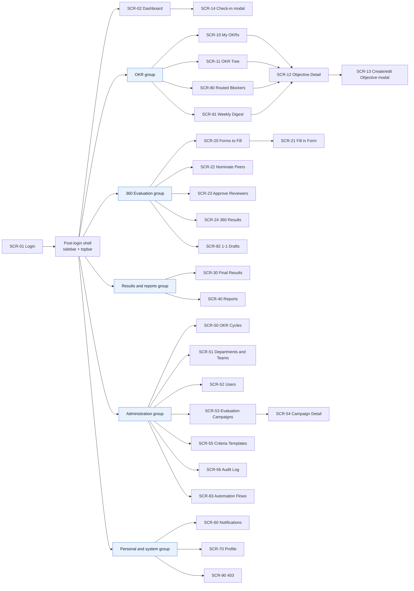
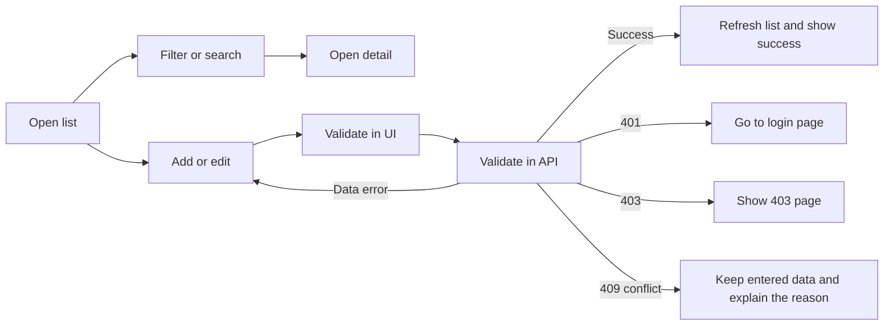
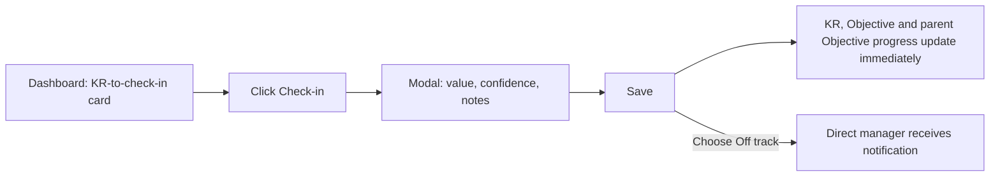
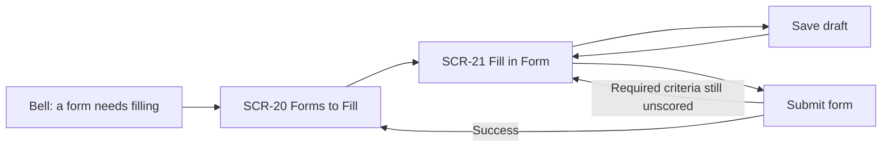
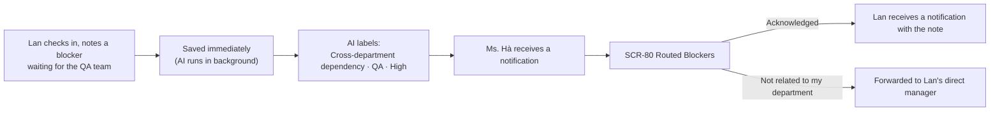
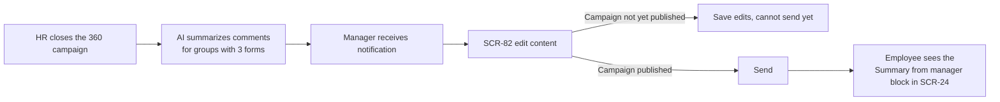

# Information Architecture

> Design status: TARGET V1
>
> Implementation status: SAMPLE UI AVAILABLE — React + mock data, no API yet

This document answers the question **"what screens does the system have, how do you get from one screen to another, and who may enter which screen?"** It connects the user stories in [08-invest-requirements.md](08-invest-requirements.md) with the UI to be drawn in a later step.

How to read the diagram:

- Dark blue boxes are gateway pages on the main menu.
- White boxes are pages.
- Rounded boxes are tabs or content blocks inside a page; double-layered boxes are pages repeated per object (each Objective and each evaluation campaign has a detail page).
- Yellow boxes are forms or tools, usually opened as a modal. A red label means only that role may enter; a label on a gateway page applies to the whole column.

Routes (hash routes): `#/login` `#/dashboard` `#/okr/my` `#/okr/tree` `#/okr/:objectiveId` `#/reviews/todo` `#/reviews/forms/:formId` `#/reviews/nominate` `#/reviews/approvals` `#/reviews/results` `#/reviews/results/:userId` `#/final-results` `#/reports` `#/admin/cycles` `#/admin/departments` `#/admin/users` `#/admin/campaigns` `#/admin/campaigns/:campaignId` `#/admin/templates` `#/audit` `#/okr/blockers` `#/okr/digest` `#/reviews/drafts` `#/admin/automation` `#/notifications` `#/profile` `#/403`.

Creating/editing an Objective and Check-in open as a **modal** right on the current page (My OKRs, OKR Tree, Objective Detail, Dashboard), so the user is not taken out of context.

The **cycle selector** on the topbar determines the data of every OKR page, dashboard and report. The default is the running cycle (`ACTIVE`); when a closed cycle is chosen, all edit and check-in buttons are hidden.

## Page access

| Page                                                                          | Who may enter                                                                                                      |
| ----------------------------------------------------------------------------- | ------------------------------------------------------------------------------------------------------------------ |
| Personal Dashboard, My OKRs, OKR Tree, Objective Detail, Notifications, Profile | All roles                                                                                                        |
| Team Dashboard                                                                | Manager                                                                                                            |
| Company Dashboard                                                             | Admin, HR                                                                                                          |
| Forms to Fill, Fill in Form                                                   | All roles, only see forms assigned to themselves                                                                   |
| Nominate Peers                                                                | All roles, when the evaluation campaign is in the nomination phase                                                 |
| Approve Reviewers                                                             | Manager (for direct reports); HR (for employees without a direct manager)                                          |
| 360 Results                                                                   | All roles view their own results after publication; Manager views direct reports; HR views everyone               |
| Final Results                                                                 | HR                                                                                                                 |
| Reports                                                                       | Admin (except the 360 results report), HR, Manager (only the unit they are responsible for)                        |
| OKR Cycles, Departments, Users, Audit Log                                     | Admin, HR                                                                                                          |
| 360 Evaluation Campaigns, Criteria Templates                                  | HR                                                                                                                 |
| Routed Blockers                                                               | Department head or team lead (only blockers routed to their own unit)                                              |
| Weekly Digest                                                                 | Manager (their own team's digest)                                                                                  |
| 1-1 Drafts                                                                    | Manager (direct reports); HR (employees without a direct manager)                                                  |
| Automation Flows                                                              | Admin (configure, re-run); HR (view the Run History tab only)                                                      |
| Access without permission                                                     | `#/403`                                                                                                            |

Items without permission are **not shown** in the sidebar. Edit, delete and check-in buttons appear only when the user has permission on that exact object (for example, the Check-in button appears only for Key Results they own).

## Screen list and content

| ID       | Screen                | Form                                                                                 | Main content displayed                                                                                                                                                                                                                                                                                                          | User story                   |
| -------- | --------------------- | ------------------------------------------------------------------------------------ | ------------------------------------------------------------------------------------------------------------------------------------------------------------------------------------------------------------------------------------------------------------------------------------------------------------------------------- | ---------------------------- |
| `SCR-01` | Login                 | Page                                                                                 | Email field, password, login button, generic error message                                                                                                                                                                                                                                                                      | US01, US02                   |
| `SCR-02` | Dashboard             | Page, 3 role-based tabs                                                              | **Personal:** my OKR progress, KRs to check in, forms to fill. **Team:** department OKRs and the OKRs of teams within (department head) or own team OKRs (team lead), members who have not checked in this week, at-risk OKRs. **Company:** progress per department, check-in rate, form submission rate                           | US23                         |
| `SCR-10` | My OKRs               | Page                                                                                 | List of my Objectives in the cycle, each KR with progress % and confidence level, Check-in button, Add Objective button                                                                                                                                                                                                         | US08, US12                   |
| `SCR-11` | Company OKR Tree      | Page                                                                                 | 4-level tree company → department → team → individual; each node has level label, title, owner or unit, progress %, confidence color; filters for department / team, person, level, confidence                                                                                                                                  | US07                         |
| `SCR-12` | Objective Detail      | Page                                                                                 | Title, level, owner, parent Objective, KR list, child Objectives; Check-in History block with list, progress chart, manager comments, AI labels on check-ins (blocker type, which department it was routed to, handling status; mismatched check-in); AI OKR review suggestions block with a Dismiss button; edit and delete buttons | US07, US11, US13, US14, US33 |
| `SCR-13` | Create / edit Objective | Modal                                                                              | Title, description, level (company, department, team, individual — only permitted levels shown), department or team when the corresponding level is selected, owner; list of 1–5 KRs (title, measure type, start value, target, unit, owner); choose parent Objective                                                            | US08, US09, US10             |
| `SCR-14` | Key Result Check-in   | Modal                                                                                | KR name, current value and target; fields for new value, confidence level, notes, blockers                                                                                                                                                                                                                                      | US12                         |
| `SCR-20` | Forms to Fill         | Page                                                                                 | List of assigned forms: person being evaluated, my role in the form, draft/submitted status, due date                                                                                                                                                                                                                           | US19                         |
| `SCR-21` | Fill in Review Form   | Page                                                                                 | Name of the person being evaluated; each criterion with a 1–5 scale or "Not enough information"; open questions; Save draft and Submit buttons; on submit, an AI warning box (visible only to the writer) with the flagged sentence, "Edit" and "Submit anyway" buttons                                                         | US19, US34                   |
| `SCR-22` | Nominate Peers        | Page                                                                                 | Peer search field, list of selected people (3–5), nomination deadline, approval status                                                                                                                                                                                                                                          | US17                         |
| `SCR-23` | Approve Reviewers     | Page                                                                                 | List of direct reports; for each person: nominated peers, add, remove and approve buttons                                                                                                                                                                                                                                       | US18                         |
| `SCR-24` | 360 Results           | Page                                                                                 | Score per criterion, score per reviewer group, gap between self-assessment and others, comments without names; "Summary from manager" block when the manager has sent the 1-1 version                                                                                                                                           | US21, US31                   |
| `SCR-30` | Final Results         | Page                                                                                 | Table per employee: OKR progress, OKR score, 360 score, final score, rating; export and publish buttons                                                                                                                                                                                                                         | US22                         |
| `SCR-40` | Reports and Export    | Page                                                                                 | Choose report type (OKR progress, check-in rate, final results), cycle and department filters, table and chart, Excel/PDF export buttons                                                                                                                                                                                        | US24                         |
| `SCR-50` | OKR Cycles            | Page with modal                                                                      | Cycle list: name, start date, end date, status; create, activate, close buttons                                                                                                                                                                                                                                                 | US06                         |
| `SCR-51` | Departments and Teams | Tree page with modal                                                                 | Tree of departments and teams, unit type, department head or team lead, member count; add department, add team to department, edit, deactivate buttons                                                                                                                                                                         | US04                         |
| `SCR-52` | Users                 | Page with modal                                                                      | User table: full name, email, role, department, direct manager, status; add, edit, enable/disable buttons                                                                                                                                                                                                                       | US05                         |
| `SCR-53` | 360 Evaluation Campaigns | Page with modal                                                                   | Campaign list: name, cycle, form template, nomination deadline, submission deadline, status; create campaign button                                                                                                                                                                                                             | US16                         |
| `SCR-54` | Campaign Detail       | Page                                                                                 | Current phase, form submission rate by department, number of missing forms per person; open nomination, open collection, send reminder, close campaign buttons                                                                                                                                                                  | US16, US20                   |
| `SCR-55` | Evaluation Criteria Templates | Page with modal                                                              | List of form templates; in each template: criteria, description, required or not, open questions; create, edit, duplicate buttons                                                                                                                                                                                               | US15                         |
| `SCR-56` | Audit Log             | Page                                                                                 | Table: actor, action, module, object, time; filters                                                                                                                                                                                                                                                                             | US26                         |
| `SCR-60` | Notifications         | Dropdown list + page                                                                 | List of notifications, newest first, read/unread status, mark-all-as-read button                                                                                                                                                                                                                                                | US25                         |
| `SCR-70` | Profile               | Page with 3 tabs                                                                     | **Account:** full name, phone number, photo; email, role, department read-only. **Security:** change password. **My permissions:** permission matrix                                                                                                                                                                            | US03                         |
| `SCR-80` | Routed Blockers       | Page                                                                                 | Pending / Handled tabs; each row: KR, reporter, reporter's department, blocker content, AI label (type, severity), time; "Acknowledged" (with note) and "Not related to my department" buttons                                                                                                                                  | US29                         |
| `SCR-81` | Weekly Digest         | Page                                                                                 | Week selector; team figures (checked in, not checked in, at-risk KRs, off-track KRs); up to 3 items needing attention written by AI, each linking to the KR; "AI-generated" label                                                                                                                                               | US30                         |
| `SCR-82` | 1-1 Drafts            | Two-column page                                                                      | Left: list of drafts by campaign and status. Right: summarized 360 score, AI suggestions (strengths, areas to improve), field to edit the content sent to the employee, Send and Discard draft buttons                                                                                                                         | US31                         |
| `SCR-83` | Automation Flows      | Page with 2 tabs                                                                     | **Flows:** 6 flows, when they run, on/off, run schedule, quota, AI calls today, most recent run. **Run History:** flow, object, status, retry count, time, tokens, error; filters; re-run button (Admin)                                                                                                                       | US27, US28                   |
| `SCR-84` | "What did the AI do?" panel | Right slide-in panel, opened from the "AI-generated" label on `SCR-12`, `SCR-80`, `SCR-81`, `SCR-82` | The steps of the exact run that produced the label: event, content renamed to codes, content sent to the AI, returned JSON, schema validation result, action taken. Rebuilt from data the viewer is allowed to see, not read from logs                                                                                         | US29–US33                    |
| `SCR-90` | No permission (403)   | Page                                                                                 | No-permission message, button to return to Dashboard                                                                                                                                                                                                                                                                            | Shared authorization         |

## Mapping user stories to screens

| User story | Main screen and action                                                                                |
| ---------- | ----------------------------------------------------------------------------------------------------- |
| US01       | `SCR-01` enter email, password, log in                                                                |
| US02       | Logout button on the topbar, return to `SCR-01`                                                       |
| US03       | `SCR-70` edit information or change password                                                          |
| US04       | `SCR-51` add, edit, deactivate departments                                                            |
| US05       | `SCR-52` add, edit, enable/disable users, assign direct manager                                       |
| US06       | `SCR-50` create, activate, close cycles                                                               |
| US07       | `SCR-11` view and filter the tree; `SCR-12` view details                                              |
| US08       | `SCR-10` or `SCR-11` → `SCR-13` create/edit Objective                                                 |
| US09       | `SCR-13` add, edit Key Results                                                                        |
| US10       | `SCR-13` choose parent Objective to link                                                              |
| US11       | `SCR-12` confirm soft delete of Objective                                                             |
| US12       | `SCR-02` or `SCR-10` → `SCR-14` check-in                                                              |
| US13       | `SCR-12` view check-in history and progress chart                                                     |
| US14       | `SCR-12` Manager comments on a check-in                                                               |
| US15       | `SCR-55` create, edit, duplicate form templates                                                       |
| US16       | `SCR-53` create campaign; `SCR-54` open nomination phase, open collection                             |
| US17       | `SCR-22` choose 3–5 peers and submit                                                                  |
| US18       | `SCR-23` keep, add, remove reviewers then approve                                                     |
| US19       | `SCR-20` choose form → `SCR-21` score, save draft, submit                                             |
| US20       | `SCR-54` view submission rate, send reminders, close campaign                                         |
| US21       | `SCR-24` view scores by criterion, by group, comments                                                 |
| US22       | `SCR-30` preview, export, publish                                                                     |
| US23       | `SCR-02` view role-based dashboard                                                                    |
| US24       | `SCR-40` choose report type, filter, export Excel/PDF                                                 |
| US25       | Bell on the topbar → `SCR-60`                                                                         |
| US26       | `SCR-56` filter audit log                                                                             |
| US27       | `SCR-83` Flows tab: on/off, edit run schedule and quota                                               |
| US28       | `SCR-83` Run History tab: filter, view errors, re-run                                                 |
| US29       | Notification → `SCR-80` acknowledge or mark as not related                                            |
| US30       | Monday notification → `SCR-81` → open KR in `SCR-12`                                                  |
| US31       | `SCR-82` edit AI suggestions then send; employee views at `SCR-24`                                    |
| US32       | No dedicated screen; results appear in `SCR-12`, `SCR-80`–`SCR-83`; clicking the "AI-generated" label opens `SCR-84` |
| US33       | Notification → `SCR-12` view mismatch label, review suggestions                                       |
| US34       | `SCR-21` warning when clicking submit                                                                 |

## Where AI appears

AI is not a separate feature, so it has no menu group of its own. Each screen that shows AI results sits in the group of the work it supports:

| Screen | Menu group | Why there |
|---|---|---|
| `SCR-80` Routed Blockers | OKR | Handling blockers raised in check-ins is part of following OKRs |
| `SCR-81` Weekly Digest | OKR | A summary of the team's OKR week |
| `SCR-82` 1-1 Drafts | 360 Evaluation | Prepared from the 360 results it sits next to |
| `SCR-83` Automation Flows | Administration | System configuration, like cycles and users |
| `SCR-84` "What did the AI do?" panel | No menu entry | Opened from the "AI-generated" label wherever that label appears |

Everywhere else AI shows up inside existing screens: labels on check-ins in `SCR-12`, review notes on a new Objective, the comment warning when submitting a form in `SCR-21`.

The UI prototype in `src/frontend` follows this grouping. The information architecture image above and some screenshots in `docs/images` were taken earlier and still show a separate "Tự động hóa AI" sidebar group.

## Screen hierarchy diagram

## Main interaction flows

### Common flow for lists and forms

### Weekly check-in flow

Goal: check in a Key Result in at most 3 actions starting from the dashboard.

### 360 reviewer flow

### Blocker routed by AI flow

The person checking in does not have to do anything extra; the department head picks up the task in 2 actions from the notification.

### 1-1 draft flow

## UI state conventions

| State                    | Required display                                                                                               |
| ------------------------ | -------------------------------------------------------------------------------------------------------------- |
| Initial loading          | Keep the page frame; show skeletons for the table, tree or chart being loaded.                                 |
| Empty                    | State clearly whether there is no data or the filter caused it; show the primary action button if permitted (for example "Add the first Objective"). |
| Input error              | Keep entered values, show the error right below the faulty field, move the cursor to the first error.          |
| API error                | Show a short message with a reference code; do not show technical details.                                     |
| Session expired (401)    | Clear the login session and go to the login page.                                                              |
| No permission (403)      | Keep the login session, show `#/403` with a way back.                                                          |
| Saving                   | Disable the submit button to prevent double submission, show the processing state.                             |
| Success                  | Show success, close the modal if any, refresh related data (for example progress on the tree after a check-in). |
| Delete confirmation      | State the Objective's name and say clearly that it disappears from the tree and reports but its history is kept. |
| Closed cycle             | Show the label "Cycle closed — view only"; hide all edit and check-in buttons.                                 |
| Result hidden for anonymity | Show "Fewer than 3 forms, so not displayed to protect anonymity"; never leave a blank cell.                 |
| AI-generated content     | Always show the "AI-generated" label next to the content; labels, suggestions and digests have no button to edit OKR or 360 figures. |
| AI processing            | After a check-in or saving an Objective, do not wait for the AI; the AI label appears later, when the user reopens the page. |
| AI flow off or failed    | All non-AI features keep working; the AI block shows "No analysis yet" instead of an error for regular users.  |

## Responsive and accessibility rules

- Works well from a 375 px screen. On narrow screens the OKR tree turns into an expandable nested list; tables scroll horizontally instead of hiding columns.
- Confidence level and progress are not conveyed by color alone: always accompanied by text ("On track", "At risk", "Off track") and a percentage number.
- Modals fit the viewport, keep action buttons always visible, trap the Tab key inside the modal, close with `Escape` when not saving, and return focus to the button that opened the modal.
- Every input has a visible label; icon-only buttons have names for screen readers.
- Keyboard users can move through the sidebar, filters, OKR tree, modal buttons and pagination in a logical order.
- Dates use the format `dd/MM/yyyy`; percentages are rounded to integers; scores are rounded to 2 decimal places.

## Mapping screens to the API

Operation names match the [OpenAPI](api/openapi.yaml) contract.

| Screen                     | API operations                                                                                                                                     |
| -------------------------- | -------------------------------------------------------------------------------------------------------------------------------------------------- |
| Login                      | `login`, `logout`                                                                                                                                  |
| Dashboard                  | `getMyDashboard`, `getTeamDashboard`, `getCompanyDashboard`                                                                                        |
| My OKRs, OKR Tree          | `listObjectives`, `getObjectiveTree`                                                                                                               |
| Objective Detail           | `getObjective`, `deleteObjective`, `listCheckins`, `createCheckinComment`                                                                          |
| Create / edit Objective    | `createObjective`, `updateObjective`, `createKeyResult`, `updateKeyResult`, `deleteKeyResult`, `linkParentObjective`                               |
| Check-in                   | `createCheckin`                                                                                                                                    |
| Forms to Fill, Fill in Form | `listMyReviewForms`, `getReviewForm`, `saveReviewDraft`, `submitReviewForm`                                                                       |
| Nominate Peers             | `getMyNomination`, `submitNomination`                                                                                                              |
| Approve Reviewers          | `listPendingNominations`, `approveNomination`                                                                                                      |
| 360 Results                | `getReviewResult`                                                                                                                                  |
| Final Results              | `calculateFinalResults`, `listFinalResults`, `exportFinalResults`, `publishFinalResults`                                                           |
| Reports                    | `getReport`, `exportReport`                                                                                                                        |
| OKR Cycles                 | `listCycles`, `createCycle`, `updateCycle`, `activateCycle`, `closeCycle`                                                                          |
| Departments                | `listDepartments`, `createDepartment`, `updateDepartment`, `deactivateDepartment`                                                                  |
| Users                      | `listUsers`, `getUser`, `createUser`, `updateUser`, `updateUserStatus`                                                                             |
| Evaluation Campaigns, Campaign Detail | `listCampaigns`, `createCampaign`, `updateCampaign`, `openNomination`, `openCollection`, `getCampaignProgress`, `remindReviewers`, `closeCampaign` |
| Criteria Templates         | `listTemplates`, `createTemplate`, `updateTemplate`, `duplicateTemplate`                                                                           |
| Audit Log                  | `listAuditLogs`                                                                                                                                    |
| Notifications              | `listNotifications`, `markNotificationRead`, `markAllNotificationsRead`                                                                            |
| Profile                    | `getProfile`, `updateProfile`, `changePassword`                                                                                                    |
| Routed Blockers            | `listRoutedBlockers`, `acknowledgeBlocker`, `rejectBlocker`                                                                                        |
| Weekly Digest              | `listWeeklyDigests`, `getWeeklyDigest`                                                                                                             |
| 1-1 Drafts                 | `listOneOnOneDrafts`, `getOneOnOneDraft`, `updateOneOnOneDraft`, `sendOneOnOneDraft`, `discardOneOnOneDraft`                                       |
| Automation Flows           | `listAutomationFlows`, `updateAutomationFlow`, `listAutomationRuns`, `retryAutomationRun`                                                          |
| Fill in Form (AI warning)  | `checkReviewComment` (called on submit, at most 5 seconds)                                                                                         |
| Objective Detail (AI)      | `listObjectiveReviewNotes`, `dismissObjectiveReviewNote`                                                                                           |
| "What did the AI do?" panel | `getAiRunExplanation`                                                                                                                             |
| Shared operations          | `listUserDirectory`, `getCampaign`, `listReviewResultSubjects`, `getMyFinalResult`, `getAutomationRun`                                             |

The `listCycles` and `listDepartments` operations also provide the selection lists for the cycle selector, filters and forms; they do not need a separate screen for that.

## Sample UI

The React sample UI running on mock data is at [src/frontend](../src/frontend/README.md). Screenshots are stored by role:

| Folder                | Role                            | Screens captured                                                                                                                                                                                                            |
| --------------------- | ------------------------------- | --------------------------------------------------------------------------------------------------------------------------------------------------------------------------------------------------------------------------- |
| `images/chung/`       | Not logged in, shared features  | `SCR-01`, quick search panel, light theme                                                                                                                                                                                   |
| `images/nhan-vien/`   | Employee (Lan)                  | `SCR-02`, `SCR-10`, `SCR-11`, `SCR-12`, `SCR-13`, `SCR-14`, `SCR-20`, `SCR-21`, `SCR-22`, `SCR-24`, `SCR-60`, `SCR-70`                                                                                                      |
| `images/quan-ly/`     | Manager (Nam, Hà)               | `SCR-02` team, `SCR-23`, `SCR-24` of an employee and the group-merging case, `SCR-40`                                                                                                                                       |
| `images/nhan-su/`     | HR (Mai)                        | `SCR-02` company, `SCR-53`, `SCR-54`, `SCR-30`, `SCR-55`, `SCR-52`                                                                                                                                                          |
| `images/quan-tri/`    | Administrator (Hùng)            | `SCR-02` company, `SCR-50`, `SCR-51`, `SCR-56`, `SCR-90`                                                                                                                                                                    |
| `images/tu-dong-hoa/` | Hà, Nam, Mai, Hùng, Lan, An     | `SCR-80`, `SCR-81`, `SCR-82`, `SCR-83` (2 tabs), `SCR-84`, demo flow from check-in to recipient (images 11–18), AI label on check-in and review suggestions in `SCR-12`, comment warning in `SCR-21`, manager summary in `SCR-24` |

**Related:** [Use cases](03-use-cases.md) · [User stories](08-invest-requirements.md) · [Acceptance criteria](06-acceptance-criteria.md)
