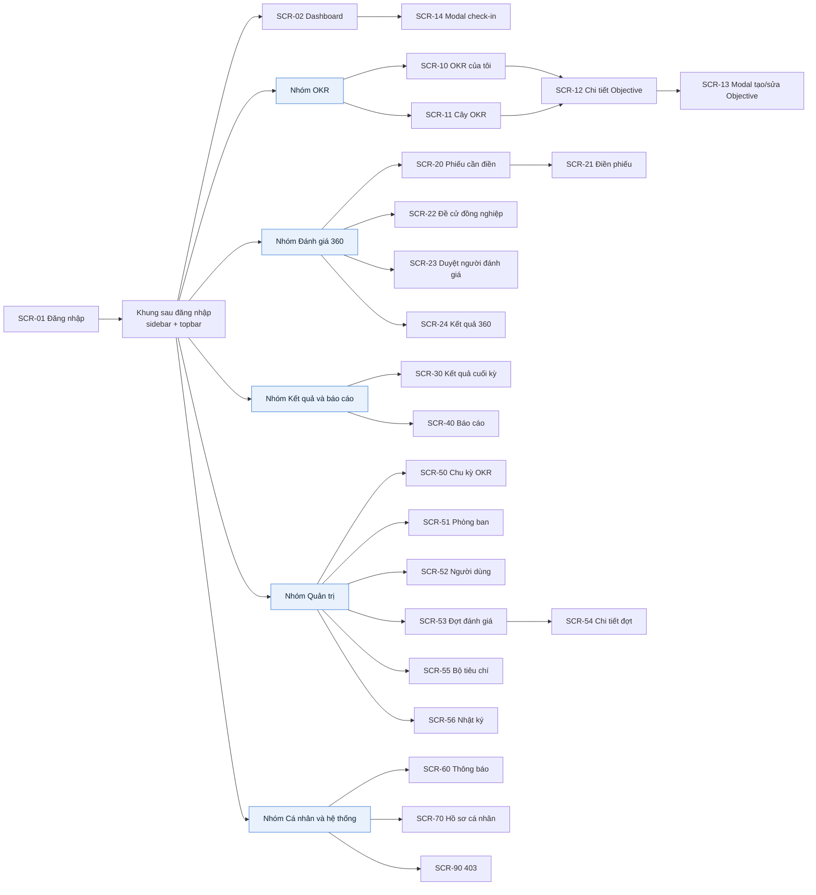
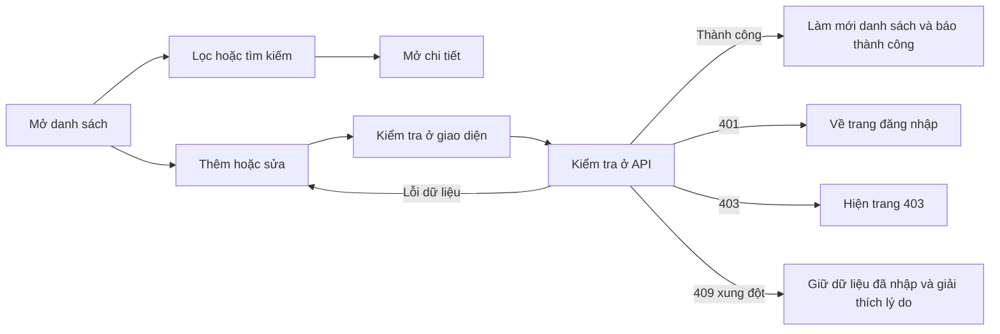
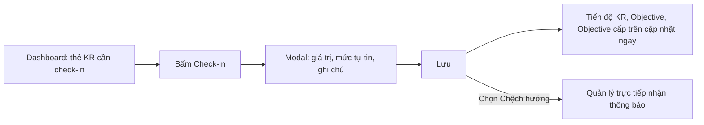
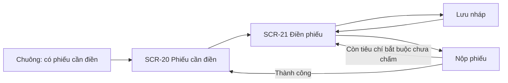

# Kiến trúc thông tin

> Trạng thái thiết kế: TARGET V1
>
> Trạng thái triển khai: CÓ GIAO DIỆN MẪU — React + dữ liệu giả, chưa có API

Tài liệu này trả lời câu hỏi **"hệ thống có những màn hình nào, đi từ màn hình này sang màn hình kia ra sao, và ai được vào màn hình nào?"**. Nó nối user story ở [08-invest-requirements.md](08-invest-requirements.md) với giao diện sẽ vẽ ở bước sau.

Cách đọc sơ đồ: ô xanh đậm là trang cổng trên menu chính; ô trắng là trang; ô bo tròn là tab hoặc khối nội dung bên trong một trang; ô chồng hai lớp là trang lặp lại cho từng đối tượng (mỗi Objective, mỗi đợt đánh giá có một trang chi tiết); ô vàng là biểu mẫu hoặc công cụ, thường mở dạng modal. Nhãn đỏ cho biết chỉ vai trò đó được vào; nhãn trên trang cổng áp cho cả cột.

Đường dẫn (hash route): `#/login` `#/dashboard` `#/okr/my` `#/okr/tree` `#/okr/:objectiveId` `#/reviews/todo` `#/reviews/forms/:formId` `#/reviews/nominate` `#/reviews/approvals` `#/reviews/results` `#/reviews/results/:userId` `#/final-results` `#/reports` `#/admin/cycles` `#/admin/departments` `#/admin/users` `#/admin/campaigns` `#/admin/campaigns/:campaignId` `#/admin/templates` `#/audit` `#/notifications` `#/profile` `#/403`.

Tạo/sửa Objective và Check-in mở dạng **modal** ngay trên trang đang đứng (OKR của tôi, Cây OKR, Chi tiết Objective, Dashboard), để người dùng không bị rời khỏi ngữ cảnh.

**Bộ chọn chu kỳ** trên topbar quyết định dữ liệu của mọi trang OKR, dashboard và báo cáo. Mặc định là chu kỳ đang chạy (`ACTIVE`); chọn chu kỳ đã đóng thì mọi nút sửa và check-in bị ẩn.

## Quyền vào trang

| Trang                                                                         | Ai được vào                                                                                                        |
| ----------------------------------------------------------------------------- | ------------------------------------------------------------------------------------------------------------------ |
| Dashboard cá nhân, OKR của tôi, Cây OKR, Chi tiết Objective, Thông báo, Hồ sơ | Mọi vai trò                                                                                                        |
| Dashboard đội nhóm                                                            | Manager                                                                                                            |
| Dashboard công ty                                                             | Admin, HR                                                                                                          |
| Phiếu cần điền, Điền phiếu                                                    | Mọi vai trò, chỉ thấy phiếu được giao cho mình                                                                     |
| Đề cử đồng nghiệp                                                             | Mọi vai trò, khi đợt đánh giá đang ở giai đoạn đề cử                                                               |
| Duyệt người đánh giá                                                          | Manager (cho nhân viên dưới quyền trực tiếp); HR (cho nhân viên không có quản lý trực tiếp)                        |
| Kết quả 360                                                                   | Mọi vai trò xem kết quả của bản thân sau khi công bố; Manager xem nhân viên dưới quyền trực tiếp; HR xem mọi người |
| Kết quả cuối kỳ                                                               | HR                                                                                                                 |
| Báo cáo                                                                       | Admin (trừ báo cáo kết quả 360), HR, Manager (chỉ phòng ban mình phụ trách)                                        |
| Chu kỳ OKR, Phòng ban, Người dùng, Nhật ký                                    | Admin, HR                                                                                                          |
| Đợt đánh giá 360, Bộ tiêu chí                                                 | HR                                                                                                                 |
| Truy cập không có quyền                                                       | `#/403`                                                                                                            |

Mục không có quyền **không hiển thị** trên sidebar. Nút sửa, xóa, check-in chỉ hiện khi người dùng có quyền với đúng đối tượng đó (ví dụ nút Check-in chỉ hiện với Key Result mình phụ trách).

## Danh sách màn hình và nội dung

| Mã       | Màn hình              | Dạng                        | Nội dung hiển thị chính                                                                                                                                                                                                    | User story             |
| -------- | --------------------- | --------------------------- | -------------------------------------------------------------------------------------------------------------------------------------------------------------------------------------------------------------------------- | ---------------------- |
| `SCR-01` | Đăng nhập             | Trang                       | Ô email, mật khẩu, nút đăng nhập, thông báo lỗi chung                                                                                                                                                                      | US01, US02             |
| `SCR-02` | Dashboard             | Trang, 3 tab theo vai trò   | **Cá nhân:** tiến độ OKR của tôi, KR cần check-in, phiếu cần điền. **Đội nhóm:** tiến độ phòng ban, thành viên chưa check-in tuần này, OKR có rủi ro. **Công ty:** tiến độ từng phòng ban, tỷ lệ check-in, tỷ lệ nộp phiếu | US23                   |
| `SCR-10` | OKR của tôi           | Trang                       | Danh sách Objective của tôi trong chu kỳ, từng KR với % tiến độ và mức tự tin, nút Check-in, nút Thêm Objective                                                                                                            | US08, US12             |
| `SCR-11` | Cây OKR công ty       | Trang                       | Cây công ty → phòng ban → cá nhân; mỗi nút có tiêu đề, người sở hữu, % tiến độ, màu mức tự tin; bộ lọc phòng ban, người, cấp, mức tự tin                                                                                   | US07                   |
| `SCR-12` | Chi tiết Objective    | Trang                       | Tiêu đề, cấp, người sở hữu, Objective cấp trên, danh sách KR, Objective con; khối Lịch sử check-in gồm danh sách, biểu đồ tiến độ, bình luận của quản lý; nút sửa, xóa                                                     | US07, US11, US13, US14 |
| `SCR-13` | Tạo / sửa Objective   | Modal                       | Tiêu đề, mô tả, cấp, người sở hữu; danh sách 1–5 KR (tiêu đề, kiểu đo, giá trị đầu, đích, đơn vị, người phụ trách); chọn Objective cấp trên                                                                                | US08, US09, US10       |
| `SCR-14` | Check-in Key Result   | Modal                       | Tên KR, giá trị hiện tại và đích; ô nhập giá trị mới, mức tự tin, ghi chú, vướng mắc                                                                                                                                       | US12                   |
| `SCR-20` | Phiếu cần điền        | Trang                       | Danh sách phiếu được giao: người được đánh giá, vai trò của tôi trong phiếu, trạng thái nháp/đã nộp, hạn nộp                                                                                                               | US19                   |
| `SCR-21` | Điền phiếu đánh giá   | Trang                       | Tên người được đánh giá; từng tiêu chí với thang 1–5 hoặc "Không đủ thông tin"; câu hỏi mở; nút lưu nháp, nộp                                                                                                              | US19                   |
| `SCR-22` | Đề cử đồng nghiệp     | Trang                       | Ô tìm đồng nghiệp, danh sách đã chọn (3–5 người), hạn đề cử, trạng thái duyệt                                                                                                                                              | US17                   |
| `SCR-23` | Duyệt người đánh giá  | Trang                       | Danh sách nhân viên dưới quyền; với mỗi người: đồng nghiệp được đề cử, nút thêm, bớt, duyệt                                                                                                                                | US18                   |
| `SCR-24` | Kết quả 360           | Trang                       | Điểm theo từng tiêu chí, điểm theo nhóm người đánh giá, chênh lệch tự đánh giá so với người khác, nhận xét không kèm tên                                                                                                   | US21                   |
| `SCR-30` | Kết quả cuối kỳ       | Trang                       | Bảng từng nhân viên: tiến độ OKR, điểm OKR, điểm 360, điểm cuối kỳ, xếp loại; nút xuất file, công bố                                                                                                                       | US22                   |
| `SCR-40` | Báo cáo và xuất file  | Trang                       | Chọn loại báo cáo (tiến độ OKR, tỷ lệ check-in, kết quả cuối kỳ), bộ lọc chu kỳ và phòng ban, bảng và biểu đồ, nút xuất Excel/PDF                                                                                          | US24                   |
| `SCR-50` | Chu kỳ OKR            | Trang có modal              | Danh sách chu kỳ: tên, ngày bắt đầu, kết thúc, trạng thái; nút tạo, kích hoạt, đóng                                                                                                                                        | US06                   |
| `SCR-51` | Phòng ban             | Trang dạng cây có modal     | Cây phòng ban, trưởng phòng, số nhân viên; nút thêm, sửa, ngưng                                                                                                                                                            | US04                   |
| `SCR-52` | Người dùng            | Trang có modal              | Bảng người dùng: họ tên, email, vai trò, phòng ban, quản lý trực tiếp, trạng thái; nút thêm, sửa, bật/tắt                                                                                                                  | US05                   |
| `SCR-53` | Đợt đánh giá 360      | Trang có modal              | Danh sách đợt: tên, chu kỳ, mẫu phiếu, hạn đề cử, hạn nộp, trạng thái; nút tạo đợt                                                                                                                                         | US16                   |
| `SCR-54` | Chi tiết đợt đánh giá | Trang                       | Giai đoạn hiện tại, tỷ lệ nộp phiếu theo phòng ban, số phiếu còn thiếu của từng người; nút mở đề cử, mở thu phiếu, gửi nhắc, đóng đợt                                                                                      | US16, US20             |
| `SCR-55` | Bộ tiêu chí đánh giá  | Trang có modal              | Danh sách mẫu phiếu; trong mỗi mẫu: tiêu chí, mô tả, bắt buộc hay không, câu hỏi mở; nút tạo, sửa, nhân bản                                                                                                                | US15                   |
| `SCR-56` | Nhật ký hoạt động     | Trang                       | Bảng: người thực hiện, hành động, phân hệ, đối tượng, thời gian; bộ lọc                                                                                                                                                    | US26                   |
| `SCR-60` | Thông báo             | Danh sách thả xuống + trang | Danh sách thông báo mới nhất trước, trạng thái đã đọc/chưa đọc, nút đánh dấu tất cả đã đọc                                                                                                                                 | US25                   |
| `SCR-70` | Hồ sơ cá nhân         | Trang có 3 tab              | **Tài khoản:** họ tên, số điện thoại, ảnh; email, vai trò, phòng ban chỉ xem. **Bảo mật:** đổi mật khẩu. **Quyền của tôi:** ma trận quyền                                                                                  | US03                   |
| `SCR-90` | Không có quyền (403)  | Trang                       | Thông báo không có quyền, nút quay về Dashboard                                                                                                                                                                            | Phân quyền dùng chung  |

## Nối user story với màn hình

| User story | Màn hình và thao tác chính                                    |
| ---------- | ------------------------------------------------------------- |
| US01       | `SCR-01` nhập email, mật khẩu, đăng nhập                      |
| US02       | Nút đăng xuất trên topbar, quay về `SCR-01`                   |
| US03       | `SCR-70` sửa thông tin hoặc đổi mật khẩu                      |
| US04       | `SCR-51` thêm, sửa, ngưng phòng ban                           |
| US05       | `SCR-52` thêm, sửa, bật/tắt người dùng, gán quản lý trực tiếp |
| US06       | `SCR-50` tạo, kích hoạt, đóng chu kỳ                          |
| US07       | `SCR-11` xem và lọc cây; `SCR-12` xem chi tiết                |
| US08       | `SCR-10` hoặc `SCR-11` → `SCR-13` tạo/sửa Objective           |
| US09       | `SCR-13` thêm, sửa Key Result                                 |
| US10       | `SCR-13` chọn Objective cấp trên để liên kết                  |
| US11       | `SCR-12` xác nhận xóa mềm Objective                           |
| US12       | `SCR-02` hoặc `SCR-10` → `SCR-14` check-in                    |
| US13       | `SCR-12` xem lịch sử check-in và biểu đồ tiến độ              |
| US14       | `SCR-12` Manager bình luận vào check-in                       |
| US15       | `SCR-55` tạo, sửa, nhân bản mẫu phiếu                         |
| US16       | `SCR-53` tạo đợt; `SCR-54` mở giai đoạn đề cử, mở thu phiếu   |
| US17       | `SCR-22` chọn 3–5 đồng nghiệp và gửi                          |
| US18       | `SCR-23` giữ, thêm, bớt người đánh giá rồi duyệt              |
| US19       | `SCR-20` chọn phiếu → `SCR-21` chấm điểm, lưu nháp, nộp       |
| US20       | `SCR-54` xem tỷ lệ nộp, gửi nhắc, đóng đợt                    |
| US21       | `SCR-24` xem điểm theo tiêu chí, theo nhóm, nhận xét          |
| US22       | `SCR-30` xem trước, xuất file, công bố                        |
| US23       | `SCR-02` xem dashboard theo vai trò                           |
| US24       | `SCR-40` chọn loại báo cáo, lọc, xuất Excel/PDF               |
| US25       | Chuông trên topbar → `SCR-60`                                 |
| US26       | `SCR-56` lọc nhật ký                                          |

## Sơ đồ phân cấp màn hình

## Luồng thao tác chính

### Luồng chung cho danh sách và biểu mẫu

### Luồng check-in hằng tuần

Mục tiêu: check-in một Key Result trong tối đa 3 thao tác kể từ dashboard.

### Luồng người đánh giá 360

## Quy ước trạng thái giao diện

| Trạng thái               | Cách hiển thị bắt buộc                                                                                         |
| ------------------------ | -------------------------------------------------------------------------------------------------------------- |
| Đang tải lần đầu         | Giữ khung trang; hiện khung xương (skeleton) ở bảng, cây hoặc biểu đồ đang tải.                                |
| Rỗng                     | Nói rõ chưa có dữ liệu hay do bộ lọc; hiện nút hành động chính nếu có quyền (ví dụ "Thêm Objective đầu tiên"). |
| Lỗi dữ liệu nhập         | Giữ nguyên giá trị đã nhập, hiện lỗi ngay dưới ô bị sai, đưa con trỏ tới lỗi đầu tiên.                         |
| Lỗi API                  | Hiện thông báo ngắn kèm mã tra cứu; không hiện chi tiết kỹ thuật.                                              |
| Hết phiên (401)          | Xóa phiên đăng nhập và về trang đăng nhập.                                                                     |
| Không có quyền (403)     | Giữ phiên đăng nhập, hiện `#/403` kèm đường quay lại.                                                          |
| Đang lưu                 | Khóa nút gửi để tránh gửi hai lần, hiện trạng thái đang xử lý.                                                 |
| Thành công               | Báo thành công, đóng modal nếu có, làm mới dữ liệu liên quan (ví dụ tiến độ trên cây sau check-in).            |
| Xác nhận xóa             | Nêu tên Objective và nói rõ nó biến khỏi cây, báo cáo nhưng vẫn giữ lịch sử.                                   |
| Chu kỳ đã đóng           | Hiện nhãn "Chu kỳ đã đóng — chỉ xem"; ẩn mọi nút sửa và check-in.                                              |
| Kết quả bị ẩn vì ẩn danh | Ghi "Chưa đủ 3 phiếu nên không hiển thị để bảo vệ ẩn danh", không để ô trống.                                  |

## Quy tắc responsive và trợ năng

- Dùng tốt từ màn hình 375 px. Cây OKR trên màn hình hẹp chuyển thành danh sách lồng nhau có thể mở rộng; bảng cuộn ngang thay vì giấu cột.
- Mức tự tin và tiến độ không chỉ thể hiện bằng màu: luôn kèm chữ ("Đúng hướng", "Có rủi ro", "Chệch hướng") và con số phần trăm.
- Modal vừa khung nhìn, giữ nút hành động luôn thấy được, khóa phím Tab bên trong modal, đóng bằng `Escape` khi không đang lưu, trả con trỏ về nút đã mở modal.
- Mọi ô nhập có nhãn hiển thị; nút chỉ có biểu tượng có tên cho trình đọc màn hình.
- Người dùng bàn phím đi được qua sidebar, bộ lọc, cây OKR, nút trong modal và phân trang theo thứ tự hợp lý.
- Ngày theo định dạng `dd/MM/yyyy`; phần trăm làm tròn đến số nguyên; điểm làm tròn 2 chữ số.

## Nối màn hình với API

Tên thao tác API là dự kiến, sẽ được chốt khi viết hợp đồng OpenAPI ở bước 4.

| Màn hình                   | Thao tác API                                                                                                                                       |
| -------------------------- | -------------------------------------------------------------------------------------------------------------------------------------------------- |
| Đăng nhập                  | `login`, `logout`                                                                                                                                  |
| Dashboard                  | `getMyDashboard`, `getTeamDashboard`, `getCompanyDashboard`                                                                                        |
| OKR của tôi, Cây OKR       | `listObjectives`, `getObjectiveTree`                                                                                                               |
| Chi tiết Objective         | `getObjective`, `deleteObjective`, `listCheckins`, `createCheckinComment`                                                                          |
| Tạo / sửa Objective        | `createObjective`, `updateObjective`, `createKeyResult`, `updateKeyResult`, `deleteKeyResult`, `linkParentObjective`                               |
| Check-in                   | `createCheckin`                                                                                                                                    |
| Phiếu cần điền, Điền phiếu | `listMyReviewForms`, `getReviewForm`, `saveReviewDraft`, `submitReviewForm`                                                                        |
| Đề cử đồng nghiệp          | `getMyNomination`, `submitNomination`                                                                                                              |
| Duyệt người đánh giá       | `listPendingNominations`, `approveNomination`                                                                                                      |
| Kết quả 360                | `getReviewResult`                                                                                                                                  |
| Kết quả cuối kỳ            | `calculateFinalResults`, `listFinalResults`, `exportFinalResults`, `publishFinalResults`                                                           |
| Báo cáo                    | `getReport`, `exportReport`                                                                                                                        |
| Chu kỳ OKR                 | `listCycles`, `createCycle`, `updateCycle`, `activateCycle`, `closeCycle`                                                                          |
| Phòng ban                  | `listDepartments`, `createDepartment`, `updateDepartment`, `deactivateDepartment`                                                                  |
| Người dùng                 | `listUsers`, `getUser`, `createUser`, `updateUser`, `updateUserStatus`                                                                             |
| Đợt đánh giá, Chi tiết đợt | `listCampaigns`, `createCampaign`, `updateCampaign`, `openNomination`, `openCollection`, `getCampaignProgress`, `remindReviewers`, `closeCampaign` |
| Bộ tiêu chí                | `listTemplates`, `createTemplate`, `updateTemplate`, `duplicateTemplate`                                                                           |
| Nhật ký                    | `listAuditLogs`                                                                                                                                    |
| Thông báo                  | `listNotifications`, `markNotificationRead`, `markAllNotificationsRead`                                                                            |
| Hồ sơ cá nhân              | `getProfile`, `updateProfile`, `changePassword`                                                                                                    |

Thao tác `listCycles` và `listDepartments` cũng cung cấp danh sách chọn cho bộ chọn chu kỳ, bộ lọc và biểu mẫu; chúng không cần màn hình riêng cho việc đó.

## Giao diện mẫu

Bản giao diện mẫu React chạy bằng dữ liệu giả nằm ở [src/frontend](../src/frontend/README.md). Ảnh chụp được lưu theo vai trò:

| Thư mục             | Vai trò                         | Màn hình đã chụp                                                                                                       |
| ------------------- | ------------------------------- | ---------------------------------------------------------------------------------------------------------------------- |
| `images/chung/`     | Chưa đăng nhập, tính năng chung | `SCR-01`, bảng tìm kiếm nhanh, chế độ nền sáng                                                                         |
| `images/nhan-vien/` | Nhân viên (Lan)                 | `SCR-02`, `SCR-10`, `SCR-11`, `SCR-12`, `SCR-13`, `SCR-14`, `SCR-20`, `SCR-21`, `SCR-22`, `SCR-24`, `SCR-60`, `SCR-70` |
| `images/quan-ly/`   | Quản lý (Nam, Hà)               | `SCR-02` đội nhóm, `SCR-23`, `SCR-24` của nhân viên và trường hợp gộp nhóm, `SCR-40`                                   |
| `images/nhan-su/`   | Nhân sự (Mai)                   | `SCR-02` công ty, `SCR-53`, `SCR-54`, `SCR-30`, `SCR-55`, `SCR-52`                                                     |
| `images/quan-tri/`  | Quản trị viên (Hùng)            | `SCR-02` công ty, `SCR-50`, `SCR-51`, `SCR-56`, `SCR-90`                                                               |

**Liên quan:** [Use case](03-use-cases.md) · [User stories](08-invest-requirements.md) · [Tiêu chí chấp nhận](06-acceptance-criteria.md)
