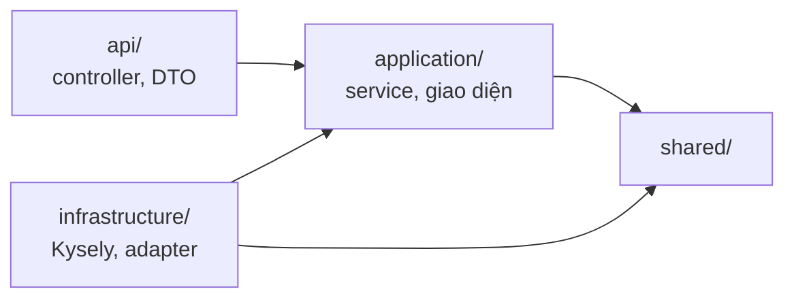

# Cấu trúc thư mục — React và NestJS

> Trạng thái thiết kế: TARGET V1
>
> Trạng thái triển khai: frontend đã có bản mẫu chạy bằng dữ liệu giả; backend CHƯA BẮT ĐẦU

Tài liệu này quy định code đặt ở đâu, để mỗi module trong [kiến trúc C3](architecture/c4.md#c3--component) và mỗi nhóm API trong [OpenAPI](api/openapi.yaml) có đúng một chỗ trong mã nguồn.

## 1. Nguyên tắc chung

- Một tính năng nghiệp vụ nằm trọn trong một thư mục, ở cả frontend lẫn backend. Đọc một thư mục là thấy đủ tính năng đó.
- Tên trong code theo hợp đồng: `operationId` là tên hàm, tên schema OpenAPI là tên DTO.
- Phân quyền và quy tắc nghiệp vụ nằm ở backend. Frontend chỉ ẩn nút cho gọn giao diện.
- `src/database/okr360.sql` là nguồn gốc của schema (ADR-003). Backend không tự sinh migration.

## 2. Toàn bộ repo

```text
OCK-360/
├── docs/                      # Tài liệu yêu cầu, kiến trúc, API
├── src/
│   ├── database/              # Schema, dữ liệu demo, kiểm thử schema (đã có)
│   ├── frontend/              # React + Vite (đã có bản mẫu)
│   └── backend/               # NestJS (chưa có)
├── compose.yaml               # Chạy postgres, api, worker, proxy (chưa có)
└── .env.example               # Tên các biến môi trường, không có giá trị thật (chưa có)
```

## 3. Frontend

### 3.1 Hiện tại

```text
src/frontend/src/
├── main.jsx, App.jsx          # Điểm vào, định tuyến theo hash
├── components/                # Shell, Login, AiWorker, AiExplain, ui.jsx, icons.jsx
├── features/                  # admin, ai, dashboard, okr, results, reviews
├── lib/                       # data.js, store.jsx, auth.js, okr.js, review.js, ai*.js
└── pages/                     # Thông báo, hồ sơ, 403
```

Mọi trang đọc dữ liệu từ `lib/store.jsx`, và `store.jsx` lấy dữ liệu giả từ `lib/data.js`.

### 3.2 Mục tiêu

Các trang trong `features/` giữ nguyên. Chỉ thay nguồn dữ liệu: mỗi tính năng có một file `api.js` gọi đúng các `operationId` của mình.

```text
src/frontend/src/
├── main.jsx, App.jsx
├── components/                # Thành phần dùng chung: Shell, Login, AiExplain, ui.jsx, icons.jsx
├── features/
│   ├── okr/
│   │   ├── api.js             # listObjectives, getObjectiveTree, createCheckin...
│   │   ├── components/        # CheckinModal, ObjectiveForm, KrRow
│   │   └── pages/             # MyOkr, OkrTree, ObjectiveDetail
│   ├── reviews/               # Cùng mẫu: api.js, components/, pages/
│   ├── results/
│   ├── dashboard/
│   ├── ai/
│   └── admin/
├── lib/
│   ├── apiClient.js           # fetch, gắn Bearer token, đổi ProblemDetails thành lỗi
│   ├── session.js             # Lưu token, tự về trang đăng nhập khi gặp 401
│   ├── format.js
│   └── permissions.js         # Ẩn/hiện nút theo vai trò, thay cho auth.js
├── mocks/                     # Dữ liệu giả của bản mẫu: data.js, aiSim.js, aiPipeline.js, AiWorker.jsx
└── pages/
```

| Thay đổi | Lý do |
|---|---|
| Thêm `features/*/api.js` và `lib/apiClient.js` | Mỗi trang gọi API qua một chỗ; lỗi `401`, `403`, `409` được xử lý giống nhau |
| Chuyển dữ liệu giả và AI giả lập sang `mocks/` | Khi `VITE_USE_MOCK=true`, `apiClient.js` trả dữ liệu giả, nên vẫn demo được khi chưa có backend |
| Bỏ phần tính tiến độ và điểm ở `lib/okr.js`, `lib/review.js` | Backend là nơi tính duy nhất; giữ lại chỉ trong `mocks/` |
| `auth.js` thành `permissions.js` | File này chỉ còn việc ẩn/hiện, không còn là phiên đăng nhập giả |

## 4. Backend NestJS

### 4.1 Cấu trúc

Một dự án NestJS có hai điểm khởi động: `main.api.ts` cho API và `main.worker.ts` cho Worker (ADR-002).

```text
src/backend/
├── package.json, tsconfig.json, nest-cli.json
├── .env.example
├── src/
│   ├── main.api.ts              # Khởi động API
│   ├── main.worker.ts           # Khởi động Worker
│   ├── api.module.ts            # Nạp các module có controller
│   ├── worker.module.ts         # Nạp Worker, không nạp controller
│   ├── shared/
│   │   ├── config/              # Đọc và kiểm tra biến môi trường
│   │   ├── database/            # Kysely, transaction, kiểu sinh từ database
│   │   ├── auth/                # JWT guard, @Roles, người dùng hiện tại, kiểm tra quan hệ báo cáo
│   │   └── http/                # Bộ lọc lỗi ProblemDetails, phân trang
│   ├── ai-gateway/
│   │   ├── application/         # Cổng gọi AI, đổi tên thành mã, đổi mã về tên
│   │   └── infrastructure/      # Adapter của nhà cung cấp; adapter giả cho test
│   ├── modules/
│   │   ├── auth/
│   │   ├── organization/
│   │   ├── okr/
│   │   ├── reviews/
│   │   ├── results/
│   │   ├── system/
│   │   └── automation/
│   └── worker/
│       ├── outbox/              # Đọc domain_events bằng SKIP LOCKED
│       ├── scheduler/           # Lịch trong automation_flows, nhắc nhở
│       ├── flows/               # flow-runner.ts và 5 luồng chạy nền
│       └── email/               # Gửi thông báo chưa gửi email
└── test/
    ├── integration/             # Chạy với PostgreSQL thật
    └── contract/                # Đối chiếu phản hồi với openapi.yaml
```

### 4.2 Bên trong một module

Mỗi module chia ba tầng như [phạm vi](01-scope.md) đã định.

```text
modules/okr/
├── okr.module.ts
├── api/                         # Tầng API
│   ├── objectives.controller.ts # Mỗi hàm là một operationId
│   ├── checkins.controller.ts
│   └── dto/                     # Tên theo schema OpenAPI: CheckinCreate, CheckinResult...
├── application/                 # Tầng nghiệp vụ
│   ├── checkin.service.ts       # Check-in, cộng dồn tiến độ trong cùng transaction
│   ├── progress-rollup.ts       # BR-042, BR-043, BR-044
│   └── okr.repository.ts        # Giao diện truy cập dữ liệu
└── infrastructure/              # Tầng hạ tầng
    └── kysely-okr.repository.ts # Cài đặt bằng Kysely
```

Unit test đặt cạnh file được kiểm thử, ví dụ `progress-rollup.spec.ts`.

### 4.3 Chiều phụ thuộc



| Quy tắc | Ví dụ bị cấm |
|---|---|
| `application/` không import `api/` hay `infrastructure/` | Service import controller, hoặc import Kysely trực tiếp |
| Module khác chỉ gọi qua service được `export` trong `*.module.ts` | `results` đọc thẳng bảng `review_answers` thay vì gọi service của `reviews` |
| Điểm 360 theo nhóm chỉ được đọc trong `reviews/` | Module khác truy vấn `vw_review_group_scores` (BR-059) |
| `worker/` không import `api/` của module nào | Worker gọi controller để dùng lại logic |
| Mọi lời gọi AI đi qua `ai-gateway/` | Một luồng tự gọi SDK của nhà cung cấp (ADR-005) |

Các quy tắc này được kiểm tra tự động bằng `dependency-cruiser` khi chạy lint, không chỉ dựa vào review.

## 5. Ánh xạ module

| Module C3 | Nhóm API (tag OpenAPI) | Backend | Frontend |
|---|---|---|---|
| Auth và phân quyền | Đăng nhập | `modules/auth`, `shared/auth` | `components/Login.jsx`, `lib/session.js` |
| Tổ chức | Hồ sơ, Tổ chức, Người dùng | `modules/organization` | `pages/Profile.jsx`, `features/admin` |
| OKR | Chu kỳ, OKR, Check-in | `modules/okr` | `features/okr`, `features/admin` (chu kỳ) |
| Đánh giá 360 | Mẫu phiếu 360, Đợt 360, Đề cử, Phiếu 360, Kết quả 360 | `modules/reviews` | `features/reviews`, `features/admin` (đợt, mẫu phiếu) |
| Kết quả và báo cáo | Kết quả cuối kỳ, Dashboard, Báo cáo | `modules/results` | `features/results`, `features/dashboard` |
| Hệ thống | Thông báo, Nhật ký | `modules/system` | `pages/Notifications.jsx`, `features/admin` (nhật ký) |
| Tự động hóa | Tự động hóa, Vướng mắc, Bản tin tuần, Bản nháp 1-1 | `modules/automation`, `worker/` | `features/ai`, `components/AiExplain.jsx` |
| AI Gateway | — | `ai-gateway/` | — |

## 6. Quy ước đặt tên

| Thứ | Quy ước | Ví dụ |
|---|---|---|
| File backend | kebab-case, đuôi theo vai trò | `checkin.service.ts`, `objectives.controller.ts` |
| Hàm controller | Trùng `operationId` | `createCheckin()` |
| DTO | Trùng tên schema OpenAPI | `CheckinCreate`, `ReviewResult` |
| Component React | PascalCase | `CheckinModal.jsx` |
| Hàm trong `api.js` | Trùng `operationId` | `createCheckin(keyResultId, body)` |
| Luồng AI | Tên enum `automation_flow` viết kebab-case | `worker/flows/blocker-routing.flow.ts` |

## 7. Cấu hình và bí mật

Bí mật chỉ nằm trong biến môi trường của `api` và `worker`, không bao giờ vào bản build của frontend (NFR-SEC-007). `.env` không đưa lên Git; `.env.example` chỉ có tên biến.

| Biến | Dùng ở | Ý nghĩa |
|---|---|---|
| `DATABASE_URL` | api, worker | Kết nối PostgreSQL |
| `JWT_SECRET` | api | Khóa ký token |
| `AI_PROVIDER`, `AI_API_KEY` | api, worker | Dịch vụ AI; chưa có thì không bật được luồng AI |
| `SMTP_HOST`, `SMTP_PORT`, `SMTP_USER`, `SMTP_PASSWORD` | worker | Gửi email |
| `OUTBOX_POLL_SECONDS` | worker | Chu kỳ đọc hộp thư sự kiện, mặc định 30 |
| `VITE_API_BASE_URL`, `VITE_USE_MOCK` | frontend | Địa chỉ API; bật dữ liệu giả. Không phải bí mật |

**Liên quan:** [Kiến trúc C4](architecture/c4.md) · [Quyết định kiến trúc](architecture/decisions.md) · [API](api/README.md)
