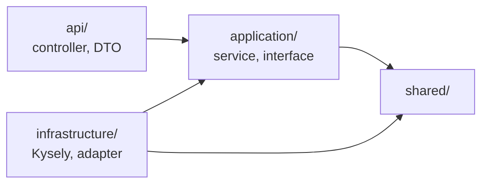

# Folder Structure — React and NestJS

> Design status: TARGET V1
>
> Implementation status: the frontend has a working prototype running on mock data; the backend has NOT STARTED

This document defines where code goes, so that each module in the [C3 architecture](architecture/c4.md#c3--component) and each API group in [OpenAPI](api/openapi.yaml) has exactly one place in the source code.

## 1. General principles

- A business feature lives entirely in one folder, in both the frontend and the backend. Reading one folder shows the whole feature.
- Names in code follow the contract: `operationId` is the function name, and the OpenAPI schema name is the DTO name.
- Authorization and business rules live in the backend. The frontend only hides buttons to keep the UI tidy.
- `src/database/okr360.sql` is the source of truth for the schema (ADR-003). The backend does not generate migrations itself.

## 2. Whole repo

```text
OCK-360/
├── docs/                      # Requirements, architecture, API documents
├── src/
│   ├── database/              # Schema, demo data, schema tests (exists)
│   ├── frontend/              # React + Vite (prototype exists)
│   └── backend/               # NestJS (not yet created)
├── compose.yaml               # Runs postgres, api, worker, proxy (not yet created)
└── .env.example               # Environment variable names, no real values (not yet created)
```

## 3. Frontend

### 3.1 Current state

```text
src/frontend/src/
├── main.jsx, App.jsx          # Entry point, hash-based routing
├── components/                # Shell, Login, AiWorker, AiExplain, ui.jsx, icons.jsx
├── features/                  # admin, ai, dashboard, okr, results, reviews
├── lib/                       # data.js, store.jsx, auth.js, okr.js, review.js, ai*.js
└── pages/                     # Notifications, profile, 403
```

Every page reads data from `lib/store.jsx`, and `store.jsx` takes mock data from `lib/data.js`.

### 3.2 Target

The pages in `features/` stay as they are. Only the data source changes: each feature has an `api.js` file that calls its own `operationId`s.

```text
src/frontend/src/
├── main.jsx, App.jsx
├── components/                # Shared components: Shell, Login, AiExplain, ui.jsx, icons.jsx
├── features/
│   ├── okr/
│   │   ├── api.js             # listObjectives, getObjectiveTree, createCheckin...
│   │   ├── components/        # CheckinModal, ObjectiveForm, KrRow
│   │   └── pages/             # MyOkr, OkrTree, ObjectiveDetail
│   ├── reviews/               # Same pattern: api.js, components/, pages/
│   ├── results/
│   ├── dashboard/
│   ├── ai/
│   └── admin/
├── lib/
│   ├── apiClient.js           # fetch, attaches Bearer token, turns ProblemDetails into errors
│   ├── session.js             # Stores the token, redirects to the login page on 401
│   ├── format.js
│   └── permissions.js         # Shows/hides buttons by role, replaces auth.js
├── mocks/                     # Prototype mock data: data.js, aiSim.js, aiPipeline.js, AiWorker.jsx
└── pages/
```

| Change | Reason |
|---|---|
| Add `features/*/api.js` and `lib/apiClient.js` | Each page calls the API through one place; `401`, `403`, `409` errors are handled consistently |
| Move mock data and the simulated AI to `mocks/` | When `VITE_USE_MOCK=true`, `apiClient.js` returns mock data, so the demo still works without a backend |
| Remove progress and score calculation from `lib/okr.js`, `lib/review.js` | The backend is the only place that calculates; it is kept only in `mocks/` |
| `auth.js` becomes `permissions.js` | This file now only shows/hides things; it is no longer a fake login session |

## 4. NestJS backend

### 4.1 Structure

A NestJS project has two entry points: `main.api.ts` for the API and `main.worker.ts` for the Worker (ADR-002).

```text
src/backend/
├── package.json, tsconfig.json, nest-cli.json
├── .env.example
├── src/
│   ├── main.api.ts              # Starts the API
│   ├── main.worker.ts           # Starts the Worker
│   ├── api.module.ts            # Loads the modules that have controllers
│   ├── worker.module.ts         # Loads the Worker, does not load controllers
│   ├── shared/
│   │   ├── config/              # Reads and validates environment variables
│   │   ├── database/            # Kysely, transactions, types generated from the database
│   │   ├── auth/                # JWT guard, @Roles, current user, reporting-relationship check
│   │   └── http/                # ProblemDetails error filter, pagination
│   ├── ai-gateway/
│   │   ├── application/         # AI call gateway, replace names with codes, map codes back to names
│   │   └── infrastructure/      # Provider adapter; fake adapter for tests
│   ├── modules/
│   │   ├── auth/
│   │   ├── organization/
│   │   ├── okr/
│   │   ├── reviews/
│   │   ├── results/
│   │   ├── system/
│   │   └── automation/
│   └── worker/
│       ├── outbox/              # Reads domain_events using SKIP LOCKED
│       ├── scheduler/           # Schedules in automation_flows, reminders
│       ├── flows/               # flow-runner.ts and the 5 background flows
│       └── email/               # Sends notifications that have not been emailed yet
└── test/
    ├── integration/             # Runs against a real PostgreSQL
    └── contract/                # Checks responses against openapi.yaml
```

### 4.2 Inside a module

Each module is split into three layers as defined in the [scope](01-scope.md).

```text
modules/okr/
├── okr.module.ts
├── api/                         # API layer
│   ├── objectives.controller.ts # Each function is one operationId
│   ├── checkins.controller.ts
│   └── dto/                     # Named after OpenAPI schemas: CheckinCreate, CheckinResult...
├── application/                 # Business layer
│   ├── checkin.service.ts       # Check-in, rolls up progress in the same transaction
│   ├── progress-rollup.ts       # BR-042, BR-043, BR-044
│   └── okr.repository.ts        # Data access interface
└── infrastructure/              # Infrastructure layer
    └── kysely-okr.repository.ts # Implementation using Kysely
```

Unit tests are placed next to the file under test, for example `progress-rollup.spec.ts`.

### 4.3 Dependency direction



| Rule | Forbidden example |
|---|---|
| `application/` does not import `api/` or `infrastructure/` | A service imports a controller, or imports Kysely directly |
| Other modules only call through services `export`ed in `*.module.ts` | `results` reads the `review_answers` table directly instead of calling the `reviews` service |
| The 360 score by group may only be read inside `reviews/` | Another module queries `vw_review_group_scores` (BR-059) |
| `worker/` does not import the `api/` of any module | The Worker calls a controller to reuse its logic |
| Every AI call goes through `ai-gateway/` | A flow calls the provider's SDK on its own (ADR-005) |

These rules are checked automatically by `dependency-cruiser` when running lint, not only by relying on review.

## 5. Module mapping

| C3 module | API group (OpenAPI tag) | Backend | Frontend |
|---|---|---|---|
| Auth and authorization | Login | `modules/auth`, `shared/auth` | `components/Login.jsx`, `lib/session.js` |
| Organization | Profile, Organization, Users | `modules/organization` | `pages/Profile.jsx`, `features/admin` |
| OKR | Cycles, OKR, Check-in | `modules/okr` | `features/okr`, `features/admin` (cycles) |
| 360 review | 360 form templates, 360 campaigns, Nominations, 360 forms, 360 results | `modules/reviews` | `features/reviews`, `features/admin` (campaigns, form templates) |
| Results and reports | Final results, Dashboard, Reports | `modules/results` | `features/results`, `features/dashboard` |
| System | Notifications, Audit log | `modules/system` | `pages/Notifications.jsx`, `features/admin` (audit log) |
| Automation | Automation, Blockers, Weekly digest, 1-1 drafts | `modules/automation`, `worker/` | `features/ai`, `components/AiExplain.jsx` |
| AI Gateway | — | `ai-gateway/` | — |

## 6. Naming conventions

| Item | Convention | Example |
|---|---|---|
| Backend file | kebab-case, suffix by role | `checkin.service.ts`, `objectives.controller.ts` |
| Controller function | Same as `operationId` | `createCheckin()` |
| DTO | Same as the OpenAPI schema name | `CheckinCreate`, `ReviewResult` |
| React component | PascalCase | `CheckinModal.jsx` |
| Function in `api.js` | Same as `operationId` | `createCheckin(keyResultId, body)` |
| AI flow | `automation_flow` enum name written in kebab-case | `worker/flows/blocker-routing.flow.ts` |

## 7. Configuration and secrets

Secrets live only in the environment variables of `api` and `worker`, and never go into the frontend build (NFR-SEC-007). `.env` is not committed to Git; `.env.example` contains only variable names.

| Variable | Used by | Meaning |
|---|---|---|
| `DATABASE_URL` | api, worker | PostgreSQL connection |
| `JWT_SECRET` | api | Token signing key |
| `AI_PROVIDER`, `AI_API_KEY` | api, worker | AI service; without them the AI flows cannot be enabled |
| `SMTP_HOST`, `SMTP_PORT`, `SMTP_USER`, `SMTP_PASSWORD` | worker | Sending email |
| `OUTBOX_POLL_SECONDS` | worker | Interval for reading the event outbox, default 30 |
| `VITE_API_BASE_URL`, `VITE_USE_MOCK` | frontend | API address; enables mock data. Not secrets |

**Related:** [C4 architecture](architecture/c4.md) · [Architecture decisions](architecture/decisions.md) · [API](api/README.md)
