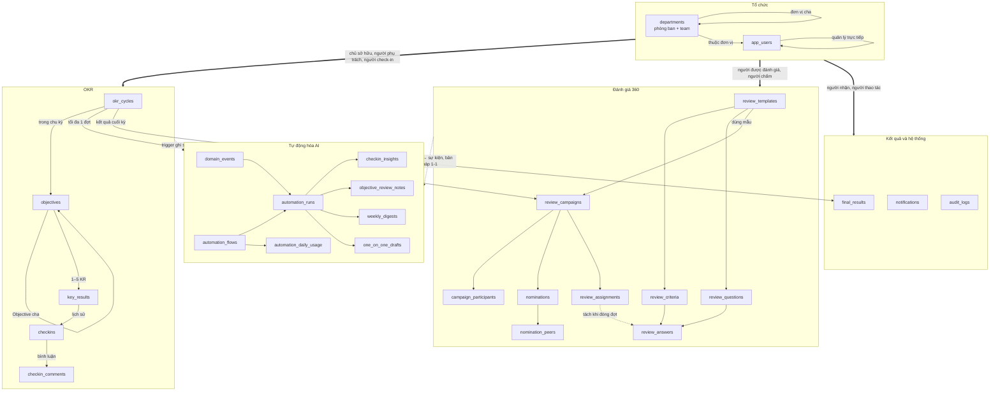
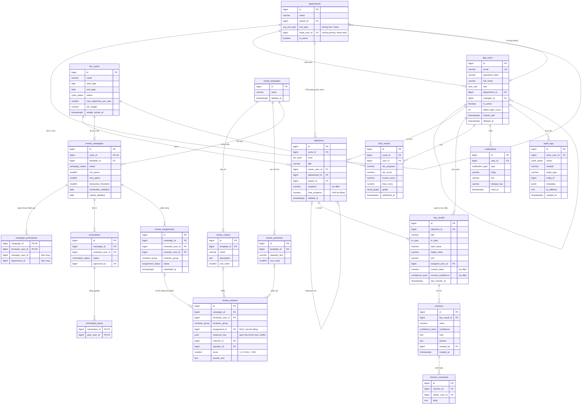
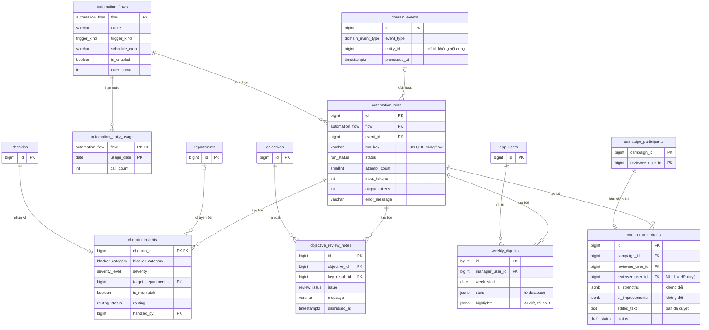

# OKR360 — Database Diagrams

Các sơ đồ dưới đây vẽ từ [`src/database/okr360.sql`](../src/database/okr360.sql) (PostgreSQL 15+, schema `okr360`). Giải thích thiết kế nằm ở [05-data-model.md](05-data-model.md). Muốn xem sơ đồ kéo thả được, dán [`okr360.dbml`](../src/database/okr360.dbml) vào [dbdiagram.io](https://dbdiagram.io).

## Quan hệ tổng quan

Sơ đồ chia 27 bảng thành năm nhóm. Mũi tên đi từ bảng cha sang bảng con; nhãn ghi ý nghĩa của khóa ngoại.

Nhóm Tự động hóa AI chỉ **đọc** từ OKR và Đánh giá 360 (mũi tên nét đứt): trigger ghi sự kiện vào `domain_events`, kết quả AI nằm ở các bảng riêng của nhóm này, không bảng OKR hay 360 nào bị AI sửa.

Đường nét đứt giữa `review_assignments` và `review_answers` là chỗ quan trọng nhất về ẩn danh: liên kết chỉ tồn tại trong lúc đợt đang thu phiếu, và bị xóa khi đóng đợt (xem [Ràng buộc ẩn danh](#ràng-buộc-ẩn-danh-nhật-ký-và-tự-động-hóa-ai)).

Mũi tên đậm đi từ nhóm Tổ chức gom chung các khóa ngoại tới `app_users` (chủ Objective, người phụ trách KR, người check-in, người được đánh giá, người chấm, người nhận thông báo…) để sơ đồ dễ đọc; sơ đồ chi tiết bên dưới vẽ từng quan hệ.

## Enums

| Enum | Giá trị | Hiển thị trên giao diện |
|---|---|---|
| `user_role` | ADMIN, HR, MANAGER, EMPLOYEE | Quản trị viên, Nhân sự, Quản lý, Nhân viên |
| `cycle_status` | DRAFT, ACTIVE, CLOSED | Nháp, Đang chạy, Đã đóng |
| `okr_level` | COMPANY, DEPARTMENT, TEAM, INDIVIDUAL | Công ty, Phòng ban, Team, Cá nhân |
| `org_unit_type` | DEPARTMENT, TEAM | Phòng ban, Team |
| `kr_type` | NUMBER, PERCENT, BOOLEAN | Số, Phần trăm, Có/Không |
| `confidence_level` | ON_TRACK, AT_RISK, OFF_TRACK | Đúng tiến độ, Có rủi ro, Chệch hướng |
| `campaign_status` | DRAFT, NOMINATION, COLLECTING, CLOSED, PUBLISHED | Nháp, Đề cử, Thu phiếu, Đã đóng, Đã công bố |
| `reviewer_group` | SELF, MANAGER, PEER, DIRECT_REPORT | Tự đánh giá, Quản lý, Đồng nghiệp, Cấp dưới |
| `assignment_status` | NOT_STARTED, DRAFT, SUBMITTED, CANCELLED | Chưa làm, Đang điền, Đã nộp, Đã hủy |
| `nomination_status` | DRAFT, PENDING, APPROVED | Đang chọn, Chờ duyệt, Đã duyệt |
| `result_grade` | EXCELLENT, GOOD, MEETS, NEEDS_IMPROVEMENT, INSUFFICIENT_DATA | Xuất sắc, Tốt, Đạt, Cần cải thiện, Thiếu dữ liệu |
| `notification_type` | CHECKIN_REMINDER, CHECKIN_OFF_TRACK, CHECKIN_COMMENT, PLANNING_REMINDER, NOMINATION_REMINDER, NOMINATION_PENDING, REVIEW_REMINDER, RESULT_PUBLISHED, BLOCKER_ROUTED, BLOCKER_UPDATED, WEEKLY_DIGEST, CHECKIN_MISMATCH, AI_DRAFT_READY, ONE_ON_ONE_SENT, AUTOMATION_ALERT | Nhắc check-in, KR chệch hướng, Bình luận mới, Nhắc lập OKR, Nhắc đề cử, Chờ duyệt đề cử, Nhắc điền phiếu, Đã công bố kết quả, Vướng mắc chuyển đến, Vướng mắc đã có người nhận, Bản tin tuần, Check-in không khớp, Có bản nháp chờ duyệt, Đã nhận tóm tắt 1-1, Cảnh báo luồng tự động |
| `audit_action` | CREATE, UPDATE, SOFT_DELETE, RESTORE, STATUS_CHANGE, CHECKIN, SUBMIT, PUBLISH, LOGIN, LOGIN_FAILED, EXPORT | Tạo, Sửa, Xóa, Khôi phục, Đổi trạng thái, Check-in, Nộp phiếu, Công bố, Đăng nhập, Đăng nhập lỗi, Xuất file |
| `automation_flow` | BLOCKER_ROUTING, WEEKLY_DIGEST, ONE_ON_ONE_DRAFT, CHECKIN_MISMATCH, OKR_REVIEW, REVIEW_COMMENT_GUARD | Chuyển vướng mắc, Bản tin tuần, Bản nháp 1-1, Check-in không khớp, Rà soát OKR, Cảnh báo nhận xét 360 |
| `trigger_kind` | EVENT, SCHEDULE, ON_SUBMIT | Theo sự kiện, Theo lịch, Khi bấm nộp |
| `domain_event_type` | CHECKIN_CREATED, OBJECTIVE_CREATED, CAMPAIGN_CLOSED | Có check-in mới, Có Objective mới, Đợt 360 đã đóng |
| `run_status` | PENDING, RUNNING, SUCCEEDED, FAILED, SKIPPED | Đang chờ, Đang chạy, Thành công, Lỗi, Bỏ qua |
| `blocker_category` | DEPENDENCY, RESOURCE, TECHNICAL, PRIORITY_CHANGE, OTHER | Phụ thuộc phòng khác, Thiếu nguồn lực, Kỹ thuật, Ưu tiên thay đổi, Khác |
| `severity_level` | LOW, MEDIUM, HIGH | Thấp, Trung bình, Cao |
| `routing_status` | OPEN, ACKNOWLEDGED, REJECTED | Chờ nhận, Đã nhận xử lý, Không liên quan |
| `review_issue` | NOT_MEASURABLE, OUTPUT_ONLY, DUPLICATE, NOT_ALIGNED | KR khó đo, Chỉ đếm việc làm, Trùng KR khác, Chưa liên kết cấp trên |
| `draft_status` | PENDING_REVIEW, SENT, DISCARDED | Chờ duyệt, Đã gửi, Đã bỏ |

## Views

| View | Trả về | Ai dùng |
|---|---|---|
| `vw_key_result_progress` | Tiến độ 0–1 của từng KR theo công thức (hiện tại − ban đầu) / (đích − ban đầu), giới hạn 0–1; KR Có/Không là 0 hoặc 1 | Màn chi tiết Objective, dashboard |
| `vw_objective_tree` | Mỗi Objective kèm gốc (`root_id`), độ sâu (`depth`) và đường dẫn từ gốc (`path`), bằng CTE đệ quy | Cây OKR, breadcrumb |
| `vw_campaign_reviewer_progress` | Mỗi người chấm còn bao nhiêu phiếu chưa nộp. **Không có cột người được đánh giá** | Nhân sự theo dõi đợt, nhắc nhở |
| `vw_automation_flow_status` | Mỗi luồng: bật/tắt, hạn mức, số lần gọi AI hôm nay, lần chạy gần nhất, số lần lỗi 7 ngày, số lần đang chờ | Màn hình Tự động hóa (Admin, HR) |
| `vw_open_blockers` | Vướng mắc đang chờ trưởng phòng được chuyển đến nhận, kèm người báo và KR | Màn hình Vướng mắc chuyển đến (trưởng phòng) |
| `vw_review_group_scores` | Điểm trung bình theo đợt, người được đánh giá, nhóm người chấm, tiêu chí; số phiếu đếm theo `response_key`. Chỉ có dữ liệu khi đợt đã CLOSED hoặc PUBLISHED | **Chỉ tầng nghiệp vụ.** Chưa áp ngưỡng 3 phiếu nên API không được trả thẳng view này |

## Sơ đồ ER chi tiết

Chỉ ghi các cột chính. Đủ cột, kiểu dữ liệu và giá trị mặc định xem trong file SQL hoặc DBML.

## Sơ đồ ER — Tự động hóa AI

Các bảng của phần tự động hóa, tách riêng để sơ đồ chính dễ đọc. Các bảng `checkins`, `departments`, `objectives`, `app_users`, `campaign_participants` chỉ vẽ khóa chính để thấy chỗ nối.

## Ràng buộc ẩn danh, nhật ký và tự động hóa AI

Đây là các quy tắc mà **mọi** truy vấn, API và báo cáo phải tôn trọng. Một số được database tự chặn; số còn lại là trách nhiệm của tầng nghiệp vụ.

| Quy tắc | Database tự đảm bảo | Tầng nghiệp vụ phải làm |
|---|---|---|
| Sau khi đóng đợt, không ai (kể cả Admin có quyền đọc database) biết ai chấm điểm nào | `close_review_campaign()` đặt `review_answers.assignment_id = NULL`; `review_assignments` không có cột điểm | Chỉ đóng đợt qua hàm này, không UPDATE trạng thái tay |
| Nhóm Đồng nghiệp/Cấp dưới dưới 3 phiếu không được hiện riêng | `vw_review_group_scores` trả `form_count` theo `response_key` | Gộp hai nhóm nếu một nhóm < 3; vẫn < 3 thì ẩn và không tính vào điểm 360 |
| Trong lúc thu phiếu, Nhân sự chỉ thấy ai còn nợ bao nhiêu phiếu | `vw_campaign_reviewer_progress` không có cột người được đánh giá | API theo dõi tiến độ chỉ đọc view này |
| Nhật ký không làm lộ ẩn danh hay bí mật | `audit_logs` không sửa, không xóa được | `metadata` không chứa mật khẩu, hash, token, nội dung phiếu, hay cặp người chấm–người được chấm của nhóm ẩn danh |
| Check-in là lịch sử thật | `checkins` không sửa, không xóa được | Sửa sai bằng một check-in mới |
| AI không sửa dữ liệu nghiệp vụ | Kết quả AI chỉ nằm ở bảng riêng; trigger giữ nguyên đề xuất gốc của AI | Tài khoản của AI worker chỉ có quyền ghi vào các bảng tự động hóa và `notifications` |
| Admin xem lịch sử chạy không đọc được nội dung | `automation_runs` và `domain_events` không có cột nội dung | Không ghi prompt hay câu trả lời của AI vào log ứng dụng |
| Thời điểm nộp phiếu không lộ qua tự động hóa | Luồng cảnh báo nhận xét 360 bị chặn ghi `automation_runs` | Chỉ cộng `automation_daily_usage` |
| Tên thật không rời khỏi hệ thống | — | Đổi tên người, phòng ban thành mã trước khi gọi AI; bảng ánh xạ chỉ nằm trong bộ nhớ |
| Nhân viên chỉ thấy nội dung đã duyệt | `one_on_one_drafts`: chỉ người duyệt gửi được, chỉ sau khi đợt đã công bố | API trả cho nhân viên đúng `edited_text`, không trả `ai_strengths`/`ai_improvements` |
