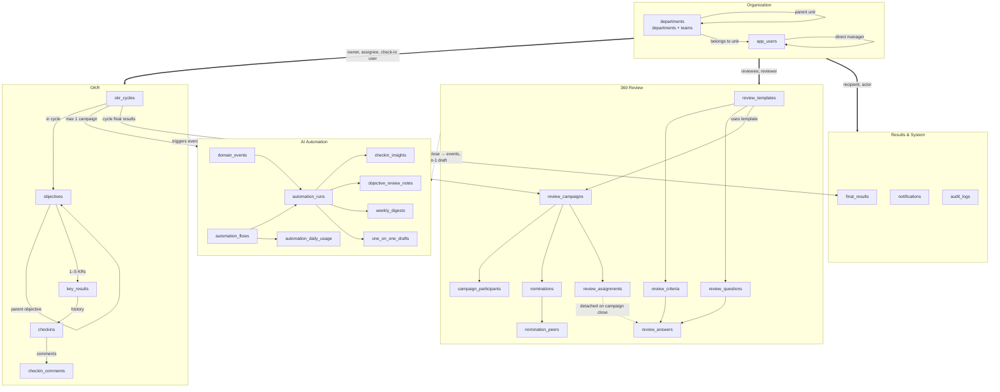
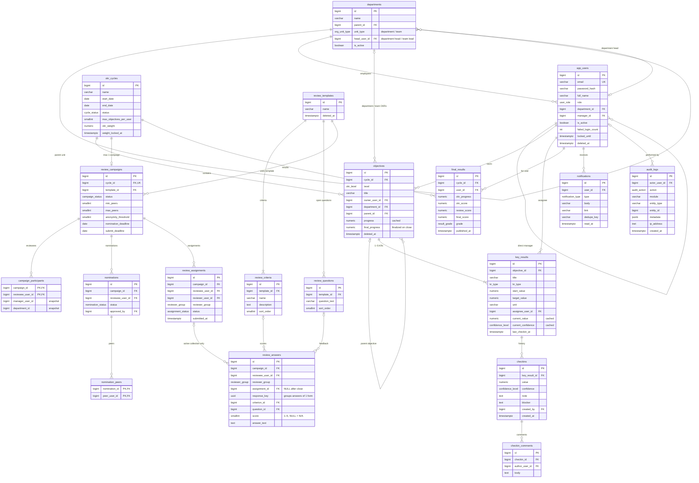
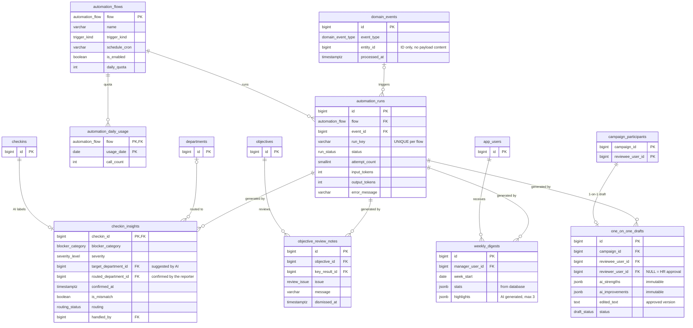

# OKR360 — Database Diagrams

This is the target database design (PostgreSQL 15+, schema `okr360`). Design rationale and details are documented in [05-data-model.md](05-data-model.md). The SQL schema itself is written in increment I1 of the [implementation plan](09-implementation-plan.md), following this document.

## Entity Relationship Overview

The diagram divides the 27 tables into five groups. Arrows point from parent tables to child tables; labels describe the foreign key relationships.

The AI Automation group only **reads** from OKR and 360 Review (dashed arrows): database triggers log events into `domain_events`, AI results reside in dedicated tables within this group, and no OKR or 360 Review tables are modified by AI.

The dashed line between `review_assignments` and `review_answers` represents the core anonymity boundary: this association exists only while the campaign is actively collecting responses, and is detached when the campaign is closed (see [Anonymity, Audit Log, and AI Automation Constraints](#anonymity-audit-log-and-ai-automation-constraints)).

Thick arrows originating from the Organization group consolidate multiple foreign keys pointing to `app_users` (Objective owners, KR assignees, check-in users, reviewees, reviewers, notification recipients, etc.) to keep the overview readable; detailed relationships are shown in the ER diagrams below.

## Enums

| Enum | Values | UI Display |
|---|---|---|
| `user_role` | ADMIN, HR, MANAGER, EMPLOYEE | Administrator, HR, Manager, Employee |
| `cycle_status` | DRAFT, ACTIVE, CLOSED | Draft, Active, Closed |
| `okr_level` | COMPANY, DEPARTMENT, TEAM, INDIVIDUAL | Company, Department, Team, Individual |
| `org_unit_type` | DEPARTMENT, TEAM | Department, Team |
| `kr_type` | NUMBER, PERCENT, BOOLEAN | Number, Percentage, Boolean |
| `confidence_level` | ON_TRACK, AT_RISK, OFF_TRACK | On Track, At Risk, Off Track |
| `campaign_status` | DRAFT, NOMINATION, COLLECTING, CLOSED, PUBLISHED | Draft, Nomination, Collecting, Closed, Published |
| `reviewer_group` | SELF, MANAGER, PEER, DIRECT_REPORT | Self, Manager, Peer, Direct Report |
| `assignment_status` | NOT_STARTED, DRAFT, SUBMITTED, CANCELLED | Not Started, Draft, Submitted, Cancelled |
| `nomination_status` | DRAFT, PENDING, APPROVED | Draft, Pending, Approved |
| `result_grade` | EXCELLENT, GOOD, MEETS, NEEDS_IMPROVEMENT, INSUFFICIENT_DATA | Excellent, Good, Meets Expectations, Needs Improvement, Insufficient Data |
| `notification_type` | CHECKIN_REMINDER, CHECKIN_OFF_TRACK, CHECKIN_COMMENT, PLANNING_REMINDER, NOMINATION_REMINDER, NOMINATION_PENDING, REVIEW_REMINDER, RESULT_PUBLISHED, BLOCKER_ROUTED, BLOCKER_SUGGESTED, BLOCKER_UPDATED, WEEKLY_DIGEST, CHECKIN_MISMATCH, AI_DRAFT_READY, ONE_ON_ONE_SENT, AUTOMATION_ALERT | Check-in reminder, KR off track, New comment, OKR planning reminder, Nomination reminder, Pending nomination approval, Review form reminder, Results published, Blocker routed, Blocker send suggestion, Blocker acknowledged, Weekly digest, Check-in mismatch, AI draft ready for review, 1-on-1 summary received, Automation alert |
| `audit_action` | CREATE, UPDATE, SOFT_DELETE, RESTORE, STATUS_CHANGE, CHECKIN, SUBMIT, PUBLISH, LOGIN, LOGIN_FAILED, EXPORT | Create, Update, Delete (Soft Delete), Restore, Status Change, Check-in, Submit, Publish, Login, Login Failed, Export |
| `automation_flow` | BLOCKER_ROUTING, WEEKLY_DIGEST, ONE_ON_ONE_DRAFT, CHECKIN_MISMATCH, OKR_REVIEW, REVIEW_COMMENT_GUARD | Blocker routing, Weekly digest, 1-on-1 draft, Check-in mismatch, OKR review, Review comment guard |
| `trigger_kind` | EVENT, SCHEDULE, ON_SUBMIT | Event-based, Scheduled, On submit |
| `domain_event_type` | CHECKIN_CREATED, OBJECTIVE_CREATED, CAMPAIGN_CLOSED | New check-in created, New objective created, 360 campaign closed |
| `run_status` | PENDING, RUNNING, SUCCEEDED, FAILED, SKIPPED | Pending, Running, Succeeded, Failed, Skipped |
| `blocker_category` | DEPENDENCY, RESOURCE, TECHNICAL, PRIORITY_CHANGE, OTHER | Cross-department dependency, Resource constraint, Technical issue, Priority change, Other |
| `severity_level` | LOW, MEDIUM, HIGH | Low, Medium, High |
| `routing_status` | SUGGESTED, OPEN, ACKNOWLEDGED, REJECTED, DISMISSED | Suggested to the reporter, Open, Acknowledged, Rejected, Not sent |
| `review_issue` | NOT_MEASURABLE, OUTPUT_ONLY, DUPLICATE, NOT_ALIGNED | Difficult to measure, Output-only activity, Duplicate KR, Not aligned with parent |
| `draft_status` | PENDING_REVIEW, SENT, DISCARDED | Pending review, Sent, Discarded |

## Views

| View | Returns | Consumers / Usage |
|---|---|---|
| `vw_key_result_progress` | Progress 0–1 for each KR calculated as (current − initial) / (target − initial), clamped to 0–1; Boolean KR is 0 or 1 | Objective detail screen, dashboard |
| `vw_objective_tree` | Each Objective with root (`root_id`), depth (`depth`), and path from root (`path`), via recursive CTE | OKR tree, breadcrumb |
| `vw_campaign_reviewer_progress` | Remaining unsubmitted forms for each reviewer. **Contains no reviewee column** | HR campaign monitoring, reminders |
| `vw_automation_flow_status` | Per flow: enabled/disabled, quota, AI calls today, last run timestamp, 7-day error count, pending count | Automation screen (Admin, HR) |
| `vw_open_blockers` | Open blockers pending acknowledgment by target department head, with reporter and KR details | Routed blockers screen (Department head) |
| `vw_review_group_scores` | Average scores by campaign, reviewee, reviewer group, criterion; form count calculated via `response_key`. Populated only when campaign is CLOSED or PUBLISHED | **Business logic layer only.** Does not enforce the 3-review threshold, so API must not expose this view directly. |

## Detailed ER Diagram

Displays primary columns only. For full columns, data types, and default values, refer to the SQL or DBML file.

## ER Diagram — AI Automation

Automation tables are separated to keep the primary diagram clear and readable. Tables `checkins`, `departments`, `objectives`, `app_users`, and `campaign_participants` show primary keys only to indicate join points.

## Anonymity, Audit Log, and AI Automation Constraints

These are constraints that **every** query, API, and report must adhere to. Some are strictly enforced by the database; the remainder are the responsibility of the business logic layer.

| Rule | Database Enforced | Business Layer Responsibility |
|---|---|---|
| After campaign closure, no one (including Admins with database read privileges) can identify which reviewer submitted which score | `close_review_campaign()` sets `review_answers.assignment_id = NULL`; `review_assignments` contains no score column | Campaign closure must only execute via this function; manual state UPDATE operations are prohibited |
| Peer/Direct Report groups with fewer than 3 reviews cannot be displayed separately | `vw_review_group_scores` returns `form_count` based on `response_key` | Merge both groups if either has < 3; if the merged group is still < 3, hide completely and exclude from 360 review score calculation |
| During active response collection, HR can only view how many unsubmitted forms each reviewer has pending | `vw_campaign_reviewer_progress` contains no reviewee column | Campaign progress tracking APIs must query this view only |
| Audit logs must never compromise anonymity or sensitive secrets | `audit_logs` is append-only (cannot be updated or deleted) | `metadata` must not contain passwords, hashes, tokens, form response answers, or reviewer-reviewee mappings for anonymous groups |
| Check-in entries represent immutable history | `checkins` cannot be updated or deleted | Corrections must be submitted as a new check-in |
| AI never modifies business data | AI outputs are stored exclusively in dedicated automation tables; database triggers preserve original AI suggestions | The AI worker account has write permissions restricted solely to automation tables and `notifications` |
| Admins inspecting execution history cannot view payload content | `automation_runs` and `domain_events` contain no content or prompt columns | Application logs must never write AI prompts or generated response content |
| Review submission timestamps cannot be leaked via automation | The review comment guard flow is prohibited from inserting into `automation_runs` | Increments only `automation_daily_usage` |
| Real identities never leave the system | — | Pseudonymize user and department names to random identifiers before sending requests to AI; mapping tables reside exclusively in memory |
| Employees can only view approved content | `one_on_one_drafts`: can only be sent by the approver, and only after the campaign is published | The employee-facing API returns strictly `edited_text`, never exposing `ai_strengths` or `ai_improvements` |
