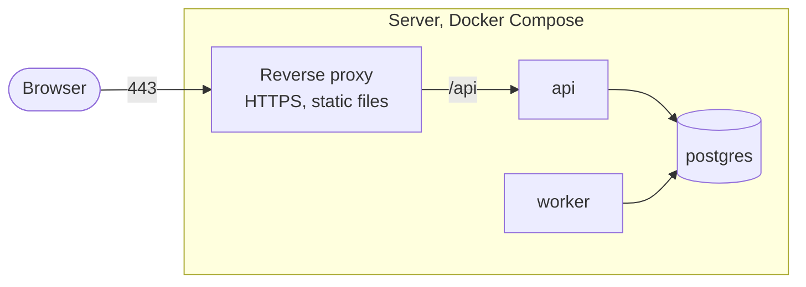

# 7. Deployment View — OKR360 V1

> Design status: TARGET V1
>
> Implementation status: NOT STARTED

## 7.1 Infrastructure

V1 runs on Docker Compose on one server. The reverse proxy handles HTTPS, serves the Web App's static files and forwards `/api` to the API.

The AI service key, SMTP credentials and JWT signing key live in the environment variables of `api` and `worker`, and are not included in the Web App build (NFR-SEC-007).

## 7.2 Environments

| Environment | Contains | Used for |
|---|---|---|
| Development machine | PostgreSQL in Docker; API and Worker run locally; `FakeAiProvider` instead of a real AI service | Writing code, running tests |
| CI | GitHub Actions with PostgreSQL as a service container | Every push and pull request |
| Production | Docker Compose behind an HTTPS reverse proxy; real AI service | After increment I10 |

Backups: daily, keep 7 copies, and a restore drill before going live (NFR-REL-005). Details per increment are in the [implementation plan](../../09-implementation-plan.md).

Previous: [6. Runtime view](06-runtime-view.md) · Next: [8. Cross-cutting concepts](08-crosscutting-concepts.md)
