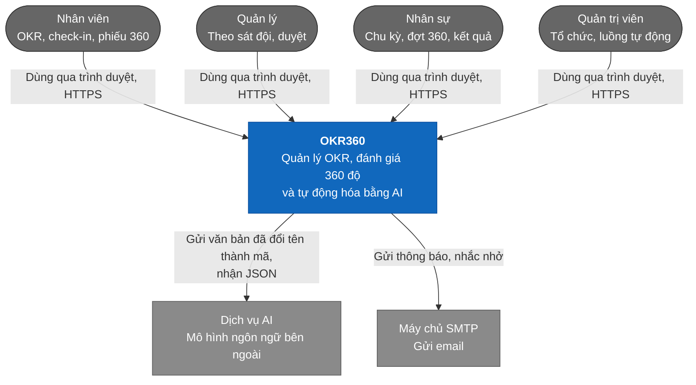
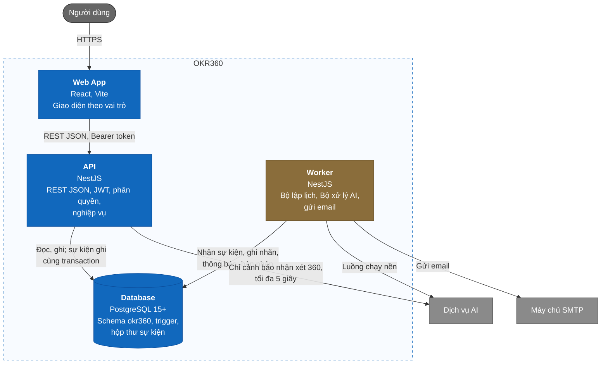
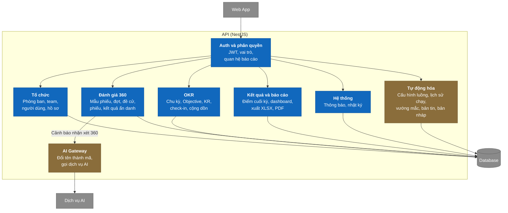
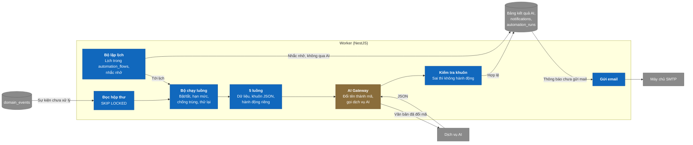
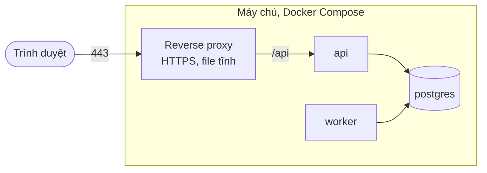

# Kiến trúc C4 — OKR360 V1

> Trạng thái thiết kế: TARGET V1
>
> Trạng thái triển khai: CHƯA BẮT ĐẦU; backend chưa có, giao diện hiện chạy bằng dữ liệu giả

Tài liệu mô tả hệ thống theo 3 cấp của mô hình C4, từ ngoài vào trong. Cấp 4 (code) nằm ở [sơ đồ class](class-diagrams.md); cách các class phối hợp trong từng thao tác nằm ở [sơ đồ sequence](sequence-diagrams.md). Lý do của từng lựa chọn nằm ở [Quyết định kiến trúc](decisions.md).

## C1 — Bối cảnh hệ thống

OKR360 là một hệ thống web dùng nội bộ cho một công ty. Hệ thống chỉ gọi ra hai dịch vụ bên ngoài: dịch vụ AI và máy chủ email.

## C2 — Container

Hệ thống gồm 4 phần chạy độc lập. Backend tách làm hai tiến trình dùng chung một mã nguồn NestJS: API phục vụ người dùng, Worker làm việc nền. Nhờ vậy AI chậm không làm chậm API.

| Container | Trách nhiệm | Không làm |
|---|---|---|
| Web App | Hiển thị theo vai trò, gọi API | Không gọi AI; ẩn nút chỉ để gọn giao diện, không phải để bảo mật |
| API | Xác thực, phân quyền, nghiệp vụ, transaction, báo cáo, xuất file | Không gọi AI ở luồng chạy nền, không gửi email trực tiếp |
| Worker | Chạy theo lịch, xử lý hộp thư sự kiện, gọi AI, kiểm tra kết quả, gửi email | Không nhận yêu cầu từ người dùng; không ghi vào bảng OKR hay 360 |
| Database | Lưu dữ liệu, chặn dữ liệu sai bằng ràng buộc và trigger, ghi sự kiện | Không áp ngưỡng ẩn danh; việc này ở tầng nghiệp vụ |

## C3 — Component

### API

Mỗi module NestJS chia ba tầng theo [phạm vi](../01-scope.md): API nhận yêu cầu, Application giữ nghiệp vụ, Infrastructure làm việc với database và dịch vụ ngoài.

| Module | Use case | Điểm cần giữ |
|---|---|---|
| Auth và phân quyền | UC01, UC02 | Mọi API trừ đăng nhập đều qua đây (BR-002) |
| Tổ chức | UC03, UC04, UC05 | Quan hệ báo cáo không suy ra từ cây đơn vị (BR-016) |
| OKR | UC06–UC14 | Check-in và cộng dồn trong cùng transaction (BR-043) |
| Đánh giá 360 | UC15–UC21 | Là nơi duy nhất đọc điểm theo nhóm và áp ngưỡng ẩn danh (BR-059) |
| Kết quả và báo cáo | UC22, UC23, UC24 | Lấy điểm 360 qua module Đánh giá 360, không đọc thẳng bảng phiếu |
| Hệ thống | UC25, UC26 | Nhật ký chỉ thêm mới (BR-083) |
| Tự động hóa | UC27–UC31 | Chỉ đọc và cập nhật phần của con người trên kết quả AI |
| AI Gateway | UC19 | Dùng chung với Worker; chờ tối đa 5 giây, lỗi thì cho nộp (BR-101) |

### Worker

Worker không có controller. Năm luồng chạy nền đi chung một đường ống; mỗi luồng chỉ khác phần lấy dữ liệu, khuôn JSON và hành động.

Bước gọi AI nằm ngoài transaction; kết quả, thông báo và lịch sử chạy được ghi trong một transaction mới ([thiết kế dữ liệu](../05-data-model.md), mục 4). Bảng mã đổi tên chỉ nằm trong bộ nhớ của lần chạy (BR-093).

## Triển khai

V1 chạy bằng Docker Compose trên một máy chủ. Reverse proxy lo HTTPS, phục vụ file tĩnh của Web App và chuyển `/api` tới API.

Khóa dịch vụ AI, thông tin SMTP và khóa ký JWT nằm trong biến môi trường của `api` và `worker`, không đưa vào bản build của Web App (NFR-SEC-007).

**Liên quan:** [Quyết định kiến trúc](decisions.md) · [Đặc tả luồng AI](ai-flows.md) · [Sơ đồ class](class-diagrams.md) · [Sơ đồ sequence](sequence-diagrams.md) · [Quy tắc nghiệp vụ](../requirements/business-rules.md) · [Yêu cầu phi chức năng](../requirements/non-functional-requirements.md) · [Thiết kế dữ liệu](../05-data-model.md)
