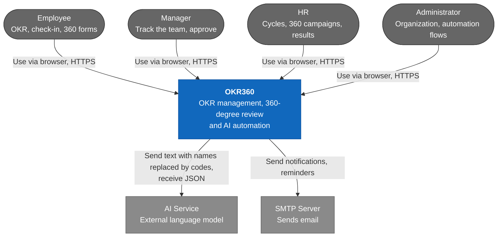
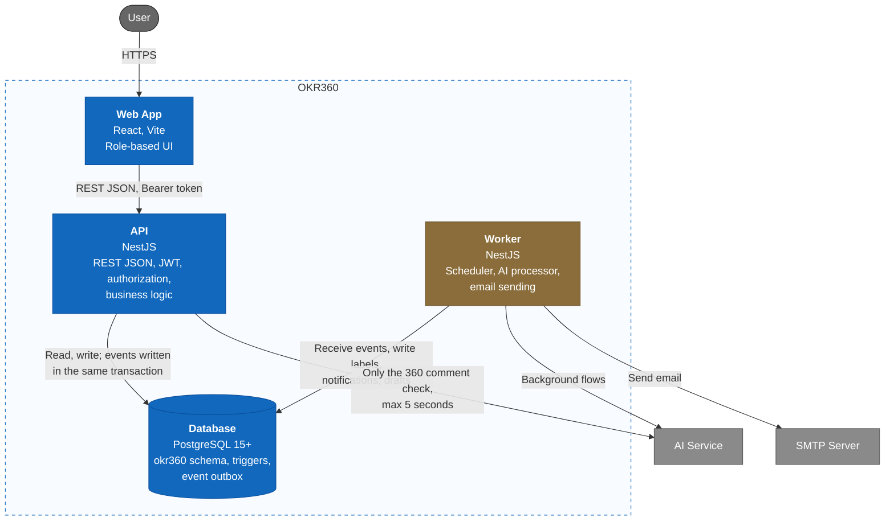
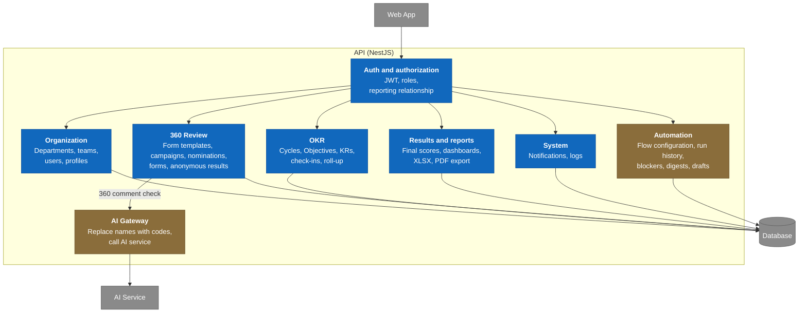
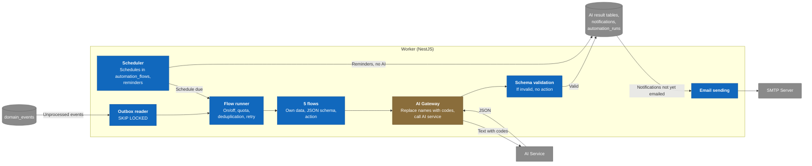
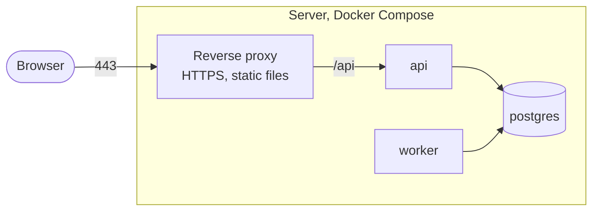

# C4 Architecture — OKR360 V1

> Design status: TARGET V1
>
> Implementation status: NOT STARTED; no backend yet, the UI currently runs on mock data

This document describes the system at 3 levels of the C4 model, from the outside in. Level 4 (code) is in the [class diagrams](class-diagrams.md); how classes collaborate in each operation is in the [sequence diagrams](sequence-diagrams.md). The reasons behind each choice are in [Architecture Decisions](decisions.md).

## C1 — System Context

OKR360 is a web system used internally by one company. The system calls out to only two external services: the AI service and the email server.

## C2 — Container

The system consists of 4 independently running parts. The backend is split into two processes sharing one NestJS codebase: the API serves users, the Worker does background work. This way a slow AI does not slow down the API.

| Container | Responsibility | Does not do |
|---|---|---|
| Web App | Displays by role, calls the API | Does not call AI; hides buttons only to keep the UI tidy, not for security |
| API | Authentication, authorization, business logic, transactions, reports, file export | Does not call AI for background flows, does not send email directly |
| Worker | Runs on schedule, processes the event outbox, calls AI, validates results, sends email | Does not accept user requests; does not write to OKR or 360 tables |
| Database | Stores data, blocks invalid data with constraints and triggers, records events | Does not apply the anonymity threshold; that is in the business layer |

## C3 — Component

### API

Each NestJS module is split into three layers per the [scope](../01-scope.md): API receives requests, Application holds business logic, Infrastructure works with the database and external services.

| Module | Use case | Key point to keep |
|---|---|---|
| Auth and authorization | UC01, UC02 | Every API except login goes through here (BR-002) |
| Organization | UC03, UC04, UC05 | The reporting relationship is not derived from the unit tree (BR-016) |
| OKR | UC06–UC14 | Check-in and roll-up in the same transaction (BR-043) |
| 360 Review | UC15–UC21 | The only place that reads scores by group and applies the anonymity threshold (BR-059) |
| Results and reports | UC22, UC23, UC24 | Gets the 360 score through the 360 Review module, does not read the form table directly |
| System | UC25, UC26 | Append-only log (BR-083) |
| Automation | UC27–UC31 | Only reads, and updates the human part of AI results |
| AI Gateway | UC19 | Shared with the Worker; waits at most 5 seconds, on failure lets the user submit (BR-101) |

### Worker

The Worker has no controllers. The five background flows share one pipeline; each flow differs only in data retrieval, JSON schema and action.

The AI call step is outside the transaction; the result, notifications and run history are written in a new transaction ([data design](../05-data-model.md), section 4). The code-mapping table (name to code) exists only in the memory of a run (BR-093).

## Deployment

V1 runs on Docker Compose on one server. The reverse proxy handles HTTPS, serves the Web App's static files and forwards `/api` to the API.

The AI service key, SMTP credentials and JWT signing key live in the environment variables of `api` and `worker`, and are not included in the Web App build (NFR-SEC-007).

**Related:** [Architecture Decisions](decisions.md) · [AI Flow Specification](ai-flows.md) · [Class Diagrams](class-diagrams.md) · [Sequence Diagrams](sequence-diagrams.md) · [Business Rules](../requirements/business-rules.md) · [Non-functional Requirements](../requirements/non-functional-requirements.md) · [Data Design](../05-data-model.md)
</Content>
</invoke>
<invoke name="read_file">
<parameter name="Path">C:\Users\Admin\Documents\testvscode\OCK-360\docs\architecture\risks.md