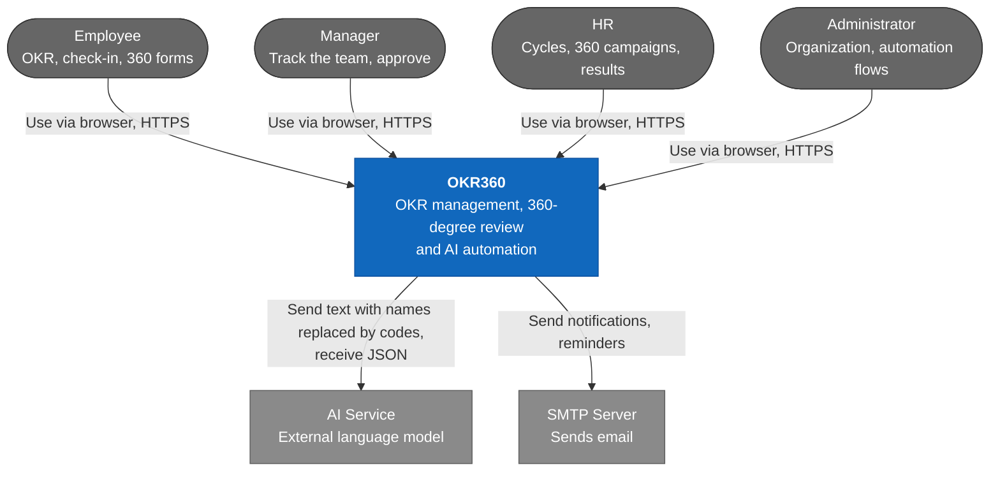

# C1 — System Context — OKR360 V1

> Design status: TARGET V1
>
> Implementation status: NOT STARTED; no backend yet, the UI currently runs on mock data

OKR360 is a web system used internally by one company. The system calls out to only two external services: the AI service and the email server.

Next: [C2 Container](02-container.md) · [C4 index](README.md)
