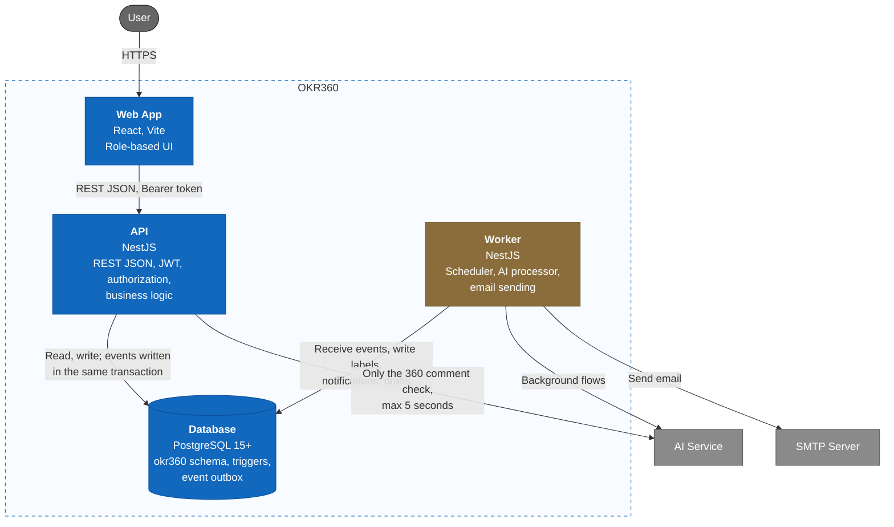

# C2 — Container — OKR360 V1

> Design status: TARGET V1
>
> Implementation status: NOT STARTED; no backend yet, the UI currently runs on mock data

The system consists of 4 independently running parts. The backend is split into two processes sharing one NestJS codebase: the API serves users, the Worker does background work. This way a slow AI does not slow down the API.

| Container | Responsibility | Does not do |
|---|---|---|
| Web App | Displays by role, calls the API | Does not call AI; hides buttons only to keep the UI tidy, not for security |
| API | Authentication, authorization, business logic, transactions, reports, file export | Does not call AI for background flows, does not send email directly |
| Worker | Runs on schedule, processes the event outbox, calls AI, validates results, sends email | Does not accept user requests; does not write to OKR or 360 tables |
| Database | Stores data, blocks invalid data with constraints and triggers, records events | Does not apply the anonymity threshold; that is in the business layer |

Previous: [C1 System Context](01-system-context.md) · Next: [C3 Component](03-component.md) · [C4 index](README.md)
