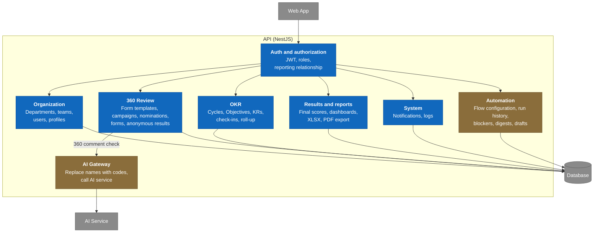
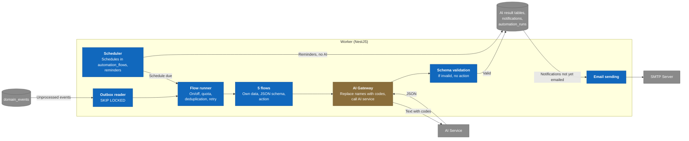

# C3 — Component — OKR360 V1

> Design status: TARGET V1
>
> Implementation status: NOT STARTED; no backend yet, the UI currently runs on mock data

## API

Each NestJS module is split into three layers per the [scope](../../01-scope.md): API receives requests, Application holds business logic, Infrastructure works with the database and external services.

| Module | Use case | Key point to keep |
|---|---|---|
| Auth and authorization | UC01, UC02 | Every API except login goes through here (BR-002) |
| Organization | UC03, UC04, UC05 | The reporting relationship is not derived from the unit tree (BR-016) |
| OKR | UC06–UC14 | Check-in and roll-up in the same transaction (BR-043) |
| 360 Review | UC15–UC21 | The only place that reads scores by group and applies the anonymity threshold (BR-059) |
| Results and reports | UC22, UC23, UC24 | Gets the 360 score through the 360 Review module, does not read the form table directly |
| System | UC25, UC26 | Append-only log (BR-083) |
| Automation | UC27–UC31 | Only reads, and updates the human part of AI results |
| AI Gateway | UC19 | Shared with the Worker; waits at most 5 seconds, on failure lets the user submit (BR-101) |

## Worker

The Worker has no controllers. The five background flows share one pipeline; each flow differs only in data retrieval, JSON schema and action.

The AI call step is outside the transaction; the result, notifications and run history are written in a new transaction ([data design](../../05-data-model.md), section 4). The code-mapping table (name to code) exists only in the memory of a run (BR-093).

Previous: [C2 Container](02-container.md) · Next: [C4 Code](04-code.md) · [C4 index](README.md)
