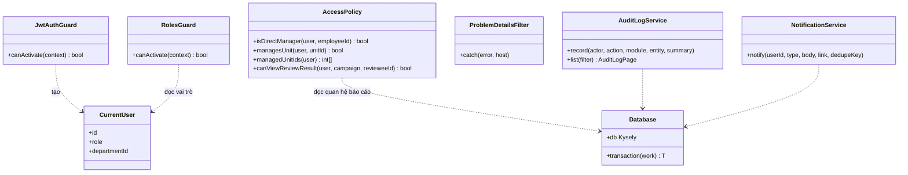
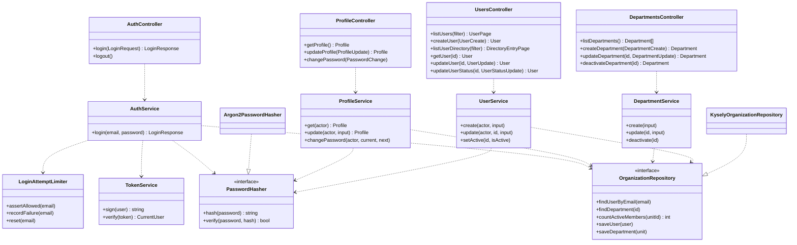
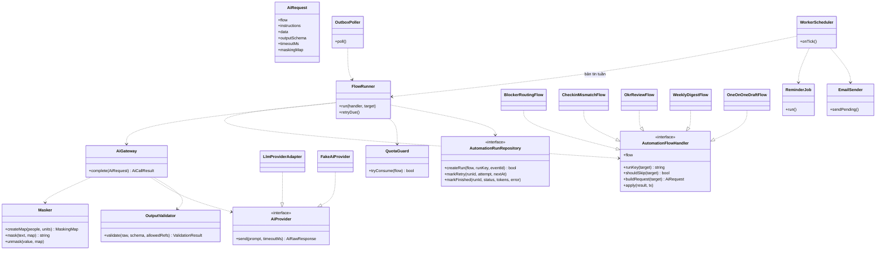

# Sơ đồ class — OKR360 V1

> Trạng thái thiết kế: TARGET V1
>
> Trạng thái triển khai: CHƯA BẮT ĐẦU; backend chưa có

Đây là cấp 4 (code) của [kiến trúc C4](c4.md): các class chính của backend NestJS, chia theo module ở [C3](c4.md#c3--component) và theo thư mục ở [cấu trúc thư mục](../07-folder-structure.md). Cách các class phối hợp trong từng thao tác nằm ở [sơ đồ sequence](sequence-diagrams.md).

## Quy ước

- Mỗi module chia ba tầng: **Controller** (tầng API), **Service** (tầng nghiệp vụ), **Repository** (giao diện ở tầng nghiệp vụ, cài đặt bằng Kysely ở tầng hạ tầng).
- Mỗi hàm của controller là đúng một `operationId` trong [OpenAPI](../api/openapi.yaml); tham số và kiểu trả về là schema cùng tên.
- Sơ đồ chỉ ghi các hàm chính của service và repository; hàm phụ, constructor và DTO không vẽ.
- Mọi controller trừ `AuthController.login` đi qua `JwtAuthGuard` và `RolesGuard`. Đường nối tới hai guard này không vẽ lại ở từng module.
- Quan hệ: `..>` là phụ thuộc, `..|>` là cài đặt giao diện.

## 1. Phần dùng chung

- `AccessPolicy` đọc quan hệ báo cáo từ database ở mỗi lần kiểm tra, nên đổi quản lý có hiệu lực ngay (ADR-006). Với đợt 360, hàm dùng bản chụp lúc mở thu phiếu (BR-055).
- `NotificationService` dùng `dedupeKey` để mỗi người nhận tối đa một lần nhắc cho mỗi sự kiện mỗi ngày (BR-081).
- `AuditLogService` không nhận điểm, nhận xét hay cặp người chấm ẩn danh (BR-083).

## 2. Đăng nhập và tổ chức

- `UserService.create` từ chối HR gán vai trò Admin (BR-004). Vòng lặp tổ chức và vòng lặp quản lý được database chặn thêm một lớp bằng trigger (BR-010, BR-013).

## 3. OKR và check-in

- `ProgressRollup` tính tiến độ Objective là trung bình cộng của KR và Objective con, đi ngược lên tới gốc, trong cùng transaction với thao tác gốc (BR-043, BR-044).
- Sự kiện `CHECKIN_CREATED` và `OBJECTIVE_CREATED` do trigger trong database ghi, nên không có class nào trong API gọi AI hay ghi hàng đợi (NFR-REL-001).

## 4. Đánh giá 360

```mermaid
classDiagram
    class ReviewTemplatesController {
        +listTemplates() ReviewTemplate[]
        +createTemplate(ReviewTemplateInput) ReviewTemplate
        +updateTemplate(id, ReviewTemplateInput) ReviewTemplate
        +duplicateTemplate(id) ReviewTemplate
    }
    class CampaignsController {
        +listCampaigns(filter) Campaign[]
        +createCampaign(CampaignCreate) Campaign
        +getCampaign(id) Campaign
        +updateCampaign(id, CampaignUpdate) Campaign
        +openNomination(id) Campaign
        +openCollection(id) Campaign
        +getCampaignProgress(id) CampaignProgress
        +remindReviewers(id) ReminderResult
        +closeCampaign(id) Campaign
    }
    class NominationsController {
        +getMyNomination(campaignId) Nomination
        +submitNomination(campaignId, NominationSubmit) Nomination
        +listPendingNominations(campaignId) Nomination[]
        +approveNomination(campaignId, revieweeId, NominationApprove) Nomination
    }
    class ReviewFormsController {
        +listMyReviewForms(filter) ReviewFormSummary[]
        +getReviewForm(id) ReviewForm
        +saveReviewDraft(id, ReviewFormInput) ReviewForm
        +checkReviewComment(id, CommentCheckRequest) CommentCheckResult
        +submitReviewForm(id, ReviewFormInput) ReviewForm
    }
    class ReviewResultsController {
        +listReviewResultSubjects(campaignId) ReviewResultSubject[]
        +getReviewResult(campaignId, revieweeId) ReviewResult
    }
    class TemplateService {
        +create(input) ReviewTemplate
        +update(id, input) ReviewTemplate
        +duplicate(id) ReviewTemplate
    }
    class CampaignService {
        +create(input) Campaign
        +openNomination(id)
        +openCollection(id)
        +progress(id)
        +close(id)
    }
    class NominationService {
        +submit(actor, campaignId, peerIds)
        +approve(actor, campaignId, revieweeId, peerIds)
    }
    class ReviewFormService {
        +saveDraft(actor, formId, input)
        +submit(actor, formId, input)
    }
    class CommentGuardService {
        +check(actor, formId, answers) CommentCheckResult
    }
    class ReviewResultService {
        +get(actor, campaignId, revieweeId) ReviewResult
        +overallScore(campaignId, revieweeId) number
    }
    class AnonymityAggregator {
        +threshold int
        +aggregate(groupScores, comments) ReviewResult
    }
    class ReviewRepository {
        <<interface>>
        +findAssignment(formId, reviewerId)
        +saveAnswers(formId, answers, tx)
        +closeCampaign(id, tx)
        +groupScores(campaignId, revieweeId)
        +visibleComments(campaignId, revieweeId)
    }
    class KyselyReviewRepository
    ReviewTemplatesController ..> TemplateService
    CampaignsController ..> CampaignService
    NominationsController ..> NominationService
    ReviewFormsController ..> ReviewFormService
    ReviewFormsController ..> CommentGuardService
    ReviewResultsController ..> ReviewResultService
    ReviewResultService ..> AnonymityAggregator
    ReviewResultService ..> AccessPolicy
    CommentGuardService ..> AiGateway
    CommentGuardService ..> QuotaGuard
    TemplateService ..> ReviewRepository
    CampaignService ..> ReviewRepository
    NominationService ..> ReviewRepository
    ReviewFormService ..> ReviewRepository
    ReviewResultService ..> ReviewRepository
    KyselyReviewRepository ..|> ReviewRepository
```

- `ReviewResultService` là nơi duy nhất đọc điểm theo nhóm (`vw_review_group_scores`) và áp ngưỡng ẩn danh qua `AnonymityAggregator` (BR-059). Module khác lấy điểm 360 qua `overallScore`.
- `ReviewRepository.closeCampaign` gọi hàm `close_review_campaign()` của database, hàm tách câu trả lời khỏi người chấm trong một transaction (BR-058).
- `CommentGuardService` không lưu cảnh báo và không ghi lịch sử chạy (BR-101).

## 5. Kết quả, dashboard, báo cáo, hệ thống

- `ScoreCalculator` là code thuần, không truy cập database: điểm OKR = 1 + 4 × tiến độ, điểm cuối kỳ theo tỷ trọng, xếp loại theo ngưỡng; thiếu điểm thì trả "Thiếu dữ liệu" (BR-071 đến BR-074).
- `ReportService` lọc theo phạm vi quyền; báo cáo kết quả cuối kỳ của Manager chỉ gồm nhân viên dưới quyền trực tiếp (BR-080).

## 6. Tự động hóa và AI Gateway

### 6.1 Trong API

- Không service nào ở đây sửa được nhãn hay đề xuất gốc của AI; chỉ cập nhật phần của con người như trạng thái xử lý, nội dung đã sửa (05 §7.3).

### 6.2 AI Gateway và Worker

- Năm luồng chạy nền chỉ khác nhau ở `AutomationFlowHandler`: dữ liệu lấy gì, khuôn JSON nào, hành động gì, đúng như [đặc tả luồng AI](ai-flows.md). `FlowRunner` lo phần chung: bật/tắt, hạn mức, chống trùng, thử lại, ghi lịch sử.
- `AiGateway` là đường duy nhất tới dịch vụ AI (ADR-005). `FakeAiProvider` ghi lại nội dung gửi đi để kiểm thử NFR-PRIV-004.
- `ReminderJob` và `EmailSender` không dùng AI.

## 7. Controller và nhóm API

| Nhóm API (tag OpenAPI) | Controller | Module |
|---|---|---|
| Đăng nhập | `AuthController` | `auth` |
| Hồ sơ | `ProfileController` | `organization` |
| Tổ chức | `DepartmentsController` | `organization` |
| Người dùng | `UsersController` | `organization` |
| Chu kỳ | `CyclesController` | `okr` |
| OKR | `ObjectivesController`, `KeyResultsController` | `okr` |
| Check-in | `CheckinsController` | `okr` |
| Mẫu phiếu 360 | `ReviewTemplatesController` | `reviews` |
| Đợt 360 | `CampaignsController` | `reviews` |
| Đề cử | `NominationsController` | `reviews` |
| Phiếu 360 | `ReviewFormsController` | `reviews` |
| Kết quả 360 | `ReviewResultsController` | `reviews` |
| Kết quả cuối kỳ | `FinalResultsController` | `results` |
| Dashboard | `DashboardsController` | `results` |
| Báo cáo | `ReportsController` | `results` |
| Thông báo | `NotificationsController` | `system` |
| Nhật ký | `AuditLogsController` | `system` |
| Tự động hóa | `AutomationController` | `automation` |
| Vướng mắc | `BlockersController` | `automation` |
| Bản tin tuần | `WeeklyDigestsController` | `automation` |
| Bản nháp 1-1 | `OneOnOneDraftsController` | `automation` |

**Liên quan:** [Sơ đồ sequence](sequence-diagrams.md) · [Kiến trúc C4](c4.md) · [Cấu trúc thư mục](../07-folder-structure.md) · [OpenAPI](../api/openapi.yaml)
