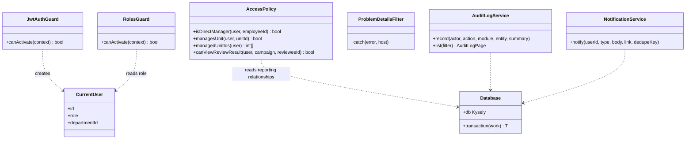
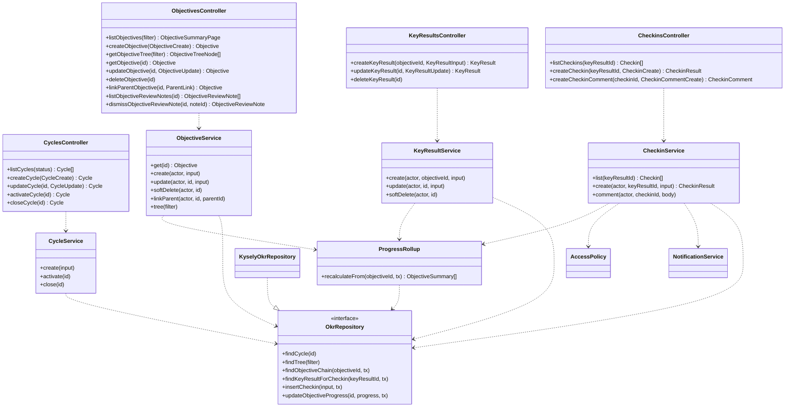

# Class diagrams — OKR360 V1

> Design status: TARGET V1
>
> Implementation status: NOT STARTED; no backend yet

This is level 4 (code) of the [C4 architecture](c4.md): the main classes of the NestJS backend, grouped by module as in [C3](c4.md#c3--component) and by folder as in the [folder structure](../07-folder-structure.md). How the classes cooperate in each operation is shown in the [sequence diagrams](sequence-diagrams.md).

## Conventions

- Each module is split into three layers: **Controller** (API layer), **Service** (business layer), **Repository** (interface in the business layer, implemented with Kysely in the infrastructure layer).
- Each controller method corresponds to exactly one `operationId` in the [OpenAPI](../api/openapi.yaml); its parameters and return type are the schemas of the same name.
- The diagrams show only the main service and repository methods; helper methods, constructors and DTOs are not drawn.
- Every controller except `AuthController.login` goes through `JwtAuthGuard` and `RolesGuard`. The links to these two guards are not redrawn in each module.
- Relationships: `..>` is a dependency, `..|>` is an interface implementation.

## 1. Shared part

- `AccessPolicy` reads reporting relationships from the database on every check, so a manager change takes effect immediately (ADR-006). For a 360 campaign, the methods use the snapshot taken when form collection opened (BR-055).
- `NotificationService` uses `dedupeKey` so that each recipient gets at most one reminder per event per day (BR-081).
- `AuditLogService` does not accept scores, comments or anonymous reviewer pairs (BR-083).

## 2. Login and organization

- `UserService.create` rejects HR assigning the Admin role (BR-004). Organization loops and manager loops are additionally blocked by the database with triggers (BR-010, BR-013).

## 3. OKR and check-in

- `ProgressRollup` computes an Objective's progress as the average of its KRs and child Objectives, walking up to the root, in the same transaction as the originating operation (BR-043, BR-044).
- The `CHECKIN_CREATED` and `OBJECTIVE_CREATED` events are written by database triggers, so no class in the API calls AI or writes to a queue (NFR-REL-001).

## 4. 360 review

```mermaid
classDiagram
    class ReviewTemplatesController {
        +listTemplates() ReviewTemplate[]
        +createTemplate(ReviewTemplateInput) ReviewTemplate
        +updateTemplate(id, ReviewTemplateInput) ReviewTemplate
        +duplicateTemplate(id) ReviewTemplate
    }
    class CampaignsController {
        +listCampaigns(filter) Campaign[]
        +createCampaign(CampaignCreate) Campaign
        +getCampaign(id) Campaign
        +updateCampaign(id, CampaignUpdate) Campaign
        +openNomination(id) Campaign
        +openCollection(id) Campaign
        +getCampaignProgress(id) CampaignProgress
        +remindReviewers(id) ReminderResult
        +closeCampaign(id) Campaign
    }
    class NominationsController {
        +getMyNomination(campaignId) Nomination
        +submitNomination(campaignId, NominationSubmit) Nomination
        +listPendingNominations(campaignId) Nomination[]
        +approveNomination(campaignId, revieweeId, NominationApprove) Nomination
    }
    class ReviewFormsController {
        +listMyReviewForms(filter) ReviewFormSummary[]
        +getReviewForm(id) ReviewForm
        +saveReviewDraft(id, ReviewFormInput) ReviewForm
        +checkReviewComment(id, CommentCheckRequest) CommentCheckResult
        +submitReviewForm(id, ReviewFormInput) ReviewForm
    }
    class ReviewResultsController {
        +listReviewResultSubjects(campaignId) ReviewResultSubject[]
        +getReviewResult(campaignId, revieweeId) ReviewResult
    }
    class TemplateService {
        +create(input) ReviewTemplate
        +update(id, input) ReviewTemplate
        +duplicate(id) ReviewTemplate
    }
    class CampaignService {
        +create(input) Campaign
        +openNomination(id)
        +openCollection(id)
        +progress(id)
        +close(id)
    }
    class NominationService {
        +submit(actor, campaignId, peerIds)
        +approve(actor, campaignId, revieweeId, peerIds)
    }
    class ReviewFormService {
        +saveDraft(actor, formId, input)
        +submit(actor, formId, input)
    }
    class CommentGuardService {
        +check(actor, formId, answers) CommentCheckResult
    }
    class ReviewResultService {
        +get(actor, campaignId, revieweeId) ReviewResult
        +overallScore(campaignId, revieweeId) number
    }
    class AnonymityAggregator {
        +threshold int
        +aggregate(groupScores, comments) ReviewResult
    }
    class ReviewRepository {
        <<interface>>
        +findAssignment(formId, reviewerId)
        +saveAnswers(formId, answers, tx)
        +closeCampaign(id, tx)
        +groupScores(campaignId, revieweeId)
        +visibleComments(campaignId, revieweeId)
    }
    class KyselyReviewRepository
    ReviewTemplatesController ..> TemplateService
    CampaignsController ..> CampaignService
    NominationsController ..> NominationService
    ReviewFormsController ..> ReviewFormService
    ReviewFormsController ..> CommentGuardService
    ReviewResultsController ..> ReviewResultService
    ReviewResultService ..> AnonymityAggregator
    ReviewResultService ..> AccessPolicy
    CommentGuardService ..> AiGateway
    CommentGuardService ..> QuotaGuard
    TemplateService ..> ReviewRepository
    CampaignService ..> ReviewRepository
    NominationService ..> ReviewRepository
    ReviewFormService ..> ReviewRepository
    ReviewResultService ..> ReviewRepository
    KyselyReviewRepository ..|> ReviewRepository
```

- `ReviewResultService` is the only place that reads group scores (`vw_review_group_scores`) and applies the anonymity threshold via `AnonymityAggregator` (BR-059). Other modules get the 360 score through `overallScore`.
- `ReviewRepository.closeCampaign` calls the database function `close_review_campaign()`, which separates answers from reviewers in one transaction (BR-058).
- `CommentGuardService` does not store warnings and does not write run history (BR-101).

## 5. Results, dashboard, reports, system

```mermaid
classDiagram
    class FinalResultsController {
        +getMyFinalResult(cycleId) FinalResult
        +calculateFinalResults(cycleId) FinalResultSummary
        +listFinalResults(cycleId) FinalResultSummary
        +exportFinalResults(cycleId, format) file
        +publishFinalResults(cycleId) PublishResult
    }
    class DashboardsController {
        +getMyDashboard(cycleId) MyDashboard
        +getTeamDashboard(cycleId) TeamDashboard
        +getCompanyDashboard(cycleId) CompanyDashboard
    }
    class ReportsController {
        +getReport(type, filter) Report
        +exportReport(type, filter, format) file
    }
    class NotificationsController {
        +listNotifications(filter) NotificationPage
        +markAllNotificationsRead() MarkAllReadResult
        +markNotificationRead(id) Notification
    }
    class AuditLogsController {
        +listAuditLogs(filter) AuditLogPage
    }
    class FinalResultService {
        +calculate(cycleId) FinalResultSummary
        +publish(cycleId) PublishResult
    }
    class ScoreCalculator {
        +okrScore(progress) number
        +finalScore(okrScore, reviewScore, okrWeight) number
        +grade(finalScore) ResultGrade
    }
    class DashboardService {
        +personal(actor, cycleId) MyDashboard
        +team(actor, cycleId) TeamDashboard
        +company(cycleId) CompanyDashboard
    }
    class ReportService {
        +build(actor, type, filter) Report
    }
    class ReportExporter {
        <<interface>>
        +export(report) file
    }
    class XlsxReportExporter
    class PdfReportExporter
    FinalResultsController ..> FinalResultService
    FinalResultsController ..> ReportExporter
    DashboardsController ..> DashboardService
    ReportsController ..> ReportService
    ReportsController ..> ReportExporter
    NotificationsController ..> NotificationService
    AuditLogsController ..> AuditLogService
    FinalResultService ..> ScoreCalculator
    FinalResultService ..> ReviewResultService : 360 score
    FinalResultService ..> NotificationService
    ReportService ..> AccessPolicy
    XlsxReportExporter ..|> ReportExporter
    PdfReportExporter ..|> ReportExporter
```

- `ScoreCalculator` is pure code with no database access: OKR score = 1 + 4 × progress, final score by weighting, grade by thresholds; when a score is missing it returns "Insufficient data" (BR-071 to BR-074).
- `ReportService` filters by permission scope; a Manager's final-result report includes only direct reports (BR-080).

## 6. Automation and AI Gateway

### 6.1 In the API

```mermaid
classDiagram
    class AutomationController {
        +listAutomationFlows() AutomationFlowConfig[]
        +updateAutomationFlow(flow, AutomationFlowUpdate) AutomationFlowConfig
        +listAutomationRuns(filter) AutomationRunPage
        +getAutomationRun(id) AutomationRun
        +retryAutomationRun(id) AutomationRun
        +getAiRunExplanation(id) AiExplanation
    }
    class BlockersController {
        +listRoutedBlockers(filter) RoutedBlockerPage
        +acknowledgeBlocker(checkinId, BlockerAcknowledge) RoutedBlocker
        +rejectBlocker(checkinId, BlockerReject) RoutedBlocker
    }
    class WeeklyDigestsController {
        +listWeeklyDigests() WeeklyDigestSummary[]
        +getWeeklyDigest(id) WeeklyDigest
    }
    class OneOnOneDraftsController {
        +listOneOnOneDrafts(filter) OneOnOneDraftSummary[]
        +getOneOnOneDraft(id) OneOnOneDraft
        +updateOneOnOneDraft(id, OneOnOneDraftUpdate) OneOnOneDraft
        +sendOneOnOneDraft(id) OneOnOneDraft
        +discardOneOnOneDraft(id) OneOnOneDraft
    }
    class AutomationConfigService {
        +update(flow, input) AutomationFlowConfig
    }
    class RunHistoryService {
        +retry(runId)
    }
    class AiExplanationService {
        +explain(actor, runId) AiExplanation
    }
    class BlockerService {
        +acknowledge(actor, checkinId, note)
        +reject(actor, checkinId, note)
    }
    class DigestService {
        +get(actor, id) WeeklyDigest
    }
    class OneOnOneDraftService {
        +edit(actor, id, text)
        +send(actor, id)
        +discard(actor, id)
    }
    class AutomationRepository {
        <<interface>>
        +findFlow(flow)
        +findRun(id)
        +findInsight(checkinId)
        +findDraft(id)
    }
    class KyselyAutomationRepository
    AutomationController ..> AutomationConfigService
    AutomationController ..> RunHistoryService
    AutomationController ..> AiExplanationService
    BlockersController ..> BlockerService
    WeeklyDigestsController ..> DigestService
    OneOnOneDraftsController ..> OneOnOneDraftService
    AiExplanationService ..> Masker : rebuilds the masking map
    BlockerService ..> AccessPolicy
    BlockerService ..> NotificationService
    OneOnOneDraftService ..> AccessPolicy
    OneOnOneDraftService ..> NotificationService
    AutomationConfigService ..> AutomationRepository
    RunHistoryService ..> AutomationRepository
    BlockerService ..> AutomationRepository
    DigestService ..> AutomationRepository
    OneOnOneDraftService ..> AutomationRepository
    KyselyAutomationRepository ..|> AutomationRepository
```

- No service here can modify the AI's original labels or suggestions; they only update the human part, such as handling status and edited content (05 §7.3).

### 6.2 AI Gateway and Worker

- The five background flows differ only in their `AutomationFlowHandler`: what data is fetched, which JSON schema, which action, exactly as in the [AI flow specification](ai-flows.md). `FlowRunner` handles the shared parts: enable/disable, quota, deduplication, retry, history logging.
- `AiGateway` is the only path to the AI service (ADR-005). `FakeAiProvider` records the content sent out to test NFR-PRIV-004.
- `ReminderJob` and `EmailSender` do not use AI.

## 7. Controllers and API groups

| API group (OpenAPI tag) | Controller | Module |
|---|---|---|
| Authentication | `AuthController` | `auth` |
| Profile | `ProfileController` | `organization` |
| Organization | `DepartmentsController` | `organization` |
| Users | `UsersController` | `organization` |
| Cycles | `CyclesController` | `okr` |
| OKRs | `ObjectivesController`, `KeyResultsController` | `okr` |
| Check-ins | `CheckinsController` | `okr` |
| Review templates | `ReviewTemplatesController` | `reviews` |
| Review campaigns | `CampaignsController` | `reviews` |
| Nominations | `NominationsController` | `reviews` |
| Review forms | `ReviewFormsController` | `reviews` |
| Review results | `ReviewResultsController` | `reviews` |
| Final results | `FinalResultsController` | `results` |
| Dashboards | `DashboardsController` | `results` |
| Reports | `ReportsController` | `results` |
| Notifications | `NotificationsController` | `system` |
| Audit logs | `AuditLogsController` | `system` |
| Automation | `AutomationController` | `automation` |
| Blockers | `BlockersController` | `automation` |
| Weekly digests | `WeeklyDigestsController` | `automation` |
| 1-on-1 drafts | `OneOnOneDraftsController` | `automation` |

**Related:** [Sequence diagrams](sequence-diagrams.md) · [C4 architecture](c4.md) · [Folder structure](../07-folder-structure.md) · [OpenAPI](../api/openapi.yaml)
