# Sequence Diagrams — OKR360 V1

> Design Status: TARGET V1
>
> Implementation Status: Design specification, not yet implemented

Each use case has a corresponding sequence diagram sharing the same number: SD-12 corresponds to UC12. The diagrams illustrate the interaction sequence among classes defined in the [class diagram](class-diagrams.md), including primary failure paths.

Conventions:

- Every request except login passes through `JwtAuthGuard` and `RolesGuard` before reaching the controller; this step is explicitly depicted only in SD-12 and SD-23.
- Errors are returned using the Problem Details format via `ProblemDetailsFilter`.
- Background AI flows share a common pipeline, fully illustrated in SD-32; SD-08, SD-12, SD-30, and SD-31 only depict steps specific to their respective flows.

| Code                                                     | Use case                                     | API                                                                        |
| -------------------------------------------------------- | -------------------------------------------- | -------------------------------------------------------------------------- |
| [SD-01](#sd-01--login)                                   | UC01 Login                                   | `login`                                                                    |
| [SD-02](#sd-02--logout)                                  | UC02 Logout                                  | `logout`                                                                   |
| [SD-03](#sd-03--manage-personal-profile)                 | UC03 Manage personal profile                 | `getProfile`, `updateProfile`, `changePassword`                            |
| [SD-04](#sd-04--manage-departments-and-teams)            | UC04 Manage departments and teams            | `createDepartment`, `updateDepartment`, `deactivateDepartment`             |
| [SD-05](#sd-05--manage-users)                            | UC05 Manage users                            | `createUser`, `updateUser`, `updateUserStatus`                             |
| [SD-06](#sd-06--manage-okr-cycles)                       | UC06 Manage OKR cycles                       | `createCycle`, `activateCycle`, `closeCycle`                               |
| [SD-07](#sd-07--view-okr-tree)                           | UC07 View OKR tree                           | `getObjectiveTree`, `getObjective`                                         |
| [SD-08](#sd-08--createedit-objective)                    | UC08 Create/edit Objective                   | `createObjective`, `updateObjective`                                       |
| [SD-09](#sd-09--manage-key-results)                      | UC09 Manage Key Results                      | `createKeyResult`, `updateKeyResult`, `deleteKeyResult`                    |
| [SD-10](#sd-10--align-to-parent-objective)               | UC10 Align to parent objective               | `linkParentObjective`                                                      |
| [SD-11](#sd-11--soft-delete-okr)                         | UC11 Soft delete OKR                         | `deleteObjective`                                                          |
| [SD-12](#sd-12--check-in-key-result)                     | UC12 Check-in Key Result                     | `createCheckin`                                                            |
| [SD-13](#sd-13--view-check-in-history-and-progress-chart) | UC13 View check-in history and progress chart | `listCheckins`                                                             |
| [SD-14](#sd-14--comment-on-check-in)                     | UC14 Comment on check-in                     | `createCheckinComment`                                                     |
| [SD-15](#sd-15--manage-review-templates)                 | UC15 Manage review templates                 | `createTemplate`, `updateTemplate`, `duplicateTemplate`                    |
| [SD-16](#sd-16--create-and-launch-360-review-campaign)   | UC16 Create and launch 360 review campaign   | `createCampaign`, `openNomination`, `openCollection`                       |
| [SD-17](#sd-17--nominate-peers)                          | UC17 Nominate peers                          | `getMyNomination`, `submitNomination`                                      |
| [SD-18](#sd-18--approve-reviewers)                       | UC18 Approve reviewers                       | `listPendingNominations`, `approveNomination`                              |
| [SD-19](#sd-19--fill-review-form)                        | UC19 Fill review form                        | `checkReviewComment`, `submitReviewForm`                                   |
| [SD-20](#sd-20--monitor-review-progress-and-close-campaign) | UC20 Monitor review progress and close campaign | `getCampaignProgress`, `remindReviewers`, `closeCampaign`                  |
| [SD-21](#sd-21--view-360-review-results)                 | UC21 View 360 review results                 | `getReviewResult`                                                          |
| [SD-22](#sd-22--aggregate-and-publish-final-results)     | UC22 Aggregate and publish final results     | `calculateFinalResults`, `publishFinalResults`                             |
| [SD-23](#sd-23--view-dashboard)                          | UC23 View dashboard                          | `getMyDashboard`, `getTeamDashboard`, `getCompanyDashboard`                |
| [SD-24](#sd-24--view-and-export-reports)                 | UC24 View and export reports                 | `getReport`, `exportReport`                                                |
| [SD-25](#sd-25--receive-notifications-and-reminders)     | UC25 Receive notifications and reminders     | Worker, `listNotifications`, `markNotificationRead`                        |
| [SD-26](#sd-26--view-audit-logs)                         | UC26 View audit logs                         | `listAuditLogs`                                                            |
| [SD-27](#sd-27--configure-automation-flows)              | UC27 Configure automation flows              | `updateAutomationFlow`                                                     |
| [SD-28](#sd-28--view-automation-run-history)             | UC28 View automation run history             | `listAutomationRuns`, `getAutomationRun`, `retryAutomationRun`             |
| [SD-29](#sd-29--handle-routed-blockers)                  | UC29 Handle routed blockers                  | `acknowledgeBlocker`, `rejectBlocker`                                      |
| [SD-30](#sd-30--view-weekly-digest)                      | UC30 View weekly digest                      | Worker, `getWeeklyDigest`                                                  |
| [SD-31](#sd-31--review-1-on-1-draft)                     | UC31 Review 1-on-1 draft                     | Worker, `updateOneOnOneDraft`, `sendOneOnOneDraft`, `discardOneOnOneDraft` |
| [SD-32](#sd-32--execute-ai-automation-flow)              | UC32 Execute AI automation flow              | Worker                                                                     |

## SD-01 — Login

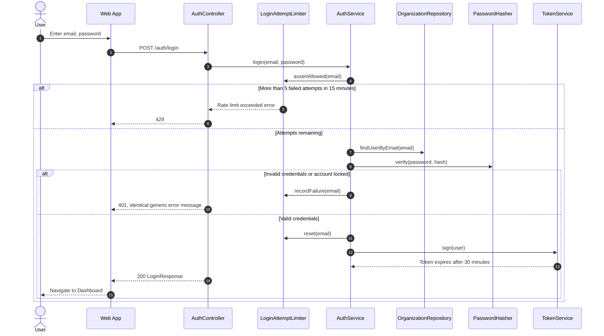

## SD-02 — Logout

V1 does not revoke tokens on the server; the token automatically expires after 30 minutes.

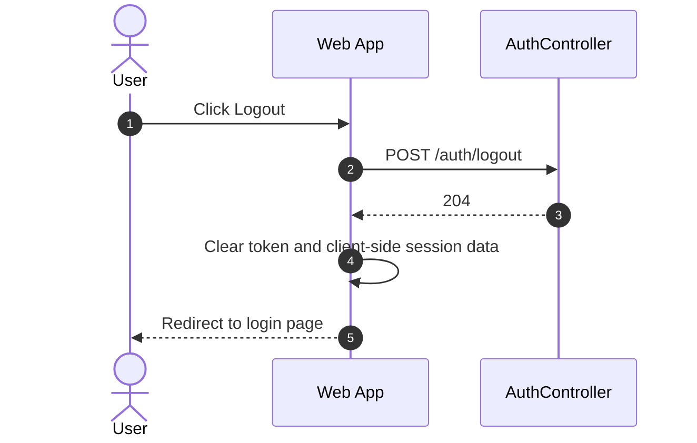

## SD-03 — Manage Personal Profile

```mermaid
sequenceDiagram
    autonumber
    actor U as User
    participant W as Web App
    participant C as ProfileController
    participant S as ProfileService
    participant H as PasswordHasher
    participant R as OrganizationRepository

    U->>W: Open Profile
    W->>C: GET /me
    C->>S: get(actor)
    C-->>W: 200 Profile
    U->>W: Edit full name, phone number, avatar
    W->>C: PATCH /me
    Note over C: DTO only accepts self-editable fields; email, role, department excluded
    C->>S: update(actor, input)
    S->>R: saveUser(user)
    C-->>W: 200 Profile
    U->>W: Enter current password and new password
    W->>C: POST /me/password
    C->>S: changePassword(actor, current, next)
    S->>H: verify(current, hash)
    alt Current password incorrect or new password under 8 characters
        C-->>W: 400
    else Valid
        S->>H: hash(next)
        S->>R: saveUser(user)
        C-->>W: 204
    end
```

## SD-04 — Manage Departments and Teams

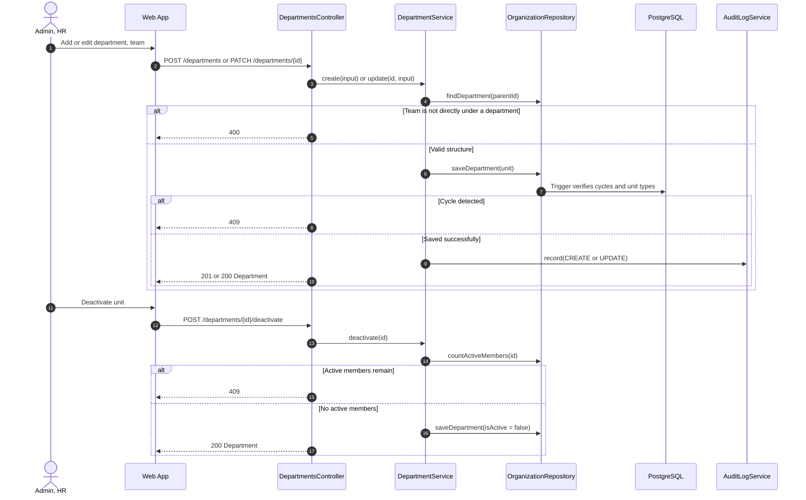

## SD-05 — Manage Users

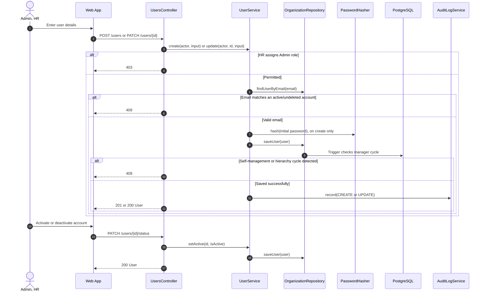

- Deactivated accounts cannot log in and cannot be assigned as new reviewers (BR-014).

## SD-06 — Manage OKR Cycles

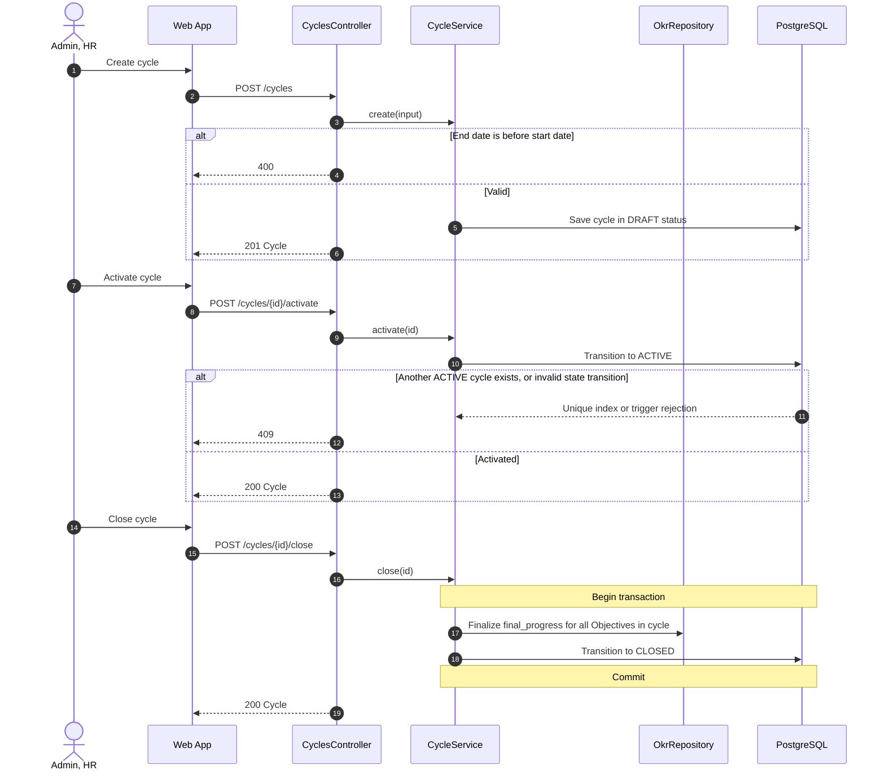

- Once closed, database triggers block all modifications to OKRs and check-ins within the cycle (BR-022).

## SD-07 — View OKR Tree

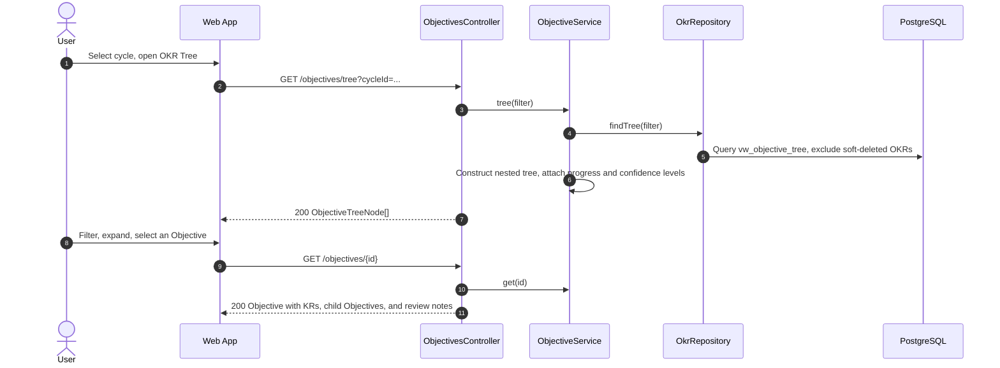

## SD-08 — Create/Edit Objective

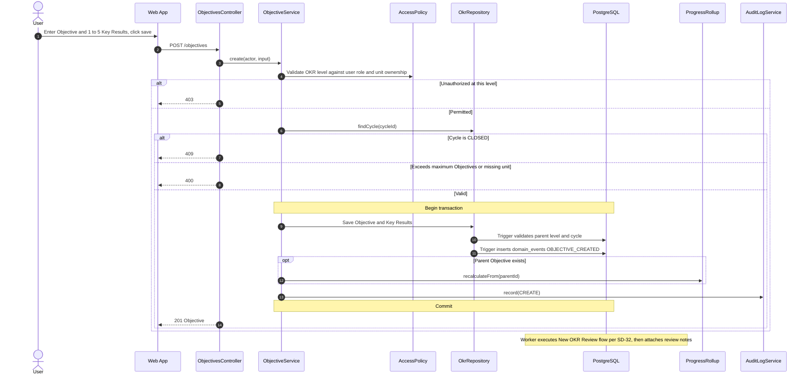

- Editing an Objective (`updateObjective`) follows the same pattern, without emitting events for AI.

## SD-09 — Manage Key Results

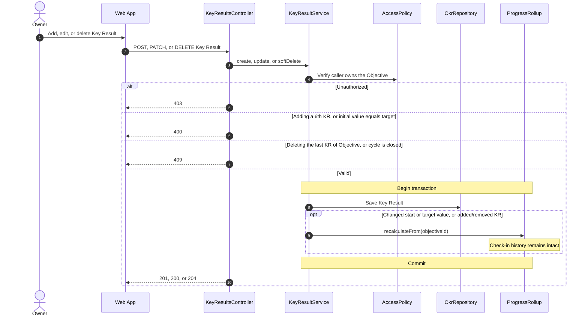

## SD-10 — Align to Parent Objective

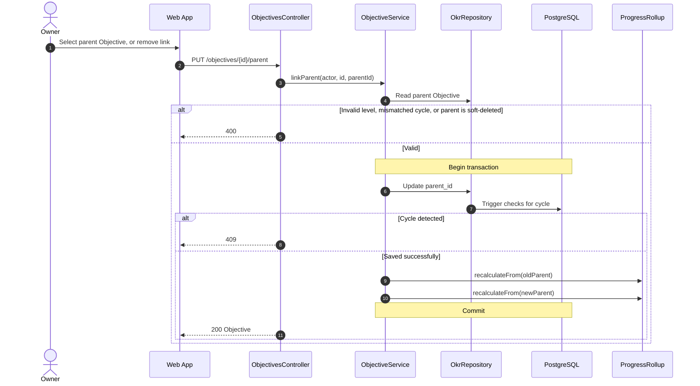

## SD-11 — Soft Delete OKR

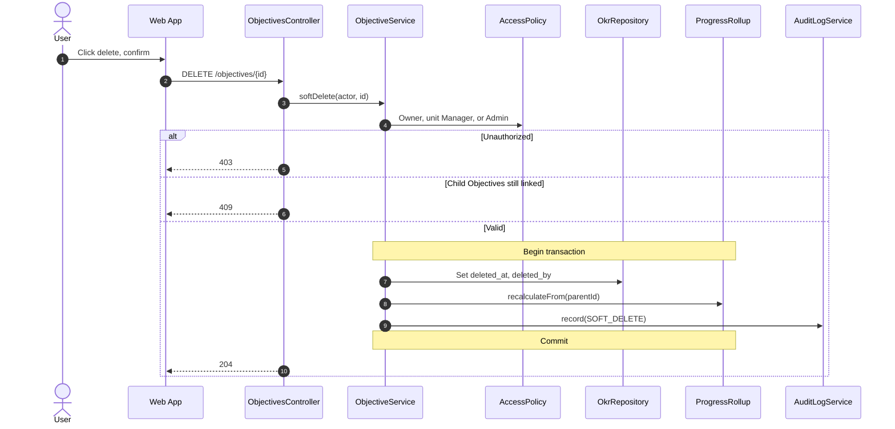

## SD-12 — Check-in Key Result

All write steps execute within a single transaction. AI is not invoked here: triggers only log events; the background Worker processes them later (SD-32).

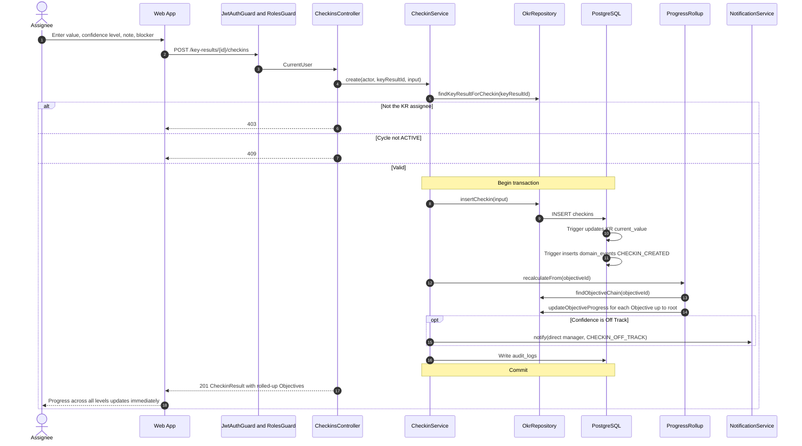

## SD-13 — View Check-in History and Progress Chart

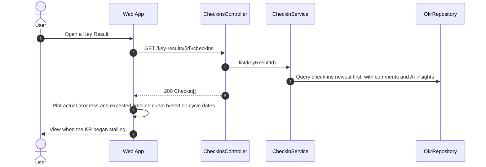

## SD-14 — Comment on Check-in

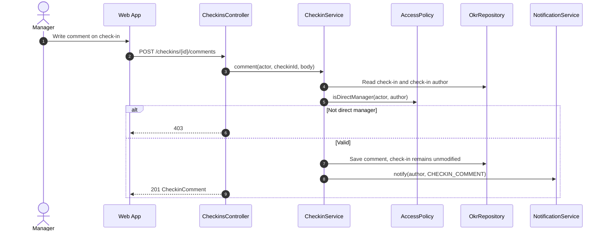

## SD-15 — Manage Review Templates

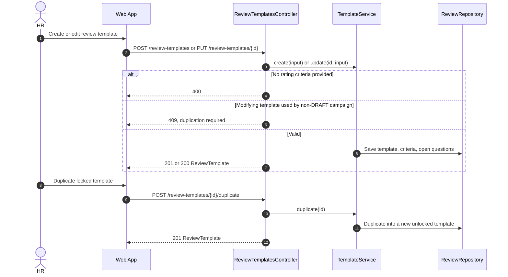

## SD-16 — Create and Launch 360 Review Campaign

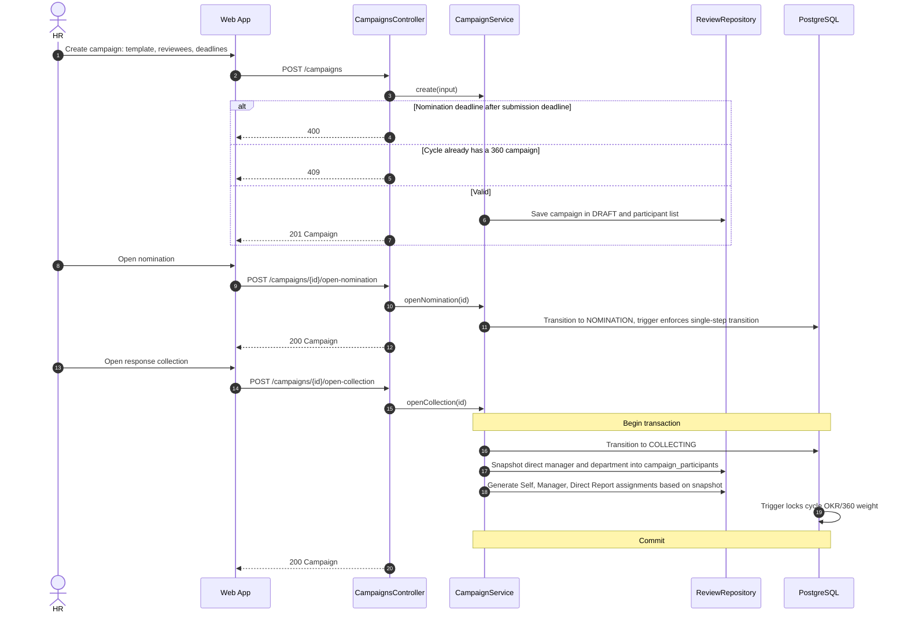

- Peer group assignments are generated upon reviewer nomination approval (SD-18).

## SD-17 — Nominate Peers

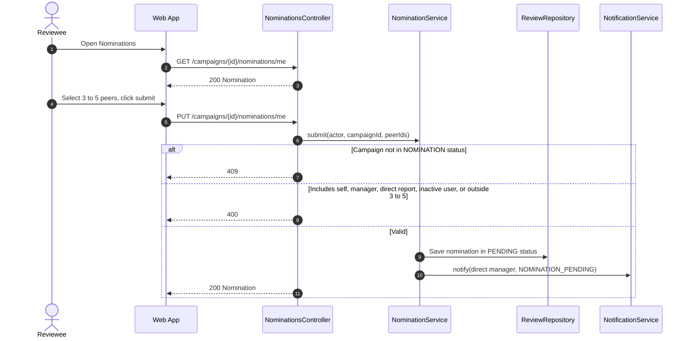

## SD-18 — Approve Reviewers

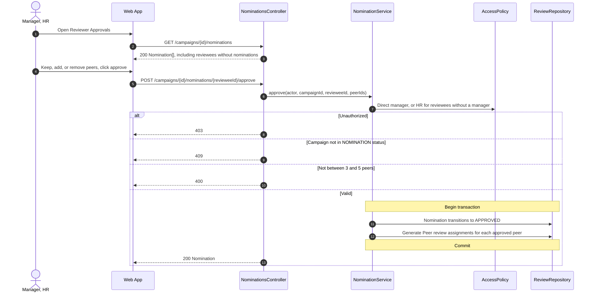

## SD-19 — Fill Review Form

This flow executes synchronously within the API request without utilizing the outbox event queue and without persisting execution run logs.

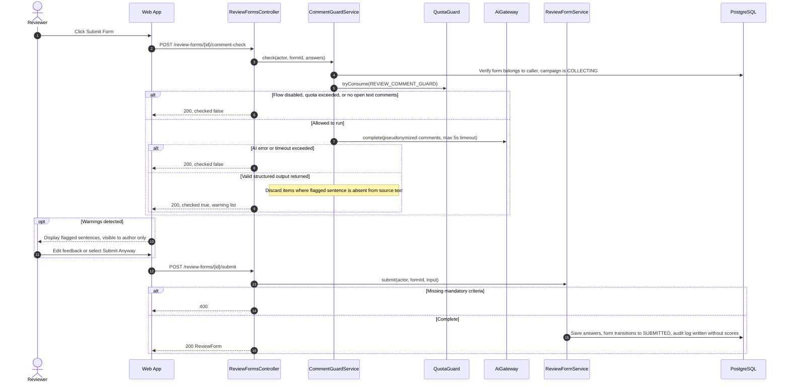

- Warnings are never persisted anywhere; only `automation_daily_usage` increments by one call count (BR-101, NFR-PRIV-006).

## SD-20 — Monitor Review Progress and Close Campaign

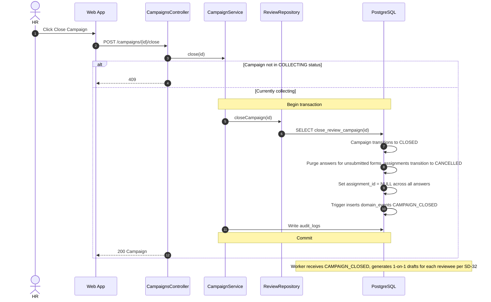

- Once `assignment_id = NULL` is set, even an actor with full database read privileges cannot correlate scores back to individual reviewers (NFR-PRIV-001).

## SD-21 — View 360 Review Results

```mermaid
sequenceDiagram
    autonumber
    actor U as User
    participant W as Web App
    participant C as ReviewResultsController
    participant S as ReviewResultService
    participant P as AccessPolicy
    participant R as ReviewRepository
    participant G as AnonymityAggregator

    U->>W: Open 360 Results
    W->>C: GET /campaigns/{id}/results/{revieweeId}
    C->>S: get(actor, campaignId, revieweeId)
    S->>P: canViewReviewResult(actor, campaign, revieweeId)
    Note over P: Self when PUBLISHED, direct manager via snapshot when CLOSED, HR always, Admin self only
    alt Unauthorized
        C-->>W: 403
    else Authorized
        S->>R: groupScores(campaignId, revieweeId)
        S->>R: visibleComments(campaignId, revieweeId)
        S->>G: aggregate(scores by group, comments)
        Note over G: Group < 3 reviews is merged; merged group < 3 is hidden and excluded from score
        G-->>S: ReviewResult, comments stripped of names and shuffled out of submission order
        S->>R: Retrieve sent 1-on-1 summary, if present
        C-->>W: 200 ReviewResult
    end
```

## SD-22 — Aggregate and Publish Final Results

```mermaid
sequenceDiagram
    autonumber
    actor HR as HR
    participant W as Web App
    participant C as FinalResultsController
    participant S as FinalResultService
    participant RS as ReviewResultService
    participant K as ScoreCalculator
    participant N as NotificationService
    participant DB as PostgreSQL

    HR->>W: Click Aggregate Results
    W->>C: POST /cycles/{id}/final-results/calculate
    C->>S: calculate(cycleId)
    alt Cycle or campaign not CLOSED, or already published
        C-->>W: 409
    else Prerequisites met
        loop Each employee
            S->>DB: Read finalized individual OKR progress
            S->>RS: overallScore(campaignId, employee)
            S->>K: okrScore, finalScore, grade
        end
        S->>DB: Overwrite final_results
        C-->>W: 200 FinalResultSummary
    end
    HR->>W: Preview, then click Publish
    W->>C: POST /cycles/{id}/final-results/publish
    C->>S: publish(cycleId)
    Note over S,DB: Begin transaction
    S->>DB: Campaign transitions to PUBLISHED, record published_at
    loop Each employee
        S->>N: notify(employee, RESULT_PUBLISHED)
    end
    Note over S,DB: Commit
    C-->>W: 200 PublishResult
```

- AI does not participate in any step of this flow.

## SD-23 — View Dashboard

```mermaid
sequenceDiagram
    autonumber
    actor U as User
    participant W as Web App
    participant G as RolesGuard
    participant C as DashboardsController
    participant S as DashboardService
    participant P as AccessPolicy
    participant DB as PostgreSQL

    U->>W: Open home page, select cycle
    W->>C: GET /dashboards/me
    C->>S: personal(actor, cycleId)
    S->>DB: My OKR progress, KRs needing check-in, pending review forms
    C-->>W: 200 MyDashboard
    opt Caller is Manager
        W->>G: GET /dashboards/team
        G->>C: Role MANAGER
        C->>S: team(actor, cycleId)
        S->>P: managedUnitIds(actor)
        S->>DB: Unit progress, members with missing check-ins, at-risk OKRs
        C-->>W: 200 TeamDashboard
    end
    opt Caller is Admin or HR
        W->>C: GET /dashboards/company
        C->>S: company(cycleId)
        C-->>W: 200 CompanyDashboard
    end
```

## SD-24 — View and Export Reports

```mermaid
sequenceDiagram
    autonumber
    actor U as Admin, HR, Manager
    participant W as Web App
    participant C as ReportsController
    participant S as ReportService
    participant P as AccessPolicy
    participant E as ReportExporter
    participant L as AuditLogService

    U->>W: Select report type, cycle, department
    W->>C: GET /reports/{type}
    C->>S: build(actor, type, filter)
    alt Admin selects FINAL_RESULTS
        C-->>W: 403
    else Authorized
        S->>P: Unit scope of caller
        Note over S: Manager only views own unit; for FINAL_RESULTS, direct reports only
        C-->>W: 200 Report
    end
    U->>W: Click Export Excel or PDF
    W->>C: GET /reports/{type}/export?format=XLSX
    C->>S: build(actor, type, filter)
    C->>E: export(report)
    C->>L: record(EXPORT)
    C-->>W: File matching currently displayed data
```

## SD-25 — Receive Notifications and Reminders

The reminder processing runs in the background Worker without AI.

```mermaid
sequenceDiagram
    autonumber
    participant SC as WorkerScheduler
    participant J as ReminderJob
    participant N as NotificationService
    participant DB as PostgreSQL
    participant E as EmailSender
    participant SM as SMTP Server
    actor U as User
    participant W as Web App
    participant C as NotificationsController

    SC->>J: run() on schedule
    J->>DB: Find KRs unchecked for 7 days, unsubmitted nominations, unsubmitted forms
    loop Each due item
        J->>N: notify(user, type, dedupeKey by date)
        N->>DB: INSERT notifications, skip if dedupeKey duplicates
    end
    SC->>E: sendPending()
    E->>DB: Read notifications pending email dispatch
    E->>SM: Send email
    E->>DB: Record email_sent_at
    U->>W: Open notifications bell
    W->>C: GET /notifications
    C-->>W: 200 NotificationPage
    U->>W: Mark as read
    W->>C: POST /notifications/{id}/read
    C-->>W: 200 Notification
```

## SD-26 — View Audit Logs

```mermaid
sequenceDiagram
    autonumber
    actor A as Admin, HR
    participant W as Web App
    participant C as AuditLogsController
    participant S as AuditLogService
    participant DB as PostgreSQL

    A->>W: Open Audit Logs, select filters
    W->>C: GET /audit-logs
    C->>S: list(filter)
    S->>DB: Read audit_logs by actor, module, action, timestamp
    C-->>W: 200 AuditLogPage, without form answers or anonymous reviewer-reviewee pairs
```

## SD-27 — Configure Automation Flows

```mermaid
sequenceDiagram
    autonumber
    actor A as Admin
    participant W as Web App
    participant C as AutomationController
    participant S as AutomationConfigService
    participant R as AutomationRepository
    participant L as AuditLogService

    A->>W: Open Automation
    W->>C: GET /automation/flows
    C-->>W: 200 AutomationFlowConfig[]
    A->>W: Enable/disable, edit schedule, quota, click save
    W->>C: PATCH /automation/flows/{flow}
    C->>S: update(flow, input)
    alt Quota non-positive or schedule invalid format
        C-->>W: 400
    else Enabling flow without configured AI service key
        C-->>W: 409
    else Valid
        S->>R: Save configuration
        S->>L: record(UPDATE, old and new values)
        C-->>W: 200 AutomationFlowConfig
    end
    Note over R: When flow is disabled, new events for flow are marked SKIPPED (SD-32)
```

## SD-28 — View Automation Run History

```mermaid
sequenceDiagram
    autonumber
    actor A as Admin, HR
    participant W as Web App
    participant C as AutomationController
    participant S as RunHistoryService
    participant R as AutomationRepository

    A->>W: Open Run History, filter
    W->>C: GET /automation/runs
    C-->>W: 200 AutomationRunPage
    A->>W: Open a run execution
    W->>C: GET /automation/runs/{id}
    C->>R: findRun(id)
    C-->>W: 200 AutomationRun, contains technical metrics only
    A->>W: Click Retry
    W->>C: POST /automation/runs/{id}/retry
    alt Caller is HR
        C-->>W: 403
    else Run not in FAILED status
        C-->>W: 409
    else Valid
        C->>S: retry(runId)
        S->>R: Reset run to pending, retry immediately
        C-->>W: 200 AutomationRun
    end
    Note over R: FlowRunner.retryDue() picks up this run per SD-32
```

## SD-29 — Handle Routed Blockers

### Sending the blocker

The Worker has already written the AI suggestion (SD-32). Nothing reaches the unit head until the person who checked in confirms (BR-107).

```mermaid
sequenceDiagram
    autonumber
    actor A as Person who checked in
    participant W as Web App
    participant C as BlockersController
    participant S as BlockerService
    participant R as AutomationRepository
    participant N as NotificationService

    A->>W: Click Send, or pick another unit and send
    W->>C: POST /checkins/{checkinId}/blocker/send
    C->>S: send(actor, checkinId, unitId)
    alt Not the person who checked in
        C-->>W: 403
    else Already sent or dismissed
        C-->>W: 409
    else Own unit or the department containing their team
        C-->>W: 400
    else Valid
        S->>R: Save chosen unit and confirmation time, routing OPEN
        S->>N: notify(head of chosen unit, BLOCKER_ROUTED)
        C-->>W: 200 CheckinInsight
    end
    opt Click Do not send instead
        W->>C: POST /checkins/{checkinId}/blocker/dismiss
        C->>S: dismiss(actor, checkinId)
        S->>R: routing DISMISSED, nobody is notified
        C-->>W: 200 CheckinInsight
    end
```

### Handling the blocker

```mermaid
sequenceDiagram
    autonumber
    actor H as Department Head
    participant W as Web App
    participant C as BlockersController
    participant S as BlockerService
    participant P as AccessPolicy
    participant R as AutomationRepository
    participant N as NotificationService

    H->>W: Open Routed Blockers, select a blocker
    alt Acknowledge resolution
        W->>C: POST /blockers/{checkinId}/acknowledge
        C->>S: acknowledge(actor, checkinId, note)
    else Not relevant to my department
        W->>C: POST /blockers/{checkinId}/reject
        C->>S: reject(actor, checkinId, note)
    end
    S->>R: findInsight(checkinId)
    S->>P: managesUnit(actor, targetDepartment)
    alt Does not manage that unit
        C-->>W: 403
    else Blocker already resolved/handled
        C-->>W: 409
    else Valid
        S->>R: Update routing status and note, AI labels remain unchanged
        alt Acknowledged
            S->>N: notify(check-in author, BLOCKER_UPDATED)
        else Rejected
            S->>N: notify(author direct manager, BLOCKER_ROUTED)
            Note over S: Record an AI misclassification occurrence
        end
        C-->>W: 200 RoutedBlocker
    end
```

## SD-30 — View Weekly Digest

```mermaid
sequenceDiagram
    autonumber
    participant SC as WorkerScheduler
    participant F as FlowRunner
    participant H as WeeklyDigestFlow
    participant A as AiGateway
    participant DB as PostgreSQL
    actor M as Manager
    participant W as Web App
    participant C as WeeklyDigestsController
    participant S as DigestService

    SC->>F: 8:00 AM Monday, one run per Manager
    F->>DB: createRun("user:{id}:week:{Monday}"), stop if duplicate
    F->>H: buildRequest(manager)
    H->>DB: Calculate prior week metrics via SQL query
    alt No notes or blockers present
        Note over H: Skip AI call
    else Text content present
        F->>A: complete(notes and blockers pseudonymized with identifiers)
        A-->>F: Up to 3 attention items, schema verified
    end
    F->>H: apply(result)
    H->>DB: Write weekly_digests and WEEKLY_DIGEST notification
    Note over DB: EmailSender dispatches email per SD-25
    M->>W: Open Weekly Digest
    W->>C: GET /weekly-digests/{id}
    C->>S: get(actor, id)
    S->>DB: Record read_at on first view
    C-->>W: 200 WeeklyDigest
```

- Metrics are computed directly via queries; AI only authors key attention items (BR-105). Errors and retries follow SD-32.

## SD-31 — Review 1-on-1 Draft

```mermaid
sequenceDiagram
    autonumber
    participant F as FlowRunner
    participant H as OneOnOneDraftFlow
    participant A as AiGateway
    participant DB as PostgreSQL
    actor M as Manager, HR
    participant W as Web App
    participant C as OneOnOneDraftsController
    participant S as OneOnOneDraftService
    participant P as AccessPolicy
    participant N as NotificationService

    Note over F: Following CAMPAIGN_CLOSED event, one run per reviewee
    F->>H: shouldSkip(reviewee)
    alt No group meets threshold, or no open text comments
        Note over H: Skip AI call, do not generate draft
    else Comments present
        F->>A: complete(pseudonymized feedback, excluding scores and reviewer identities)
        A-->>F: Strengths, improvement areas, no verbatim quotes
        F->>H: apply(result)
        H->>DB: Write one_on_one_drafts in Pending Review status
        H->>DB: AI_DRAFT_READY notification to approver
    end
    M->>W: Open draft, edit content
    W->>C: PATCH /one-on-one-drafts/{id}
    C->>S: edit(actor, id, text)
    S->>P: Manager via snapshot, or HR for reviewees without a manager
    alt Not the assigned approver
        C-->>W: 403
    else Draft already sent or discarded
        C-->>W: 409
    else Valid
        S->>DB: Save edited_text, original AI proposals preserved immutable
        C-->>W: 200 OneOnOneDraft
    end
    alt Send to employee
        W->>C: POST /one-on-one-drafts/{id}/send
        C->>S: send(actor, id)
        alt Campaign not PUBLISHED
            C-->>W: 409
        else Published
            S->>DB: Status SENT, record sender and timestamp
            S->>N: notify(employee, ONE_ON_ONE_SENT)
            C-->>W: 200 OneOnOneDraft
        end
    else Discard draft
        W->>C: POST /one-on-one-drafts/{id}/discard
        C->>S: discard(actor, id)
        C-->>W: 200 OneOnOneDraft
    end
```

- Employees only see the approved content within the "Manager Summary" section of 360 results (SD-21, BR-092).

## SD-32 — Execute AI Automation Flow

Example illustrated with the Blocker Routing flow; the four other background flows differ only in their `AutomationFlowHandler`. The Weekly Digest begins from `WorkerScheduler` rather than `OutboxPoller`.

```mermaid
sequenceDiagram
    autonumber
    participant O as OutboxPoller
    participant F as FlowRunner
    participant Q as QuotaGuard
    participant RR as AutomationRunRepository
    participant H as BlockerRoutingFlow
    participant A as AiGateway
    participant M as Masker
    participant P as AiProvider
    participant V as OutputValidator
    participant DB as PostgreSQL

    loop Every 30 seconds
        O->>DB: Fetch unprocessed domain_events, FOR UPDATE SKIP LOCKED
        O->>F: run(handler, event)
        F->>Q: tryConsume(BLOCKER_ROUTING)
        alt Flow disabled or quota exceeded
            F->>RR: markFinished(SKIPPED)
        else Allowed to run
            F->>RR: createRun(flow, "checkin:21")
            alt run_key already exists
                Note over F: Stop, avoid duplicate execution
            else New run execution
                F->>H: shouldSkip(check-in)
                alt Check-in contains no blocker
                    F->>RR: markFinished(SKIPPED)
                else Blocker present
                    F->>H: buildRequest(check-in)
                    H->>DB: Read blocker and department directory
                    F->>A: complete(request)
                    A->>M: mask(data)
                    Note over A,P: Out-of-transaction call, max 30s timeout
                    A->>P: send(prompt with identifiers masked)
                    alt AI error or timeout exceeded
                        A-->>F: error
                        F->>RR: markRetry(after 1, 5, or 15 minutes)
                        Note over F: 4th consecutive error marks finished as FAILED
                    else AI returns JSON
                        A->>V: validate(raw, schema, valid department IDs)
                        alt Invalid schema
                            F->>RR: markFinished(FAILED)
                        else Valid schema
                            A->>M: unmask(result)
                            Note over F,DB: New transaction
                            F->>H: apply(result)
                            H->>DB: Write checkin_insights
                            H->>DB: Write the send suggestion for the person who checked in (BLOCKER_SUGGESTED)
                            F->>RR: markFinished(SUCCEEDED, token count)
                            F->>DB: Mark event processed_at
                            Note over F,DB: Commit
                        end
                    end
                end
            end
        end
    end
```

- Masking mappings reside strictly in memory for the duration of the run; `automation_runs` contains neither the outgoing payload nor the AI response (BR-093, BR-100).
- Runs pending retry are retrieved by `FlowRunner.retryDue()` once `next_attempt_at` is reached.

**Related:** [Class Diagrams](class-diagrams.md) · [AI Flow Specification](../arc42/ai-flows.md) · [C4 Architecture](../c4/README.md) · [Use Cases](../../03-use-cases.md)
